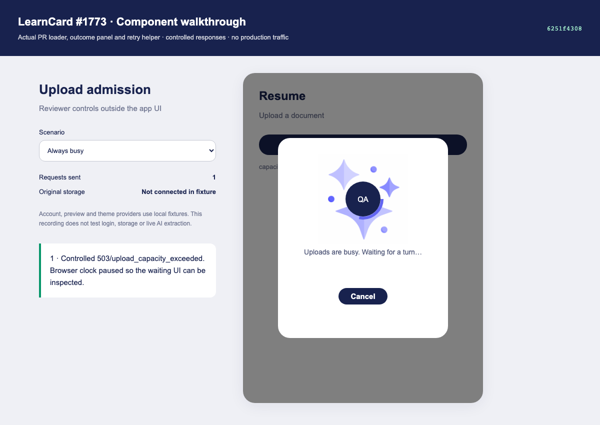
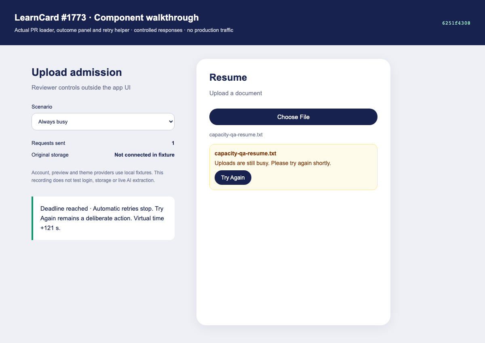

# PR1773 review evidence

Source under review: `6251f4308a413c53c28197076ae9a95f95e1e373`.

[Watch the annotated walkthrough](upload-capacity-walkthrough.mp4) (16 seconds, 340 KiB).

## Recording scope

This is a **component fixture**, not a signed-in full-app or live-backend recording. It bundles the unchanged `ChecklistLoader`, `UploadFileOutcomePanel`, and `waitForUploadCapacity` from the PR source. Account/modal/theme/document-preview providers and extraction results are local fixtures. The Resume shell and reviewer controls are harness UI. Tailwind utilities are generated for those components. English copy comes from the source translation catalog. All document content is synthetic; no production traffic or credentials were used.

The browser clock is paused/advanced as stated in the recording. The cancellation check advances six seconds and observes one request total. Recovery advances 5.5 seconds past `Retry-After: 5` and observes two requests total. Advancing 121 seconds verifies the deadline check after a suspended timer, then manual Try Again accepts a fresh attempt. This does not measure two minutes of continuous polling or production capacity. The fixture does not prove unsaved-original/storage behavior; the upload-hook tests cover that, and the full-app steps below exercise it manually.

Local full-app startup and the normal browser capture connection timed out on the workstation; that validation is not claimed. Screenshots preserve the rendered component capture, and annotations are visible in the reviewer-control panel. Video is the browser recording encoded to H.264; no timing cuts were introduced.

## Full-app manual QA

Frontend source: 6251f4308. Backend AI-Passport110 is merged and deployed (confirmed by Donny).

## Setup

Run the PR frontend; use an adult test account with AI processing enabled. Open **Build My LearnCard**, then **Resume** (repeat a smoke with Certificates, Transcripts, Diplomas). Use `capacity-qa-resume.txt`, which contains synthetic course text and no personal data.

## Normal deployed-backend check

Without any override, upload the file. Expect extraction and normal review or genuine empty-result feedback. The UI should not show capacity waiting unless the service actually returns a busy response. This path calls the deployed backend normally.

## Deterministic retry checks without filling production slots

Install `qa-fetch-override.js` in browser DevTools on the PR frontend. The override only replaces recognized admission responses for `/credentials/parse-file`; all other requests retain their configured services. Reload the page to remove it.

1. **Recover:** `uploadCapacityQA.reset('recover')`. Upload the file. First request receives a synthetic 503 with `Retry-After: 5`; expect “Uploads are busy. Waiting for a turn…” and Cancel. Expect no immediate saved original. After at least five seconds, a second request goes to the real backend. Its actual extraction outcome should appear normally. Inspect `uploadCapacityQA.calls` (normally 2).
2. **Owner limit:** `uploadCapacityQA.reset('owner')`. Repeat; the first response is synthetic 429/upload_in_progress. Expect the same waiting/retry UX.
3. **Cancel:** `uploadCapacityQA.reset('busy')`. Upload, wait for the waiting message, then Cancel before the next request. Note `uploadCapacityQA.calls`; it must not increase after another 6+ seconds. The new original must remain unsaved. Starting a new upload must still work.
4. **Leave screen:** in busy mode, upload and close the upload manager during waiting. The request count must stop. Reopening must not restart that cancelled wait.
5. **Budget exhausted:** in busy mode, leave the manager open for about two minutes. Expect “Uploads are still busy. Please try again shortly.” and Try Again, without saving the new original. Counts must then stop. Switch to pass mode without resetting the UI, click Try Again, and expect a fresh request to the deployed service.
6. **Accepted request dismissal:** in pass mode, after a real extraction request has started, the existing “Notify me when it's ready” dismissal behavior should remain available. Cancelling an admission wait and dismissing accepted extraction are different actions.

The controlled 503/429 responses are frontend QA fixtures, not evidence that production was overloaded. This is not a capacity/load benchmark. Browser-level network errors and model-processing failures must not automatically replay the extraction request; focused tests cover these boundaries.
