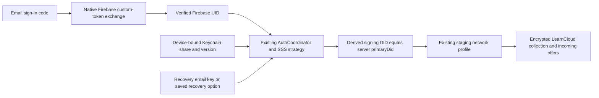

# Native account integration

On October 12, 2026, the personal SwiftUI app signed into the shared LearnCard Firebase project, restored an existing staging identity using the user's recovery email key, and loaded the first 30 encrypted personal collection records plus three incoming offers. An app update/relaunch resumed the same account without another email code or recovery prompt. The user entered the code and recovery information directly in the app.

This establishes the first existing-account connection. It does not establish production readiness or validate every mutation against this account. The earlier disposable [staging credential exchange](STAGING_VALIDATION.md) separately verified issue/send/claim/index/reload interoperability with the current SDK.

## Account flow

The iOS layer exchanges the staging login API's custom token using Firebase's documented REST endpoints. It verifies the returned email and UID, stores refresh/session credentials in Keychain, and refreshes them through the documented secure-token endpoint. Concurrent refreshes share a task. Sign-out invalidates earlier operations and drains pending persistence so a late response cannot restore a signed-out session. See [Firebase Auth REST reference](https://firebase.google.com/docs/reference/rest/auth).

This email-code slice does not need to reuse the Capacitor app's Firebase iOS registration. Its existing plist belongs to a different bundle. Google/Apple native providers, provider callbacks, and Firebase SDK integration still require the experiment's own app registration and configuration.

## Recovery and storage

The bundle imports the current `createSSSStrategy` and `AuthCoordinator` source. Native adapters provide Firebase tokens and scoped Keychain storage instead of web persistence. The strategy preserves share versions, historical lookup, DID challenges, and rotation. A recovery email key and a saved word-based recovery phrase are distinct formats; **recovery email is the default UI option**.

Persistent device shares and share versions are scoped by Firebase UID, tenant, and staging environment. Only the main/pending device-share slots are accepted. Session credentials and device shares use `kSecAttrAccessibleWhenUnlockedThisDeviceOnly`, with iCloud synchronization disabled. Signing keys, server auth shares, and user-entered recovery material remain in memory; private keys never appear in command replies or diagnostics.

A windowless nonpersistent WebKit host runs bundled SDK code beneath SwiftUI. It is disposed on backgrounding, sign-out, or process termination. SDK requests go through a bounded native URLSession transport with fixed staging hosts, no cookies/stored credentials, and rejected redirects. The account host permits `/api/keys/`; `X-Auth-Token` is forwarded only to that staging account API. Browser connections remain blocked by CSP. The fetch adapter preserves `Response.url` for DIDKit WASM resolution.

Sign-out retains this device's recovery share. The separate “Sign Out and Forget This Device” action removes it. Signing into a different configured test email does not reuse the previous account's device-share namespace. Unsupported setup/legacy upgrade states lead to existing staging setup rather than creating another signing identity.

## Personal credential facade

`LiveCredentialService` connects collection, inbox, claim, self-issued creation, recipient review, sending, and signed JSON export to the local SDK host. Collection pages contain at most 30 records. Internal preference records are omitted; duplicate URIs are deduplicated. Original signed credentials are retained independently of their display metadata. Artwork comes from credential images. LearnCard issuer usernames use the existing `:users:<username>` extraction pattern; staging profiles can supply display names, with `@username` as the fallback.

Signature checking is explicit and limited to the proof. It does not establish issuer trust, revocation, or schema/status checks. Send is available only for credentials issued by this account. Export contains the complete signed JSON; it is not a presentation or selective-disclosure flow. Activity is session-local. Receive opens Inbox directly in live mode.

## Evidence and remaining checks

Confirmed live: Firebase email-code sign-in, existing account recovery through the email key, server signing-identity equality, existing profile lookup, encrypted collection loading, incoming offers, and Keychain-backed relaunch. Five native account unit tests and seven domain tests pass; four Bun bridge tests pass. All five redesigned UI interaction checks passed on a separate iPhone 17 Pro / iOS 26.4 simulator. The Keychain test passed after moving it from the XCTest UI runner into a DEBUG-only app-process probe using disposable synthetic values; it checks device-only accessibility, isolation, update/read, and removal. The initial runner-based failure remains recorded rather than erased. [ACCOUNT_RESULTS.json](ACCOUNT_RESULTS.json) records the evidence summary.

Remaining: real-account pagination and claim/create/send mutation checks; partial claim/index interruption recovery; revocation sync; contact-inbox and guardian approval; QR device approval; passkey/escrow identity recovery; native new-account setup; Google/Apple providers; real claim links/camera; presentations/share links; physical devices and minimum iOS 18. Do not describe those as validated based on the disposable SDK exchange.

## Source landmarks

- `scripts/prepare-account.ts`: public Firebase client configuration and bundled source.
- `ios/NativeCore/Sources/LearnCardNativeSDK/FirebaseSession.swift`: sign-in, refresh, persistence cancellation.
- `KeychainVault.swift`, `AccountStorageScope.swift`, `AccountBridge.swift`: device-only account storage boundary.
- `AccountRuntime.swift`, `StagingTransport.swift`, `account-runtime/runtime.ts`: typed commands, transport, identity and credential operations.
- `ios/Sources/AccountController.swift`, `AccountSignInView.swift`: native lifecycle and recovery UI.

Run `bash apps/learncard-native/scripts/run-ios.sh` for the approved staging test account or add `--demo` for unsigned samples. Run `bash apps/learncard-native/scripts/test-core.sh` for the account/domain tests. Configuration contains only the public Firebase API key and approved test email; never put tokens, shares, recovery keys, or passwords in generated resources, docs, or test attachments.

## Update 2026-10-12 — Approved concept, navigation, and title verification

The current visual direction uses a neutral white/charcoal canvas and logo-derived color on cards, not colored or gradient page backgrounds. The selected built-in image-generation concept and generation brief are in `design/`. Correct tiled-L mark, circular real credential artwork, layered cyan feature card, compact gallery, and native navigation now run in the signed-in simulator.

Destinations: Collection, Inbox, Apps, Home. Home streamlines the web dashboard into arrivals, Create, and session-local activity. Apps currently opens the staging consumer store in the browser; native catalog/installation/consent remains the next phase. Store admin/developer portals remain excluded.

Seven updated UI checks pass in `artifacts/ui-20261012-141350-93352.xcresult`, including visible headings on all four tabs and scrolled inline Collection title. An earlier accessibility-only existence assertion missed a blank painted title; the new assertions require hittability and the Collection screenshot was visually reviewed. The app-process Keychain probe and account/domain evidence above remain separate validations.

WIP is isolated on `codex/vesper-73`, based on tested commit `82a051cf1`; the primary checkout remains on its prior branch with unrelated changes intact. Upstream main has newer account changes, so merging that baseline requires another SDK/account validation before declaring compatibility. No live account JSON, keys, email codes, personal test email, or generated secret fixtures belong in the branch.
