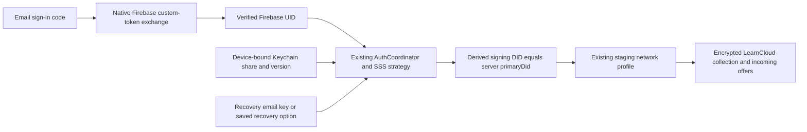

# Native account integration

**October 16 provider update:** Native Apple/Google authorization now feeds this same Firebase session, UID scope and LearnCard recovery/setup routing. Live activation still requires the Lab bundle’s own provider registrations; synthetic test results do not establish live OAuth. See [current implementation and activation gates](NATIVE_SIGN_IN.md).

On October 12, 2026, the personal SwiftUI app signed into the shared LearnCard Firebase project, restored an existing staging identity using the user's recovery email key, and loaded the first 30 encrypted personal collection records plus three incoming offers. An app update/relaunch resumed the same account without another email code or recovery prompt. The user entered the code and recovery information directly in the app.

This establishes the first existing-account connection. It does not establish production readiness or validate every mutation against this account. The earlier disposable [staging credential exchange](STAGING_VALIDATION.md) separately verified issue/send/claim/index/reload interoperability with the current SDK.

## Account flow

The iOS layer exchanges the staging login API's custom token using Firebase's documented REST endpoints. It verifies the returned email and UID, stores refresh/session credentials in Keychain, and refreshes them through the documented secure-token endpoint. Concurrent refreshes share a task. Sign-out invalidates earlier operations and drains pending persistence so a late response cannot restore a signed-out session. See [Firebase Auth REST reference](https://firebase.google.com/docs/reference/rest/auth).

This email-code slice does not need to reuse the Capacitor app's Firebase iOS registration. Its existing plist belongs to a different bundle. Google/Apple native providers, provider callbacks, and Firebase SDK integration still require the experiment's own app registration and configuration.

## Recovery and storage

The bundle imports the current `createSSSStrategy` and `AuthCoordinator` source. Native adapters provide Firebase tokens and scoped Keychain storage instead of web persistence. The strategy preserves share versions, historical lookup, DID challenges, and rotation. A recovery email key and a saved word-based recovery phrase are distinct formats; **recovery email is the default UI option**.

Persistent device shares and share versions are scoped by Firebase UID, tenant, and staging environment. Only the main/pending device-share slots are accepted. Session credentials and device shares use `kSecAttrAccessibleWhenUnlockedThisDeviceOnly`, with iCloud synchronization disabled. Signing keys, server auth shares, and user-entered recovery material remain in memory; private keys never appear in command replies or diagnostics.

A windowless nonpersistent WebKit host runs bundled SDK code beneath SwiftUI. It is disposed on backgrounding, sign-out, or process termination. SDK requests go through a bounded native URLSession transport with fixed staging hosts, no cookies/stored credentials, and rejected redirects. The account host permits `/api/keys/`; `X-Auth-Token` is forwarded only to that staging account API. Browser connections remain blocked by CSP. The fetch adapter preserves `Response.url` for DIDKit WASM resolution.

Sign-out retains this device's recovery share. The separate “Sign Out and Forget This Device” action removes it. Signing into a different email does not reuse the previous account's device-share namespace. Fresh and missing-profile accounts now use [native first-time setup](FIRST_TIME_SETUP.md); legacy migration stays a web handoff. Required recovery setup uses the canonical encrypted backup and confirmation APIs, and pending guardian approval keeps consumer features closed.

## Personal credential facade

`LiveCredentialService` connects collection, inbox, claim, self-issued creation, recipient review, sending, and signed JSON export to the local SDK host. Collection pages contain at most 30 records. Internal preference records are omitted; duplicate URIs are deduplicated. Original signed credentials are retained independently of their display metadata. Artwork comes from credential images. LearnCard issuer usernames use the existing `:users:<username>` extraction pattern; staging profiles can supply display names, with `@username` as the fallback.

Signature checking is explicit and limited to the proof. It does not establish issuer trust, revocation, or schema/status checks. The detail view now presents this result as a structured, scoped signature badge; it never derives trust or lifecycle status from error text. Read-only criteria, alignment, evidence, date and result projections preserve the original signed data. See [credential details and individual sharing](CREDENTIAL_DETAILS.md). The initial Send action was limited to credentials issued by this account; the current flow below moves sending into reusable creations. Export contains the complete signed JSON; it is not a presentation or selective-disclosure flow. Activity is session-local. Receive opens Inbox directly in live mode.

## Evidence and remaining checks

Confirmed live: Firebase email-code sign-in, existing account recovery through the email key, server signing-identity equality, existing profile lookup, encrypted collection loading, incoming offers, and Keychain-backed relaunch. Five native account unit tests and seven domain tests pass; four Bun bridge tests pass. All five redesigned UI interaction checks passed on a separate iPhone 17 Pro / iOS 26.4 simulator. The Keychain test passed after moving it from the XCTest UI runner into a DEBUG-only app-process probe using disposable synthetic values; it checks device-only accessibility, isolation, update/read, and removal. The initial runner-based failure remains recorded rather than erased. [ACCOUNT_RESULTS.json](ACCOUNT_RESULTS.json) records the evidence summary.

Remaining: real-account pagination and claim/create/send mutation checks; partial claim/index interruption recovery; revocation sync; contact-inbox and guardian approval; QR device approval; passkey/escrow identity recovery; native new-account setup; Google/Apple providers; real claim links/camera; presentations/share links; physical devices and minimum iOS 18. Do not describe those as validated based on the disposable SDK exchange.

## Source landmarks

- `scripts/prepare-account.ts`: public Firebase client configuration and bundled source.
- `ios/NativeCore/Sources/LearnCardNativeSDK/FirebaseSession.swift`: sign-in, refresh, persistence cancellation.
- `KeychainVault.swift`, `AccountStorageScope.swift`, `AccountBridge.swift`: device-only account storage boundary.
- `AccountRuntime.swift`, `StagingTransport.swift`, `account-runtime/runtime.ts`: typed commands, transport, identity and credential operations.
- `ios/Sources/AccountController.swift`, `AccountSignInView.swift`: native lifecycle and recovery UI.

Run `bash apps/learncard-native/scripts/run-ios.sh` for the approved staging test account or add `--demo` for unsigned samples. Run `bash apps/learncard-native/scripts/test-core.sh` for the account/domain tests. Configuration contains only the public Firebase API key and approved test email; never put tokens, shares, recovery keys, or passwords in generated resources, docs, or test attachments.

## Update 2026-10-12 — Approved concept, navigation, and title verification

The current visual direction uses a neutral white/charcoal canvas and logo-derived color on cards, not colored or gradient page backgrounds. The selected built-in image-generation concept and generation brief are in `design/`. Correct tiled-L mark, circular real credential artwork, layered cyan feature card, compact gallery, and native navigation now run in the signed-in simulator.

Destinations: **Home, Collection, Inbox, Apps**. Home is the initial signed-in destination and streamlines the web dashboard into arrivals, Create, and session-local activity. Apps now has native catalog/installation/consent and opens partner experiences in the in-app browser; see [Apps integration](APPS_INTEGRATION.md). Store admin/developer portals remain excluded.

Seven updated UI checks pass in `artifacts/ui-20261012-141350-93352.xcresult`, including visible headings on all four tabs and scrolled inline Collection title. An earlier accessibility-only existence assertion missed a blank painted title; the new assertions require hittability and the Collection screenshot was visually reviewed. The app-process Keychain probe and account/domain evidence above remain separate validations.

WIP is isolated on `codex/vesper-73`, based on tested commit `82a051cf1`; the primary checkout remains on its prior branch with unrelated changes intact. Upstream main has newer account changes, so merging that baseline requires another SDK/account validation before declaring compatibility. No live account JSON, keys, email codes, personal test email, or generated secret fixtures belong in the branch.

## Update 2026-10-12 — Creation parity and encrypted sharing

Create now uses the active web issue flow's VC v2 + OBv3 3.0.3 contexts, artwork, achievement format, criteria, and recipient-specific template delivery. The native Design/Recipient/Review screens use PhotosPicker and native action sheets; the final action uploads a resized JPEG through the same tenant Filestack provider and creates a reusable Boost template. Delivery uses `wallet.invoke.send({ type: 'boost', templateUri, recipient })`; self delivery also accepts and indexes the issued credential, while sending to another member does not add it to the issuer's personal collection. Your creations reads a separate paginated LIVE/PROVISIONAL template list. The photo upload follows [Filestack's documented file API](https://www.filestack.com/docs/api/file/), with no Firebase/DID authorization forwarded to that provider. Uploads are public via their CDN link, explained before confirmation.

The plus menu has Create new, Send existing creation, Share credentials. The share picker accepts up to 50 explicitly selected personal credentials, supports a title and optional passcode, and uses a 30-day expiry. It reuses the existing web `prepareShare`, canonical URL builder, and publication outcome classifier. Original signed credentials/public endorsements, holder presentation, AES-GCM envelope, and owner recovery remain in the existing web protocol. The URL viewing key is in the fragment; no signing seed is returned. Pending publication returns no URL and retries the same operation. Demo mode creates no link, only unsigned sample text.

The current SDK successfully signs/verifies the native builder template and encrypts/decrypts/verifies the web sharing manifest/presentation in offline tests. Native UI and domain tests cover creating for someone without adding their credential to the issuer's collection, reusable creations, multiple selection, and action sheets. **These are not live validation of Filestack upload, template delivery, or share-link publication on this Firebase account.** User-driven basic self creation was observed in the earlier form; the expanded template path is a new integration slice.

Remaining parity: advanced web builder fields, evidence/skills/imports, multiple/email/phone recipients, claim links, native link-owner history/edit/stop, recipient link rendering, and cross-launch delivery/share retry recovery. Session journals reduce duplicate retry steps after successful replies; a dropped network response can still leave delivery ambiguous. Do not claim atomic or fully durable delivery.

Latest validation: five account security tests, ten domain tests, and seven Bun protocol/transport tests (31 assertions) pass. The final ten-check UI suite had nine passes and one timing-sensitive selector-label assertion; adding a bounded wait for the updated value resolved the focused rerun. No app selection behavior changed for that harness repair. Result bundle paths are recorded in ACCOUNT_RESULTS.json.

## Update 2026-10-12 — Native account and chrome refinement

The signed-in simulator now shows the edge-to-edge bottom tray and matching light/dark outlined passport, tray, rocket, and timeline icons. The compact action popover retains the three working destinations. Inbox uses left-aligned 64px artwork instead of tall centered thumbnails; asynchronous artwork shows a native progress indicator until success or unavailable-art fallback.

The Account sheet is opaque, grouped, and compact. It loads the network profile avatar/bio when available, offers native display-name/bio editing, and exposes exact web destinations for privacy/shared links and notifications. A native recovery/security overview explains device storage and sign-out/forget behavior, with a web recovery/export/deletion handoff. It does not expose private signing keys or pretend native recovery export/account deletion/push preferences are implemented. Native profile editing is implemented but live update validation is still outstanding. The signed-in Collection/tray appearance was visually inspected; demo interaction checks are separate.

Final chrome regression: all eleven native UI checks passed in `artifacts/ui-20261012-145753-2266.xcresult`, including custom tray/action popover, Account/security navigation, and the previously timing-sensitive format/category check. The current signed-in simulator was visually checked for the tray and category stack.

Lifecycle correction after visual QA: resume saved access whenever the scene becomes active while the account is locked; iOS may pass through inactive between background and active. Locked/loading screens retain a Continue fallback when idle. The SDK host still disposes on background. Simulator build passes; real-device background/unlock remains a release check.

## Account and lifecycle regression CI — October 12, 2026

`Vesper checks` now runs the native suite automatically on `codex/vesper-73`. It covers the production account controller and SwiftUI account screens through disposable fake backend boundaries, alongside native Keychain/Firebase transport checks, domain/UI flows and real offline SDK interoperability. See [TESTING.md](TESTING.md) for exact coverage and commands. Live-account configuration, credentials and recovery material are excluded from CI; the staging mutation runner remains opt-in.

Thirteen deterministic controller tests exercise background/inactive/active transitions, recovery failure/retry/relaunch, late initialization and recovery replies, priority sign-out, cleanup failure, and forgetting a locked account. Five account UI cases exercise actual Home/activate and relaunch transitions, recovery input clearing, and sign-out/forget confirmation. The existing domain, Keychain, demo UI and SDK checks remain in the suite, and Release is compiled with fixture entry points excluded.

Sign-out previously went through the same busy gate as recovery and could be ignored. It now invalidates outstanding operations and closes the SDK immediately, then removes native session tokens. Forget also deletes scoped primary/pending share/version slots without requiring an active SDK host. Ordinary sign-out preserves remembered recovery access. Initialization recovery errors retain friendly feedback and recovery inputs are cleared on background.

The additional bundled-command regression reproduced missing share/profile-update dispatch routes; their implementations had been nested under the Firebase auth adapter. Both were moved into the actual command dispatcher. This is a routing correction; it does not establish live publication or profile-update success. A confirmation test was corrected for iOS 26's outside-dismiss popover behavior; explicit Cancel remains supported where the system presents it.

## Update 2026-10-15 — Profile photos

Native Edit profile supports choosing, previewing, replacing and removing a photo. Upload occurs only on Save Profile. The existing public image uploader and network profile `image` field preserve web interoperability; unchanged photo edits omit the field, while removal sends an empty string. Generation guards span upload and profile update. See [profile-photo contracts and manual live gate](PROFILE_PHOTOS.md).

## Credential lifecycle reads — October 18, 2026

`LiveCredentialService.credentialStatus` uses a focused account command for a cached original URI. It prefers authenticated `getMyCredentialLifecycleStatuses`, then proof-checked structured status-list results. `CredentialStatusStore` belongs to the detail destination, keeps last-confirmed status during a failed retry, and discards cancelled reads. Original payloads, Passport snapshots, account readiness and existing staging transport limits remain unchanged. [Scope and states](CREDENTIAL_DETAILS.md#verification-scope-and-revocation).
