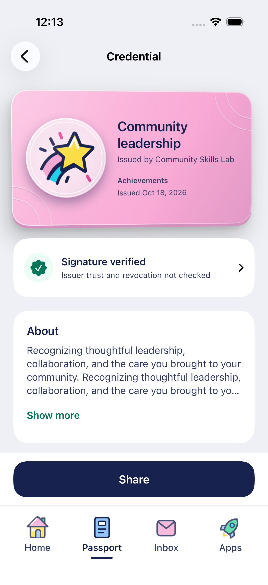
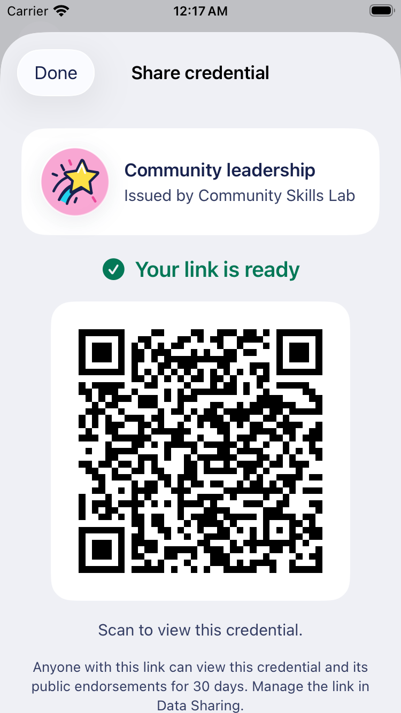

# Native credential details

October 17–18, 2026. Preserve the rendered credential hero. Separate a compact verification panel, About, credential information and any supplied optional sections. Ordinary reading panels are flat; the credential remains the raised object. Body text uses subheadline scale, section titles use headline scale, and metadata uses secondary labels with stronger values.

## Verification scope

The runtime already calls `verifyCredential` with `checks: ['proof']`. Its new structured `signatureState` is `verified`, `notVerified` or `unavailable`. An empty errors array from that actual check establishes the first state. Resolution/network/proof errors do not identify revocation, suspension or issuer trust; a failed check says Signature not verified. Missing checks remain unavailable. Never derive a success badge from the old English summary string.

The green checkmark explicitly says **Signature verified**. Its visible caption says issuer trust and revocation were not checked; expanding the panel explains the scope. Unsigned local samples retain a separate label and never acquire a verified badge. This does not implement the web issuer registry, issuer endorsements or complete lifecycle verification.

## Additional information

`account-runtime/credential-details.ts` makes a read-only projection without rewriting the signed original:

- Achievement criteria narrative and reference URL, including multiple subjects/achievements and legacy badge narrative.
- Alignment name, description, framework, code and reference URL.
- Evidence and attachments with names, descriptions and links.
- Field of study, role, term, credits, activity dates and expiration (`validUntil` / legacy `expirationDate`).
- Result values, including zero, with inline or referenced achievement result descriptions.

Only supplied sections appear. Plain text is not executed as markup. Reference links accept HTTP/HTTPS URLs without embedded credentials; other references remain noninteractive. Unknown/malformed optional entries do not become fabricated facts. The original signed payload remains intact for sharing/export. Optional dates require complete ISO timestamps; date-only or malformed strings are not assigned an invented timezone.

Paragraphs show up to four lines with Show more only when their measured content is actually truncated, including enlarged text. Each optional list initially shows up to three items and can reveal the rest. No extra network reads or writes occur when expanding these sections. The existing original credential export remains an advanced option rather than a replacement for these fields.

## Primary actions and sharing

A measured footer on the detail scroll view keeps the primary action available above the root navigation tray. Offers keep Add to Passport, reusable creations keep Send, and signed personal credentials use **Share**. Unsigned samples preserve their demo actions. The root tray height contract remains unchanged. Signed JSON export moves into More options with its full-data disclosure.

Share opens a focused review for exactly this one credential. It does not open the multi-selection picker or publish on presentation of the sheet. Creating a link explicitly invokes the existing native `share()` boundary with one ID and a stable request ID. Retry fingerprints use the meaningful fields in canonical key order so Foundation/WebKit dictionary ordering cannot change an otherwise identical request. That existing web-compatible flow preserves complete original credentials and public endorsements inside an encrypted holder presentation, with a 30-day expiry and owner controls in Data Sharing. It uses the modern encrypted presentation-link protocol already in native, rather than introducing another copy of web's older seed/PIN sharing implementation.

After successful publication, the same complete URL is used for the native QR, Copy link and iOS share sheet, including its fragment viewing key. A pending publication exposes no QR/URL and offers Check link status using the same operation. A failure keeps the credential and explicit retry. Closing/reopening the sheet on the same detail screen retains the ready link instead of publishing again. Leaving/re-entering the detail screen starts a new review; cross-launch publication recovery remains outside this UI pass.

Unsigned demo credentials prepare sample text and never publish a real link. QR/retry/pending UI checks use an explicitly isolated service and an `example.invalid` URL. They do not prove live publication or recipient behavior on a real account. HTTPS presentation links open the existing web recipient viewer; native recipient presentation-link intake is separate from QR credential claiming.

## Follow-up: endorsements

The user explicitly split endorsements into a later feature. Plan native counts and lists, source-credential binding, individual endorsement details, public/private visibility, requests and response routing together. Keep issuer trust, credential signatures and endorsements distinct. Existing sharing's inclusion of public endorsements is preserved; this pass adds no request/accept/visibility mutation.

## Verification

See [TESTING](TESTING.md) for actual runs and installed-build evidence. Core tests check old/new wire compatibility, fractional dates and preservation of the original payload. Runtime tests compare the projection with immutable originals and exercise the actual SDK proof check and existing encrypted presentation manifest. Native UI checks cover expanded source fields, pinned actions, secondary export, failure/pending/ready/reopen, sample sharing and Arabic accessibility text.

## Actual native screens

These captures use isolated display fixtures and a nonfunctional `example.invalid` presentation URL. The green badge exercises a supplied signature-result fixture; it is not a claim about a real account. Real SDK cryptography is checked separately in the runtime tests.

| Details                                                                                               | QR on a 375-point phone                                                                            |
| ----------------------------------------------------------------------------------------------------- | -------------------------------------------------------------------------------------------------- |
|  |  |

[Expanded alignment references](design/credential-alignments-native.png). Native screenshot QR decoding confirms the exact expected URL and fragment key at both phone sizes.
