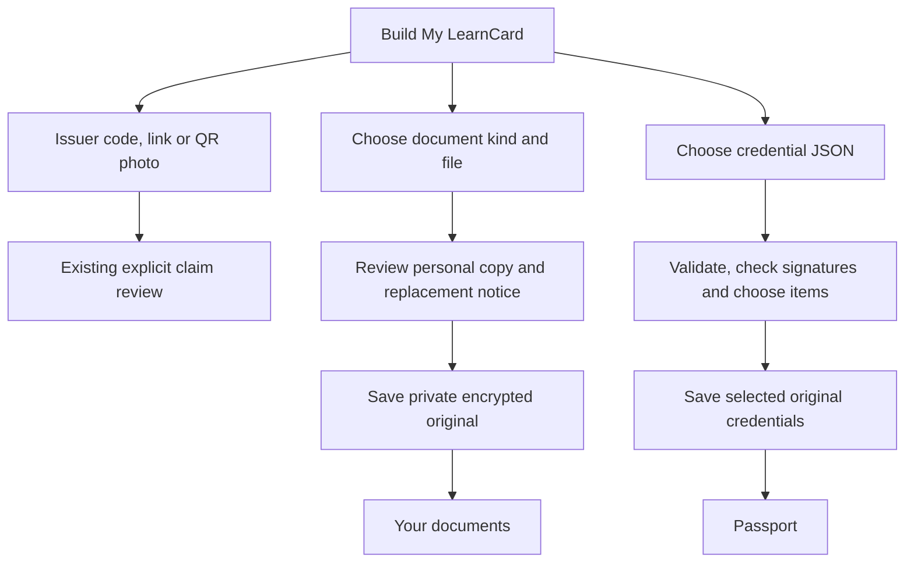

# Native document and credential-file intake

October 16, 2026. Build My LearnCard now separates issuer-provided claim routes from importing files. It is optional, reachable from Home and **+ Add → From your files**, and uses the current signed-in account. No document is required for signup.

The October 17 pass adds [optional document milestones and consent-reviewed sample credentials](SAMPLE_CREDENTIALS.md).

## Two different imports

- **Document copy:** select Résumé, Certificate, Transcript or Diploma, then choose one PDF, Word `.docx`, text or PNG/JPEG/WebP file, up to 4 MiB. File selection reads locally; Save private copy is the first write. The original is embedded in a self-issued `RawArtifactCredential`, encrypted for the learner through LearnCloud and indexed with the same source category as web. It is a personal copy, not an institution-issued credential or verified achievement. A résumé explicitly replaces the web/current résumé copy after review.
- **Existing signed credential:** choose a JSON file up to 1 MiB and 50 candidate credentials. The web's text/presentation extraction helper supplies candidates, followed by the actual VC schema and signature-proof checks. Review shows each title, original issuer, check outcome and explicit selection. Failed proofs cannot be added. An unavailable check is labeled accordingly and confers no trust. Only selected originals are encrypted/indexed; native never rewrites their issuer, subject or proof and never signs them again. Semantic categories, including Portfolio and Qualifications, remain distinct from `uploadType: rawVC`.

No credential/document write happens during file selection or review. Neither importing an existing credential nor saving a personal document issues a new credential to another person, accepts an incoming claim or creates a share link. No automatic app-consent synchronization or AI-insight generation is triggered.

## Lifecycle, retries and viewing

Each review belongs to one account host. Leaving review, backgrounding or locking clears native state; a review-bound discard clears the host payload without erasing a newer review. Late prepares/saves cannot populate another account. File reads are bounded even if the provider's reported size is wrong. Invalid formats, empty/large files, unsupported credentials and network failures have translated feedback.

Native imports use deterministic content-derived index IDs; a lost index reply is reconciled on retry or a reselected file after relaunch. A partial credential import retains selection and reports added/existing/failed counts. Retry leaves already saved native items in place. A failed encrypted upload can leave an unindexed storage object, but does not create a second visible index entry. Imports originally added through web with random IDs are not globally content-deduplicated by this native ID scheme.

Your documents reads source records independently of the first Passport page and includes web-created records. Counts are actual index counts. The optional four-kind milestone indicator marks each document kind once when its saved count is positive; it is not a signup or credential-quality score. The initial list shows up to 20 documents of each kind and states that bound. Legacy web records without filename metadata show their document kind until opened. Originals are read/decrypted only on explicit open, then shown by native Quick Look. Temporary viewer copies have complete file protection and are removed on dismissal/background/exit; startup removes owned remnants from an interrupted process. File size and supported original data-URL types are checked again when opening.

Original document records stay outside the personal credential cards and sharing picker. Imported credentials appear in Passport after refresh. Failure to refresh does not undo a successful save, and a failed status read does not become an empty count.

## Web alignment and remaining scope

The source audit covers web `useUploadFile.tsx`, `useUploadVcFromText.ts`, `extractCredentialsFromText.ts`, checklist queries and the AI Passport authentication helper. Document `rawArtifact` fields/context and the four source categories match web. The separate credential source tag is `rawVC`.

AI document extraction is the next slice: it requires the existing AI Passport challenge/session protocol, privacy/age eligibility, processing consent, review/editing and reconciliation of generated self-authored results. This pass does not introduce a processing button that cannot work. The verifier retains the current staging/cached-context transport; external issuers needing unsupported remote resolution can be blocked and need dedicated compatibility checks. Open Badges v2 conversion, JWT credential envelopes, batches of files, full document management/pagination, physical iCloud-provider review and live cross-client file writes remain separate. The résumé builder/editor remains web-only.

See [design reference and native evidence](design/DOCUMENT_INTAKE_BRIEF.md) and [verification](TESTING.md).
