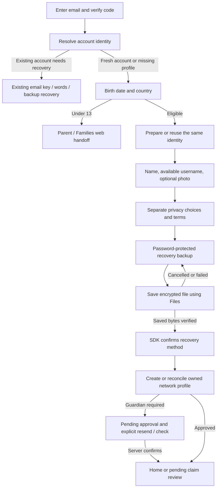

# Native first-time setup

October 16, 2026. The iOS client now implements first-time setup against existing staging services. Existing-account recovery remains a separate route. [Composition reference](design/SIGNUP_BRIEF.md); [verification](TESTING.md). A fresh live Firebase signup, real guardian approval and physical-device file-provider/recovery round trip remain manual validation gates.

## User flow

Email entry is editable. Firebase still validates the exchange's returned email/UID, refresh tokens stay in Keychain, and setup never infers eligibility from a network failure. General sign-in does not add new social providers or production endpoints.

Birth date and country are explicit choices with designed searchable/date sheets. A missing identity is created only after this age decision. An existing identity without a network profile keeps its original key. Name and lowercase username use existing server syntax and a debounced availability check; submission handles a later collision without taking another person's profile. Photo preparation strips metadata and uses the existing public image-upload path.

The entire profile-photo card opens the native library picker, including the round thumbnail, text and whitespace. A camera badge and forward chevron make the action visible; selected-photo removal is separate. Cancellation retains the name/username draft. Larger text can stack the row while preserving one generous tap target.

Optional AI, analytics and bug-report choices begin off and are separate from accepting terms. The shared age policy restricts those options for younger users; mutation validation also clamps them off. No document processing or AI enrollment happens automatically. Preferences are upserted through the existing DID-challenge API **before** profile creation; a failed preference save prevents completion.

## Recovery enrollment

The inspected LearnCard staging tenant disables new email-backup delivery and does not configure the relay public key. Existing emailed recovery keys can still recover older accounts. Native signup therefore uses the SDK's **password-protected backup file** enrollment. It does not attempt unconfigured email delivery or create a native cryptographic format.

The password is entered twice, 12–256 characters. Canonical `setupRecoveryMethod(method: backup)` returns encrypted JSON; only that file leaves the hidden SDK host. SwiftUI's system exporter saves it. The completion handler reads back the saved bytes, verifies they equal the prepared artifact and calls canonical `confirmRecoveryMethod`, which decrypts/checks the backup and obtains server confirmation. Only then can the network profile be created. Cancelling or failing export does not create a profile. Retry in the same foreground session reuses the same encrypted file and identity.

Background/sign-out removes password, photo draft, encrypted export artifact and the SDK host from memory. If export was not confirmed, resuming requires generating/saving a replacement backup; the UI explains that it replaces the previous file. The signing identity remains the same. Once confirmation has been durably recorded, finishing an interrupted profile step does not rotate again. A successful file save is not a substitute for a tested recovery round trip; see the manual gates below.

## Age and approval behavior

The native UI consumes a JSON policy generated from the same country/threshold source as mutation validation. Civil dates are checked for real days, future dates, birthday boundaries and leap days. Current product behavior blocks independent under-13 signup and routes to Families. For EU users aged 13+ below the configured country threshold, guardian email is required and profile creation sends `approved: false`. Non-EU teens must acknowledge the existing web parent-knowledge notice. This is parity with current product logic, not a universal legal assertion about all countries.

Ireland was corrected in **both shared maps** from 13 to 16, following [Irish DPC guidance](https://www.dataprotection.ie/sites/default/files/uploads/2023-04/DPC_ChildrensData_ParentalConsent.pdf). The remaining partial table/fallback and the use of digital-consent age for certain minor preferences still need policy review. A full legal review or comprehensive server enforcement is outside this frontend slice.

A profile with `approved: false` gets no usable Home/Collection/Apps/credential client. Parent email send failure leaves the account pending with an explicit resend. Sending or resending is never approval. Check status and foreground resume read the actual profile; only server confirmation opens account features. An older pending profile without locally saved guardian contact asks for that address again. This uses the existing guardian services without changing their authorization model.

## Interrupted operations and protected progress

A UID-scoped, device-only Keychain journal records a bounded non-secret draft, preference/recovery confirmation and guardian-send progress. DOB and guardian contact are protected personal data; the journal contains no password, recovery share or signing key. Progress is valid for seven days (expired/malformed entries are purged on the next read), removed on completed setup or Forget This Device, and isolated from another UID. Sign-out retains unfinished progress, consistent with remembered account access.

A fresh-account marker is written after the existing coordinator returns `needs_setup`, or after the explicit staging reset has verified remote cleanup and removed this UID's old local access. It lets interrupted setup survive the coordinator's five-minute legacy heuristic. It never upgrades an unknown older account into a new identity. Missing-profile setup after recovery also reuses the current identity. The reset's separate protected receipt is retained by Forget This Device so unfinished destructive work remains resumable.

Commands serialize profile/recovery mutations. Before retrying an uncertain profile-create result, the adapter reads the signed-in identity's profile and compares ownership, handle, DOB and country. It does not blindly create another profile. A username taken after backup confirmation returns to editable profile setup; completion reuses that confirmed backup. Native generation guards reject late results after lock/sign-out. Pending scan intent is retained until required setup and approval finish, then returns to review rather than automatically claiming.

## Boundaries and next work

- Live setup on the retained staging Firebase login is complete: the user finished required profile/privacy and encrypted-backup setup, and a private self-issued credential was saved and read. Final-build relaunch and that credential’s persistence/opening were verified after upgrade and simulator restart. New Firebase identity creation, full staging-web UI parity and saved-backup recovery on another disposable device remain separate validation. Do not send codes, passwords or recovery files through chat.
- Exercise real guardian delivery, failed delivery/resend, link approval and foreground recheck using dedicated test identities. Synthetic checks do not prove external delivery.
- Physical Files/iCloud/third-party provider, keyboard, VoiceOver, energy, tablet and translation review remain.
- Existing-account Recovery & security still links to web for broader recovery management. This slice adds enrollment during required signup, not full native recovery settings or account deletion.
- Build My LearnCard remains optional Home credential intake, planned separately. People remains planned via Home/Account/Inbox without a fifth tab or side menu. See [the remaining roadmap](ONBOARDING_AND_PEOPLE.md).

## Live account reset requested

The user selected a staging-only data/profile/recovery reset of the current dedicated test account, retaining the shared Firebase login. Account → Reset staging account has matching-email confirmation and explicit retry after interruption. Completion disposes the old SDK host and starts required setup with the retained verified login. See [the source audit, cleanup boundaries and live status](ACCOUNT_DELETION_AUDIT.md).

The user has now completed that reset and required setup. Home is the initial signed-in destination, followed by Collection, Inbox and Apps in the navigation tray. Existing pending claim intent opens review after readiness; it never claims automatically. Do not reset the recreated account again for this completed validation.

## Source map

`account-runtime/signup-policy.ts` → shared policy, strict draft and privacy validation; `signup.ts` → serialized enrollment/profile/approval state machine; `runtime.ts` → real coordinator, SDK, preference and network adapters. `Signup.swift` → typed facade, native validation and generated policy. `NativeAccountController.swift` → lifecycle and upload boundary. `NativeSignupView.swift` / `SignupSelectionSheets.swift` → actual forms and system export. `SignupTests.swift`, `SignupUITests.swift` and `signup.test.ts` cover these boundaries without live signup or mail.
