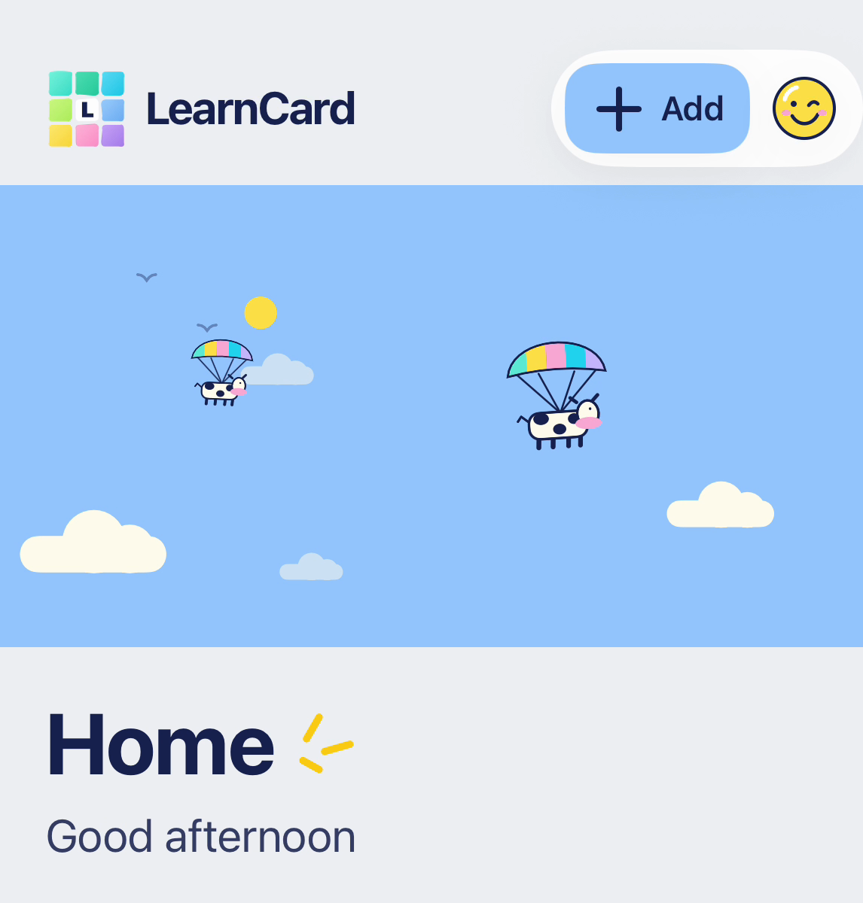
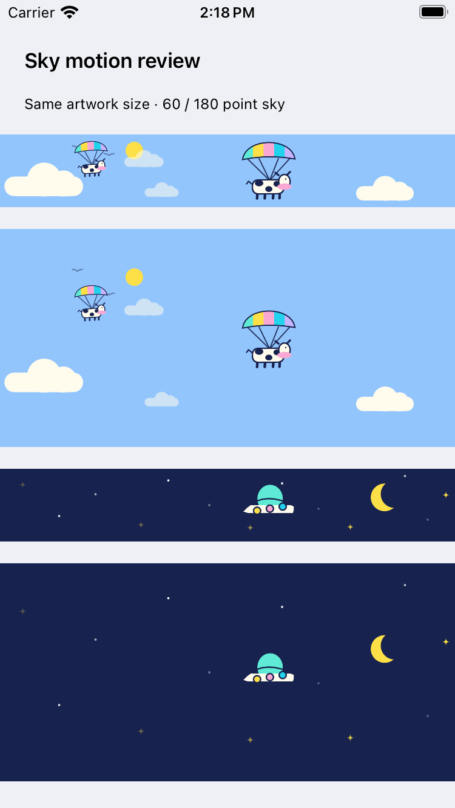
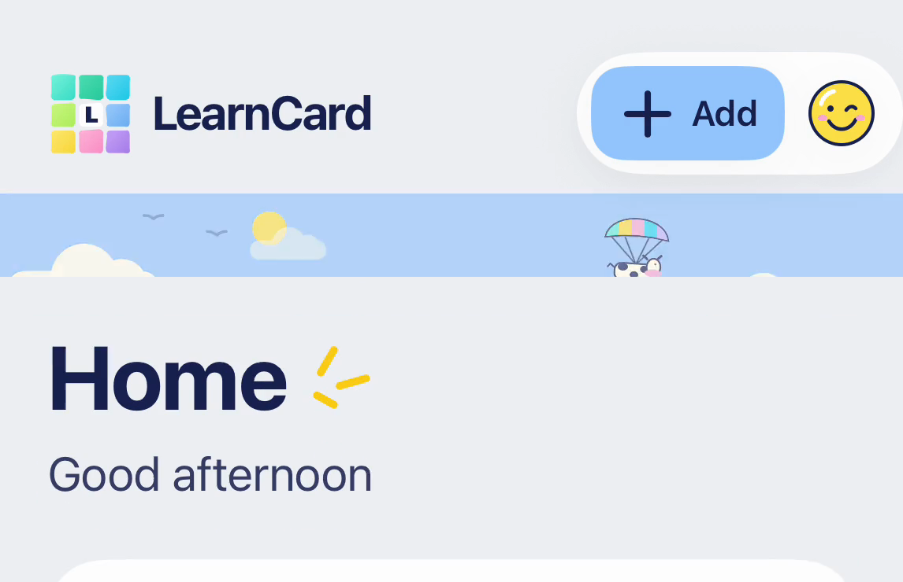
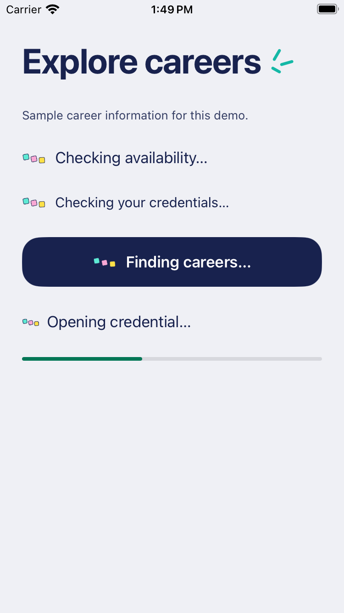
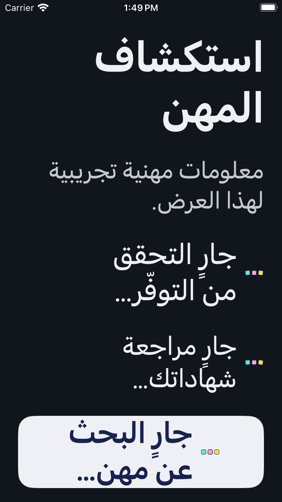

# Native loading feedback — October 23, 2026

The refresh sky keeps its existing flat scenes, visitors, stars and rare cow cameo. Its background fills the **entire visible gap above the scroll content**, including deep elastic pulls taller than the native refresh control. It follows native scrolling back to the compact loading strip on release, then collapses when the actual read finishes. Exposed-height opacity softens the first and last portion of the reveal.

[BrandRefreshScrollView](ios/Sources/BrandRefreshScrollView.swift) places a noninteractive, clipped artwork host in its own scroll view. [RefreshReveal](ios/NativeCore/Sources/LearnCardNativeCore/LoadingPresentation.swift) uses the unobscured viewport (excluding the navigation bar’s safe-area coverage) and content anchor in scroll coordinates, with horizontal bounds from the native control. The control height sets fade distance and artwork size; it no longer caps sky coverage. Clouds, sun/moon and visitors retain their resting-strip sizes while their positions spread through the larger scene. No image is stretched to fit a deeper pull.

No fixed refresh height, manual content inset, added page spacer, pan recognizer, custom spring or viewing delay is introduced. SwiftUI's refresh action/VoiceOver announcement and existing lifetime remain. Keep operation observation isolated below the ScrollView modifier; observing it on the scroll owner previously cancelled reads.

## Shared inline loading

[BrandProgressStyle](ios/Sources/BrandProgressStyle.swift) replaces SwiftUI's indeterminate spinner with three small outlined teal, pink and yellow tiles in a staggered wave. It is deliberately separate from the logo and sky scene. Contextual text sits beside the glyph with leading alignment and wraps for large text/RTL. Existing mini/small contexts use a smaller glyph; fixed image geometry remains. The style is installed at the app root, so buttons, rows, image placeholders, account preparation and standalone statuses share one treatment.

The wave is bounded, not progress. Its timeline pauses when the view disappears or the app is inactive, and remains still for Reduce Motion/VoiceOver. Label-free indicators retain a localized loading label; existing explicitly hidden decorative indicators stay hidden. Determinate progress, including real sample synchronization counts, keeps the system linear bar and its actual fraction. No operation duration, success state or backend behavior changes.

On the career screen, first availability checks use a leading inline status. A recheck with existing data uses the existing search button's busy state, preserving the search/results layout. Search already has contextual busy feedback in that button, so its duplicate standalone spinner is removed. Other bespoke placement refinements can be addressed against concrete manual-test examples; the shared style does not claim a complete spacing audit of every screen.

## Simulator compatibility

The installed Xcode 27.1 iOS 27.1 runtime reports only iPhone Duo in its supported device types. The globally installed iPhone 17 Pro type cannot be created with that runtime. [simulator.sh](scripts/simulator.sh) now chooses from the selected runtime's actual supported iPhone types, preserving preferred ordinary devices when compatible and accepting newer types without selecting an incompatible global entry. Existing named available devices and explicit IDs retain their normal reuse behavior.

No account reset, login/credential/consent write, provider enablement, TestFlight change or hosted native CI is part of this visual pass. Native fixture evidence and exact local checks are recorded in [TESTING](TESTING.md).

## Actual native review

### Elastic sky follow-up

The [actual Home pull/release clip](design/sky-elastic-pull-native.mp4) shows the full gap filling, then returning to the compact strip and collapsing after the read. It is cropped from the active native iOS 27.1 display, with no synthetic motion or retiming. The forced cows and ten-second in-memory read are isolated review fixtures; production refresh duration is unchanged. The observed deep pull reveals about 205 points of sky, with the heading below it and the navigation bar clear.

The [paired native drawing](design/sky-elastic-artwork-native.png) compares 60/180-point afternoon and night skies with a constant 60-point artwork size. It uses the production renderer at a frozen Reduce Motion pose. The sky triples in height; the main cow’s outline measures 89×96 versus 88×95 pixels, within one pixel of subpixel edge rasterization. This is drawing evidence; actual pull/release behavior is verified separately.

### Earlier reveal and inline-loader pass

The [Home pull/release clip](design/sky-refresh-reveal-native.mp4) is cropped from a real native gesture on the iOS 27.1 simulator. It shows the opening/closing aperture, moving clouds/cows and the heading remaining below the strip. This is a deliberately slow in-memory read fixture; production timing is unchanged. The crop excludes the Duo simulator’s separate system-status area and lower page.

The following iOS 18.1 captures use an isolated DEBUG loading gallery with the production progress style. They compare standard English with Arabic dark accessibility3/Reduce Motion; the Arabic image is an accessibility stress test, not the default Arabic text size. The English bar shows actual 40% fractional progress.

| Standard English                                                    | Arabic accessibility / Reduce Motion                                                                   |
| ------------------------------------------------------------------- | ------------------------------------------------------------------------------------------------------ |
|  |  |

The gallery opens only with `--demo --loading-gallery`. It performs no provider or account operation. Exact test results and installation limits are in [TESTING](TESTING.md#loading-feedback--october-23-2026).
