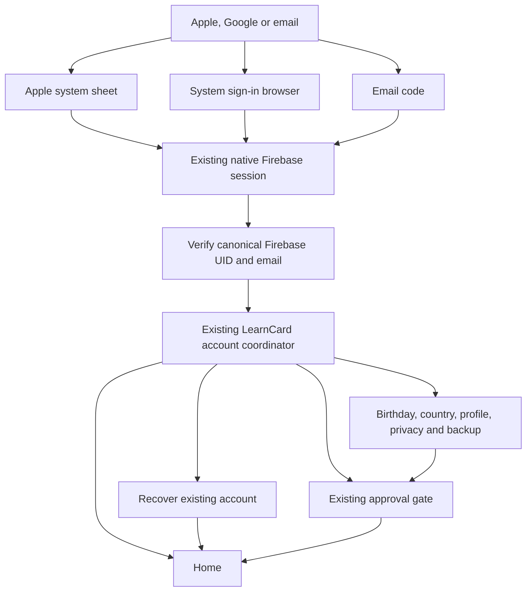
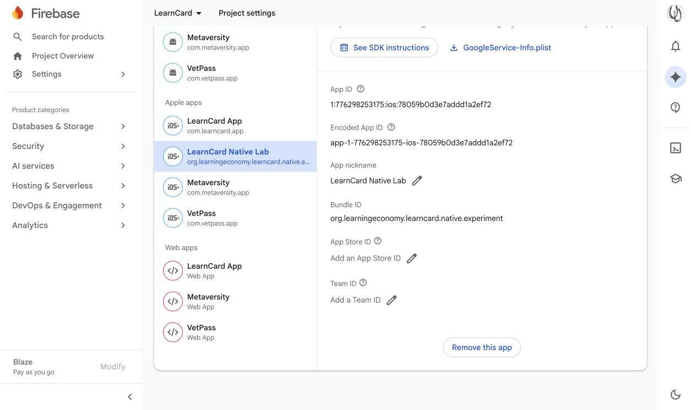

# Native Apple and Google sign-in

Apple and Google now have native sign-in boundaries and branded controls alongside email. Both feed the existing Firebase session and LearnCard setup/recovery controller. **Native Lab is registered in Firebase and has its own matching Google iOS client.** Live providers remain disabled in committed defaults and in the installed review build; a local Google override is prepared for a deliberate later live test. Synthetic UI fixtures exercise the implementation without accessing a real Apple/Google account.

The user's reported web problems were popup handling and confusing startup-store/Web3Auth state. This implementation keeps authorization in Apple's system sheet or Google's system sign-in browser. It does not import the web sign-in adapter, web startup stores, Capacitor auth, Web3Auth or a second Firebase SDK/session.

## Flow



A provider login establishes the Firebase identity. It does not bypass LearnCard recovery, create a replacement signing identity or approve a child profile. An existing account uses its canonical Firebase UID for the same Keychain/SSS scope. Apple relay addresses are accepted when returned by Firebase. Profile names and photos remain explicit choices in native setup.

A provider collision asks the user to use their original sign-in method. The client never calls credential-linking APIs or chooses a LearnCard identity merely by matching email. Firebase's own account policy remains authoritative. Linking a different provider to an existing account, including consent for Apple anonymized identities, remains separate work.

## Authorization and lifecycle boundaries

- Apple uses `ASAuthorizationController`, cryptographic state and a fresh nonce. The request carries its SHA-256 digest; the raw nonce accompanies the Firebase exchange. Only email scope is requested.
- Google uses `ASWebAuthenticationSession`, an installed-app authorization code, S256 PKCE, state and an OpenID Connect nonce. Requested scopes are `openid email profile`, with account selection and no offline access. Code exchange uses Google's fixed HTTPS token endpoint with no client secret or stored Google session tokens.
- Local Google claim parsing checks attempt/audience/issuer/expiry binding. It is **not signature verification**. Firebase verifies the provider proof, then `accounts:lookup` must confirm the same UID and linked provider before saving the existing Firebase session.
- Provider proofs, authorization codes, raw nonces and PKCE verifiers stay in memory. Only the existing Firebase session is saved in the device-only Keychain. Request bodies and provider errors are not logged or shown to the user.
- Inactive presentation is allowed. True backgrounding cancels the provider surface and any in-flight Firebase exchange. Generation checks discard late callbacks; an already completed saved session resumes through normal account routing. Sign-out also invalidates old exchanges before removing the saved session.
- Provider cancellation is benign and preserves the typed email. Failure returns to email sign-in with friendly copy. If Firebase already succeeded but connecting to LearnCard fails, Retry resumes that session instead of opening another provider attempt.
- Google callback schemes are owned by system authentication, including stale/malformed URLs. They never replace a pending credential claim. A pending claim returns to explicit review after successful sign-in and any required recovery.

The code follows [Google's installed iOS flow](https://developers.google.com/identity/protocols/oauth2/native-app), [Firebase's Apple nonce guidance](https://firebase.google.com/docs/auth/ios/apple) and [Firebase's REST identity-provider exchange](https://firebase.google.com/docs/reference/rest/auth). Google recommends its iOS SDK; the documented lower-level installed flow was selected here to retain the current dependency-free native REST session. Android/Chrome custom-scheme restrictions do not apply to this iOS redirect. This is an iOS integration, not an Android implementation.

## Registration and live activation

The checked-in iOS Firebase plist belongs to **`com.learncard.app`**. Native Lab is **`org.learningeconomy.learncard.native.experiment`**. Do not copy that client ID or change the Lab bundle ID to borrow its registration; the existing review account/container must remain intact.

1. **Registered October 16 with explicit user approval:** Lab is an iOS app in the existing **`learncard` / `776298253175`** Firebase project. Its downloaded Firebase plist has the matching bundle ID and newly generated iOS Google client. Google was already Enabled in Authentication; no provider switch was changed. Public identifiers are recorded in [firebase-registration.json](firebase-registration.json). Firebase acceptance of an actual provider proof and the complete staging sign-in remain live verification gates. Google's [registration instructions](https://developers.google.com/identity/sign-in/ios/start-integrating) explain the bundle/client relationship.
2. Confirm which Apple Developer team currently owns LearnCard sign-in. The repository contains a prior team-transfer checklist; it is not evidence that transfer/grouping is complete. Add the Lab App ID with Sign in with Apple, group it with the existing primary web/production identity as appropriate, and verify Firebase's Apple configuration accepts this app's token audience. Update provisioning for the capability. This matters for retaining existing Apple user identities; see [Apple app grouping](https://developer.apple.com/help/account/capabilities/group-apps-for-sign-in-with-apple/) and [Firebase Apple setup](https://firebase.google.com/docs/auth/ios/apple).
3. A matching ignored `oauth-config.local.json` is prepared on this Mac. To recreate it, copy `oauth-config.json` and set `googleClientID` from the public registration record. Apple stays false. Enable Apple only after setting its confirmed public `appleTeamID` and `appleWebIdentityGrouped: true`. Providers can be enabled independently. The normal build continues using disabled tracked defaults unless the override environment variable is supplied.
4. Build with the public override:

```bash
LC_NATIVE_OAUTH_CONFIG="$PWD/apps/learncard-native/oauth-config.local.json" \
    bash apps/learncard-native/scripts/run-ios.sh
```

`prepare-native-sign-in.ts`, called by the normal preparation/build scripts, generates the bundled public resource, callback scheme and signing entitlements. Before opening the project directly in Xcode, run preparation with that same override. The generator rejects unknown fields, foreign bundle/project IDs and Apple enablement without team/grouping confirmation. It cannot remotely prove registration or grouping; console verification is still required. No provider secret, Apple private key, web client secret or `GoogleService-Info.plist` is bundled by this flow.

The completed registration is **LearnCard Native Lab / org.learningeconomy.learncard.native.experiment**, Firebase App ID **`1:776298253175:ios:78059b0d3e7addd1a2ef72`**. Its Google client is **`776298253175-q0hdgjk35du8dqgm0ofsarqquogdbt1l.apps.googleusercontent.com`**. The downloaded plist remains in Downloads and an ignored artifacts archive; only public identifiers are recorded in Git. No Firebase/Google SDK dependency or plist was added to the mobile target.



The earlier Apple portal inspection selected the old WeLibrary team and blocked membership resources until its Account Holder accepts the latest Program License Agreement. The current production team/grouping remains unverified; no agreement was accepted. Firebase's existing Apple provider being Enabled does not establish Native Lab capability, provisioning or audience acceptance.

This pass created the Lab registration and its generated Google client. Existing production registrations, provider switches, billing, backend settings and the real review account are unchanged. Four existing native-sign-in configuration tests pass, and the exact local client produces the expected callback scheme with Apple disabled. No live provider sign-in, app reinstall or full regression rerun was performed for registration; the installed build remains the Passport naming checkpoint.

## Visual and manual checks

[Native screenshots](design/NATIVE_SIGN_IN_BRIEF.md) compare English and Arabic at the same standard text size, including Arabic dark appearance. The deliberately enlarged accessibility capture is separately labeled; it is not the default Arabic scale. Apple uses the official `ASAuthorizationAppleIDButton`; Google uses the existing official multicolor mark. App copy has en/es/fr/ar entries. Apple's official button and system authorization UI follow iOS application/system localization; this app's runtime language preference does not itself translate UIKit's Apple button. Physical-device language/VoiceOver review remains required.

After registration, check each provider on a signed physical device with a disposable account: cancellation/retry, existing UID and signing identity, Apple Hide My Email, first-time setup, existing-account recovery, conflicting original sign-in method, background/resume, sign-out/relaunch and pending-claim review. Do not reset the recreated staging review account or delete its shared Firebase login. Production Apple account deletion/revocation and provider linking remain separate from this staging sign-in slice.

## Source landmarks

- `ios/Sources/SystemNativeSignInClient.swift`: one owned system authorization surface and cancellable Google code exchange.
- `ios/NativeCore/Sources/LearnCardNativeSDK/NativeSignIn.swift`: ephemeral proof, configuration, callback routing, PKCE/state/nonce binding.
- `FirebaseSession.swift`: Firebase exchange, canonical lookup and existing persistence.
- `NativeAccountController.swift`: provider lifecycle, saved-session retry and common account gates.
- `ios/Sources/NativeSignInButtons.swift`, `AccountSignInView.swift`, `ReceiveView.swift`: controls, presentation and callback/claim separation.
- `scripts/native-sign-in-config.ts`, `prepare-native-sign-in.ts`, `oauth-config.json`: public registration and generated build configuration.
- `NativeSignInTests.swift`, `NativeSignInUITests.swift`, `account-runtime/native-sign-in-config.test.ts`: synthetic security, lifecycle, UI and configuration coverage. Exact passing runs and limitations are recorded in [TESTING](TESTING.md).
