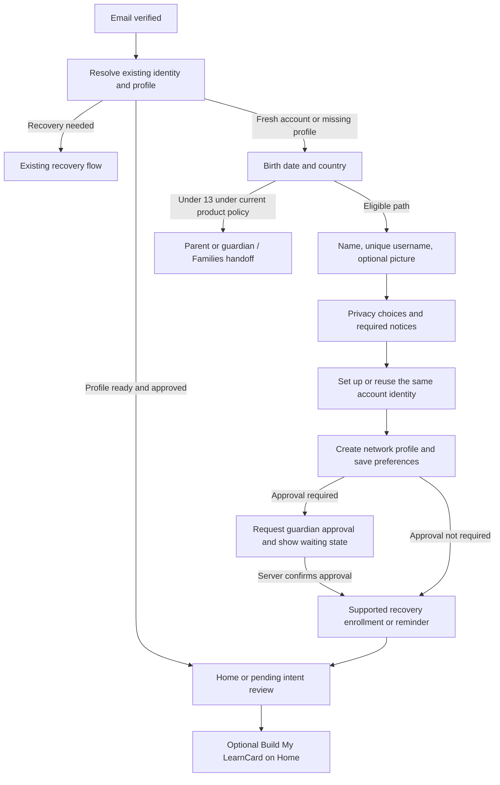

# First-time setup, Build My LearnCard and People

Planning and source audit, October 16, 2026. **Proposed; not implemented.** The completed [account-access pass](ACCOUNT_ACCESS.md) covers existing-account sign-in/recovery and presentation of web setup handoffs. It is not a native registration flow. This plan follows the user's request to cover first-time accounts, age/country safeguards, Build My LearnCard and a home for connections without adding a side menu.

## Current gaps

| Area                                      | Current native behavior                                                        | Next implementation                                                                |
| ----------------------------------------- | ------------------------------------------------------------------------------ | ---------------------------------------------------------------------------------- |
| Brand-new account                         | Shared coordinator can return `needs_setup`; native shows a web setup handoff  | Native eligibility → account setup → profile creation                              |
| Existing identity without network profile | `stateDTO` returns `missing_profile` and discards the usable client            | Resume profile setup for the same identity; never generate a replacement identity  |
| Profile awaiting approval                 | Native `stateDTO` does not inspect `profile.approved`                          | Explicit pending-approval state before opening account features; refresh on resume |
| Test login                                | Configured email is read-only                                                  | General email entry/account routing before broad new-user testing                  |
| Build My LearnCard                        | Home integration previously deferred onboarding; scan/claim exists separately  | Optional Home entry and native credential-intake journey                           |
| Connections                               | Native Inbox handles some connection requests/prompts; recipient search exists | Full paginated connections/request management and profile details                  |

Inspected web onboarding, age helpers and checklist files match the primary checkout at the time of this audit. This is a local-source audit, not a verification of every deployed environment or a complete backend authorization review.

## 1. First-time account setup

Entry is **email verification → resolve account state**. Returning users continue through normal resume/recovery. A missing network profile is different from a missing signing identity. Neither condition should fall through to an apparently empty Collection.

### Proposed native screens

1. **A little about you:** birth date and country, with a short explanation of why they are needed. Country inference may suggest a value, but the user confirms it. Validate real dates and future dates with calendar-aware birthday boundaries.
2. **Make it yours:** display name, public username and optional profile picture. Show debounced availability, offline/retry feedback and a useful collision suggestion. The server's create result remains authoritative if availability changes before submission. Keep the chosen handle stable during retries.
3. **Your choices:** concise required notices and real privacy settings. Preserve age-derived defaults and restrictions; independent optional choices must not become one blanket agreement. Do not auto-enroll AI or document processing as a side effect of finishing registration.
4. **A grown-up's help**, when required: guardian email, explicit sending/failure/resend states, waiting, approval recheck and safe sign-out. Sending an email is not approval. Returning from a link or foregrounding re-fetches server status. A successful parent approval cannot be represented by a local boolean.
5. **Ready to begin:** short welcome with supported recovery setup/reminder, then Home. Resume a scanned claim or app intent at its review step after all required setup/approval completes. Do not automatically claim, connect or grant access.

Use the approved neutral canvas, vivid Colorful objects, substantial typography, original drawn artwork and painted transitions. Birth-date/country controls should be designed sheets or native date controls with accessible labels. New screens and nested sheets need en/es/fr/ar, RTL, large text and keyboard review. The next visual pass should generate a composition reference after routing and required states are settled.

### Existing web behavior to preserve or review

`OnboardingFlow.tsx` currently runs age/country → profile → an optional recovery PIN when escrow is enrolled → welcome. It checks under-13 eligibility, country-specific EU consent, guardian email, a teen acknowledgment on the non-EU branch, username syntax/availability and privacy defaults. The variable named `needsUSConsent` actually applies to all non-EU teens in that implementation; it is product behavior to review, not evidence of a universal legal rule.

The flow prepares a new key through `AuthCoordinator.setupNewKey`, calls `createProfile` with name/handle/picture/DOB/country/role and the Firebase token, marks profiles needing consent `approved: false`, then sends the guardian request. It persists preferences, attempts existing guardian-link reconciliation and conditionally offers recovery PIN enrollment. Preserve those account contracts, rather than copying the React modal implementation.

Age parity is technically feasible with the existing helpers and services, but a literal copy would carry known inconsistencies:

- `gdprAgeLimits.ts` has both display-name and country-code maps, a partial country table and fallback values. **Ireland is currently 13 in both maps**, while the Irish regulator describes 16 for online processing that relies on consent. Review/correct the shared policy before generating native fixtures; do not invent a native-only correction. [Irish DPC guidance](https://www.dataprotection.ie/sites/default/files/uploads/2023-04/DPC_ChildrensData_ParentalConsent.pdf).
- Digital consent age, general minor status and product feature restrictions are separate policy decisions. The existing `getMinorAgeThreshold` uses the EU digital-consent threshold for some privacy defaults; that should be explicitly reviewed. The Commission describes country-specific thresholds between 13 and 16 where this consent rule applies. [European Commission guidance](https://commission.europa.eu/law/law-topic/data-protection/information-business-and-organisations/legal-grounds-processing-data/are-there-any-specific-safeguards-data-about-children_en).
- The inspected `createProfile` handler accepts client profile fields without computing a country-aware age decision itself. Adding a native form is presentation parity, not proof that policy is enforced across clients. Shared policy plus server enforcement is the durable follow-up; audit affected protected operations before broad registration rollout.
- The web sends guardian email after profile creation and treats that send's failure separately. Native must retain a retryable pending state if profile creation succeeded but sending failed. Preferences failure must not silently enable optional features.
- Native currently sets `enableEmailBackupShare: false` and only exposes existing-account recovery. New-account recovery enrollment needs a deliberate contract and web interoperability validation; do not register new accounts with only the current device remembered and assume recovery has been configured.

### Account implementation constraints

Expose typed states such as eligibility/profile setup, pending approval and ready through the native account bridge. Do not present network/identity errors as registration eligibility. Preserve existing recovery and migration safeguards: the native coordinator has a five-minute legacy-account heuristic, so interrupted first-time setup and later return need explicit tests. Never turn an older unknown account into a fresh identity to bypass that heuristic.

Keep new identity creation after the age decision, as web does. Existing identity plus missing profile reuses that identity. Snapshot non-secret setup progress where needed; DOB and guardian contact require deliberate protected storage and retention, not incidental logging/preferences. Clear private input on sign-out/background as appropriate. Serialize setup and use account-generation checks so responses cannot populate a different account.

After an uncertain response, read existing state before repeating key setup or profile creation. A server-created profile, failed preference save and failed approval email are distinct recoverable outcomes. Verify ownership of an existing profile before treating a conflict as successful completion. General email entry and fresh disposable-account testing are prerequisites for claiming native signup works.

## 2. Build My LearnCard on Home

This is **optional credential intake after account setup**, available to existing users too. Home should show an illustrated **Build My LearnCard** card with a useful next action and Continue; a full native page holds the intake options. It can be skipped or dismissed and reopened later. Do not require the user to upload documents to finish signup or fabricate a completion percentage.

The current web feature includes résumé, certificate, transcript and diploma uploads, selected QR/claim-link intake, raw credential JSON import and optional demo/sample tools. LinkedIn, school-connect and self-attested-skills entries exist in enums but are commented out of the active checklist; do not advertise them as current supported actions. Sample data must remain visibly optional and separate from real records.

Native delivery can be incremental:

1. Add the real Home entry and useful scan/paste-claim routes already supported by native. Keep unavailable document actions out until their contracts work.
2. Add native document/credential file intake, upload/storage, progress/failure/cancel/retry and review before saving extracted credentials. Audit existing parser/AI privacy gating first; uploading a document and processing its contents are distinct steps. Interrupted or partial import must not duplicate records or present self-authored extracted content as an issuer-verified achievement.
3. Match web bookkeeping: shared LearnCloud categories/source tags and actual counts, with durable operation state where needed. Counts use `resume`, `certificate`, `transcript`, `diploma` and imported `uploadType: rawVC`, independently of semantic Collection categories. Existing web intake must be visible natively and vice versa. Completion follows saved data, not local taps or a subset of loaded Collection pages.

Adding an existing résumé here is compatible with keeping the separate résumé **builder/editor** web-only. AI career Pathways and AI Sessions remain their own native slices.

## 3. People and connections without a side menu

Keep Collection / Inbox / Apps / Home initially. Add a **People** page with a prominent Home entry and a stable Account → People shortcut. Connection requests in Inbox link into that page and retain contextual actions. This gives relationships a destination without making a fifth bottom tab or introducing desktop navigation. Reassess a dedicated tab only if actual use warrants it.

- **Connections:** searchable paginated profiles, real supplied images or the drawn smiley, clear connection state and profile details.
- **Requests:** incoming requests and existing explicit accept/decline flows; **Sent** shows outgoing requests/cancellation. Keep blocked profiles available in a secondary management view.
- **Find or invite:** existing username/profile search and supported profile invitation links/QR. Contact-invite QR is a separate protocol from the implemented credential-claim scanner and needs explicit parsing/routing/review support.
- **Details:** name/username, public bio, send an existing creation or share selected credentials through explicit review, disconnect and block/unblock. Connection alone must not imply credential access or approval of a data-sharing agreement.

Reuse the paginated SDK contracts (`getPaginatedConnections`, `getPaginatedConnectionRequests`, `getPaginatedPendingConnections`), connection mutations and blocked-profile APIs. Search must work beyond the first loaded page; inspect existing profile search filtering and add a server query only if needed. Share state and invalidation with Inbox so accepting a request updates the list, badge and prompt together. Preserve explicit connect/skip decisions after claiming credentials. Group all page, request and browser state under the current account; lock/sign-out removes private content and invalidates pending responses.

This is LearnCard's connection graph. Access to the device address book is a separate product choice and is not required for this slice. iPad split-view presentation can follow later without promising current tablet validation.

## Suggested delivery order and acceptance

| Slice                          | Relative scope                                                         | Acceptance gate                                                                                                           |
| ------------------------------ | ---------------------------------------------------------------------- | ------------------------------------------------------------------------------------------------------------------------- |
| Shared policy/approval audit   | Small focused investigation, potentially separate shared/backend fixes | Reviewed policy table; explicit distinction between age, approval and feature restrictions                                |
| Native first-time registration | Moderate account integration plus UI                                   | Fresh adult, missing-profile, underage, pending-approval and interrupted/retry paths; existing-account recovery unchanged |
| People                         | Moderate, largely existing SDK APIs                                    | Multi-page search, incoming/outgoing requests, block/disconnect, Inbox consistency and lifecycle isolation                |
| Build My LearnCard             | Small navigation entry; document processing is a larger slice          | Real intake paths, web index parity, privacy-aware processing, review, partial failure and duplicate prevention           |

Automated policy cases should cover birthday boundaries, leap days, missing/future dates, country changes, each configured threshold and unknown-policy behavior. Native account cases should cover losing a profile-create response, handle races, failed preference/email saves, delayed guardian approval, resume after five minutes, cancellation/sign-out and pending scan/Apps intents. People tests need pagination/search, duplicate requests, stale responses after account switch and badge consistency. Build My tests need malformed/large files, partial imports, retry/relaunch, cancellation, processing restrictions and truthful counts. All new UI needs four-language, RTL, dark/light, accessibility type and Reduce Motion review.

No live signup, approval email, document upload, contact action or policy change was performed for this plan. No new app build or hosted CI run is required for the documentation-only update.

## Source map

- Web registration: `apps/learn-card-app/src/components/onboarding/v2/OnboardingFlow.tsx`; login routing in `src/pages/login/LoginPage.tsx`.
- Age and preferences: `src/components/onboarding/onboardingNetworkForm/helpers/gdpr.ts`, `helpers/validators.ts`, `src/components/onboarding/privacyPreferences.ts`; shared `packages/learn-card-base/src/constants/gdprAgeLimits.ts`.
- Account setup: `packages/learn-card-base/src/auth-coordinator/AuthCoordinator.ts`; native `account-runtime/runtime.ts`, `ios/Sources/AccountSignInView.swift` and `ios/NativeCore/Sources/LearnCardNativeSDK/AccountRuntime.swift`.
- Server profile and approval: `services/learn-card-network/brain-service/src/routes/profiles.ts` and `routes/inbox.ts` (`sendGuardianApprovalEmail`, `approveGuardianRequest`).
- Build My LearnCard: `apps/learn-card-app/src/components/learncard/checklist/CheckListContainer.tsx`, `CheckList.tsx`, `CredentialIntakeOptions.tsx`, `checklist-steps/`; `src/hooks/useUploadFile.tsx`; shared `src/hooks/useGetCheckListStatus.ts` and `src/react-query/queries/checklist.ts` under `packages/learn-card-base`.
- Contacts: `apps/learn-card-app/src/pages/addressBook/`; paginated hooks in `packages/learn-card-base/src/react-query/queries/queries.ts`; SDK methods in `packages/plugins/learn-card-network/src/types.ts` and `plugin.ts`.
- Native integration: `ios/Sources/HomeAppsView.swift`, `AccountView.swift`, `InboxActivityView.swift`, `RootView.swift`; `account-runtime/inbox.ts` and existing claim/creation/sharing coordinators.
