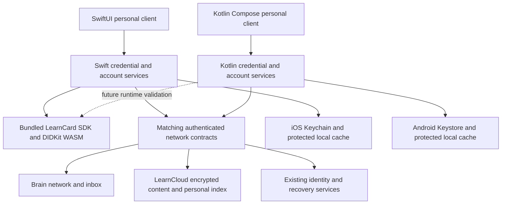

# LearnCard native client plan

Build an independent personal credential app with SwiftUI for iOS, followed by Kotlin and Jetpack Compose for Android. Keep LearnCard account identity and credential interoperability while using a simpler interface shaped around phone tasks. This is a greenfield client experiment, approved October 12, 2026; the existing Ionic and Capacitor applications continue to serve their current audiences.

## Product scope

The core jobs are to find and understand a credential, receive one, claim it, create a credential for someone, send it, and share credentials already held. Account sign-in, recovery, privacy, revocation, and any required guardian approval support those jobs and remain part of the product.

Admin tools, organization management, bulk issuance, developer portals, application administration portals and App Store administration remain excluded. **Consumer Apps is the current implementation priority** (updated October 13): native discovery, installation, listing details, app launching, consent and Data Sharing. Published third-party apps run in a separate in-app browser. First-party AI career Pathways should become native in its own follow-up; Journeys needs separate scope confirmation. Families and AI Sessions require separate feature work. Résumé builder stays web-only inside the browser. BoostCMS is deprecated as a product direction per the user; reference the current credential builder's data semantics rather than treating surviving legacy components as a feature checklist.

## Native interface

Four stable tabs keep navigation small: **Collection**, **Inbox**, **Apps**, and **Home**. Home provides a compact personal dashboard and activity. Create/send/share live in the toolbar action menu; incoming credentials are reviewed in Inbox. Account, native Data Sharing and language settings live behind the profile control. Use the correct tiled-L mark, flat adaptive white/charcoal canvas, blue/cyan selection accents, colorful credential surfaces and the bottom navigation tray. Native stacks, sheets, search, system typography, VoiceOver, Reduce Motion, dark mode, right-to-left layout and comfortable touch targets remain the interaction vocabulary.

| Task            | Proposed native interaction                                                                                                 |
| --------------- | --------------------------------------------------------------------------------------------------------------------------- |
| Browse          | Searchable collection with compact category filters; useful title and issuer visible immediately                            |
| Understand      | One credential detail screen with artwork, title, issuer, summary, and accurate trust/status information                    |
| Receive         | Scan or paste a supported link, resolve its offer, then review before claiming                                              |
| Claim           | Show issuer, recipient, and requested permissions; confirm once; distinguish awaiting approval from failure                 |
| Create          | Choose a simple starting point, describe the achievement, add optional details, preview, then choose the recipient          |
| Send            | Choose a contact or scan a recipient, confirm identity and credential, then show delivery state                             |
| Share           | Select credentials and purpose, review disclosed information, choose link/presentation options, then use the OS share sheet |
| Follow progress | Activity shows actual claim, send, sync, and sharing states with contextual retry actions                                   |

### One credential detail screen

Badge, certificate, membership, and learning credentials use a coherent detail layout. Their content determines which sections appear; users do not need to switch among badge/certificate/raw-data views to understand one credential. The screen's first page answers what it is, who issued it, why it matters, and what can be done with it.

Evidence, criteria, skills, dates, linked credentials, and additional fields appear as readable, expandable sections when present. Larger source artwork or a supplied certificate document can open in a native viewer. CLR collections can expand their contained achievements without flattening or losing their signed relationships. Technical inspection and export sit behind a secondary action.

Verification is a computed result with its check time and relevant limitations. Never equate attractive issuer branding, a successful signature alone, or being in the collection with full issuer trust. Pending verification, expired, revoked, and unavailable status checks must have distinct states.

The client uses one detail screen, actual credential artwork and issuer imagery where available, with explicit loading and fallback states. Samples carry an unsigned label. Rich nested content, evidence and document viewing remain further detail-view work; decorative presentation never implies issuer trust.

### Design pass after live functionality

The user rejected the current visual treatment as too generic and the first branding pass as uninspired. The official marks and initial category colors are not an approved final design. Complete the live account and core credential flows first, then make a deliberate visual and interaction pass across Collection, Inbox, Activity, credential detail, and creation/claim flows.

- Give actual credential graphics a prominent role in the collection and detail screen. Carry achievement/badge images, issuer imagery, and supplied covers or backgrounds through the live display adapter. The display adapter now carries `artworkURL` and `issuerLogoURL`; continue improving rendering with real content. Preserve aspect ratios and distinguish badge artwork from issuer logos and certificate documents. Use an intentional fallback when artwork is absent.
- Use more LearnCard color across section backgrounds, larger surfaces, and navigation context, rather than limiting identity to a logo and pale card fills. Develop coordinated green, pink, emerald, and blue treatments from the established colorful theme. Let credential artwork retain its own colors. Check contrast and dark mode across every surface.
- Improve transitions with native SwiftUI motion: carry artwork naturally from collection into detail, make sheets and navigation feel connected, and give claim completion and new credential arrival clear visual feedback. Keep scrolling and input responsive; respect Reduce Motion and avoid ambient animation that competes with reading.
- Reconsider hierarchy, card composition, spacing, and the relationship between artwork and text. Do not repeat the same generic rounded tile for every credential or treat a larger logo as the design solution. Keep one coherent credential detail presentation and native controls.
- Review Collection, credential detail, and Inbox together with representative real credentials before spreading the direction across the app. Verify empty/loading/error states, long titles, image loading and missing artwork, larger text, and dark mode as part of the design review.

Installed design reference: `gpt-taste` from [Leonxlnx/taste-skill](https://github.com/Leonxlnx/taste-skill/tree/d237dd399d57524945c0c81327da5da19f7a468d/skills/gpt-tasteskill), pinned to commit `d237dd399d57524945c0c81327da5da19f7a468d`, at `/Users/donny/.codex/skills/gpt-taste/SKILL.md`. Only this subset was installed. Apply its composition, imagery, hierarchy, and motion guidance to the native brief. Its React/GSAP, landing-page AIDA structure, hover interactions, random layout selection, and web-font prescriptions do not override the approved SwiftUI architecture, task-based app structure, accessibility, or the user's request for a richer palette. No redesign implementation is included in this installation step.

### A smaller credential builder

Start with a concise native flow: **Describe → Optional details → Preview and recipient → Issue/send**. Keep drafts and editing accessible, and disclose advanced fields progressively. Acknowledgments and personal achievements can provide approachable starting points; the underlying Open Badges and Verifiable Credential formats stay intact.

Current authoring references include the active `apps/learn-card-app/src/pages/issue/IssueCredentialPage.tsx` and the credential template schema/utilities under `apps/learn-card-app/src/pages/appStoreDeveloper/partner-onboarding/components/CredentialBuilder/`. The latter lives in a portal directory, so use its data semantics as a reference, not its full UI or administrative workflow. `apps/learn-card-app/src/pages/boostAFriend/boostAFriend.helpers.ts` also reuses those template utilities. Audit current entry points before choosing the final creation subset; component existence is not evidence that it remains a supported product flow. In particular, `OBv3CredentialBuilder.tsx` has no external callers in the current source search and is not an authoritative active-flow reference.

In the prototype, creation is a title, description, and category form that produces an unsigned local sample. Production creation must distinguish drafts, templates, issued credentials, recipients, and delivery outcomes. Sending issues or delivers a credential under the user's authority; sharing presents a credential the user already holds. A received credential cannot simply be reissued as though the holder were its issuer.

## SDK compatibility findings

| Component              | Evidence in this repository                                                                                                            | Native implication                                                                                                           |
| ---------------------- | -------------------------------------------------------------------------------------------------------------------------------------- | ---------------------------------------------------------------------------------------------------------------------------- |
| SDK initialization     | `packages/learn-card-init/src/initializers/learnCardFromSeed.ts` composes TypeScript plugins and selects WASM or Node DIDKit           | No drop-in Swift SDK is established here; initialize only the personal-client capability subset                              |
| Node native plugin     | `packages/plugins/didkit-plugin-node/src/plugin.ts` loads platform `.node` files; `native/Cargo.toml` depends on vendored DIDKit/SSI   | Node bindings are not an iOS binary; reuse audited Rust behavior through a mobile FFI boundary if proven                     |
| Recovery               | `packages/sss-key-manager/src/crypto.ts` uses Argon2id via `hash-wasm`; other modules use Web Crypto and browser storage               | Matching algorithms, parameters, serialization, salts, and storage behavior are required; a UI framework does not solve this |
| Network authentication | `packages/learn-card-network/brain-client/src/index.ts` obtains challenges and attaches DID-auth proofs and optional guardian approval | Firebase sign-in alone is insufficient for personal network and cloud requests                                               |
| Incoming credentials   | Network plugin exposes incoming/received credentials and acceptance                                                                    | A native adapter must preserve pending/accepted/revoked semantics                                                            |
| Personal collection    | `packages/learn-card-base/src/hooks/useClaimCredential.ts` accepts a network credential, then calls `addVCtoWallet`                    | Network acceptance and encrypted personal indexing are separate steps                                                        |
| Contact inbox          | Network plugin exposes `finalizeInboxCredentials` and `recoverInboxCredentials`                                                        | Include verified contact delivery, decryption, recovery, and guardian handling; it differs from direct network acceptance    |
| Sharing                | `apps/learn-card-app/src/components/share-links/` and network share-link methods manage sharing lifecycle                              | Sharing a screenshot or unsigned display data is not interoperable credential sharing                                        |
| HTTP bridge            | `packages/learn-card-bridge-http/src/learn-card.ts` initializes a singleton with a server `WALLET_SEED`                                | The existing HTTP bridge is not a multi-user personal-client adapter; do not upload user seeds to it                         |

React Native could reuse some TypeScript service logic, but this repository contains no validated mobile runtime adapter for the complete SDK and recovery stack. Runtime and crypto compatibility would still need investigation. The user selected fully native interfaces after this review. This choice deliberately accepts two UI implementations and native SDK integration work; it is not a claim that Swift will connect to the existing SDK automatically.

Upstream [DIDKit is archived](https://github.com/spruceid/didkit). LearnCard has its own pinned DIDKit/SSI forks in `.gitmodules`; they were not initialized in this checkout during scaffolding. [SpruceKit Mobile](https://github.com/spruceid/sprucekit-mobile) is another candidate for a mobile crypto evaluation, but adopting it requires LearnCard format and encryption compatibility tests. No crypto dependency is selected or added to the prototype. The iOS 26.4 simulator JSContext probe returned `WebAssembly: object`, with `fetch`, `crypto`, `indexedDB`, and `window` undefined. This makes a bundled local SDK runtime worth testing with explicit native platform adapters; global API presence alone does not prove that the existing WASM or full SDK works. This result is simulator evidence, not a guarantee for iOS 18 or a physical device.

### Passkey recovery correction

`packages/sss-key-manager/NATIVE_PASSKEY_PLAN.md` assumes native Apple PRF is unavailable and proposes a server-assisted recovery change. That platform premise is stale: the installed Xcode 26.4 SDK declares platform passkey PRF request/input/output APIs available from iOS 18. Apple documents [PRF assertion input](https://developer.apple.com/documentation/authenticationservices/asauthorizationpublickeycredentialprfassertioninput-swift.struct) and its [input values](https://developer.apple.com/documentation/authenticationservices/asauthorizationpublickeycredentialprfassertioninput-swift.struct/inputvalues-swift.property).

API availability does not prove that an existing user's passkey or provider will support recovery. Test native and web derivation against the exact existing PRF salt, domain handling, credential ID, relying-party configuration, and encrypted recovery record. Preserve password/recovery-phrase paths while evaluating PRF; do not weaken the recovery trust model based on the older plan.

## Proposed production architecture

This diagram describes the intended live architecture. The SwiftUI app, Foundation domain package, and in-memory demo service exist. A separate test-target SDK host now runs the current SDK locally in WebKit; authenticated production transport and live account adapters remain proposed.

Keep UI state separate from services. Preserve original signed payload bytes/structures alongside derived display records. Native networking handles transport and authentication. Evaluate a shared Rust library and a bundled local SDK runtime for signing, verification, canonicalization, and LearnCard encryption compatibility before choosing the implementation. Generate or fixture-test cross-platform models instead of maintaining independent, drifting interpretations of credential formats. Never treat arbitrary URL contents or unknown JSON as a trusted credential.

Use native secure storage for device secrets and encrypted persistent collection data. Check the account's derived identifier before attaching a recovered identity to existing data. Local biometric unlock protects access to existing secrets; it does not replace server authentication or recovery. Choose accessibility/background policies deliberately and keep secret material out of logs, bridge payloads, and analytics. This is a production gate, not functionality provided by the sample scaffold.

An offline collection should remain readable with an explicit last-sync/check time. Writes, acceptance, issuance, and sharing require explicit state transitions. A claim can be accepted on the network while personal-index sync fails; persist that state and offer a targeted retry instead of issuing or accepting again. Handle revocation and rotation without silently recreating or discarding the user's identity.

Real claim links, OpenID credential offers, sharing links, and presentation requests need an allowlisted resolver, expiry checks, and authentication-aware routing. Retain pending requests across sign-in and require review before disclosure or claiming. Register universal links and associated domains only for an agreed experiment identity. The prototype registers only `learncard-native-demo` and does not claim real LearnCard URLs.

## Delivery sequence and acceptance gates

| Stage                           | Deliverable                                                                                                                                  | Gate to move forward                                                                                                                                                       |
| ------------------------------- | -------------------------------------------------------------------------------------------------------------------------------------------- | -------------------------------------------------------------------------------------------------------------------------------------------------------------------------- |
| 0 Native interaction experiment | Independent Xcode project, sample collection/inbox, creation, claim, local send activity, native sharing, tests                              | Review the interaction direction in the simulator; exercise dark mode, accessibility, larger text, and a physical device                                                   |
| 1 Crypto and account spike      | Compare the candidate Rust boundary with a bundled local SDK runtime; signed fixture and encryption interoperability; exact recovery vectors | Same deterministic identity as SDK; cross-verify VCs/VPs; decrypt each other's LearnCloud/JWE data; same recovered account identity; report actual binary size and latency |
| 2 Live collection and account   | Existing sign-in and recovery, protected device storage, authenticated reads, encrypted collection cache                                     | Existing user sees the same collection; restart/offline/lock/sign-out work; revoked/expired/unverified content is represented accurately                                   |
| 3 Receive and claim             | Native camera scan, universal links, direct and contact inbox flows, claim and index recovery                                                | End-to-end web/native issuance and claiming; interruptions and retries never duplicate; guardian approval and contact ownership remain enforced                            |
| 4 Create and send               | Smaller native builder with saved drafts, image/evidence handling, recipient confirmation, real issuance and delivery                        | Web can verify and claim native-issued credentials; sender/recipient and delivery state are accurate; offline drafts cannot appear issued                                  |
| 5 Credential sharing            | Signed presentations and current share-link lifecycle, QR/native share sheet, privacy review                                                 | Existing web viewer resolves native-created shares; expiry/passcode/revocation and disclosure behavior match contracts                                                     |
| 6 iOS pilot                     | Dedicated signing, app icon, privacy metadata, notifications, universal-link infrastructure, TestFlight                                      | Real-device recovery and interoperability pass; measured startup/scroll/large-collection behavior meets agreed targets                                                     |
| 7 Android client                | Kotlin/Compose app implementing the same tested contracts and candidate Rust core through JNI                                                | Same interoperability/recovery fixtures; Android scanner, Keystore, sharing, links, and background behavior tested on device                                               |

Stage 0 is scaffolded and uses current LearnCard branding. Stage 1 has working offline SDK checks and a disposable staging credential exchange; see [SDK spike results](SDK_SPIKE.md) and [staging validation](STAGING_VALIDATION.md). Firebase-backed account restoration and the initial personal facade are now connected; see [ACCOUNT_INTEGRATION.md](ACCOUNT_INTEGRATION.md). Full delivery, claim, sharing, lifecycle, and release gates remain open. Keep Android UI development behind proven contracts; validate its local SDK host separately.

## First integration work

1. Register/configure the separate Firebase iOS app in the shared `learncard` project and use a dedicated staging test login. Keep the network, cloud, and SSS endpoints explicitly on staging.
2. Adapt native provider sessions and Keychain storage to the existing SSS strategy. Prove Firebase UID continuity, restored signing DID equality, share versions, restart, recovery errors, sign-out, and account switching.
3. Turn the tested local WebKit SDK host and native transport into a typed account facade with cancellation, lock/dispose, bounded commands, and friendly errors. Preserve signed payloads separately from display metadata.
4. Connect the SwiftUI collection and inbox to the confirmed account. Test pagination, missing content, revoked credentials, guardian restrictions, contact-inbox claims, and interrupted acceptance/indexing.
5. Validate physical iPhones and the minimum supported iOS version. Keep JavaScriptCore adapters or mobile Rust FFI as later alternatives if measurements justify them; evaluate native passkey PRF separately with real authenticators.

## Validation

Domain tests exercise claim deduplication, concurrent claiming, creation validation, send authority, recipient validation, and strict demo-link routing. Native XCTest interactions cover claiming, creation and recorded send, receive review without automatic acceptance, and the native share sheet in dark mode. The diagnostic JSContext probe records the installed iOS simulator's WebAssembly, fetch, crypto, IndexedDB, and window globals; it does not establish React Native/Hermes support or real-device SDK compatibility.

Production tests must prove actual cryptographic and network behavior, including partial acceptance/index failure, interrupted recovery, account switching, revocation sync, unknown/expired links, guardian restrictions, and disclosure consent. Testflight release also needs VoiceOver, Dynamic Type, Reduce Motion, real-device camera and Keychain checks, and interoperability between web, iOS, and eventually Android.

## Setup validation on October 12 2026

Xcode 26.4.1 built and launched the app on a dedicated iPhone 17 Pro simulator running iOS 26.4. All seven Swift Testing domain tests passed, including nine invalid-link cases; all five XCTest checks passed, covering claim, creation and local send, receive review, native sharing in dark mode, and the diagnostic JSContext probe. Nx recognized the four native targets. Physical-device testing, iOS 18 runtime behavior, larger accessibility text, VoiceOver, and all live SDK/account interoperability remain unverified.

## SDK spike update on October 12 2026

The preferred first live adapter uses the current SDK in a bundled local WebKit service host beneath SwiftUI. Ten credential-library fixture signatures exchange in both directions, along with DAG-JWE, LearnCloud index field hashes, presentations, DID-auth JWTs, SSS recovery vectors, and QR-transfer encryption. A full CLR fixture retains an explicit status/schema verification exception. See [SDK_SPIKE.md](SDK_SPIKE.md) for the offline evidence and account identity boundaries.

## Staging update on October 12 2026

The SDK host now passes an authenticated staging exchange with disposable private profiles: existing identity/profile lookup, encrypted receipt and proof verification, acceptance plus personal LearnCloud indexing, reload, and native issuance/send verified by the current SDK. The host uses a restricted native URLSession transport and leaves browser network access blocked. See [STAGING_VALIDATION.md](STAGING_VALIDATION.md) and [STAGING_RESULTS.json](STAGING_RESULTS.json).

The next account milestone targets staging/dev services and the explicitly approved shared Firebase project `learncard` with a dedicated test login. Register/configure the separate native Firebase app, adapt provider sessions and the current SSS recovery strategy, preserve signing/profile identity checks, and store device recovery material in Keychain. The personal SwiftUI app remains a sample until that account facade is connected. Guardian/contact-inbox flows, interrupted claims, revocation, sharing, and real-device support remain unverified.

## Account and native design update on October 12 2026

The existing staging account now signs in through native Firebase REST, recovers through the current SSS source, and loads its collection and incoming offers. Keychain-backed relaunch was observed. Recovery email is the default; saved word-based recovery is a separate option. See [ACCOUNT_INTEGRATION.md](ACCOUNT_INTEGRATION.md) for limits.

The next design pass uses real credential art in round windows, a featured credential plus adaptive two-column gallery, flush horizontal category scrolling, balanced Inbox/Create controls, and mint/pink/blue section backgrounds. Live Receive goes directly to Inbox. SwiftUI zoom navigation connects collection cards to details; the featured card gently tilts and buttons respond to presses. Reduce Motion disables zoom, scaling, and tilt; accessibility text uses a single column. The installed gpt-taste skill informs visual variety, spacing, contrast, and motion; its web-specific GSAP, landing-page structure, and fonts do not replace native SwiftUI behavior.

## Scope clarification 2026-10-12 — Consumer App Store

The user clarified that excluding App Store features meant its admin/developer side, not the learner-facing LearnCard App Store. Keep iterating the minimal Collection/Inbox/Activity design first. Once that is satisfactory, the next product phase includes discovering, browsing, installing/opening, and managing LearnCard apps, with native account/permission/credential-consent flows. Investigate the existing consumer contracts and app compatibility before choosing navigation or implementation. App Store admin, developer publishing tools, and organization/admin portals remain excluded. The initial Apps destination linked to staging web; the October 13 implementation below supersedes that placeholder.

## Design corrections 2026-10-12

The user rejected pale green gradient washes: card and page hues blended and felt low contrast. Use flat warm Collection paper, stronger flat category cards, pink Inbox with white offer cards, and blue Activity. Left-align the official wordmark and profile control; collapse the wordmark to the mark on scroll. Category rail must reach the screen edges. Artwork sits in circular windows, the featured card gently tilts, and Reduce Motion disables nonessential movement. Reuse current LearnCard navigation artwork where practical. Native large titles showed an iOS 26.4 rendering problem despite existing in accessibility; move large headings into scroll content and use inline native titles once scrolled so no blank title area is reserved. Verify screenshots as well as accessibility assertions.

## Approved concept and navigation update 2026-10-12

The generated light/dark Collection concept in `design/collection-concept-2026-10-12.png` was approved by the user ("way better"). This supersedes the warm cream canvas, colored page washes, and full wordmark described above. Use softly toned white / charcoal canvases, correct tiled-L mark only at the left, blue/cyan selection and Create accents, layered cyan featured cards with circular artwork on the left, and colorful compact gallery cards. Preserve real artwork and original signed payloads; the generated example illustrations are concept-only.

Bottom navigation: **Collection, Inbox, Apps, Home**. Apps is the native consumer LearnCard App Store destination; the initial staging-web placeholder is superseded by the October 13 integration. Home replaces standalone Activity with a streamlined version of the web dashboard: arrivals, useful actions, and recent activity. Current activity is session-local, not historical network activity; integrate accurate durable history later. No administrator or developer publishing UI belongs in these destinations.

## Personal credentials, creations, and actions — 2026-10-12

Collection means **My credentials**, including received and self-issued credentials that the user holds. Reusable templates and sending tools are **Your creations**, a distinct destination under Home. Do not classify every credential whose issuer is the current account as a managed template. The live template list uses `getPaginatedBoosts` (LIVE/PROVISIONAL); live collection detail no longer treats Send as a holder action. New sends use the SDK template delivery path to issue fresh recipient-specific contents.

The top plus opens a native action sheet: **Create new**, **Send existing creation**, **Share credentials**. Format and category choices also use native action sheets. Create is Design → Recipient → Review, with PhotosPicker artwork, title/description, OBv3 format, category, criteria, self or selected LearnCard member, and a final confirmation. Optional artwork uploads through the same Filestack tenant as web only after confirmation. A created template lives in Your creations; choosing self also accepts and privately indexes the issued credential. Direct member delivery does not add the recipient's credential to the issuer's personal collection. Existing web advanced fields, multiple recipients, email/phone delivery, and claim links remain later parity work.

Share selects one or multiple personal credentials, reviews the explicit selection, then prepares the current web encrypted sharing protocol. Reuse `shareLinkFlow.prepareShare` and publication classification; preserve originals and public endorsements, signed holder presentation, encrypted owner recovery, fragment content key, optional passcode, and a 30-day expiry. No legacy seed-in-path links. Pending publication must not produce a shareable URL. Native Data Sharing now lists owned links and supports copy/share/stop; link editing, pending-operation retry and deeper history remain follow-ups. Session retry state preserves prepared inputs and operation IDs, but does not survive app termination.

The prominent stack shows the newest issue date among currently loaded matching records, labeled Latest issued. It is not an endorsement or issuer-trust signal. Category determines the front color; both backing colors differ from it. Pagination/search operate on loaded personal records, and the heading may change as additional pages load.

## Native chrome and account pass — 2026-10-12

Use the generated secondary board as visual reference (`design/secondary-concept-2026-10-12.png`). The user approved its outlined navigation icon style and requested a matching rocket plus a bottom tray. Custom SwiftUI bottom navigation hides the iOS 26 floating system tab bar; preserve safe-area layout, VoiceOver selection, badge counts, and four actual destinations. The action bubble has compact colored icon circles and left-aligned rows, not default oversized gray confirmation pills. Format/category still use action sheets.

Inbox uses compact horizontal rows with round artwork on the left, readable title/issuer, a small category pill, and a review chevron. Credential detail retains its larger left-aligned artwork. Image loading and unavailable-art states are explicit.

Account has an opaque grouped sheet, compact avatar/initials header, native display-name/bio editor, native Data Sharing and language selection, a notification link to the exact staging web route, Help, native recovery overview, and separate sign-out/forget controls. Forget requires its own confirmation because the next sign-in needs recovery. Recovery backup/export, account deletion, contact/phone management, role/country/DOB fields, and push preferences are not yet implemented natively; route to existing web capabilities with a clear handoff rather than fake controls. Native profile updates affect network profile displayName/bio, not the Firebase auth contact identity.

## Consumer Apps implementation — 2026-10-13

The current slice replaces the web-store placeholder with My apps/Discover, catalog category filters and search, listing details, installed app management, an in-app browser and native agreement review. Profile Data Sharing opens the same native screen: contract recipients/access, withdrawal, owned shared-link status, copy/share and stop. Removing an app and withdrawing its agreement are distinct SDK operations.

Read permissions start optional access off and share only credentials explicitly chosen. Complete contract audiences are used for LearnCloud encryption. A session review token binds approval to the displayed agreement, permission sets, recipients and audience version, checked again after encryption. Existing server age/guardian gates remain authoritative; native family approval is not invented.

The browser uses a separate nonpersistent WKWebView and a bundled local parent with a real partner iframe. Partner SDK requests are checked against the exact iframe source and origin; native callbacks require the trusted main frame. Identity requests get a native prompt and a domain-bound public-account proof, never Firebase tokens or account signing keys. The browser closes on account background/lock. Raw credential-selection, template-authoring, learner-context and AI-session client workflows remain explicit unsupported actions. Template app events use the existing listing-scoped network API; offered credentials are reviewed through Inbox. See APPS_INTEGRATION.md for capability boundaries and validation.

Apple String Catalog is the native translation source. Generated .strings/.stringsdict resources also support SwiftPM tests. English, Spanish, French and Arabic cover new Apps/consent/Data Sharing/browser/language UI and selected existing shell labels, with pluralization and RTL. Paraglide remains in the web/JavaScript layer. Existing credential-builder, recovery and dashboard copy still needs a complete localization audit; translation coverage is not represented as complete.

Follow-ups: native AI career Pathways (confirmed by the user, not Journeys); separate Families/guardian navigation and approval; separate AI Sessions/native learner-context synchronization; web-only résumé builder; continued visual review; full existing-screen localization and translation review. Keep admin/developer/publisher tools out of the consumer client.
