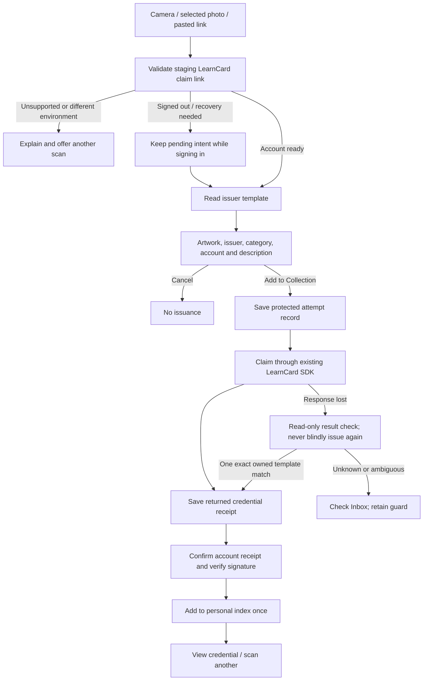

# Native QR scanning and credential claims

October 15, 2026. Scan a code is available from the header action menu, Inbox and Home, and before sign-in. Camera, photo and pasted links lead to the same explicit review. Scanning never issues or accepts a credential automatically.

## Supported inputs and capture

- Canonical web staging links: `https://staging.learncard.app/claim/boost?boostUri=…&challenge=…` and the staging.learncard.ai alias. The web's extra `claim=true` flag is compatible. These are the links displayed by the current web credential QR component.
- Explicit native handoff: `learncard-lab://claim?boostUri=…&challenge=…`. The experiment registers this scheme independently of the demo scheme.
- Demo links work only in explicit sample mode. They never resolve real codes to sample credentials.
- The nested resource must be an exact staging-network Boost URI. Production links, credentials disguised as templates, duplicate required parameters, fragments, credentials/ports in URLs, arbitrary websites, other schemes and oversized inputs are refused before transport.

Camera capture uses VisionKit DataScanner, restricted to QR codes, at normal tracking frequency. It stops after the first result and when inactive, backgrounded or dismissed. Unsupported hardware/simulator and denied/restricted permission have clear alternatives. Camera-use permission copy has English, Spanish, French and Arabic resources.

PhotosPicker grants access to the selected photo without asking for the whole library. Vision decodes the photo locally; no photo upload occurs. Images are bounded to 20 MB / 20 million pixels. Multiple distinct QR payloads require a photo with just one code. Publisher text and artwork are preserved; interface copy uses the native catalog and RTL layout.

The app handles delivered URLs, but automatic opening of ordinary HTTPS links from the system Camera/Safari still requires associated-domain entitlements, the correct signed application identity and a matching hosted AASA file. Those distribution/domain changes are not claimed by the simulator implementation. Scan inside the app, choose a photo, paste a link or use the registered native scheme today.

## Account and transaction boundaries

A pending link lives in the account controller, outside the replaceable collection screen. It survives foreground/background locking and the sign-in/recovery screens in the running process. Background removes the credential preview and clears unsubmitted input. Successful recovery opens review again; sign-out clears pending intent. An intent bound to one account cannot move to another. Unused in-memory intent expires after 15 minutes; force-quitting before confirmation requires scanning again.

The runtime reads the same deployed endpoint as web: **`/api/storage/resolve`**, including the private claim challenge. The deployment was checked read-only with an invalid public URI: the API path returned structured 400, while the path without `/api` returned 404. No real claim capability was used in that check. Preview is an issuer template and may be unsigned; the interface does not call it a verified credential.

Confirm uses `claimBoostWithLink`, which returns a newly issued credential URI and is **not an idempotent acceptance API**. The native flow therefore:

1. Writes a device-bound Keychain attempt record before sending the mutation. Failure to save it prevents issuance.
2. Requires a current review, re-resolves its template before issuance and consumes that review once. A typed preflight change/unavailable/Family refusal can return to review without a duplicate issuance.
3. Saves a known issued URI before indexing. Finishing/retrying uses that same receipt, never another `claimBoostWithLink` call.
4. Checks the authenticated account's received records and verifies the actual signed credential before adding it to LearnCloud. Existing index entries are reused and semantic category is preserved. The complete web category table is shared through `packages/learn-card-base/src/helpers/credentialCategoryMap.ts`; web helper exports remain compatible and the table itself is unchanged. Original signed payloads remain unchanged.
5. Keeps a guard when the mutation response is lost. Result checking considers up to 50 recent received records and requires exactly one exact `boostId` match; it never guesses by title or issuer. Multiple matches, credentials without that embedded template reference, unavailable reads and unresolved results remain uncertain. No second issuance occurs through this device's same-account guard. This is not global idempotency across other clients/devices; the server needs that contract for stronger guarantees.

Receipt keys hash the verified Firebase UID and capability, so tokens do not appear in Keychain account labels. Receipt values contain only an optional issued URI and start time; they never persist the raw challenge. Minimal protected receipt metadata remains independent of saved sign-in/recovery access, including after ordinary sign-out. A future child-account switcher must include the active profile identity in this scope before reusing it for managed children; this client currently signs for the root account only.

After completion the existing collection refresh and server-owned connection prompt loader run. A prompt still requires the user's decision; scanning does not connect people automatically. Existing Inbox offers continue using `acceptCredential`, a distinct path from template issuance.

Known Family templates are refused before issuance and offer the existing web access-review flow in a system in-app browser. The screen warns that its signed-in web account can differ. Unconfirmed server receipt is shown as pending, without inventing a guardian-approval reason or weakening server gates. Other QR protocols—connection cards, shared presentations, OID4VCI/OID4VP, VC-API and arbitrary raw credential imports—remain separate integrations with an explicit unsupported explanation.

## Design and regression references

The built-in image generator produced [this concept](design/claim-flow-concept-2026-10-15.png); [the brief](design/CLAIM_FLOW_BRIEF.md) records the exact prompt and implementation choices. Shipping capture/success artwork is editable SVG, not a screenshot crop. Native scale, neutral surfaces, Colorful objects, adaptive contrast and accessibility follow [the design system](design/DESIGN_SYSTEM.md).

Protocol checks cover no-write preview, current-template confirmation, single-use review, owned receipts, category preservation, idempotent indexing, signature/tamper checks, Family/foreign input rejection, result reconciliation and exact API routing. Production-store tests cover pending intent, lock/account changes, late reads/issuance, durable receipts and refused Keychain writes. Actual QR PNG decoding and multi-code rejection run through Vision. UI tests use unsigned samples and the production account/recovery screens with synthetic backend boundaries. See [TESTING](TESTING.md) and [STATUS](STATUS.md) for exact results and limitations. Physical camera capture and a dedicated end-to-end live claim still require manual validation.
