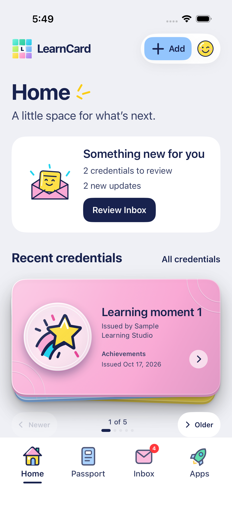
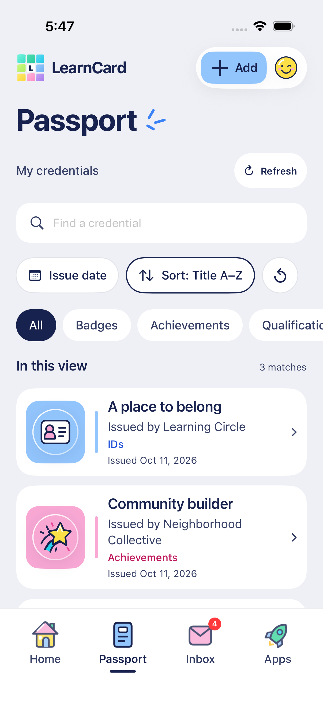
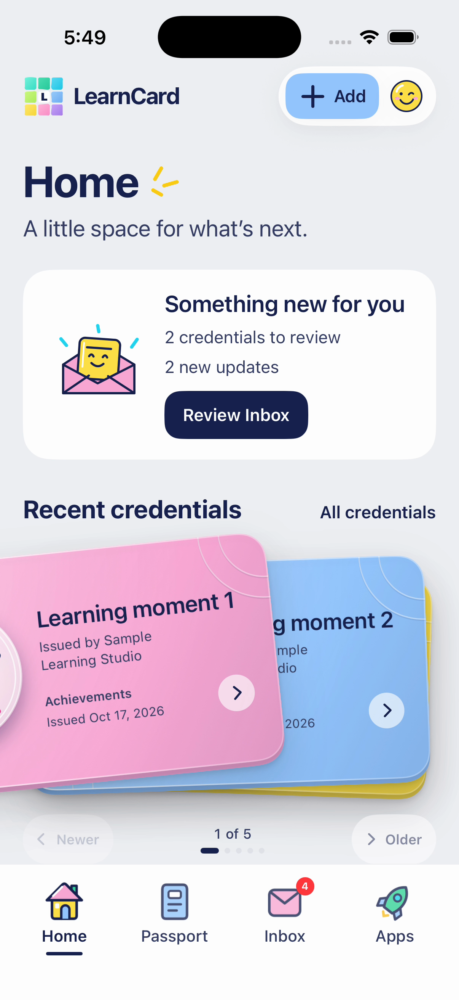

# Recent credential stack

Updated October 17, 2026. Home’s **Recent credentials** section browses the latest five loaded personal credentials across all categories. **All credentials** opens Passport's complete list and clears an earlier Passport search/filter/detail destination. Family records remain separate. Equal dates preserve source order; duplicate IDs cannot occupy multiple positions. Swiping is read-only browsing, never credential dismissal or deletion.

Passport always uses list rows, including its default, single-record and wider layouts. Search, category/date filters, sorting, paging, issuer/date metadata and credential-detail navigation remain. Changing a Passport filter does not change Home's current deck position. An explicit All credentials action returns to the unfiltered list; ordinary tab switching preserves each page's state.

The Home shortcut also clears an earlier Passport detail destination. The older See all action only switched tabs, which could restore a credential left open there. The current action resets the Passport navigation identity before selecting it. Its label owns a minimum 44-point touch area, including the space above/below the lettering.

## Interaction and appearance

- Swipe left for an older credential and right for a newer one in left-to-right layouts; Arabic mirrors these directions. Newer/Older buttons and the position/dot indicator provide the same bounded navigation.
- The active card follows a horizontal drag and slight rotation. A committed swipe tosses it beyond the edge, then the next card settles forward. Short drags and attempts beyond an end spring back. Vertical intent preserves Home scrolling.
- Covered cards render the actual credential surface, issuer/title, category artwork and category color before the drag begins. The old opaque decorative sleeves are removed. There are at most two visible covered layers. At the oldest card, the previous cards provide the visible layers for reverse browsing. A single record has no fabricated layers.
- Issuer/date metadata remains on each card. Tapping opens that exact credential; returning preserves its position. A refresh retains the active record if it is still in the latest five, otherwise selecting the newest eligible record.
- Covered cards are hidden from hit-testing and VoiceOver, and never create duplicate zoom sources. Their visual content remains fully rendered during reveal.

Each credential keeps a permanent, uniquely identified detail-transition source. Promoting a covered card changes its transform and interaction state without replacing its label or artwork. The earlier active/inactive source branches crossfaded two versions of the card during promotion, producing a brief faded/doubled frame. Keeping the source modifier in place removes that structural handoff while retaining tap-to-detail zoom.

The deck uses the currently loaded personal-index pages. If more pages remain, its caption says Latest among loaded credentials. Swiping does not start a whole-account scan. Passport owns list paging and complete-collection filtering/sorting.

## Motion, accessibility and lifecycle

The horizontal pan uses iOS 18's `UIGestureRecognizerRepresentable` with a delegate that refuses vertical intent. Fast intentional flicks and longer drags advance; small accidental movements do not. The toss lasts about 220 ms, followed by spring settlement; input is serialized while settling. Width-relative thresholds remain bounded.

Reduce Motion changes the reading position immediately without a drag transform or throw. Newer/Older controls have 44-point targets and localized labels/custom actions. The Home title and All credentials action stack at accessibility text sizes. English, Spanish, French and Arabic retain formatted position labels.

Leaving Home, scrolling the deck out of view, backgrounding or changing Reduce Motion invalidates pending completions and clears transient drag state. These operations preserve the settled reading position. The deck has no ambient timeline animation; credential detail retains its separate automatic tilt/sheen.

## Source and regression landmarks

- `ios/NativeCore/Sources/LearnCardNativeCore/RecentCredentialDeck.swift`: latest-five selection, cursor reconciliation and swipe intent/commit rules.
- `ios/NativeCore/Sources/LearnCardNativeCore/LearnerHomeSummary.swift`: five recent personal records, excluding offers/families, and honest loading/failure/empty/partial states.
- `ios/Sources/HomeAppsView.swift`: Home deck and All credentials entry.
- `ios/Sources/CollectionView.swift`: list-only Passport browsing.
- `ios/Sources/LatestCredentialStack.swift`: actual covered cards, toss/settlement, native pan, cancellation, controls and detail navigation.
- `RecentStackUITests.swift`: actual swipes, bounds, navigation/return, short-drag cancellation, vertical scrolling, independent Passport search/category state and Arabic Reduce Motion. The explicit Home shortcut is checked after leaving a Passport detail open, including a tap below its lettering and Arabic accessibility-size layout.

See [TESTING](TESTING.md) for current evidence. Automated credentials and interactions use isolated fixtures.

## Native screen and motion evidence

Production SwiftUI with isolated mixed-category samples; no real account data appears in these captures.

| Home recent deck                                 | Passport list                                     | Card revealed during drag                                                         |
| ------------------------------------------------ | ------------------------------------------------- | --------------------------------------------------------------------------------- |
|  |  |  |

[Eight-second actual swipe recording](design/home-deck-drag-reveal-native.mp4). The held gesture reveals the next card's real blue surface, title and issuer before the pink card has left. Its underlying yellow layer belongs to the next portfolio credential.

[Arabic category list](design/passport-list-arabic-native.png) and [older records after All credentials clears an earlier search](design/passport-all-credentials-native.png).

The promotion refinement keeps the rendered card intact through the lift. [Updated nine-second native handoff recording](design/home-deck-handoff-native.mp4) and [settled incoming card](design/home-deck-handoff-native.png). The previous conditional-source baseline has a brief faded/doubled frame; this source-stable recording does not.
