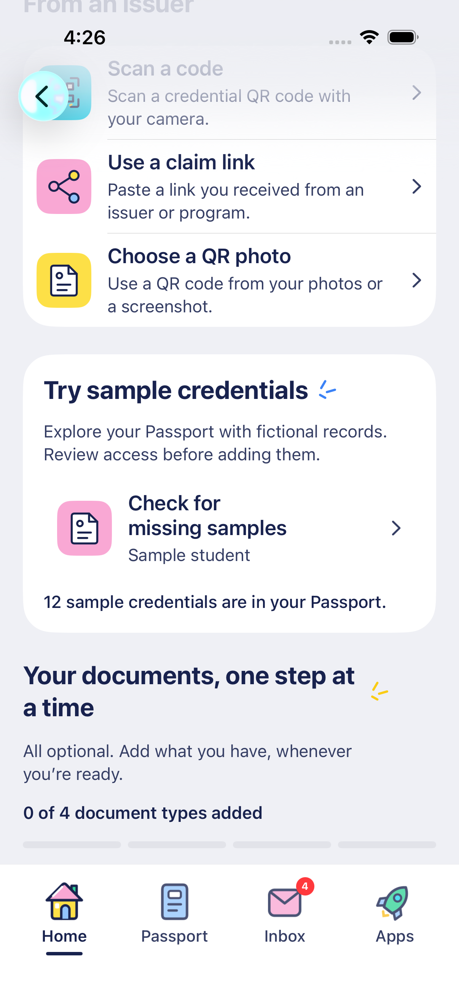
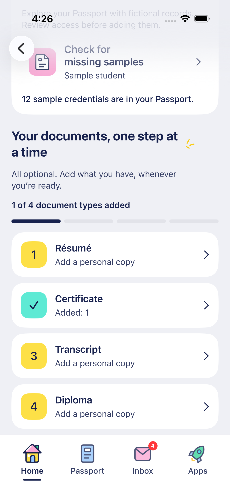
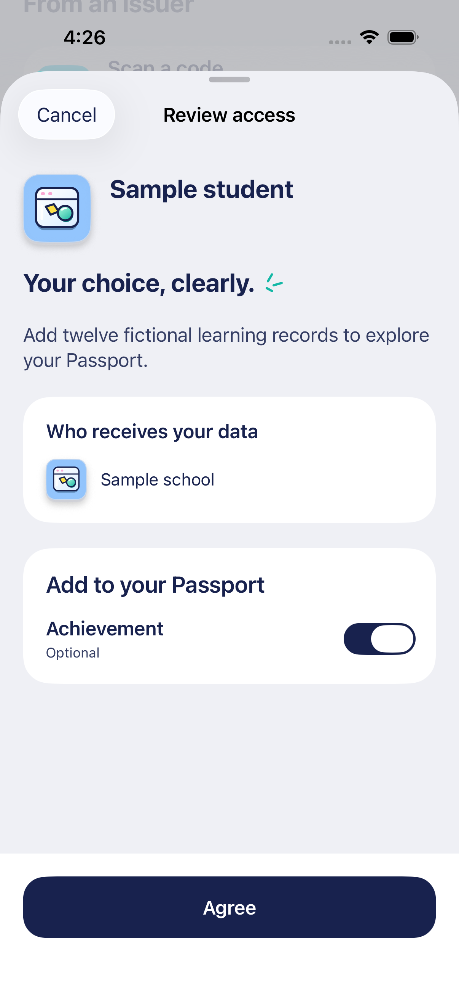
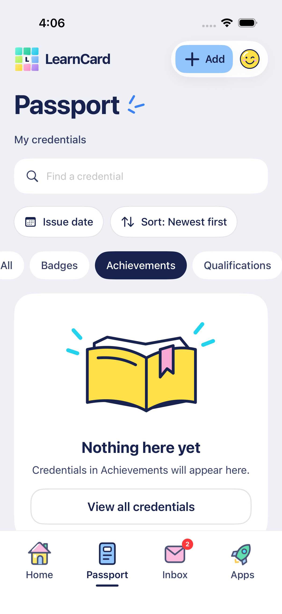

# Sample credentials and optional document milestones

October 17, 2026.

Build My LearnCard keeps issuer code/link/photo routes, adds **Try sample credentials**, and presents the four supported document kinds as optional milestones. A résumé, certificate, transcript and diploma each count once when at least one original is saved. Multiple files of one kind do not inflate progress; opening a picker does not complete a step. Counts come from the existing LearnCloud source-category queries, including documents added on web. JSON imports and sample credentials are separate from this four-item progress indicator. There is no signup gate or requirement to complete every step.

## Same sample source as web

The staging-only native runtime consumes `features.samplePersonas` from the web staging tenant configuration. It does not select a production contract, seed new issuers, switch accounts or use a shared demo login. The initial configured bundle is the sample student.

Opening the hub reads available bundles and existing consent. **Review & add samples** opens the existing native access sheet, showing the real contract audience, requested read/write scopes and explicit choices. Required permissions remain labelled, optional sharing starts off, and cancellation makes no write. For this explicit sample-add route, receiving defaults follow the contract’s `defaultEnabled` values (as on web); these remain visible optional toggles. At least one receiving category must be selected before agreement. This does not preselect reading existing credentials or personal information. Expired, guardian-gated or unsupported contracts cannot silently proceed. A fingerprint including auto-boosts detects changed contracts before agreement. Sample consent is single-flight and a lost response is reconciled against existing terms before another publication.

After agreement, targeted synchronization reads all pages of credentials for the configured contract's active consent records, including previously received credentials. It restricts records to that contract/terms and configured auto-boosts, verifies their proofs, accepts them through the normal network endpoint and adds their original URIs to LearnCloud with source-contract metadata. Categories preserve the existing native category resolver. No signed content is rewritten or reissued. Signed fictional bundle records receive a **Sample** label and explanatory detail copy, while their normal signature/export behavior remains intact; they are not conflated with unsigned local UI fixtures.

A missing delivery, unavailable read or failed index write stays incomplete. **Check for missing samples** retries synchronization without granting access again; already indexed originals are retained, and stable URI IDs allow recovery after an interrupted index response. Progress only reports records actually present after synchronization. Account replacement/lock rejects late state; file-sheet dismissal does not interrupt a separate sample operation. Access remains manageable through the existing Data Sharing destination. Removing an entire sample bundle from native is not added in this slice.

Native synchronization deliberately does not run web's broad cross-contract sharing synchronization or AI insight refresh. Adding samples does not opt the user into new disclosure to other contracts.

## Passport refinements

The date/sort reset is a labelled 44-point circular arrow directly beside the sorting control, with an adaptive second-row layout where needed. Selecting a category alone no longer creates a reset row: **All** and the empty-state **View all** action already clear the category. Typed search survives a date/sort reset. The category empty illustration shows the complete open book and ribbon; the overlapping category tile is removed.

## Verification

See [the current verification entry](TESTING.md) for focused runtime, Swift and native UI results. All automated writes use disposable in-memory fixtures. Live addition remains an explicit action in the installed native app; opening the hub does not accept an agreement.

## Native screen evidence

These captures use the production SwiftUI views with isolated demo services; displayed sample records are fixtures.

| Optional steps                                                      | Saved certificate                                                   | Explicit access review                                          | Clear category empty state                                                  |
| ------------------------------------------------------------------- | ------------------------------------------------------------------- | --------------------------------------------------------------- | --------------------------------------------------------------------------- |
|  |  |  |  |

[Compact 375-point sample result and milestones](design/build-milestones-compact-native.png) shows the same flow on a smaller phone; the remaining document rows are reached by scrolling.
