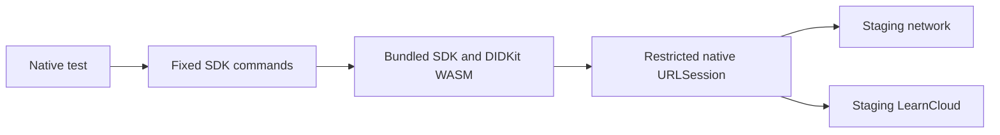

# Native staging credential validation

The native SDK host successfully connected to real LearnCard staging profiles and services on October 12, 2026. An iPhone 17 Pro simulator on iOS 26.4 completed the exchange, and the current TypeScript SDK independently checked its outputs. [STAGING_RESULTS.json](STAGING_RESULTS.json) records the measured summary.

The test used two fresh private, disposable profiles. That disposable test is separate from the subsequent [existing-account connection](ACCOUNT_INTEGRATION.md), which confirms native Firebase email-code sign-in, SSS email-key recovery, Keychain-backed relaunch, and collection/inbox loading in the personal SwiftUI app.

## Confirmed behavior

- Opened an existing staging profile with the same signing identity; checked signing `did:key` and profile DID separately.
- Received, decrypted, and verified a credential sent by the current SDK, preserving its signed payload.
- Accepted the offer, cleared its pending state, and confirmed the network received record.
- Added the encrypted personal LearnCloud index record.
- Reinitialized the SDK and reloaded the same collection record and credential.
- Let the current SDK read the native-created index and decrypt the claimed credential.
- Issued and sent a credential from iOS; the current SDK received it and verified its signature and payload equality.
- Removed test sent records, collection index, and profiles during cleanup.

The exchange uses an Open Badges v3 fixture and proof-only verification. It establishes signature and storage interoperability, not issuer trust, status, or every claim pathway. The broader offline fixture coverage is in [SDK_SPIKE.md](SDK_SPIKE.md).

## Transport



WebKit hosts bundled code in a nonpersistent store. Its content security policy blocks remote scripts and direct browser connections; navigation stays on the local SDK page. The native handler permits HTTPS GET/POST only to the exact staging network and cloud hosts, forwards required headers, disables cookies and stored credentials, rejects redirects, and bounds requests. SDK commands have a 120-second deadline.

Two details matter:

- A windowless host needs an explicit scheduling policy while active. `inactiveSchedulingPolicy = .none` allows SDK batching and asynchronous work; Apple's default suspends tasks outside a window. The production facade will need a lock/dispose lifecycle. [Apple documentation](https://developer.apple.com/documentation/webkit/wkpreferences/inactiveschedulingpolicy-swift.property).
- The native fetch adapter must preserve `Response.url`. Constructed JavaScript responses otherwise report an empty URL. DIDKit's generated WASM glue reads that URL; its HTTP client parses it. The initial adapter stalled at DID-document resolution despite successful responses. Preserving the URL made the complete exchange pass, and a regression test covers it. [Reqwest WASM source](https://docs.rs/reqwest/latest/wasm32-unknown-unknown/src/reqwest/wasm/client.rs.html).

Payload comparisons sort dictionary keys recursively while preserving array order and value types. Presentation changes never mutate the signed credential.

## Account environment selected by the user

| Component           | Configuration                                     |
| ------------------- | ------------------------------------------------- |
| Tenant              | `learncard`                                       |
| Network             | `https://staging.network.learncard.com/trpc`      |
| Personal collection | `https://staging.cloud.learncard.com/trpc`        |
| Account recovery    | `https://staging.api.learncard.app/api`           |
| Firebase            | Shared project `learncard`, dedicated test login  |
| Native bundle       | `org.learningeconomy.learncard.native.experiment` |

The staging tenant overrides inherit shared Firebase settings. The user explicitly approved that shared project for the next sign-in/recovery test. This exchange created no Firebase users and called no Firebase or account recovery APIs.

Next, obtain the experiment's registered Firebase iOS configuration and enroll a dedicated test login in staging SSS. Confirm that native sign-in returns the same Firebase UID, recovery restores the stored signing DID, and the existing staging profile and collection open without creating another identity. Validate Keychain persistence, restart, sign-out, recovery errors, and account switching. Google/Apple provider callbacks must preserve existing account identity. [Firebase Apple setup](https://firebase.google.com/docs/auth/ios/start).

Other pending cases include guardian approvals, contact-inbox finalization, partial acceptance/index failures, pagination, revocation sync, share links, external issuers/storage, and physical/minimum-iOS devices.

## Reproduce

```bash
bash apps/learncard-native/scripts/test-staging.sh -quiet
bun test apps/learncard-native/sdk-spike/staging.test.ts
```

The runner checks health, prepares profiles and an encrypted offer, generates ignored local inputs, uses the explicit `LearnCardNativeStaging` scheme, exports native outputs, independently verifies them, and cleans up on exit. The regular scheme skips the live test. Native initialization refuses setup older than 20 minutes; this does not expire signing material or replace server cleanup.

If cleanup fails, ignored `sdk-spike/generated/staging-state.json` remains for retry:

```bash
bun --conditions=development apps/learncard-native/sdk-spike/staging-account.ts cleanup
```

Generated seeds and raw outputs remain ignored. Summary snapshots contain no seeds, recovery material, Firebase tokens, or passwords. Cleanup removes the test index and network records/profiles; it does not promise to purge service logs, backups, or empty internal LearnCloud identity records.
