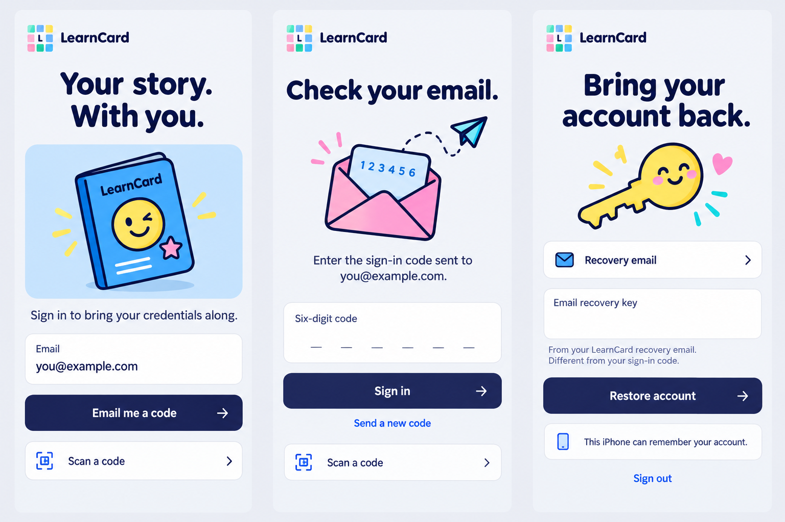
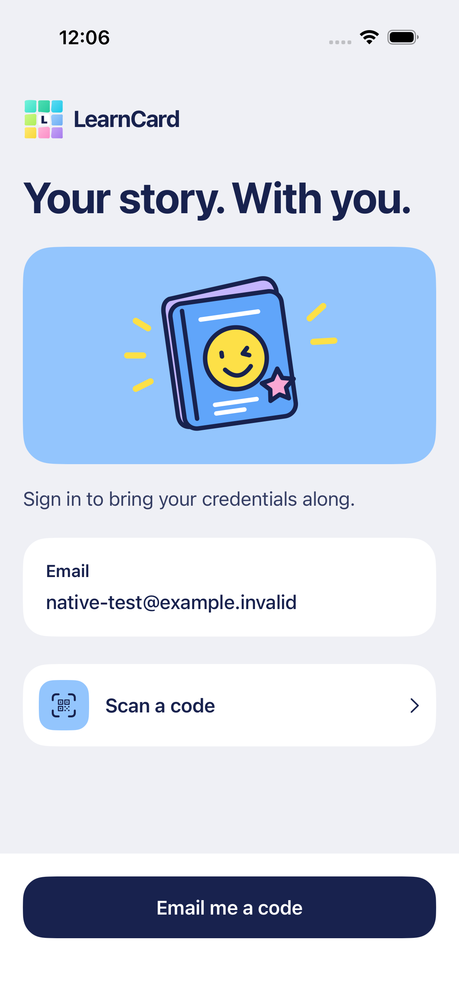
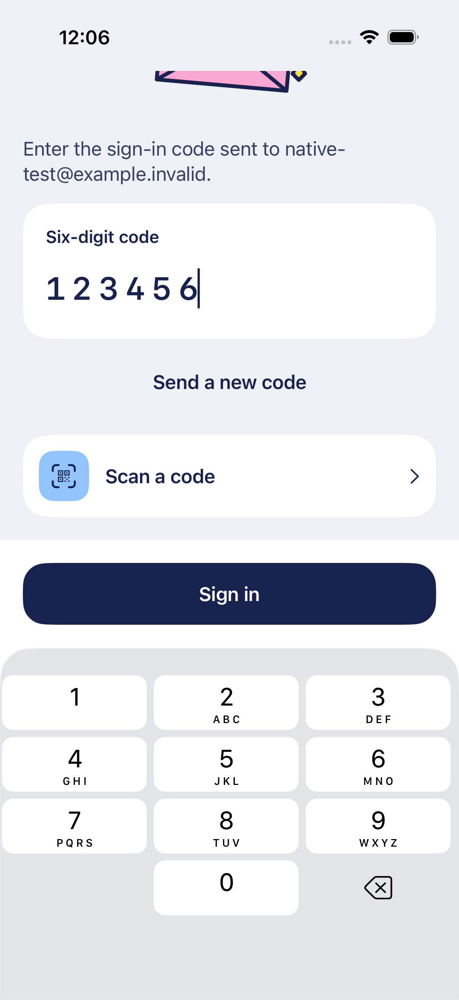
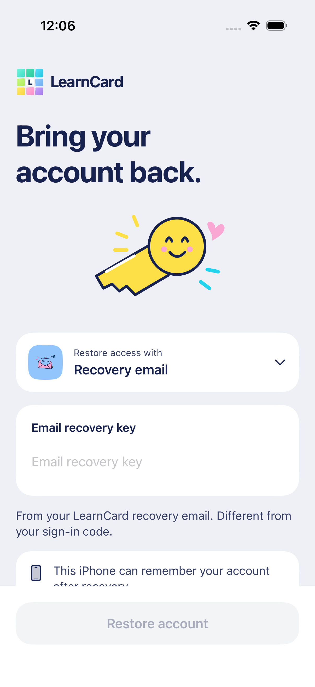
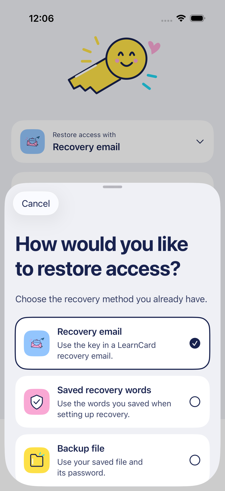
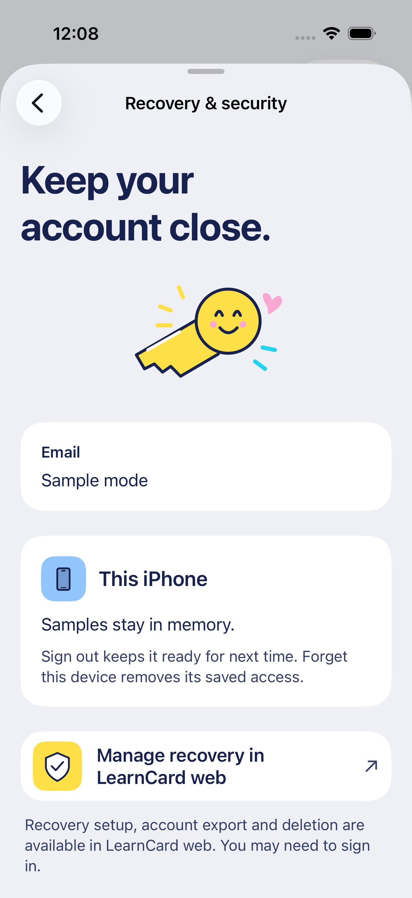
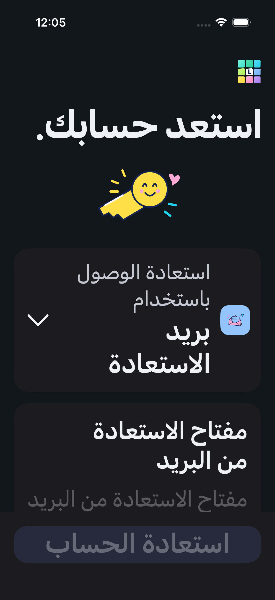

# Account access design — October 16, 2026

The user selected Account, sign-in and recovery for the next native UI pass. Continue the approved substantial typography, playful drawn illustrations, vivid Colorful accents and neutral adaptive canvas. The generated board is a composition reference; shipping art is original editable SVG and the actual forms retain existing account behavior.

## Composition reference



The blue passport with a wink welcomes returning learners. A pink envelope, code card and cyan plane distinguish email verification. A smiling yellow key gives recovery a warmer tone. Navy actions remain dominant; each real field has a persistent label. New illustrations use the existing generator and light/dark SVG asset convention rather than cropped mockup pixels.

## Native implementation













The actual method sheet scrolls at large text sizes and explicitly inherits locale/RTL and Dynamic Type. The form scrolls above a fixed action tray; illustration height decreases at accessibility sizes. Email remains the configured dedicated login, and web recovery-management capabilities are labeled honestly. Generated board spacing is adjusted for actual keyboard geometry, long translations and existing claim/account actions. New ambient animation is unnecessary in forms; the approved painted motion remains in waiting/lock states. See [behavior and validation boundaries](../ACCOUNT_ACCESS.md).

## Exact generation prompt

```text
Use case: ui-mockup. Create a polished three-screen iPhone UI composition board for LearnCard native account access: sign-in, email code, and account recovery. These should belong to an existing confident, whimsical SwiftUI app with substantial SF-like navy #18224E typography, neutral #EFF0F5 canvas, white panels, bright opaque default Colorful accents (#F9A8D4 pink, #93C5FD blue, #FDE047 yellow, #22D3EE cyan, #34D399 green, #C4B5FD violet). Three separate portrait artboards side by side, no hardware bezels, no marketing website. Brand at top left: small 3x3 mosaic of irregular watercolor squares, navy L on white central square, no black outline or circular white surround; LearnCard wordmark. Bold hand-drawn navy-outline illustrations with rounded strokes and flat vivid fills, tiny rays/heart/star marks, coherent with a cute trophy/envelope/passport icon family. SCREEN 1: welcoming headline 'Your story. With you.'; a compact charming illustrated blue credential/passport with a yellow winking smiley and pink star, occupying a purposeful mid-size colored panel rather than an oversized hero. Short text 'Sign in to bring your credentials along.'; a white labeled Email panel displaying 'you@example.com' as the configured test account, no invented editable account selector. Navy 'Email me a code' button; quiet illustrated 'Scan a code' secondary row. SCREEN 2: 'Check your email.' headline; a pink envelope with a small blue code card and a dashed paper-plane trail; clear caption 'Enter the sign-in code sent to you@example.com.' White labeled 'Six-digit code' entry; navy 'Sign in' button; quieter 'Send a new code' text action and a compact Scan a code secondary entry. SCREEN 3: 'Bring your account back.'; warm yellow key with a small smiling round face, cyan/pink accents and tiny rays. Compact selected method row 'Recovery email' with envelope icon and chevron that clearly opens a bottom selection sheet; secure input panel labeled 'Email recovery key'; short helper 'From your LearnCard recovery email. Different from your sign-in code.' Navy 'Restore account' action. A small white informational row 'This iPhone can remember your account.'; a quiet Sign out secondary action. Hierarchy, comfortable substantial type, compact generous-enough rhythms, clear fields and a persistent action area above keyboard. Retain readable navy text on colored surfaces. Do not add gradients, big glass islands, giant top gaps, admin controls, fake trust/security guarantees, passwords as default login, fingerprint claims, confetti, or background floating splash blocks. These are composition ideas to implement as native UI with editable SVG illustrations; do not mimic a web landing page.
```

Generated with the built-in image tool. Reference generated October 15; implementation and review completed October 16. No external image-generation CLI/API fallback was used.
