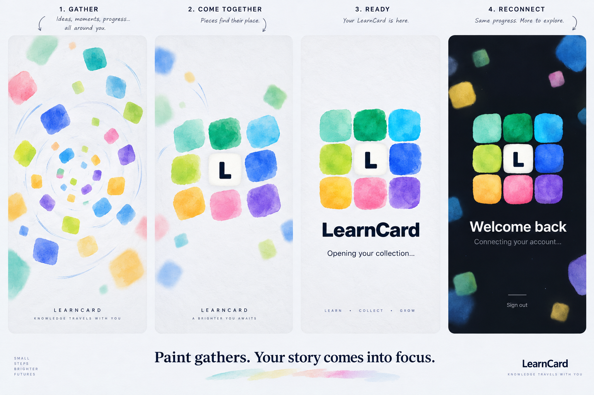

# Account motion design brief — October 15, 2026

**Current direction — October 16:** the user rejected the small/separated-to-full assembly because real app openings can finish before it completes. The system splash and running view now start with the full-size assembled mark and LearnCard name. Keep only the gentle stop-motion jiggle and floating edge pieces. The older gathering storyboard below is retained for material/style provenance; its opening sequence is superseded. See [the current contract](../ACCOUNT_MOTION.md).

The user requested more expressive loading/lock/initial screens: swirling LearnCard-colored blocks and a launch animation in which watercolor logo pieces come together. The ordinary app canvas remains neutral. Built-in `image_gen` produced a storyboard and a grayscale paint material; final layout and animation are SwiftUI, not a video or a generated-screen image.

## Selected composition



Eight soft pigment pieces and the central L form the original three-by-three mosaic, with clear copy below and drifting colored shapes at the edges. Dark mode uses the existing charcoal canvas. After review, the user requested more saturation. The final native implementation keeps the geometry, strengthens the mint/green/cyan/lime/blue/yellow/pink/violet stops and lightens the texture overlay; the storyboard is softer than the final palette. The native implementation preserves original SVG geometry and Colorful hue meanings; it omits storyboard annotations, extra slogans and the paper-wide noise layer. Actions remain genuine account actions. See [implementation and accessibility contract](../ACCOUNT_MOTION.md).

## Exact storyboard prompt

```text
Create a premium motion-design storyboard / UI concept board for the LearnCard native iPhone app, landscape board with four generous portrait artboards side by side, no physical phone bezels. It is a playful but refined learning credential app. Show FOUR keyframes: 1 'Gather' dispersed soft watercolor rounded square color daubs spiraling gently inward on a near-white #EFF0F5 paper canvas; 2 'Come together' those same daubs nearly assembled into the 3x3 LearnCard mosaic; 3 'Ready' the assembled 3x3 mark centered large, white center square with dark navy L, eight colorful uneven organic square daubs around it (top mint, emerald, cyan; middle lime, white L, blue; bottom warm yellow, pink, violet), below beautiful strong native SF-style wordmark LearnCard and short status 'Opening your collection…'; 4 dark-mode reconnect screen on #11151C with the same bright painterly mosaic and a few soft floating color blocks around the edges, text 'Welcome back' and 'Connecting your account…', subtle secondary 'Sign out' action lower. Reproduce the soft painted mosaic concept: no outline on colored blocks, watercolor pigment layering and soft irregular rounded edges, not a solid corporate app logo. Important composition: artwork has real presence (around 180-220pt within a 393pt screen), broadly orbiting color accents restrained behind, ample clear space for high contrast status and actions, no generic spinner-only form, no gradients covering the entire screen, no low contrast rainbow text. Fun intelligent warmth and gentle physicality. Show subtle motion trails and small directional arcs only as storyboard annotations outside phone artboards; final ready frame clean. This is a conceptual board, not a request for finished app assets. Keep all exact UI copy short and clean. Bottom board caption 'Paint gathers. Your story comes into focus.' Subtle paper texture, strong graphic design, polished typography, tasteful saturated brand colors.
```

## Exact material prompt

```text
Create a single square grayscale watercolor pigment density texture for compositing over colored paint shapes in a native app. Full bleed edge to edge, no objects, no logo, no letters, no borders, no gradients, no lighting effects or shadows. Close-up of genuine cold-press watercolor paper with softly irregular pigment pooling, translucent cloudy washes, delicate granulation, subtle bloom and dry-brush feathering. Mostly off-white and light gray, a few medium gray pigment clusters, no pure black. Rich organic watercolor variation at a medium scale, clear enough to remain visible in a small colored square. Flat scanned art material, not a photo of a sheet of paper. No watermark. Opaque background.
```

Material source: [watercolor-pigment-source.png](watercolor-pigment-source.png). Packing to 512 pixels and masking/rotation are reproducible in `scripts/prepare-motion-artwork.ts` and `PigmentTile`. The mark geometry remains editable vectors. The final watercolor material is the real generated texture; synthetic circle speckles were removed. After the user approved the assembly and stronger colors, they requested continuing small stop-motion tile shifts and more visible background floating; these are implemented natively and are not depicted by a single storyboard frame. These were built-in generations, not CLI/API fallback.
