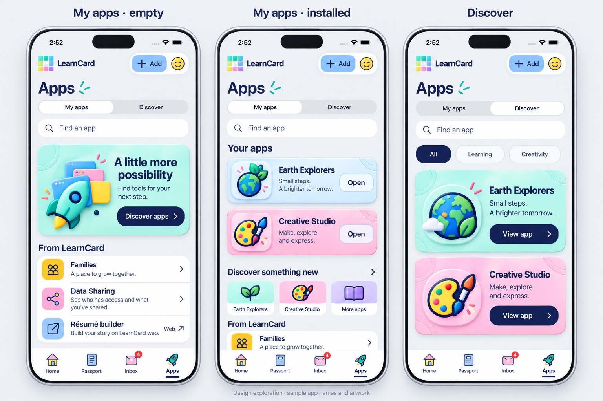
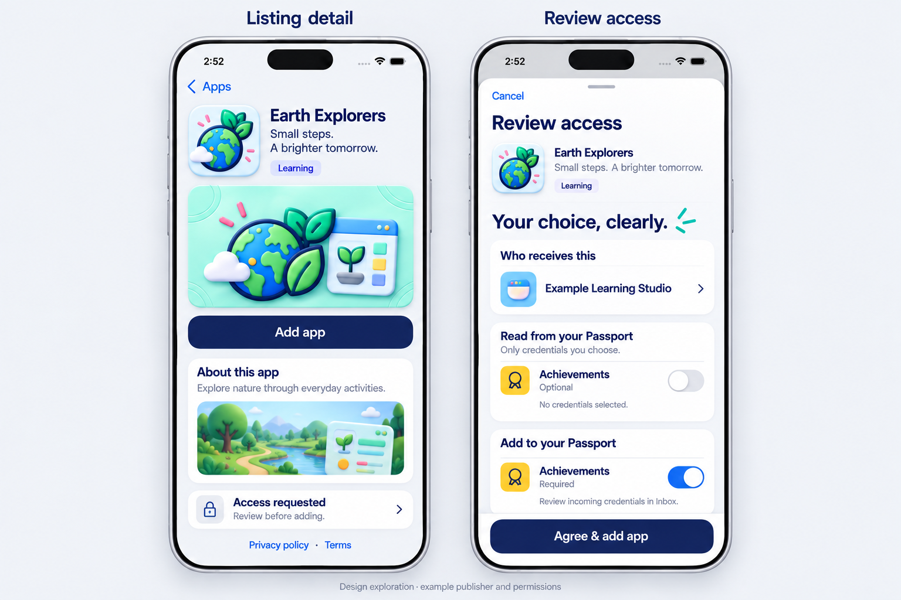
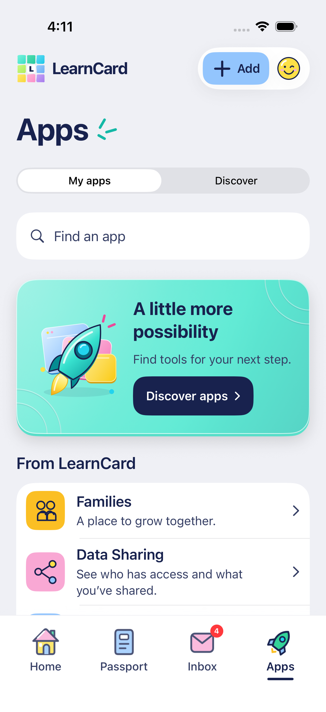

# Apps in the rendered style — October 16, 2026

The user selected Apps as the next redesign and requested new mockups using the [approved credential material](CREDENTIAL_DEPTH_BRIEF.md), then approved trying this direction. The native implementation now carries the app-first hierarchy and rendered material through My apps, Discover, listing detail and access review. Generated names/art/scopes remain illustrative; actual native captures below are separate evidence. See [the implementation contract](../APPS_REDESIGN.md).

## New boards

Generated with the built-in `image_gen` tool. [Both exact prompts](APPS_RENDERED_PROMPTS.txt) are retained. The first board references the approved pink credential material and the actual current Apps screen; the second references that material and the new browse board. App names, publisher identity, art, screenshots and permissions on these boards are synthetic examples.

## Proposed composition

| State              | Main job                           | Visual emphasis                                                                                             |
| ------------------ | ---------------------------------- | ----------------------------------------------------------------------------------------------------------- |
| My apps, empty     | Discover a useful app              | A compact dimensional rocket/app-window illustration, one short invitation and a clear Discover apps button |
| My apps, installed | Open something already added       | Installed entries first, distinct publisher art, readable titles and direct Open actions                    |
| Discover           | Browse and inspect                 | Search, actual category chips and catalog cards; View app opens detail before installation                  |
| Listing            | Understand the app and next action | Publisher art/screenshots, concise metadata, About, access summary and Add/Open                             |
| Review access      | Make an informed choice            | Small app identity, actual recipients/scopes, required/optional text and an explicit agreement tray         |

Move Families, Data Sharing and the web-only résumé builder below the installed/empty app area. Keep their existing destinations. They must remain reachable through search/no-match/loading/error states; an empty catalog cannot hide native utilities. Do not add a fifth tab or replace the shared header.

Use the same Colorful palette, neutral canvas, substantial SF typography, small static heading rays and Home / Passport / Inbox / Apps tray. Concentrate physical depth in illustrations, app identity and card edges: a shallow lower edge, directional light, light embossed corner contours and restrained cast shadows. Do not apply the credential-detail tilt loop to app lists or permission forms. Keep prose and toggles on calm readable surfaces.

## Translate the reference into real data

- Preserve actual publisher icons and screenshots, including their original colors/aspect ratios. The globe/palette in the board are examples, never substitutes for real publisher identities. Only missing art gets the generic app-window fallback.
- Do not recolor every publisher's artwork. A neutral raised frame and small deterministic shell accent can create depth without pretending to be supplied app branding. Do not infer category/endorsement from decoration.
- The generated “Creativity” chip is exploratory wording. The implemented categories remain the supported catalog values: all, learning, ai, games, tools, employment, credentials, plugin and other. Any taxonomy change requires its own source/contract audit.
- The installed screen's miniature discovery gallery repeats example apps. Prefer one clear Discover row unless actual fetched catalog content justifies a gallery. Do not fabricate recommendations or rank.
- Oversized ordinary catalog cards are a composition reference, not a featured flag. Preserve catalog order; render “Featured” only for a real promotion flag. Support dense lists and long titles rather than requiring every item to be a hero.
- A listing hero is conditional on suitable actual publisher artwork/screenshots; do not generate a bespoke hero for every live app or reuse the sample landscape for unrelated apps.
- The board's recipient chevron must not imply a destination that does not exist. Display the actual recipient name plainly unless a supported detail route exists.
- Required access is selected and disabled, with explicit Required text. The rendered toggle is not an editable option. Optional scopes start off; credential selection stays explicit. Use the actual semantic category art, including the newer achievement shooting star.
- The sample “Review incoming credentials in Inbox” is not a blanket promise about every partner write path. Final permission copy must describe what the existing contract and receiving flow actually do.
- Show Add/Open/Review access according to actual installation and changed-contract state. Honor unsupported listings, server age/guardian restrictions and unavailable requests. Uninstall and withdrawing access remain different actions.

## Bounded implementation sequence

1. **My apps:** reorder existing sections, implement the empty illustration/action, improve installed rows with shallow static depth. Search only app entries; preserve utilities and distinct query-empty/loading/error/partial-page states. Reuse existing store and browser launch.
2. **Discover and detail:** carry the same material into catalog/listing hierarchy. Preserve actual categories, pagination/search across pages, promotion facts, screenshots, links, installation state and retry behavior.
3. **Access review:** polish layout/spacing and app identity while preserving decision semantics, actual recipients, no default optional consent, explicit credential selection, stale-contract refresh and disabled/blocked/loading states. Do not modify protocol or data-disclosure scope as part of a visual pass.
4. **Review actual native screens:** empty and several installed apps, no search matches, long titles, missing/failed art, paging, retry, English light and Arabic dark at matched standard type; separate accessibility-size captures and narrow/wide phone widths. Review static depth in dark/Reduce Motion. Keep iPad as a distinct future layout decision.

Keep stable route/control identifiers where behavior remains equivalent. Existing `ConsumerAppsUITests` cover discovery/consent/install/Data Sharing, direct Open, partner identity/cancel/unsupported behavior, account background browser disposal and locale persistence. Extend coverage for the new section hierarchy and distinct empty/search/error states; run the touched Apps and Home routes rather than claiming the whole suite passes. Native hosted CI remains manual.

## Related native learning queue

[Learner Pathways, Journeys and related features](../LEARNER_LEARNING_PLAN.md) are now explicitly queued. They should become native first-party experiences, separate from third-party apps in the in-app browser. Do not place nonfunctional “coming soon” tiles into this Apps visual slice.

## Implemented native screens

These captures exercise production SwiftUI with isolated sample services. Both sample listings lack publisher artwork, so they intentionally show the same generic app-window fallback. The generated globe/palette/screenshots above are not installed catalog data. The two-app compact capture is scrolled to its installed rows.

| State                                           | Actual capture                                                        |
| ----------------------------------------------- | --------------------------------------------------------------------- |
| My apps empty, 402-point phone                  | [Standard English](apps-rendered-empty-native.png)                    |
| My apps with two installations, 375-point phone | [Compact installed list](apps-rendered-installed-compact-native.png)  |
| Discover, actual sample promotion flag          | [Catalog](apps-rendered-discover-native.png)                          |
| Listing with generic missing-art fallback       | [Detail](apps-rendered-detail-native.png)                             |
| Access review before optional selection         | [Standard review](apps-rendered-access-native.png)                    |
| Required scope, fixed noninteractive row        | [Compact lower review](apps-rendered-required-compact-native.png)     |
| Arabic dark, enlarged stress preview            | [My apps](apps-rendered-arabic-accessibility-native.png)              |
| Arabic dark, enlarged stress preview            | [Access review](apps-rendered-access-arabic-accessibility-native.png) |

Arabic accessibility captures are deliberately enlarged; they are not the default Arabic font size. Existing standard French/Arabic title/direction checks pass separately. Nine core cases and twelve distinct focused UI cases pass across the [recorded runs](../TESTING.md#rendered-apps--october-16-2026), including fixed child-control grouping, empty/search/error separation, direct Open, agreement/cancellation, Home routing and browser background disposal. Live partner/account writes and hosted CI were not performed.
