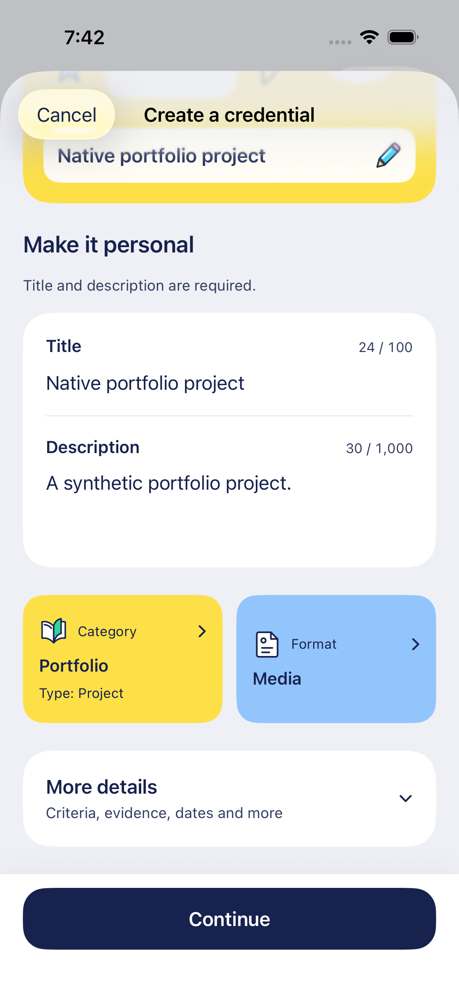

# Credential authoring parity — October 16, 2026

This pass aligns the native creator with the regular web creator at upstream commit `c7df5938ca9245227d561c036dc7db8b80c240be`. It extends the approved drawn illustration system and designed bottom sheets; no new image-generation board was needed.

Category describes where the credential belongs; its next screen selects the credential type. Format describes its visual presentation. All eight regular categories, 115 standard types and four selectable formats come from a shared, audited catalog. IDs retain their dedicated format. See [source audit, serialization and remaining boundaries](../CREDENTIAL_AUTHORING_PARITY.md).

## Actual native screens

These are production SwiftUI views using unsigned, disposable fixtures on the separate checks simulator. They are not generated mockups or evidence of live issuance.

| Screen                                                          | What to review                                                               |
| --------------------------------------------------------------- | ---------------------------------------------------------------------------- |
| [Categories](authoring-categories.png)                          | Eight Collection-aligned labels, illustrations and colors; the list scrolls. |
| [Qualification types](authoring-qualification-types.png)        | Category-specific choices, including License and Certification.              |
| [Portfolio type search](authoring-portfolio-types.png)          | Searchable types; translated and original English names both match.          |
| [Portfolio draft](authoring-portfolio-draft.png)                | Category and explicit Project type sit beside the independent Media format.  |
| [Visual formats](authoring-formats.png)                         | Badge, Award, Certificate and Media; type choices are absent.                |
| [ID format](authoring-id-format.png)                            | IDs keep their fixed card presentation.                                      |
| [Arabic accessibility search](authoring-arabic-type-search.png) | Actual RTL, larger text and dark presentation with localized results.        |

Back or Cancel before choosing a type leaves the draft unchanged. Selecting a type commits both category and type. Changing category starts with the web's default format; changing only the type retains the current format. Review repeats all three values before creation. The category is preserved in signed data, reusable-template metadata and self-claimed Collection records.

The lightweight native preview adapts its artwork window; complete web display layouts, every ID appearance field and user-defined custom types remain separate. Existing optional details, artwork upload, recipient selection, cancellation and delivery are retained. See [test evidence and installed build](../TESTING.md).
