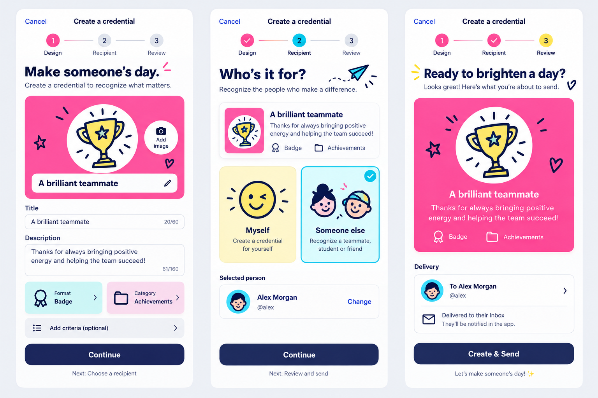

# Credential builder design pass — October 15, 2026

The user found the three-step creator drab after the account-motion pass. The built-in image generator produced this composition study; SwiftUI implements the layout and existing editable vector illustrations provide the final artwork.



## Native implementation

Use a compact numbered step indicator, an artwork-led credential canvas, persistent field labels and a fixed action tray. The category sets the credential's Colorful panel; the format and category selectors remain native action sheets. The title/description are required, with their actual 100/1,000-character limits; optional criteria retain their 2,000-character limit. Choose Myself or an explicitly selected LearnCard member, then review the actual draft, delivery and reuse behavior before creating anything.

The mockup is composition guidance. The implementation uses navy text on bright panels, adaptive white/charcoal surfaces, existing bold SVG category artwork and the round smiley placeholder. It does not crop generated art or present fictional Alex details as a live account. Real selected artwork replaces the illustration. Review includes actual criteria and the public-artwork disclosure. It promises delivery to the Inbox, not push notifications. The final title is “One last look” so it also fits self-issued credentials.

Large text stacks the credential artwork/text and selectors. Long labels wrap; the footer grows with text. Narrow content is bounded at 620 points rather than stretching forms across an iPad. The presented creator and nested recipient sheet explicitly inherit native language, RTL and review text-size preferences. No splash-like background animation is added inside forms.

The visual pass keeps the existing three authoring kinds and seven credential formats. Full semantic-category authoring, such as Qualifications and Portfolio, still needs a separate SDK builder contract update; Collection already displays those categories correctly. Original signed credential data is unaffected. See [flow and verification](../CREDENTIAL_BUILDER.md).

## Actual simulator screens

These are production SwiftUI views with unsigned sample data, rather than generated screens:

- [Design](credential-builder-native-design.png)
- [Recipient](credential-builder-native-recipient.png)
- [Review](credential-builder-native-review.png)
- [Arabic accessibility/dark recipient picker](credential-builder-native-arabic-picker.png)
- [Arabic accessibility/dark review](credential-builder-native-arabic-review.png)

## Exact generation prompt

```text
Design a polished high-fidelity three-screen iPhone UI concept board for the LearnCard native credential creator. Three portrait screen artboards side by side, no hardware bezels, light neutral #EFF0F5 canvas and white surfaces, bold navy #18224E SF-like typography. The approved product personality is confident, whimsical, bright Colorful accents and bold hand-drawn navy-outline illustrations. Please design a real usable native flow, not a generic form or a marketing page. Screen 1 DESIGN: compact navigation Cancel / Create a credential; a small clear numbered Design / Recipient / Review step indicator with active pink accent. Headline 'Make someone’s day.' and very short caption. A prominent pink credential canvas with a large circular illustrated trophy and a small 'Add image' camera button attached to the artwork; editable card title visible in the canvas. Below, white fields with persistent labels 'Title' and 'Description', and compact colorful selector tiles 'Format · Badge' / 'Category · Achievements'. Optional criteria is a clear quieter expandable row. Fixed bottom safe-area tray with strong navy Continue button and subtle next-step text. Screen 2 RECIPIENT: consistent step indicator with cyan active accent, headline 'Who’s it for?' with tiny hand-drawn paper airplane. A compact summary of the actual pink credential 'A brilliant teammate' and large selectable cards for 'Myself' with round yellow winking smiley and 'Someone else' with two cute drawn faces and pink/cyan backgrounds. An existing selected person row 'Alex Morgan · @alex' with clear Change action. Fixed bottom Continue. Screen 3 REVIEW: active yellow step, headline 'Ready to brighten a day?' a larger pink credential preview with original bold outlined trophy in circular artwork window, title 'A brilliant teammate', short description, category/format. A white delivery summary with round smiley avatar and 'To Alex Morgan' and clear 'Delivered to their Inbox'. Persistent navy 'Create & Send' button. Exact constraint: saturated mint/cyan/pink/yellow/violet accents, no watercolor wash that desaturates the panels, no gray inactive giant pills, no gratuitous gradients, no huge empty top gap, no wild floating decorative blocks from loading screens. Keep it refined, accessible, achievable in SwiftUI, real photographs can replace illustrated artwork. Distinct but cohesive compositions and natural comfortable scale. Tiny pencil/heart/star doodles near headings, never obscure text. Clear fields and actual buttons are important, no invented privacy or trust claims.
```

Built-in image generation; no CLI/API fallback. The source board is saved here rather than treated as evidence of a shipped screen. Simulator screenshots and focused regression results are recorded separately in [TESTING](../TESTING.md).
