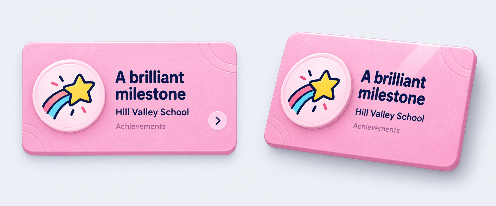
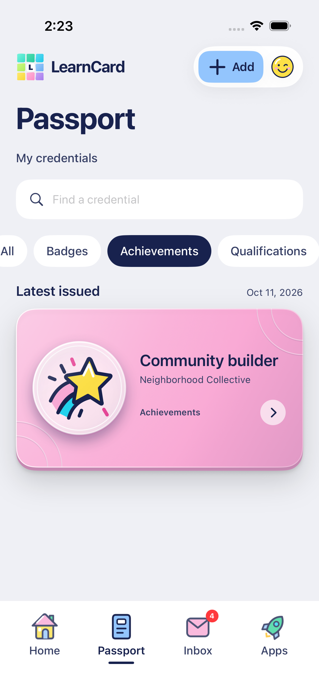
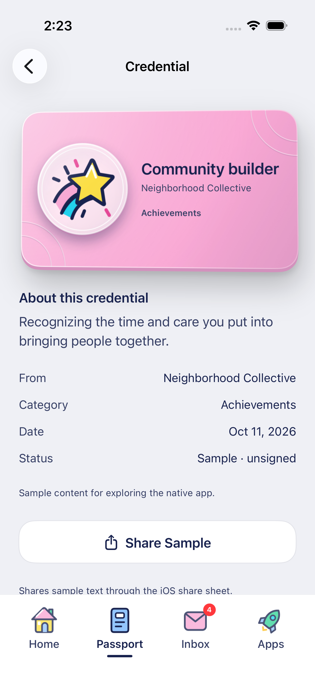
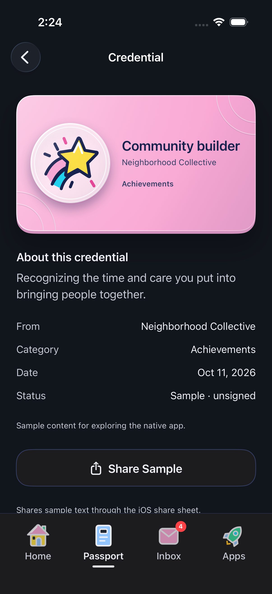
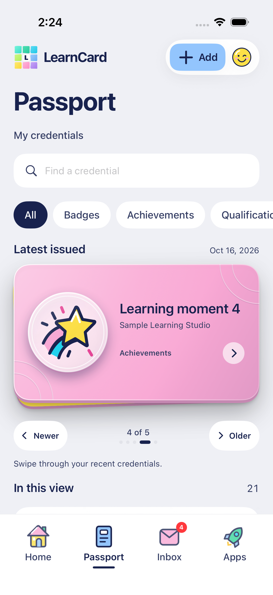

# Credential card depth — October 16, 2026

The user found the solid category cards flat, the automatic detail tilt/reflection too faint, and the trophy illustration unappealing. They explicitly approved the rendered look of the new board because it makes the cards pop. This pass keeps the neutral app canvas and colorful category identities while giving the physical card a more visible surface and edge.

## Direction

Generated with the built-in `image_gen` tool. The [exact prompt](CREDENTIAL_DEPTH_PROMPT.txt) and board are retained here. The board is a design reference; production uses SwiftUI layers and editable SVG, not raster crops or its simulated paper texture.

- A same-color lower edge and soft cast shadow give each featured card thickness.
- Directional surface lighting and two shallow corner contours break up the flat fill without competing with text.
- The featured artwork window has a lighter category-tinted face, inset ring, lower edge and its own small shadow. Issuer-provided artwork remains intact.
- An original yellow shooting star with pink/cyan trails replaces the default achievement trophy throughout the category artwork system. It is a category placeholder, never a verification mark.
- Detail cards use a nine-second automatic loop with up to seven degrees of yaw and 3.2 degrees of pitch, a stronger diagonal reflection behind the labels and a shifting cast shadow. The moving light never washes over text or issuer artwork. There is one card; no extra detail stack or touch gesture.
- Static light/material cues remain with Reduce Motion. Looping motion/reflection pauses for Reduce Motion, VoiceOver, background and offscreen states. Native scrolling and claim controls keep their existing behavior.

## Implementation

`CredentialCardSurface.swift` owns the static light/contours. `DesignSystem.swift` composes the card edge, raised artwork and shared shadows. `CredentialDetailCard.swift` owns the isolated automatic light/tilt/shadow loop. `LatestCredentialStack.swift` retains real recent-record browsing while removing its heavy three-point white outline. `prepare-illustrations.ts` remains the source for both achievement SVG appearances.

## Verification

Six distinct focused UI cases pass across two runs. The final four-case run passes automatic rendered motion, identical still pixels in dark Reduce Motion, large-text scroll/claim, and five-card traversal/open/rewind. The preceding run also passes reduced-motion scroll/claim and mirrored Arabic dark browsing. The first stack-open attempt navigated to the right detail but XCTest retried a disappearing source query; the check now taps its confirmed visible center once and still asserts the chosen credential and rewind state. Final reflection light sits behind labels/artwork. The corner paths stay within the card bounds.

Actual native captures below use unsigned synthetic samples; no live credential/account write is part of this pass. The generated board above remains separate from these native screenshots. Native CI remains manual.

Release and Debug compile. The final Native Lab install matches all 48 build files and the original private account configuration; the separate checks simulator is shut down. See [exact run/install records](../TESTING.md#credential-surface-and-automatic-light--october-16-2026).
