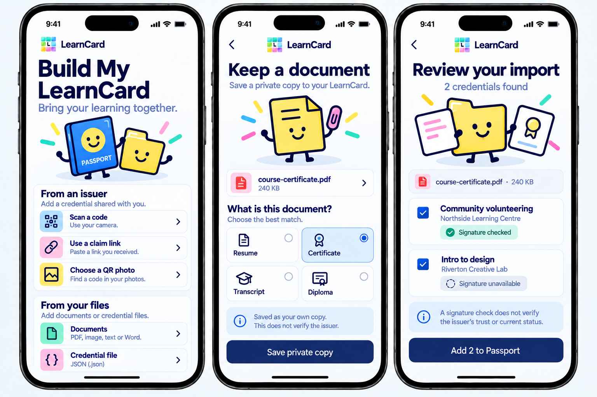
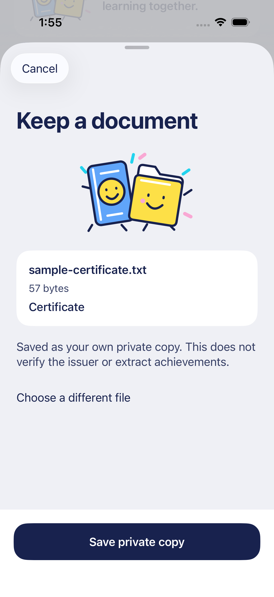
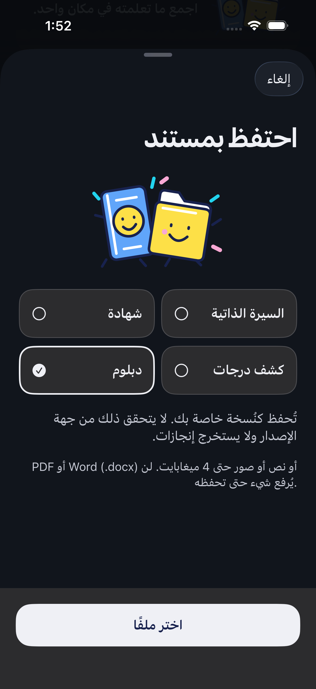

# Build My LearnCard file intake

October 16, 2026. Learner-focused document and credential-file intake extends the approved [Home/first-arrival direction](LEARNER_HOME_BRIEF.md). The design uses neutral adaptive pages, substantial navy typography, saturated Colorful objects and original editable SVG illustrations.

## Generated composition

This is a generated design reference, not an app capture. The composition separates From an issuer from From your files, keeps document-type selection visible and makes the review/save boundary clear. The right-hand reference image's decorative PDF filename is not the implemented credential input: existing signed credentials are imported from JSON. No pictured sample person, file or credential is written into the review account.

The native implementation uses SwiftUI and original `IntakeFolderIllustration` light/dark SVGs from `scripts/prepare-illustrations.ts`, rather than cropped generated artwork. Existing issuer claim routes and original credential artwork are retained. Documents are clearly labeled private personal copies; credential proofs do not become issuer-trust badges. Four-language/RTL, accessibility text, cancellation and background handling use the existing native patterns.

## Generation record

Created with the built-in **image_gen** tool. [Exact prompt](DOCUMENT_INTAKE_PROMPT.txt). The style reference was the approved `learner-first-arrival-concept-2026-10-16.png`, viewed before generation. Output was copied into this directory from `/Users/donny/.codex/generated_images/01a1300a-7718-7d23-a0ff-1e17e63f793e/exec-ce29ec6a-17c4-4efa-b1ce-e6edae9f5c6b.png`.

Behavior and limits are recorded in [the intake contract](../DOCUMENT_INTAKE.md). Native verification and actual synthetic captures are recorded after the focused checks in [TESTING](../TESTING.md).

## Actual native screens

These are synthetic simulator captures from production SwiftUI views, separate from the generated board. The file content boundary uses disposable in-memory samples; the real staging account receives no sample file or credential.

| Document review, English light                            | Document kind, Arabic dark at standard size                                    |
| --------------------------------------------------------- | ------------------------------------------------------------------------------ |
|  |  |

[Build My LearnCard file routes](build-files-native-2026-10-16.png) and [selected credential import review](credential-import-review-native-2026-10-16.png) are also captured. The unavailable proof label in the latter is deliberate: these disposable UI samples carry no valid cryptographic proof. Separate protocol tests use the actual SDK for signature checks and raw-artifact signing.

The [native original viewer](document-viewer-native-2026-10-16.png) is captured only after the test sees the actual synthetic document text, rather than merely its loading/close controls. The content assertion and dismissal pass in `intake-viewer-content-2026-10-16.xcresult`.
