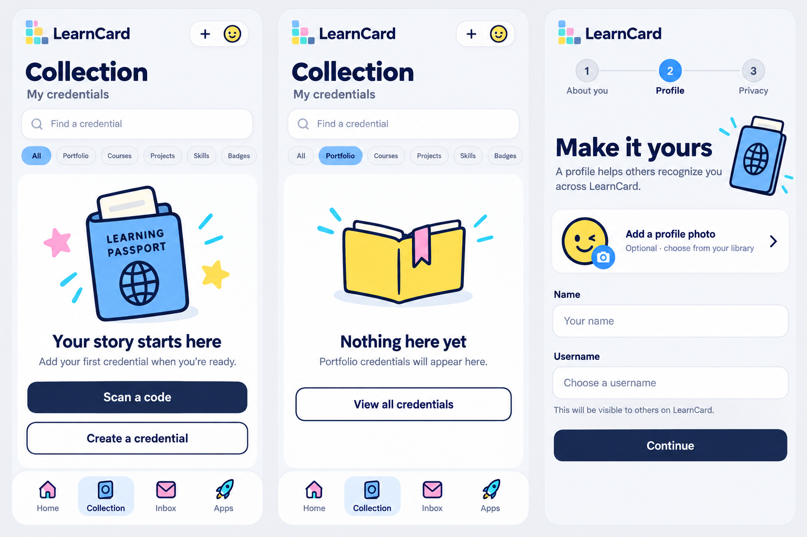
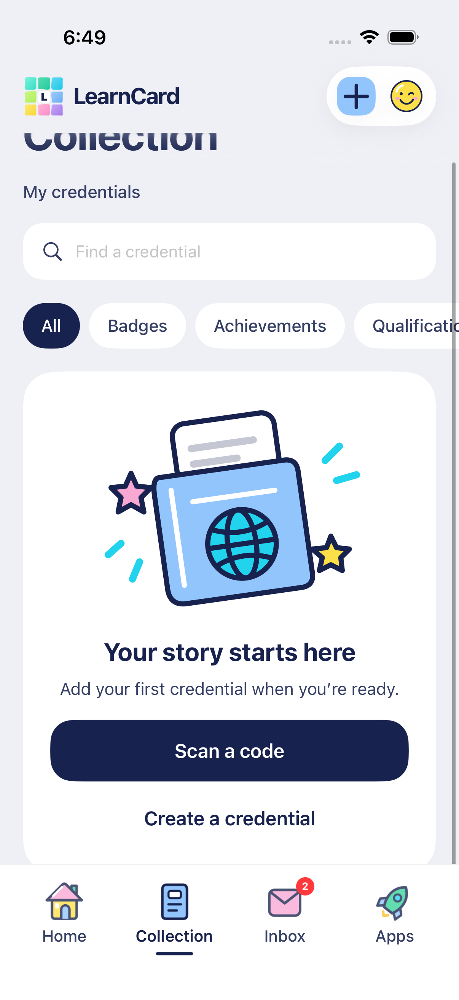
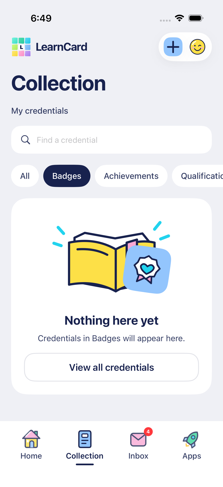
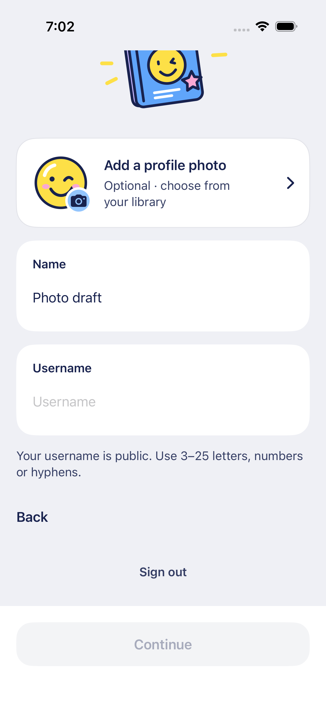
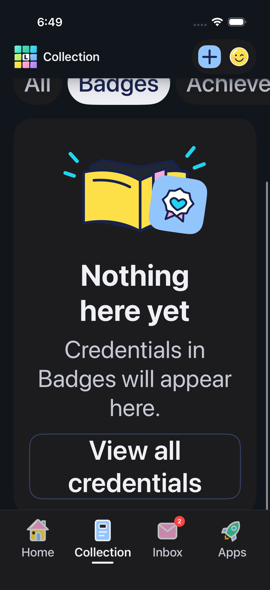
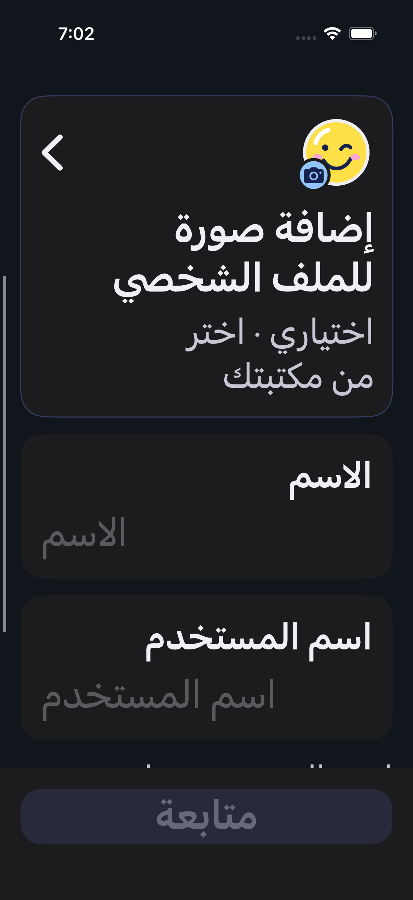
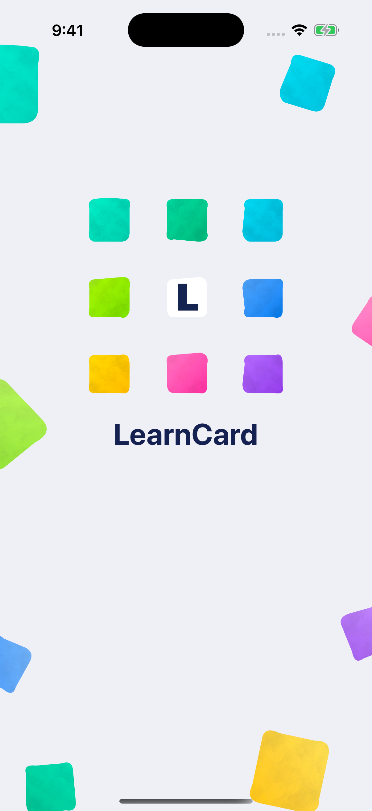
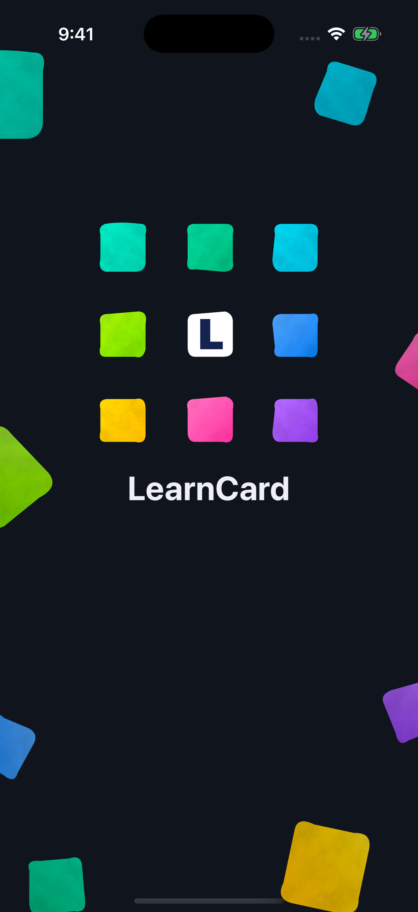
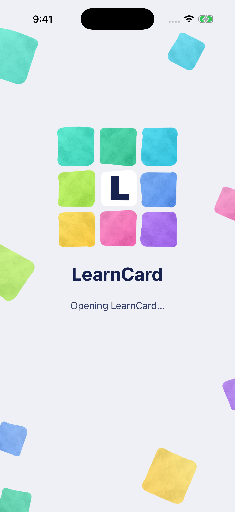
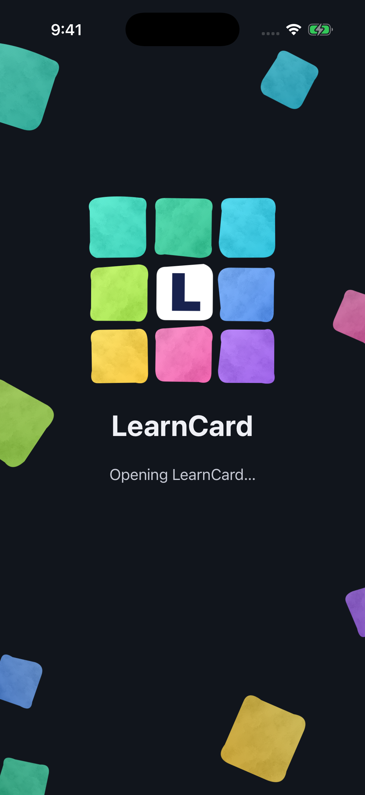

# Collection emptiness, launch continuity and signup photo

October 16, 2026. Follow-up to the user's category/search confusion, sparse new-collection artwork, contrasting launch screen and inactive signup thumbnail.

The built-in image-generation tool produced this reference using [the exact saved prompt](EMPTY_STATES_PROMPT.txt). Native implementation keeps the existing painted logo, real category vocabulary, active navy chips, typography and navigation tray. The board's invented Courses/Projects filters and altered mark are not adopted. Original editable SVG artwork ships from `scripts/prepare-illustrations.ts`; this bitmap is a composition reference.

- A genuinely empty collection gets a bold blue learning passport, concise welcoming copy and explicit Scan/Create routes.
- An empty category gets a drawn book/folder with the actual category icon and color, category-specific copy and View all credentials. Focusing a blank search field does not turn it into a search failure.
- A nonempty query with no matches retains the magnifying-glass illustration and search reset. Incomplete pagination says nothing has loaded here yet and offers the existing Load More flow; it never asserts the whole account is empty.
- Signup's entire white photo row, including the round thumbnail and whitespace, opens the native picker. A blue camera badge and forward chevron clarify the action; removal remains a separate button. Draft and lifecycle protections stay in place.
- Launch uses an explicit adaptive storyboard, textured painted mark, LearnCard wordmark and shared size/position metrics. The first animated frame shows the same separated, visible tiles and eight edge pieces as the static splash; the logo gathers inward and continues its held stop-motion poses. Background pieces ease into their floating paths; status copy fades in below the stable brand. There is no minimum wait before account readiness. Accessibility sizes retain a compact, scrollable layout and Reduce Motion/VoiceOver show the assembled still mark.

The storyboard is generated by `scripts/prepare-motion-artwork.ts`, with layout values from `BrandMotion.swift`. It uses the same light `#EFF0F5` / dark `#11151C` canvas and pigment material as SwiftUI. Native launch resources are static; motion belongs to the running application. See Apple's [launch-screen configuration](https://developer.apple.com/documentation/xcode/specifying-your-apps-launch-screen) and [launch debugging guidance](https://developer.apple.com/documentation/technotes/tn3118-debugging-your-apps-launch-screen).

The cold-start investigation found that an integer-looking alpha string compiled to `1/255`, exposing black. The source now uses `"1.000"` and manual CI verifies both appearances in the compiled catalog. A stale launch snapshot on the disposable simulator also needed a simulator restart; no real review app was uninstalled. The later edge-art pass replaces negative center multipliers with explicit leading anchors so green blocks remain clipped at the edge instead of crossing the wordmark. See [the current launch and motion contract](../ACCOUNT_MOTION.md).

Verification evidence and actual simulator screenshots are recorded in [TESTING](../TESTING.md). Real review account data is preserved; these checks do not reset or enroll another account.

## Actual native screens

These are simulator captures of the implemented screens using synthetic data. The All state is scrolled enough to show both actions. The category illustration uses the current category icon/color; Arabic accessibility layouts retain full text and scroll naturally.

| Empty collection                                 | Empty category                               | Signup photo                                       |
| ------------------------------------------------ | -------------------------------------------- | -------------------------------------------------- |
|  |  |  |

| Category in Arabic, large text and dark appearance        | Photo row in Arabic, large text and dark appearance      |
| --------------------------------------------------------- | -------------------------------------------------------- |
|  |  |

Actual cold start: [light appearance](cold-launch-native-light.mp4) · [dark appearance](cold-launch-native-dark.mp4). These recordings include the OS-controlled static launch and the running animation, with no account/network operation. They verify the corrected canvas; they do not measure real sign-in time.

## Updated static splash and inward assembly

The later October 16 pass carries the eight painted edge accents and LearnCard name into the static launch. Tiles start visibly separated, then gather inward; they no longer open outward before assembly. The name stays in place and appears once. Explicit leading constraints keep green accents at the edge, clear of the brand. Build 2 refreshes the launch catalog cached by earlier same-version simulator installs; no account removal is needed.

| System splash, light                            | System splash, dark                           |
| ----------------------------------------------- | --------------------------------------------- |
|  |  |

| Running loading screen, light                      | Running loading screen, dark                           |
| -------------------------------------------------- | ------------------------------------------------------ |
|  |  |

Updated actual cold starts: [light appearance](splash-continuity-light.mp4) · [dark appearance](splash-continuity-dark.mp4). Static captures use the debugger-wait launch to inspect the OS-owned screen; the clips launch normally. These are synthetic review modes, with no live account operation or artificial production delay.

## Live review

After the user unlocked macOS, the updated real review account opened Home with the correct navigation order. The saved private signup-test credential remained present and opened with its description and signature-check status. The revised empty Badges category was also inspected. No repeat reset/signup or new credential was needed. The app is left on Home. An apparent self-connection prompt from the earlier test was skipped without creating a connection; prompt identity filtering/server generation remains a separate follow-up.
