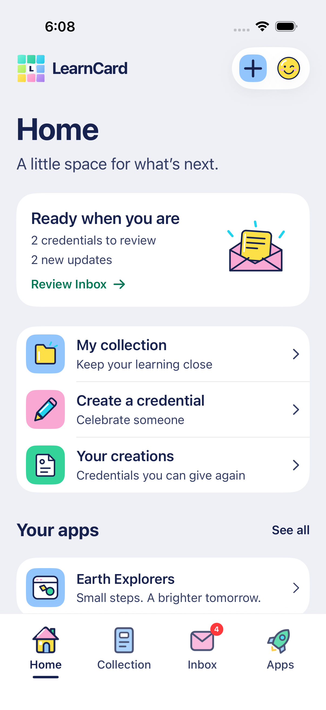
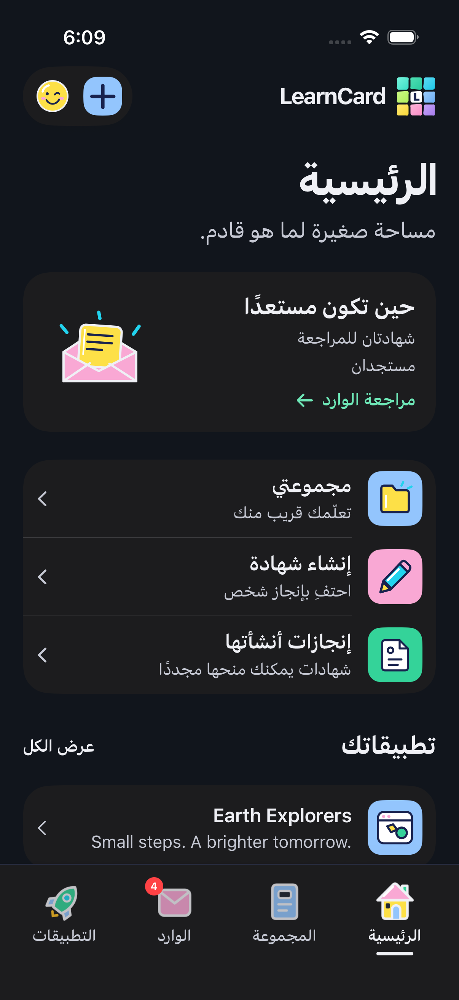
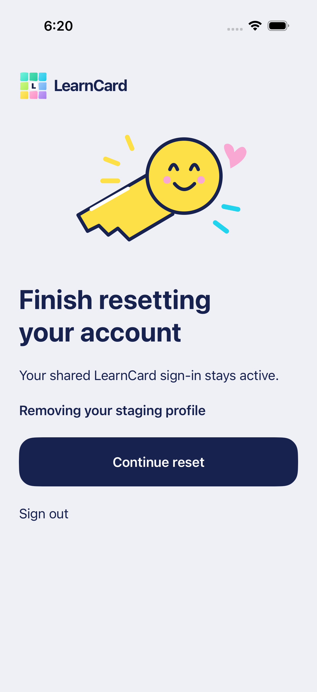
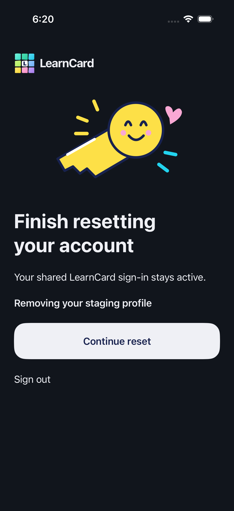

# Home entry and reset continuation

October 16, 2026. Following live signup review, Home becomes the initial signed-in destination and the first tab. Reading order is **Home → Collection → Inbox → Apps**; Arabic starts at the right edge. The existing [Home concept](home-drawn-concept-2026-10-15.png) remains the visual reference, with its earlier tab order superseded here.

The reset continuation button now explicitly pairs its adaptive foreground and fill. It no longer inherits navy text on navy. Light and dark screenshots were inspected for readable text and spacing; interaction checks require a usable button and successful continuation into setup. No real reset is performed by these fixtures.

These are actual simulator screenshots using synthetic account data, not generated mockups:

| Home, English light                                              | Home, Arabic dark                                                                   |
| ---------------------------------------------------------------- | ----------------------------------------------------------------------------------- |
|  |  |

| Reset continuation, light                                                 | Reset continuation, dark                                                 |
| ------------------------------------------------------------------------- | ------------------------------------------------------------------------ |
|  |  |

The full local regression run passes 153 Bun, 129 Swift and 84 simulator cases, with one intentional live-exchange skip. Ten native-issued credential outputs also pass independent web-SDK signature verification. See [testing evidence and limits](../TESTING.md), [Home behavior](../HOME_INTEGRATION.md) and [live reset/signup scope](../ACCOUNT_DELETION_AUDIT.md). Second-device backup recovery and full staging-web UI parity remain separate live checks.
