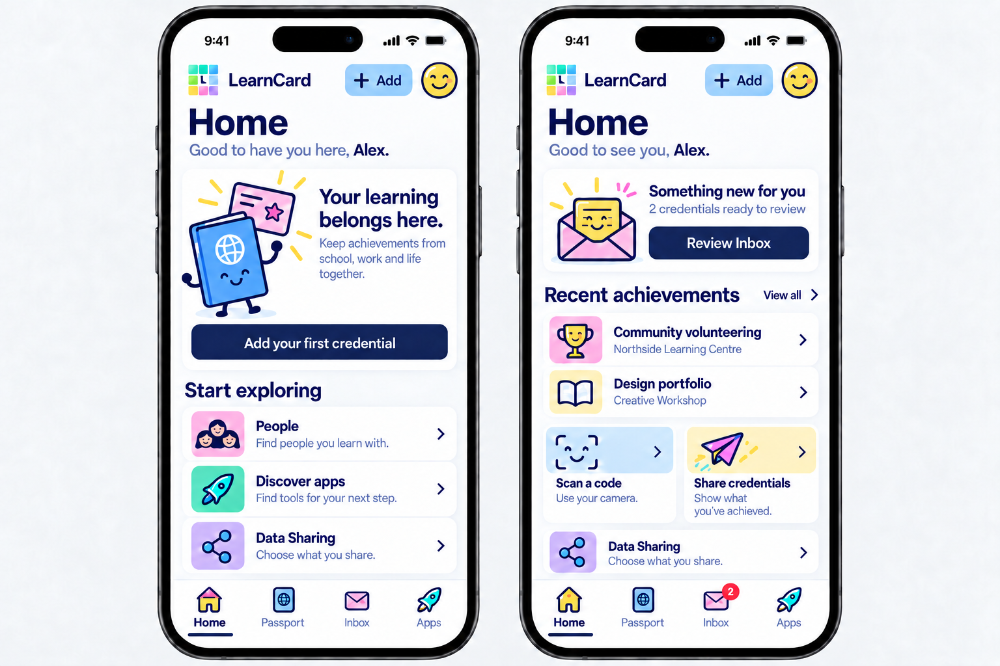
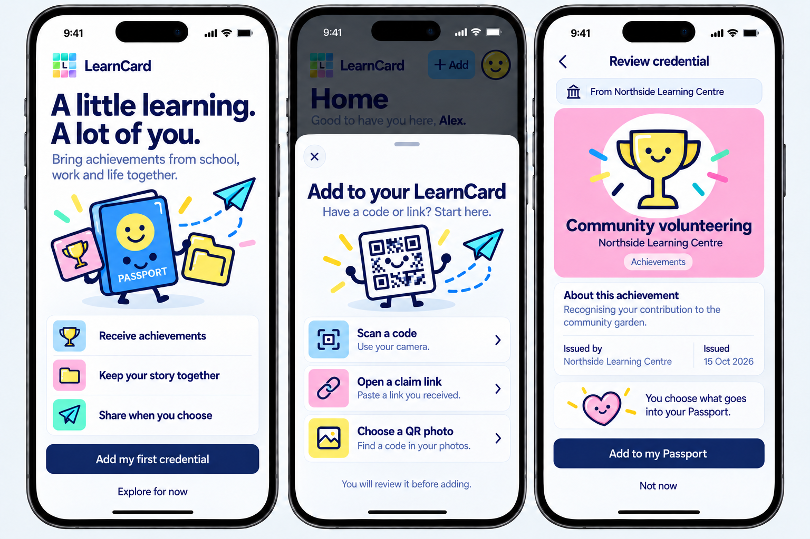
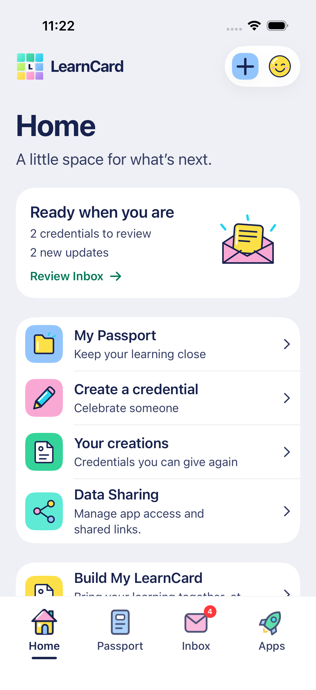

# Learner Home and first arrival

October 16, 2026. The user selected the learner experience as the immediate priority and approved the visual direction of these generated boards. The personal destination is now named **Passport**, matching web and distinguishing it from shared credential collections. The app's naming change is implemented; the new Home and optional welcome below remain design references awaiting implementation.

## Home for a new and returning learner

The new learner gets a useful first action and an approachable explanation. Returning Home prioritizes incoming credentials, recent personal achievements and scan/share actions. People, consumer Apps and Data Sharing remain accessible. Create/Your creations stay available through secondary tools; their placement and the existing action menu need a deliberate implementation pass rather than removal of capabilities.

The header concept labels its action **Add**, avoiding the ambiguity of an isolated plus. It leads to the intake choices below. The profile smiley remains a separate Account action. Keep the existing four-tab order: **Home / Passport / Inbox / Apps**. Data Sharing remains an easy-to-find Home action; People and Families remain accessible even when not visible in the returning Home's first viewport. Installed apps belong below the initial learner tasks and should use supplied publisher artwork.

## First arrival and intake

These three screens are not a mandatory three-step wizard:

1. **Optional welcome after required setup:** one brief explanation, Add my first credential and Explore for now. The three illustrated lines explain value; they are neither buttons nor progress steps.
2. **Add to your LearnCard:** designed sheet with three existing native routes: camera scan, pasted claim link and locally decoded QR photo. The whole row is actionable. Camera permission follows the camera action, not simply opening this sheet.
3. **Direct claim review:** if a claim is already pending, bypass welcome and resume explicit review after account, recovery and guardian requirements. The card has one active face, no fake stack or unsupported trust badge. Accepting and declining remain deliberate.

Required birth-date/country/profile/privacy/recovery and guardian behavior is unchanged. This is activation after account setup, not replacement signup. Do not add a mandatory role picker, document upload, sample records or a demo-account login. Build My LearnCard stays optional and can reuse the intake surface. A credential's issuer, evidence and authenticity must not be inferred from its decorative artwork.

## Implementation contract

- Show the new-user composition only after relevant reads succeed. Loading, failed reads and incomplete pagination cannot establish an empty Passport or an empty Inbox. Existing holders may still have no pending offers, and returning learners may have no installed apps.
- Use actual pending/unread state and available recent records. Board names, records and counts are synthetic composition examples; no sample person or credential should enter the real account. Do not imply the first loaded page is a complete total or introduce invented learning scores, goals or percentages.
- Ordinary sign-in/resume must not replay welcome. Scope optional activation/dismissal state to the account; make it revisitable and preserve pending claim intent. Revalidate on background/resume and ignore late replies after lock, sign-out or account replacement.
- Share opens the existing personal credential picker and explicit publication flow. It does not issue a new credential or give a connection access to private records. Disable or explain sharing when no actual eligible records exist.
- Keep native data and route identifiers stable. The visible Passport rename preserves `collection` wire values, stable tab tags, accessibility IDs, asset names and models. Shared collection/link terminology is not renamed by this change.
- Implement artwork as original editable SVG/light-dark assets and controls as SwiftUI, never crops from these raster boards. Preserve supplied user/credential/publisher images. Ordinary pages keep neutral adaptive canvases and saturated Colorful objects; no floating navigation island or perpetual Home animation.
- Adapt the composition to narrow phones, iPad, dark appearance, four languages/RTL and Dynamic Type. Long issuer/title text wraps; do not squeeze every sample section into one viewport or reproduce gradients/shadows literally. Normal Arabic previews use the same standard text size as English, separately from accessibility stress checks.

Before shipping the redesign, verify fresh and returning states, pending claims, interrupted setup, welcome skip/revisit, real empty/error/loading states, large-library recent selection, navigation, sharing, Data Sharing and account lifecycle. Current UI verification for the naming change does not validate the unimplemented Home concept.

## Current app naming verification

These are actual synthetic simulator captures of the existing Home with the implemented Passport label, not the new Home composition:

| English light, standard text size                                                  | Arabic dark, standard text size                                                    |
| ---------------------------------------------------------------------------------- | ---------------------------------------------------------------------------------- |
|  |  |

The focused run passes four Swift cases and two existing Home UI cases, covering localization resources, navigation sizing/order, English light/Arabic dark and the existing Inbox/Passport/creator destinations. Private configuration was restored byte-for-byte. These results validate the naming change; the proposed learner Home/welcome still needs implementation and its own checks.

## Generation record

Generated and refined with the built-in **image_gen** tool; no CLI/API fallback. Old Home and signup boards were visual references only. Exact initial prompts are [Home](LEARNER_HOME_PROMPT.txt) and [first arrival](LEARNER_FIRST_ARRIVAL_PROMPT.txt); [refinement prompts](LEARNER_REFINEMENT_PROMPTS.txt) record the affordance/copy/nav refinements and final Passport naming.

The initial artwork's false "instantly" claim and numbered/chevron welcome rows were corrected. Final boards preserve review-before-add and distinguish static explanations from real actions. Original and intermediate outputs remain in the generator's storage and ignored local artifacts; the two selected boards are saved beside this brief.

Organization workspaces remain a separate [planning proposal](../WORKSPACES_PLAN.md), outside this learner UI slice. Live Apple/Google activation and demo login remain deferred.
