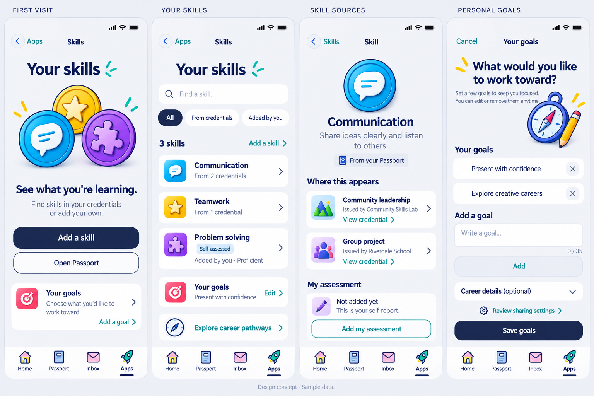
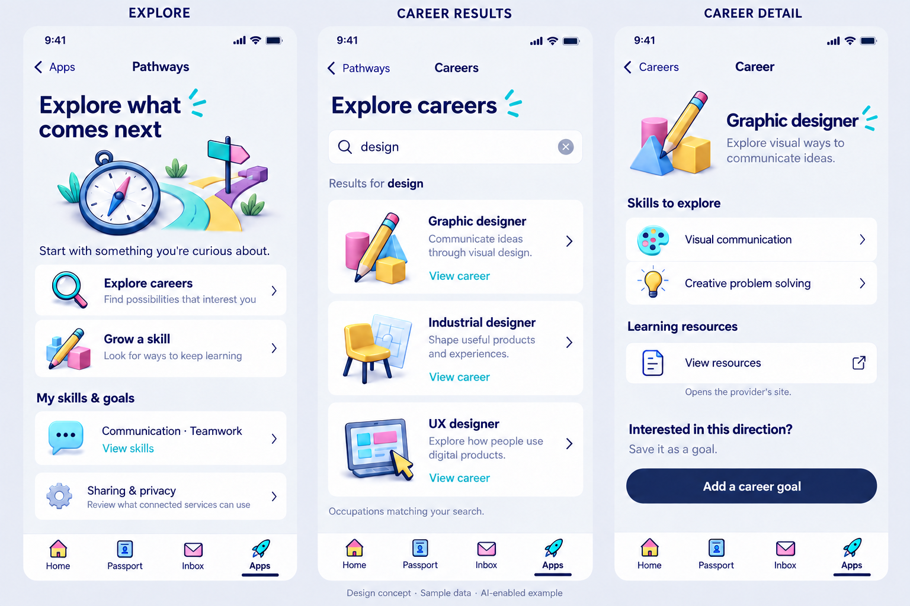
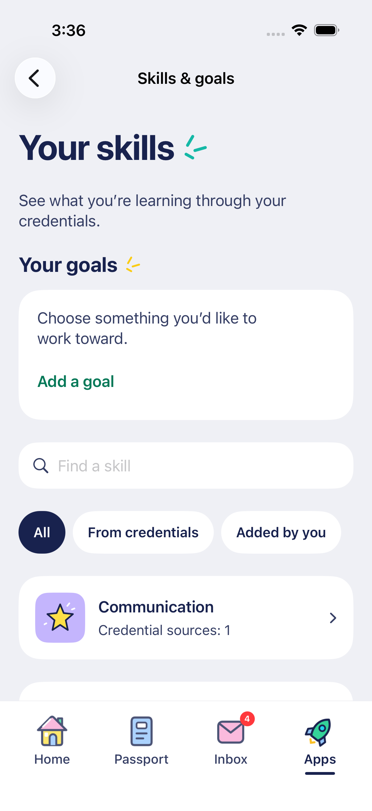
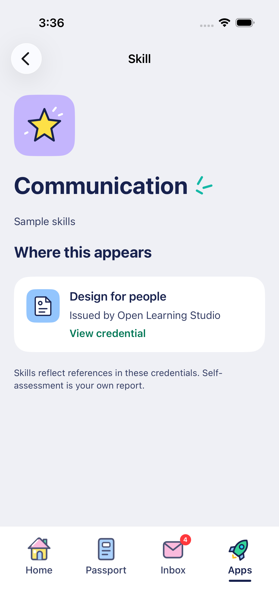
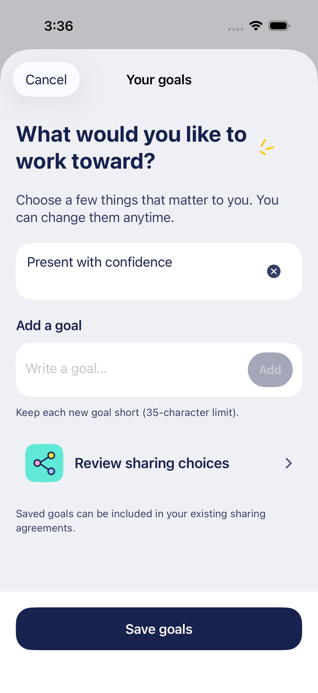
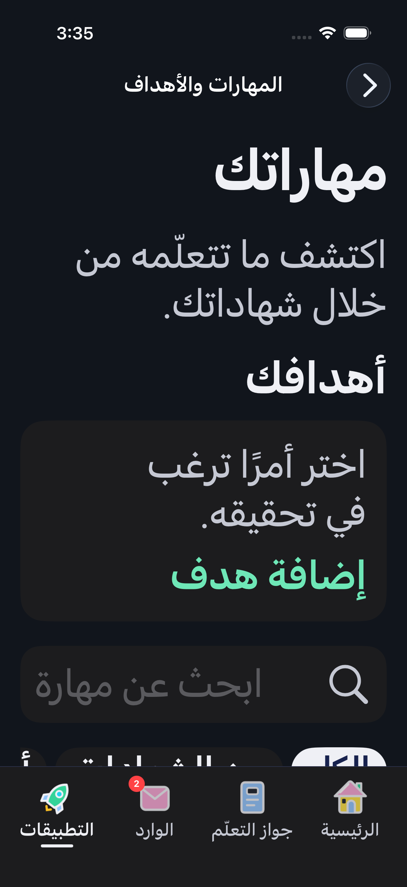
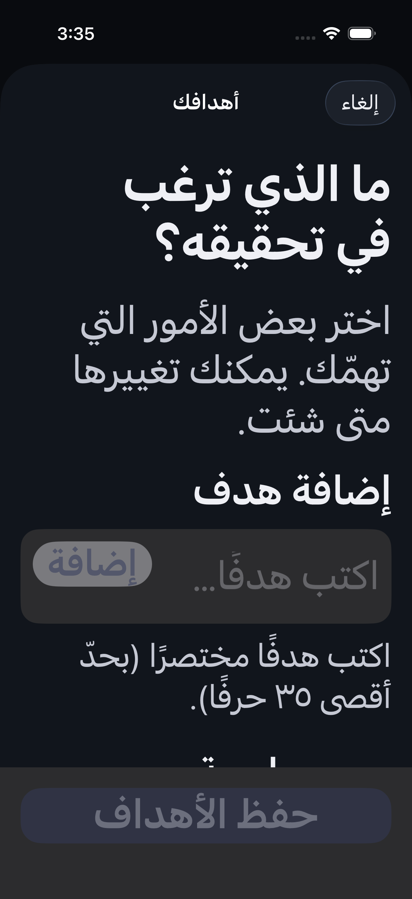

# Learner Skills, goals and career exploration — October 18, 2026

The user asked to resume the planned learner-learning features. This first design pass follows the [learning queue](../LEARNER_LEARNING_PLAN.md) and [source audit/implementation contract](../LEARNER_SKILLS.md). It uses the approved rendered artwork, flat reading panels, small heading rays and existing four-tab shell. These are generated concepts with sample data, not native screenshots or live personalized results.

## October 18 implementation refinement

The user approved proceeding but found some new graphics inconsistent with the rest of the app. The implemented Skills/goals slice therefore uses the existing outlined category star and Drawn credential/share tiles. Flat panels, heading rays and navigation remain shared. The generated glossy medallions/compass are composition studies, not production assets. Career exploration stays a subsequent integration.

The goal form also uses a smaller title and places its Add action beside the field, keeping it visible when the keyboard opens. Actual native captures and verification are linked below after the generated references.

Live account reads exposed a much longer Skills list than the sample board. The native hub places a compact goal summary above search/list content, with a first-goal preview and total count; the editor shows all saved goals. This keeps goals discoverable without forcing the learner through the whole list.

## Personal Skills and goals

| Screen         | Purpose                                                      | Behavior to preserve in implementation                                                                                                                     |
| -------------- | ------------------------------------------------------------ | ---------------------------------------------------------------------------------------------------------------------------------------------------------- |
| First visit    | A useful invitation without demanding a professional profile | Add a supported personal skill, open Passport or set an optional goal. Do not claim absence until reads finish.                                            |
| Your skills    | Browse credential-linked and self-added skills               | Search and filter by real provenance; identify self-assessment, preserve source identities and open actual skill details.                                  |
| Skill sources  | Explain why a skill appears                                  | Link actual source credentials and their issuers; show self-assessment separately. A source count is not a mastery/verification score.                     |
| Personal goals | Edit a small set of learner-chosen goals                     | Load existing freeform goals, keep edits local until Save, preserve data on failure and provide access to sharing choices. Career details remain optional. |

## Career exploration after Skills

This is the career Pathways destination, distinct from step-by-step Journeys. Explore careers and Grow a skill are entry concepts; enable only real supported destinations. Search results show illustrative occupations without invented salary, job-growth or personal match scores. Career detail can lead to real learning resources and an editable goal review. Opening a career is not consent to start a session or analyze uploaded documents.

Both Skills & goals and career exploration belong in a first-party learning group within Apps. Preserve Home / Passport / Inbox / Apps. A later Home continuation uses actual personal state and availability. Journeys, Sessions and Insights each retain their separate integration checkpoint; do not fill the Apps screen with unavailable placeholder tiles.

## Translating the concepts

- Follow [the shared design system](DESIGN_SYSTEM.md), not generated geometry literally. Keep ordinary reading/action panels flat, navy pill controls and limited local depth in illustrations. Use native SF typography and actual shared tray assets rather than replacing them with the generated icons.
- The goals concept's decorative heading rays sit on the leading side; production uses the established trailing-side modifier, including RTL/accessibility behavior. Primary buttons use the adaptive paired ink/fill tokens, with no decorative sheen behind labels.
- Long titles, translated content and large text expand vertically. Keep action trays, settled bottom clearance and 44-point minimum hit targets; a full-screen generated form is not a new sheet/safe-area convention.
- “From credentials” and “Added by you” must use real source classification. Personal self-assessment may coexist with an institution-linked skill. Neither implies issuer trust or endorsement. Use supported framework identity and distinguish unavailable originals from absent data.
- The goal limit shown is provisional UI copy tied to the current web input behavior; settle Unicode-compatible validation and preserve existing longer entries. Do not silently rewrite goals, drag-reorder them or persist per-keystroke.
- Sharing choices must open the actual Data Sharing controls. Existing agreements may receive profile changes. Avoid blanket private/public claims and automatic consent/AI side effects.
- The career board depicts an already AI-enabled sample context. Loading, opted-out/age-unavailable AI, no results, failed reads, partial results, expanded optional career details, the supported-skill picker and dirty-form cancellation still need state designs before implementation. The concepts do not complete those checks.

## Generation record

Generated with the built-in `image_gen` tool; no CLI or external image provider was used. Images were copied into this design directory while preserving the originals in the generator output folder. Selected files are `learner-skills-concept-2026-10-18.png` and `learner-career-pathways-concept-2026-10-18.png`.

Exact prompt sequence:

1. [Skills initial prompt](LEARNER_SKILLS_PROMPT.txt), referencing the actual Apps surface hierarchy and credential material captures.
2. [Skills refinement](LEARNER_SKILLS_REFINEMENT_PROMPT.txt), editing the first Skills study with the Apps capture as the material/shell reference. The result above is selected.
3. [Career initial prompt](LEARNER_CAREER_PROMPT.txt), continuing the personal Skills composition.
4. [Career refinement](LEARNER_CAREER_REFINEMENT_PROMPT.txt), removing leaked instruction copy and the duplicate goal action.
5. [Career cleanup](LEARNER_CAREER_CLEANUP_PROMPT.txt), removing the repeated sharing heading. The result above is selected.

The credential reference was used for artwork/material only; its older detail hierarchy is not a proposed information order for these screens. No production icons or runtime assets were replaced. Native implementation, account round-trip testing and real provider results remain subsequent work.

## Implemented native screens

The first Skills/goals slice uses established native artwork and actual production views/stores with isolated synthetic services. These captures contain sample credentials/goals, not the retained review account's personal data. See [behavior and remaining integrations](../LEARNER_SKILLS.md) and [exact local checks](../TESTING.md#personal-skills-and-goals--october-18-2026).

| Native Skills                                  | Source detail                                   | Personal goal draft                                |
| ---------------------------------------------- | ----------------------------------------------- | -------------------------------------------------- |
|  |  |  |

| Arabic dark accessibility3 Skills                                                | Arabic dark accessibility3 goal sheet                                                         |
| -------------------------------------------------------------------------------- | --------------------------------------------------------------------------------------------- |
|  |  |

The goal Add button is beside the field at standard type sizes and remains on its mirrored side in RTL. Disabled controls use reduced opacity. The sheet explicitly receives locale, direction and text size from the presenting screen; translated labels alone are insufficient evidence. Shared heading rays hide at accessibility sizes. Career-result artwork/screens above remain unimplemented concepts.

[Compact 375-point goal editor](personal-goals-compact-native.png): the capture is scrolled after adding a draft, so its upper heading is naturally under the navigation bar. The saved-goal/reopen/discard check passes with the keyboard and fixed footer on this shorter viewport.
