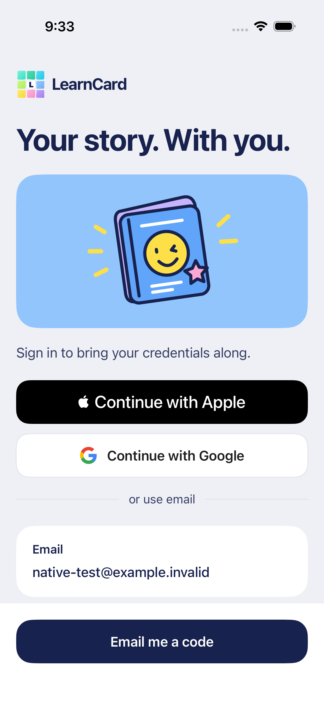
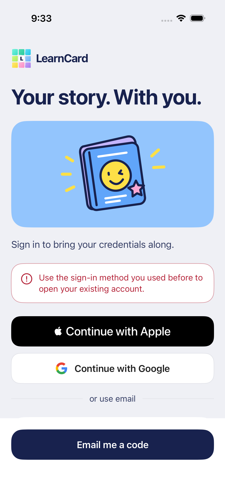
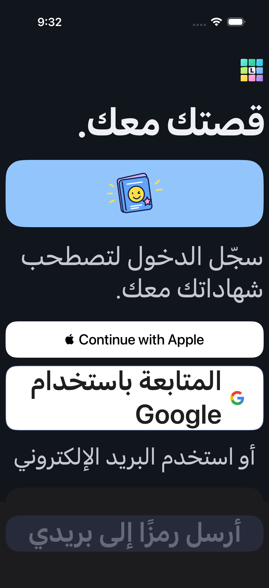
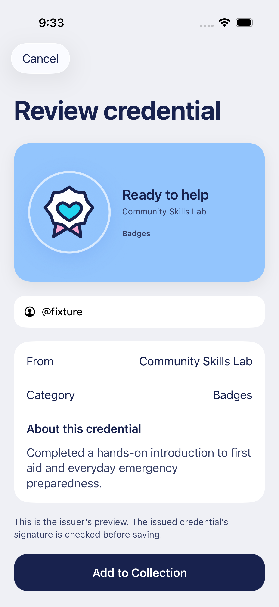

# Native sign-in controls

Actual iPhone 17 Pro / iOS 26.4 screenshots from the production account screen and controller, with DEBUG-only synthetic provider boundaries and an isolated Keychain. No Apple/Google login, live account or token is represented. These were visually inspected for readable branding, action hierarchy and accessibility wrapping.

The official Apple control and Google's existing official mark sit between the drawn passport and editable email. The fixed tray retains the email-code fallback. A provider conflict remains an actionable email screen:

Arabic, dark appearance and accessibility text wrap without horizontal clipping. Apple's system control follows the iOS application/system language, which remains English in this fixture; the app's Arabic preference translates the surrounding copy and Google label.

Provider sign-in and required recovery return a pending credential to review. Acceptance remains explicit:

See [behavior, registration and remaining manual gates](../NATIVE_SIGN_IN.md) and [test evidence](../TESTING.md).
