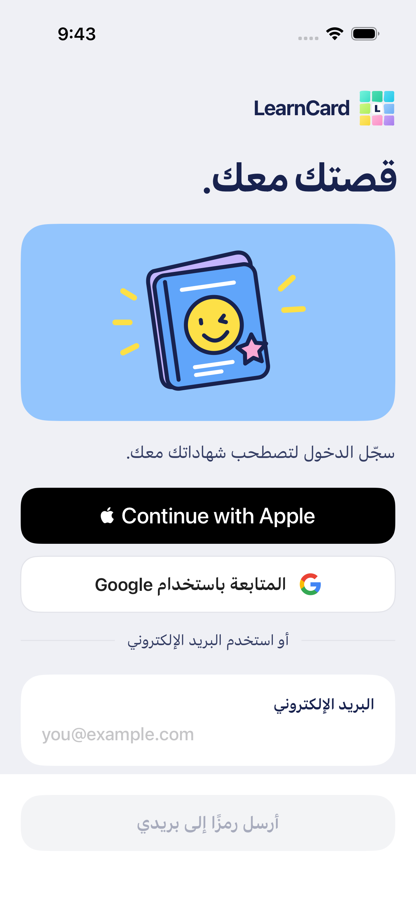
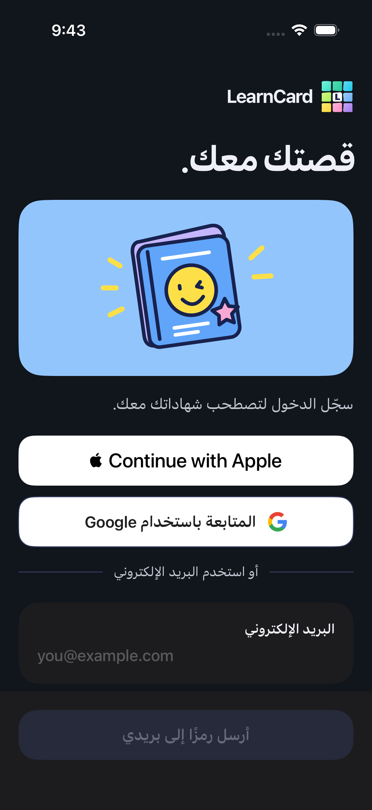

# Native sign-in controls

Actual iPhone 17 Pro / iOS 26.4 screenshots from the production account screen and controller, with DEBUG-only synthetic provider boundaries and an isolated Keychain. No Apple/Google login, live account or token is represented.

The default-language previews below use the **same standard iOS text size**. The earlier giant Arabic image forced `accessibility3` through `--large-type`; it was an enlarged accessibility stress test. It did not represent default Arabic typography. Ordinary app launches continue to follow the user's system text size.

English at standard text size:

Arabic at the same text size:

Arabic dark appearance at the same text size:

The official Apple control and Google's existing official mark sit between the drawn passport and editable email. Empty email keeps the email-code action disabled; provider actions remain available. Apple's system control follows iOS application/system language, which remains English in these fixtures; the app's Arabic preference translates the surrounding copy and Google label.

A provider conflict remains an actionable email screen:

The **deliberately enlarged accessibility stress test** is kept [as a separate capture](native-sign-in-arabic-accessibility.png). Its button wrapping and cancellation check still pass. Do not compare its font scale with the standard English/Arabic previews above.

Provider sign-in and required recovery return a pending credential to review. Acceptance remains explicit:

See [behavior, registration and remaining manual gates](../NATIVE_SIGN_IN.md), [the design-system review rule](DESIGN_SYSTEM.md#language-previews) and [test evidence](../TESTING.md).
