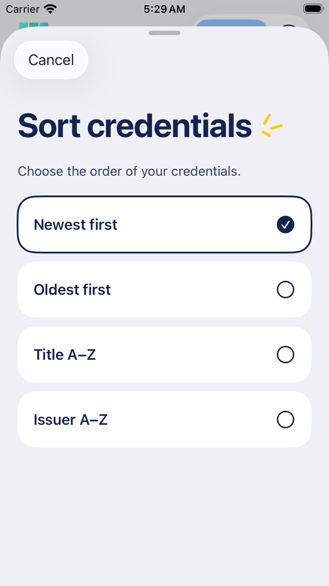

# Passport browsing and credential identity

October 17 review: an individual issuer name such as “Timmy” was ambiguous on the card, and the Passport only supported text/category filtering with newest-first ordering.

## Identity and date

Cards and shared list rows explicitly say **Issued by _name_**. Preserve supplied names and credential titles verbatim; an issuer is not necessarily the person who delivered the credential. The runtime adapter already resolves the actual credential issuer, so this pass changes presentation rather than identity semantics.

Show **Issued _date_** below the category, as quiet metadata. This fits narrow list rows without putting a trailing date beside a long title. Cards use the same wording and put the date in the footer. The detail metadata labels are **Issued by** and **Issue date**. Date formatting follows the chosen locale.

`Credential.issueDate` exposes the existing model date only when it is known. The adapter uses the credential's `issuanceDate` or `validFrom`; epoch zero means unavailable. Omit unavailable dates on cards/rows and say “Unavailable” in detail. Date filters exclude those records, while both chronological sorts keep them last. These labels add no issuer-trust or status claim; existing verification caveats remain.

## Browsing controls

Keep search followed by two compact controls: **Issue date** and **Sort: _current order_**. Category chips remain directly below. Active date/sort choices receive a quiet outline, a date summary shows the applied interval, and Reset filters & sort restores categories/date/newest ordering without clearing typed text. The existing Clear search flow can restore the full browsing state.

Issue date opens a designed sheet with Any date, Last 30 days, This year and Custom dates. Custom dates are inclusive calendar days, with From/Through controls. Apply commits the draft; Cancel discards it. Sort opens a matching single-choice sheet for Newest first, Oldest first, Title A–Z and Issuer A–Z. Choosing an order applies it and closes the sheet. Controls wrap/grow with text, and sheets support RTL and Dynamic Type.

Text, dates and non-default sorting show a straightforward result list instead of the recent stack, so the selected order is visible. Browsing an ordinary category retains its recent stack. Text matches all whitespace-separated terms across title, issuer and description, ignoring accents/case and respecting the selected locale. Families stay separate.

## Paged accounts

Reuse the existing read-only `CredentialPickerLoader` and `CredentialPickerQuery`, including calendar boundaries and deterministic sorting. Search, category/date filters and non-default sort check remaining pages automatically; unfiltered newest browsing keeps explicit Load More. While more pages exist, result counts explicitly say loaded matches, and paging text says the result set is incomplete. Failure stops automatic paging and offers explicit retry. Cancelling/leaving the page stops before another page begins; one already-started read may finish. An empty loaded subset does not claim the whole account is empty.

Passport passes `live: false` to the query deliberately: its unreadable records must stay visible. Sharing still passes the real live-mode flag to exclude credentials whose original signed payload cannot be disclosed. Filtering/sorting never edits credential data or selections.

## Evidence

Focused verification and actual native captures are recorded in [TESTING](../TESTING.md). The root layout continues to reserve the tray as a sibling of TabView; metadata growth must not be compensated with guessed per-page tray padding.

These are actual native screens with disposable unsigned sample credentials:

| Passport results                                                            | Credential detail                                                                       |
| --------------------------------------------------------------------------- | --------------------------------------------------------------------------------------- |
|  |  |

| Compact sort sheet                                                               | Compact Arabic accessibility date sheet                                                               |
| -------------------------------------------------------------------------------- | ----------------------------------------------------------------------------------------------------- |
|  |  |

The last image is an accessibility stress preview, not the default Arabic scale.
