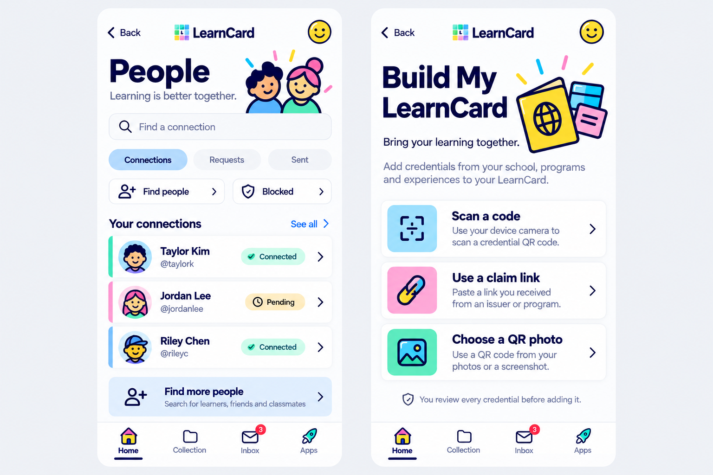

# People and optional intake — October 16, 2026

The user requested an obvious Home Scan action, Data Sharing beside the credential actions, and a destination for contacts and Build My LearnCard without a side menu. The built-in image-generation skill produced this composition reference using the approved Home board. Shipping SwiftUI uses new original SVG illustrations and the existing drawn smiley/image loaders.

## Implemented direction

Keep the neutral canvas, substantial navy type, bright Colorful tiles, clear full-row touch surfaces and the four-tab tray. Data Sharing is the fourth row of the main Home group. Scan a code now has a drawn scanner icon, useful description and chevron on a white card. Families retains its existing route and treatment.

People lives on Home, Account and Inbox; Inbox opens Requests. The native page separates Connections/Requests/Sent from Find people and Blocked management, with clear search/loading/empty states. Compact rows keep avatar/name/username/state together; accessibility sizes stack them. Supplied profile photos remain authoritative. A round smiley is the missing-photo fallback; two cheerful drawn faces illustrate the intro. Profile actions use real relationship state and explicit confirmation for removal/block/cancellation.

Build My LearnCard is optional intake after setup. The yellow passport/card illustration introduces three real routes: camera scan, claim link and selected QR photo. The link route focuses a field without starting the camera; photo opens the system picker. The existing review/confirm/retry contract stays authoritative. There is no invented completion score, AI upload placeholder or contact permission request.

This is the first intake slice, not full web document-processing parity. User-defined invitation QR, document extraction/raw JSON intake and profile-specific send/share tools remain separate. See [scope and source contracts](../PEOPLE_AND_INTAKE.md) and [validation](../TESTING.md).

## Native screen evidence

Actual simulator captures are collected from disposable demo fixtures, separately from the generated board. They exercise the production views and stores; no sample person is represented as a real user, and no live request, block or document upload is made. The final screenshots and installed-build evidence are linked from [STATUS](../STATUS.md).

- [Home action group with Data Sharing](people-home-actions.png)
- [Home People/Scan entries](people-home-scan.png)
- [Connections](people-connections.png)
- [Request profile](people-request-profile.png)
- [Arabic accessibility People](people-arabic-accessibility.png)
- [Build My LearnCard](build-native-intake.png)
- [Arabic accessibility Build My LearnCard](build-arabic-accessibility.png)
- [Explicit claim review from the hub](build-native-review.png)

## Generation specification

The built-in generator received `home-drawn-concept-2026-10-15.png` as the style reference. The requested two-screen board used a neutral `#EFF0F5` canvas, white surfaces, bold navy `#18224E` typography, saturated yellow/cyan/pink/mint/violet/blue accents, bold outline illustrations and round smiley fallbacks. People required search, Connections/Requests/Sent, Find/Blocked actions and compact left-aligned rows with explicit status. Build required an opening yellow passport, Scan a code / Use a claim link / Choose a QR photo, short descriptions and review-before-adding copy. No fake percentages, document/AI actions, device contacts, dramatic gradients or extra tab were requested.

Generated example names and avatars guide composition only. Native layout adapts to actual account records, localization, RTL, Dynamic Type, system pickers and existing navigation. The original vector sources live in `BuildIllustration`, `PeopleIllustration`, `DrawnPeople` and `DrawnScan` image sets.
