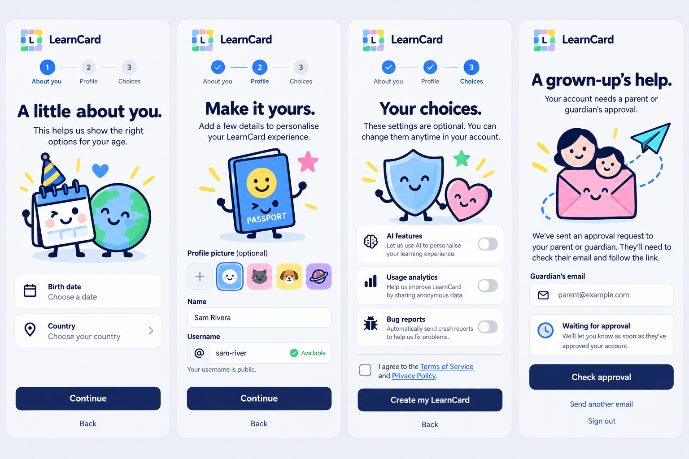
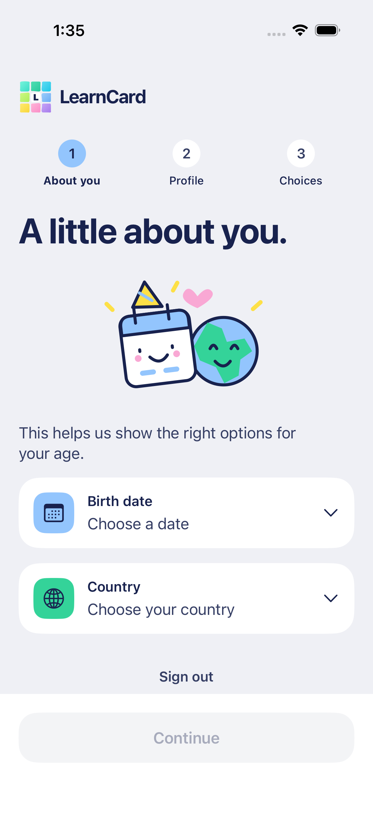
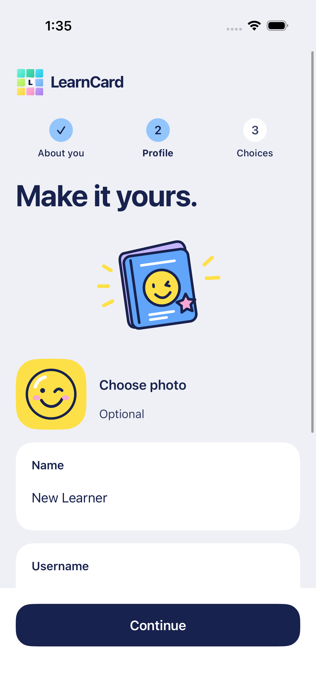
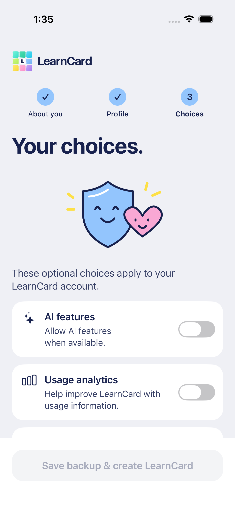
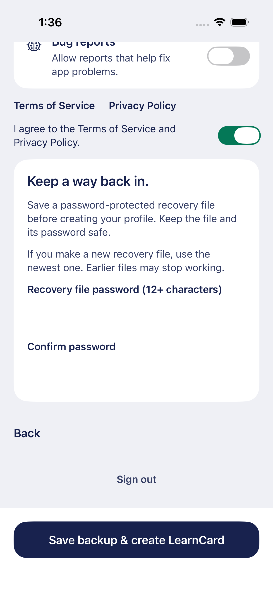
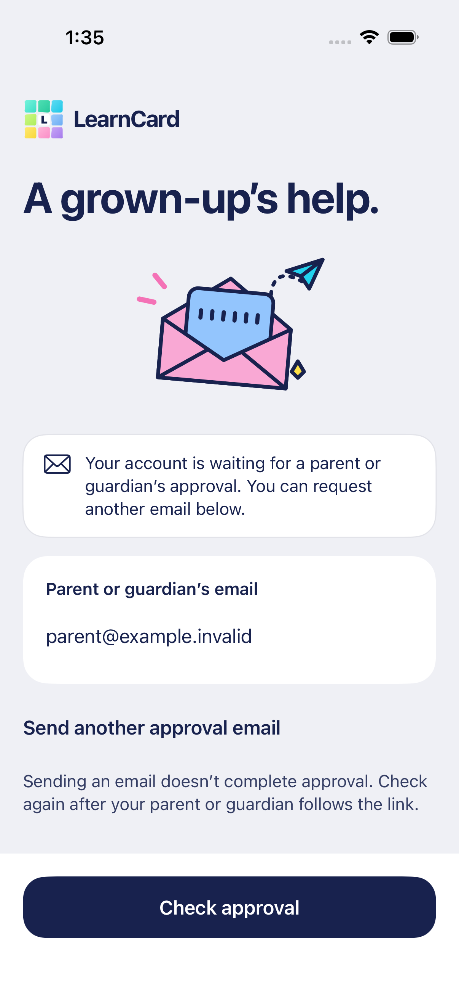
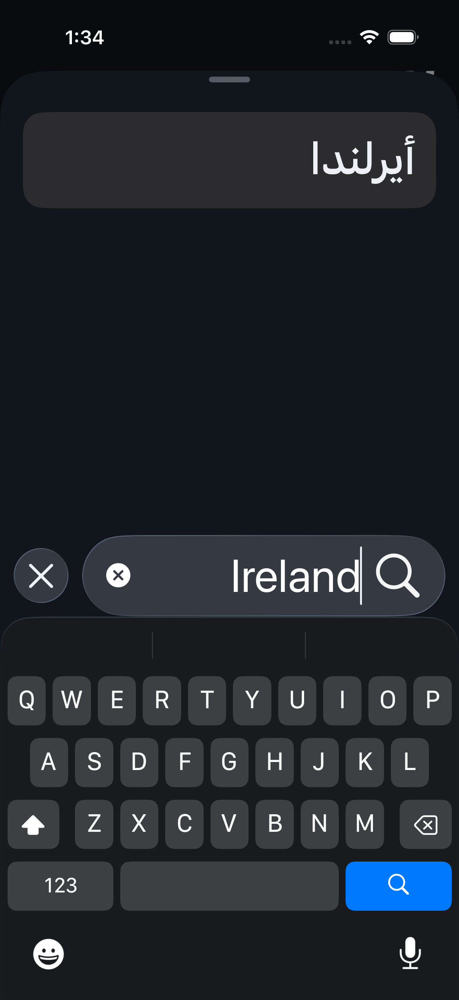

# First-time setup composition

October 16, 2026. The generated board explores the approved neutral canvas, vivid Colorful objects, substantial native type and drawn companions across About you, Profile, Choices and parent approval.

The [exact generation prompt](SIGNUP_PROMPT.txt) is preserved. Final artwork is original editable light/dark SVG generated by `scripts/prepare-illustrations.ts`: a calendar/globe pair and smiling shield/heart, alongside the existing passport, envelope and round smiley. No crops of this board ship as controls or icons.

The actual implementation uses persistently labeled fields, designed searchable country/date sheets, a compact three-step indicator and a fixed contextual action tray. Artwork yields space to accessibility text and keyboards. Nested sheets inherit locale, RTL and Dynamic Type. Forms keep quiet transitions; painted motion remains reserved for account waits.

The board's finalization/recovery shorthand is adapted to actual staging capability: no new email backup can be delivered with the current tenant settings, so Choices includes password-protected backup enrollment and a real system Files save. Profile creation waits for saved-file verification and SDK confirmation. Guardian waiting reads the server rather than presenting a fake completion screen. These are required functional adaptations, not optional decoration.

Representative implemented screenshots from the passing final simulator run use synthetic identities and passwords only:

See [the flow contract](../FIRST_TIME_SETUP.md) for lifecycle, policy and manual validation boundaries.
