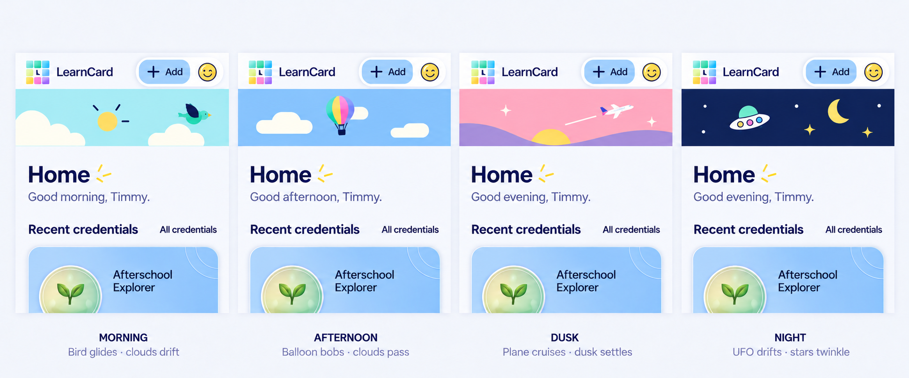

# Local-time sky refresh — design study, October 18, 2026

**Status: flat style preferred by the user; scene-visitor refinement proposed, not implemented.** The user rejected the current compact figure-eight plus “Refreshing…” label. They proposed a full-width particle treatment or a shallow local-time sky reveal, paired with morning/afternoon/evening greetings on Home.

The first two atmospheric imagegen studies were rejected as too detailed, mismatched with the app, and visibly AI-generated. Keep that correction: use sparse, graphic forms closer to LearnCard’s outlined illustrations. The dimensional credential card remains its own emphasized object.



The user prefers the flat style and suggested replacing arbitrary floating blocks with recognizable scene visitors. Brand colors are welcome where natural, not mandatory. [Earlier flat study](pull-refresh-sky-graphic-concept-2026-10-18.png).

## Proposed visual direction

- A shallow edge-to-edge strip appears between the shared header and page content during a pull/refresh. Idle pages reserve no decorative strip.
- Morning: aqua field, yellow sun, simple cream clouds and one small gliding bird.
- Afternoon: blue field, two pill-shaped clouds and one gently bobbing hot-air balloon. Broad LearnCard-color envelope panels provide a natural brand accent.
- Dusk: pink/lavender field, a small setting sun, first stars and a tiny plane with a short contrail.
- Night: deep navy, a small crescent, sparse stars and one drifting UFO. A few colored portholes echo the palette; omit the previous planet/meteor to keep this scene sparse.
- Remove the arbitrary floating blocks. Brand colors can live on the bird, balloon, plane or UFO, without requiring every scene to include every color. The header keeps the only logo. No visible refresh label or progress percentage.
- Motion should carry the effect: one slow visitor per scene, light cloud drift and restrained twinkle. Keep the visitor visible from the first revealed frame so a quick real refresh still has a complete composition. Avoid cinematic skies, volumetric clouds, glossy fantasy light, swarms and long arrival intros.

The board shows a proposed shallow reveal, not measured production refresh geometry. Validate the available native height before implementation; crop/scale the illustration to the real reveal rather than forcing scroll insets.

## Greeting and behavior audit

Native Home currently uses static `home.greetingName` / `home.greeting` in `ios/Sources/HomeAppsView.swift`.

The web dashboard helper is `apps/learn-card-app/src/pages/launchPad/LaunchPadHeader/launchPadHeader.helpers.ts`: morning 06:00–11:59, afternoon 12:00–17:59, evening 18:00–23:59, neutral Hello 00:00–05:59. Web Pathways Today has a different schedule and “Still here” late-night wording; do not conflate them.

Use device-local time for a future greeting/sky implementation, updating on foreground/time changes. Illustration phase can distinguish dusk from night while retaining an appropriate evening greeting. Exact sky phase boundaries remain a design choice; this does not require location permission or a weather service.

Preserve the established native `.refreshable` gesture, accessible refresh action, asynchronous lifetime and failure/retry states. Keep VoiceOver’s spoken operation feedback even when visible refresh copy is removed. Reduced Motion uses a still illustration; stop animation offscreen/inactive. Do not replace the stable refresh-operation reference or observe it in an outer accessibility modifier, which previously cancelled native work. See [the existing integration contract](PULL_REFRESH_BRIEF.md).

No app source, installed build, account data or tests change in this concept pass.

## Generation record

Generated with the **built-in image_gen tool**. The current app screenshot was the composition reference. The flat style is preferred. The current board is the fourth revision, adding the user-suggested visitors and removing arbitrary blocks; visitor details/motion are still a proposal. The earlier detailed skies are rejected references, not approved assets.

### Initial study prompt

```text
Use case: ui-mockup
Asset type: polished native iOS pull-to-refresh concept board for LearnCard; visual brainstorming, not production UI assets.
Primary request: Transform the tiny centered refresh ornament into an immersive full-width horizontal strip of living sky revealed only when the page is pulled down. Show four time-of-day variants, each integrated into the real Home layout. NO visible "Refreshing" word. This is a short delightful reveal, not a permanent banner.
Input image: the supplied screenshot is a composition and brand reference only. Preserve the recognizable LearnCard header, one mosaic wordmark, blue Add/profile pill, pale lavender paper canvas, substantial navy Home heading with three tiny yellow accent strokes, secondary greeting, Recent credentials header and a partial credential card below. Generate a NEW concept board; do not edit the source file.
Composition: one landscape board, FOUR equally sized native screen crops SIDE BY SIDE, no phone hardware. Each crop shows header, revealed full-bleed sky strip, Home title, local-time greeting, Recent credentials row and a small peek of a tactile credential. Clear small labels outside the app identify MORNING / AFTERNOON / DUSK / NIGHT. The atmospheric strip spans edge to edge of each app viewport, roughly 90–105 points tall on a 402-point phone, sitting BETWEEN the fixed app header and the page heading. No floating rounded card around the strip. The strip alone has a scene background; the header and reading content keep the familiar pale canvas. Give its bottom boundary a very subtle atmospheric fade, not an enormous gradient wash over the app.
Scenes: MORNING — warm peach light blending into aqua sky, a small golden sun and soft rounded fluffy clouds. AFTERNOON — fresh saturated sky blue, sculptural pillowy white clouds with gentle depth and small sunny highlights; a few tiny teal/yellow/pink particles riding the breeze. DUSK — a luminous apricot-to-pink-to-violet horizontal sky gradient, low sun, lavender cloud wisps and the first small stars. NIGHT — deep navy almost-black sky, a tactile crescent moon, a small distant ringed planet, sparkling pinprick stars and ONE slender shooting meteor crossing part of the strip. Use the colorful particle idea as a restrained connective accent, never a second mosaic logo.
Style/medium: refined, playful rendered illustration with soft tactile depth and luminous atmospheric color, consistent with the approved dimensional LearnCard credential artwork. Bold clean silhouettes at SMALL strip height, careful surface light, restrained fine grain. Existing UI stays flat, clear and native. NOT photorealistic weather, not a cartoon character illustration, not a generic flat icon set.
Text verbatim inside app: "LearnCard", "+ Add", "Home", "Recent credentials", "All credentials". Greetings respectively: "Good morning, Timmy.", "Good afternoon, Timmy.", "Good evening, Timmy.", "Good evening, Timmy." Greetings use smaller regular-weight secondary navy text beneath Home. Never put text over the sky.
Motion annotations OUTSIDE UI beneath the four crops: "Clouds drift · sun warms", "Cloud parallax · colored specks", "Cloud wisps · first stars", "Star twinkle · rare meteor". Illustrate motion through composition; avoid drawn arrows over product UI.
Constraints: exactly one LearnCard mark per screen, in the header. No spinner, no refresh words, no progress percentage, no second logo, no large title inside the reveal, no permanent space reserved when idle, no giant celestial objects overwhelming the shallow strip, no confetti explosion, no body-card diffuse shadows. The design should feel feasible for native animation and preserve legible existing content. The visual day phase and greeting are driven by the user's local time.
```

### Height refinement prompt

```text
Use case: ui-mockup refinement.
Edit target: the supplied four-column LearnCard morning/afternoon/dusk/night concept board.
Change ONLY the proportions and scene composition of the sky reveal: the existing sky regions are too tall. Reduce each sky strip to HALF its current height, approximately 80–90 native points at a 402-point viewport, aspect ratio about 4.5:1. Move Home, its greeting, Recent credentials and the credential peek UP to follow the shallower strip with the same modest spacing. Recompose the clouds and celestial objects for a shallow panoramic window rather than squashing them. The moon/planet should be small enough for this height, the meteor a fine glint; keep a few subtle LearnCard-color particles. Make the strip fully edge-to-edge within each app crop. Preserve the beautiful softly rendered atmospheric lighting and four distinct times of day.
Keep the four identical header layouts, exactly one LearnCard logo per header, blue Add/profile pill, native navy hierarchy, pale reading background, all exact text and time-specific greetings, the credential card material, and the four bottom labels/motion captions unchanged. No refresh word, no new UI, no extra icons, no new slogans, no phone hardware. The strip is revealed only during pulling/refreshing, not a permanent Home hero. Make a polished final comparison board.
```

### Selected graphic revision prompt

```text
Use case: ui-mockup, precise style refinement.
Edit target: supplied LearnCard four-column morning/afternoon/dusk/night Home mockup.
Critical user feedback: the detailed glossy skies look obviously AI-generated and do not match the rest of the app. Replace ONLY all four sky illustrations with genuinely SIMPLE GRAPHIC MOTION DESIGN. Keep every existing product UI element, exact text, four-column board, shallow strip dimensions, header logo, Home/greeting type and credential peek unchanged.
Art direction for the strips: crisp flat cut-paper/vector-like forms, large simple geometry, bold limited palettes, a few consistent navy #18224E line details. Think the same family as the app's outlined paper-plane, sunburst and smiley illustrations. The objects should be feasible as a handful of native shapes. Absolutely no volume-rendered cloud banks, no fluffy photorealistic atmospheric cloud textures, no cinematic sunset, no realistic lighting, no glowing highlights, no painterly brushwork, no airbrushed gradients, no scenery, no photo depth, no grain/noise, no sparkly fantasy wallpaper.
MORNING: pale warm aqua field, ONE small solid yellow sun disc with 3–4 short navy ray marks, ONE or TWO simple cream clouds made of three rounded overlapping lobes. Lots of open field. AFTERNOON: clean LearnCard sky blue field, TWO widely spaced solid off-white pill/cloud shapes, one tiny yellow sparkle. DUSK: a quiet two-color pink and lavender field, ONE small coral/yellow half-sun disappearing at the lower edge, ONE thin pill cloud, TWO tiny flat four-point stars. NIGHT: flat deep navy field, a SMALL simple lemon crescent, ONE tiny mint dot-planet with a thin ring, no more than SEVEN tiny white/yellow dots or short four-point stars; ONE minimal shooting-star streak made from two narrow straight lines and a small yellow dot.
Across the whole board, at most two tiny rotated LearnCard-color squares per strip, used as discrete geometric particles, not confetti. Reuse the same sparse shape vocabulary and consistent outline scale in every variant. Keep all celestial elements small and the sky ribbons genuinely shallow/full-width.
Do NOT simplify or change the approved dimensional credential cards underneath. Do NOT add mascots/faces to celestial objects. No "Refreshing" words, extra logos, labels inside the strip, progress bar or spinner. Preserve the four time-of-day greetings and the board's bottom labels verbatim. This should look intentionally designed by the same product illustrator, not like generic generated landscape art.
```

### Scene visitors revision prompt

```text
Use case: ui-mockup refinement.
Edit target: the supplied four-column FLAT GRAPHIC LearnCard morning / afternoon / dusk / night refresh concept board.
User-approved direction: retain the simpler flat illustrated style. The user wants recognizable tiny scene visitors instead of random floating color blocks.
Change ONLY the sky strips and the four bottom motion captions. Keep the exact existing app header, one LearnCard logo per header, Add/profile pill, Home headings, time-of-day greetings, Recent credentials row and approved dimensional credential cards unchanged. Preserve the shallow full-width strip dimensions and clear native hierarchy.
Remove EVERY floating colored square/particle from all four sky strips. Do not remove squares from the actual header brand logo.
Use ONE small readable visitor in each scene:
MORNING: one stylized small bird in mid-flight, with a teal/mint body, one simple navy wing shape and a tiny warm-colored beak; no flock, no cartoon eyes/face. Keep the flat yellow sun and two simple cream cloud forms, with ample empty space.
AFTERNOON: one small hot-air balloon, its envelope divided into four or five broad solid LearnCard-color panels (mint, cyan, pink, yellow, blue), with thin navy ropes and a tiny simple basket. It should be a clean pictogram with no gradients, texture or realistic volume. Keep two pill clouds, one partly behind the balloon.
DUSK: one tiny elegant off-white airplane with a restrained blue/pink tail accent and one short straight contrail; drawn as a few simple geometric shapes. Keep the pink/lavender fields, small half-sun and sparse first stars.
NIGHT: one friendly SMALL flat UFO: mint/aqua dome, navy outlined saucer with three small yellow/pink/cyan portholes. No face, beam, glow or 3D shading. Place it where it reads clearly against the dark navy field. Retain a small lemon crescent and five or six tiny stars. Remove the previous meteor and ringed planet so the UFO is the single moving visitor.
Flat cut-paper/vector-like rendering throughout the sky strips: confident simple geometry, limited solid fills, consistent navy line details that match LearnCard's icons. No volumetric/AI fantasy/weather wallpaper detail, no photorealism, airbrush, grain, glows, or drop shadows on sky objects. Brand colors live naturally on the bird, balloon, plane and UFO; no confetti.
Keep visitors modest in size (roughly 25–45 native points high within the strip), visible in the initial resting pose of a pull reveal, not dominating the page. This is a motion design concept: each would slowly cross/bob within its scene; no spinner, refresh word, progress percentage or extra permanent banner.
Replace the four bottom motion captions verbatim with: MORNING: "Bird glides · clouds drift"; AFTERNOON: "Balloon bobs · clouds pass"; DUSK: "Plane cruises · dusk settles"; NIGHT: "UFO drifts · stars twinkle". Preserve the four time-of-day column labels. Make a polished coherent comparison board.
```
