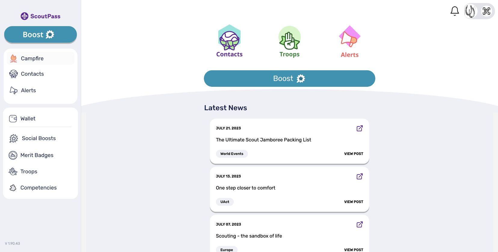
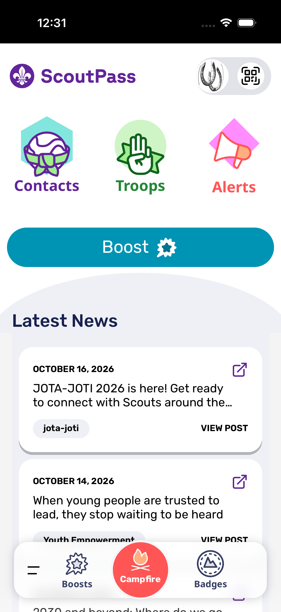
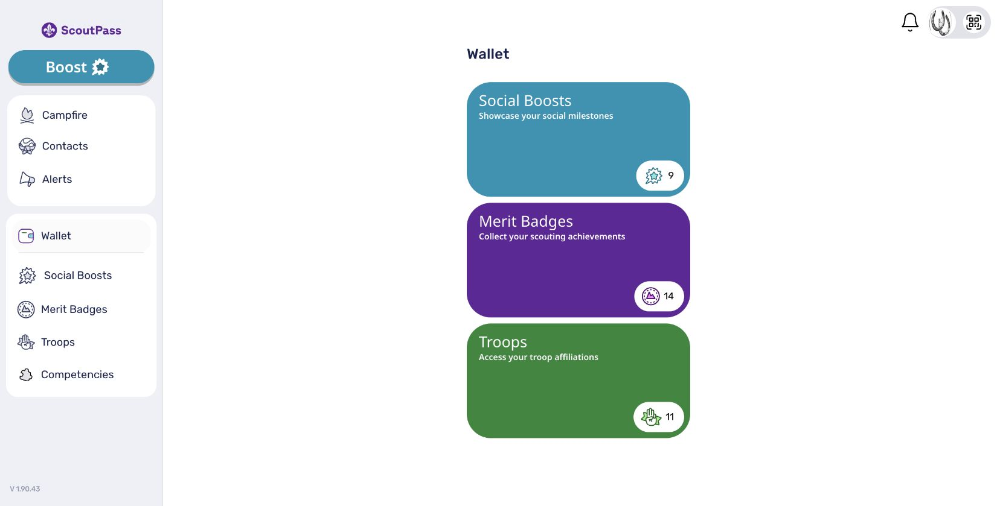
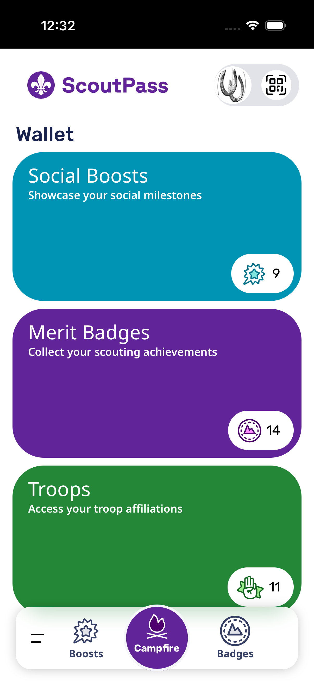
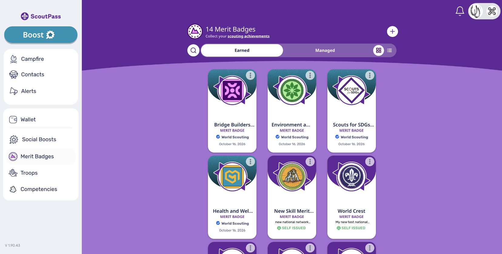
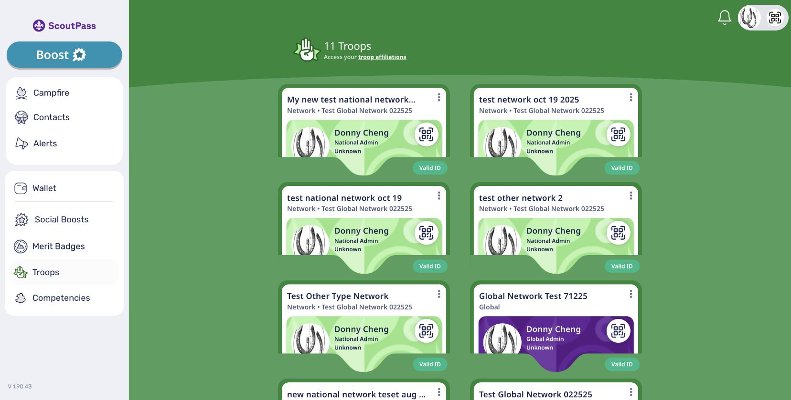
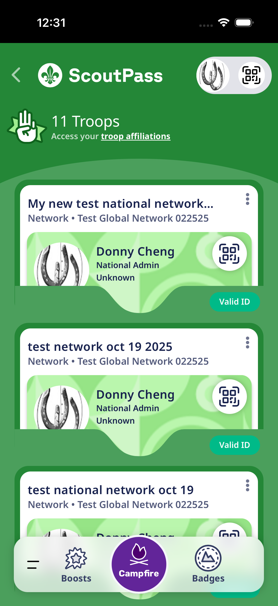

# ScoutPass Tailwind 4 smoke captures

Captured on October 19, 2026 from the actual production-built ScoutPass app, signed into the user-authorized test account. These are manual smoke evidence, not frozen visual baselines or a new CI gate.

| Screen       | Desktop web                                 | Native iOS                                  |
| ------------ | ------------------------------------------- | ------------------------------------------- |
| Campfire     |  |  |
| Wallet       |      |      |
| Merit badges |      |      |
| Troops       |      |      |

Desktop overview captures use Chrome at 1656×839. Native captures use an actual bundled Capacitor app on an iPhone 17 Pro simulator running iOS 26.4, with no development server URL. Automatic bundle updates were disabled only in the local installed build; tracked native configuration and lockfiles were restored unchanged.

Campfire had both `justify-start` and `justify-center`. Tailwind 3 resolved this to center; Tailwind 4 resolved it to start. Removing the conflicting start class restores centered news cards, confirmed with computed `justify-content: center` and a zero-pixel center offset.

The local static web preview displays bundled fallback news because it does not serve `/api/scout-news`. Native uses the live feed. This content difference is expected; these are not before/after comparisons. Both signed-in clients load 14 merit badges and 11 troop memberships.

## Nested network/troop credential modals

The list viewport extends to the physical bottom edge, matching the Create a Social Boost view. The complete final Test badge and Award action are visible immediately on this simulator, without scrolling. The user confirmed the final behavior works as expected. A persistent 8px gap below the pinned search row separates it from cards while scrolling.

`TroopCredentialsModal` uses a bounded `min-h-0` flex layout and one relative HTML scroll region. Relative positioning contains positioned descendants, preventing a second outer scrollbar. The shared surface layer handles device clearance as padding at the end of the scroll content, rather than shortening the viewport with a permanent bottom strip. No device-inset variables are referenced in modal content. The caller paints the surface `grayscale-100` so parent wallpaper cannot show through.

Earlier short-screen web checks at a 390×600 CSS viewport confirmed both final Award/Boost actions are fully reachable, the header remains at y=0, and the outer surface remains at scrollTop=0. Those metrics and intermediate captures remain archived in `capture.json`; the full-height native captures above represent the final layout. Chrome's existing 80% zoom means those web image dimensions differ from CSS dimensions.

Validation: six existing TroopChildrenBox/news tests, six shared AppModal tests, the production web build, bundled native simulator build, safe-area gate and normal formatter/workspace lint hook pass. Physical devices, Android and minimum supported browser versions still need separate release QA.

Manual check: open a network/troop, then Merit Badges or Social Boosts. Confirm there is no fixed clipping band above the bottom edge, the full final card is visible whenever it fits, and there is a gap below search while scrolling. Swipe longer lists to the end and confirm the final Award/Boost action is reachable. Closing the child returns to the parent. Do not award or issue a credential during this check.

See [capture.json](capture.json) for dimensions, timestamps, hashes and build provenance. Intermediate files remain archived; no sign-in codes or account storage are included.
