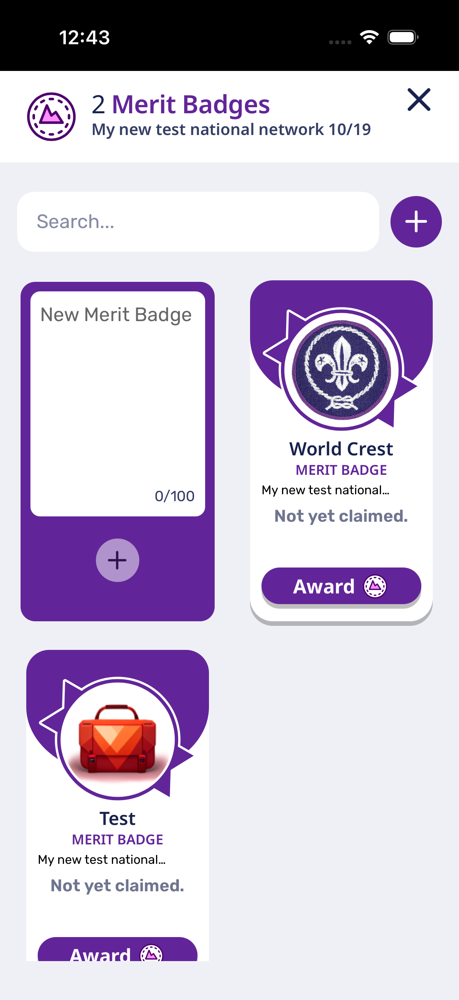
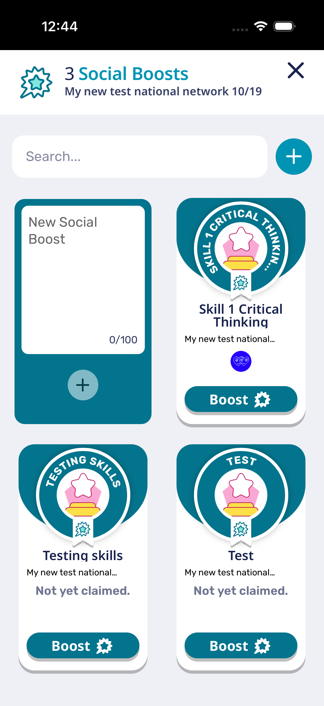

# ScoutPass Tailwind 4 smoke captures

Captured on October 19, 2026 from the actual production-built ScoutPass app, signed into the user-authorized test account. These are manual smoke evidence, not frozen visual baselines or a new CI gate.

| Screen       | Desktop web                                 | Native iOS                                  |
| ------------ | ------------------------------------------- | ------------------------------------------- |
| Campfire     |  |  |
| Wallet       |      |      |
| Merit badges |      |      |
| Troops       |      |      |

The desktop captures use Chrome at 1656×839. The native captures use an actual bundled Capacitor app on an iPhone 17 Pro simulator running iOS 26.4, with no development server URL. Automatic bundle updates were disabled only in the local installed build; tracked native configuration and lockfiles were restored unchanged.

Campfire had both `justify-start` and `justify-center`. Tailwind 3 resolved this to center; Tailwind 4 resolved it to start. Removing the conflicting start class restores centered news cards, confirmed with computed `justify-content: center` and a zero-pixel center offset. The existing Scout news suite passes all five cases. The production web build and native simulator build pass.

The local static web preview displays the bundled 2023 fallback articles because it does not serve `/api/scout-news`. Native uses the live 2026 feed. This content difference is expected; these are not before/after comparisons. Both signed-in clients load 14 merit badges and 11 troop memberships. Header controls, navigation, card gutters and overview layouts were inspected manually. Physical devices, Android and minimum supported browser versions still need separate release QA.

See [capture.json](capture.json) for dimensions, timestamps, hashes and build provenance. No sign-in codes or account storage are included.

## Nested network credential modals

The network/troop menu opens Merit Badges and Social Boosts in another fullscreen surface. Its content background previously stopped above the surface's bottom padding, exposing the parent wallpaper. The caller now paints that surface `grayscale-100` too, preserving the shared surface's inset ownership. The important background utility overrides the fullscreen shell's transparent ID rule. Both categories use this same entry point.

| Network merit badges                                       | Network social boosts                                      |
| ---------------------------------------------------------- | ---------------------------------------------------------- |
|  |  |

Verified both populated child modals and dismissal back to the parent network in the rebuilt iOS 26.4 app. Desktop computed surface backgrounds are opaque `rgb(239, 240, 245)` for both categories. The existing TroopChildrenBox and Scout news suites pass six tests; the production web build, native simulator build and safe-area gate pass.
