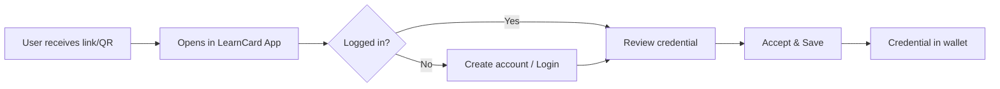
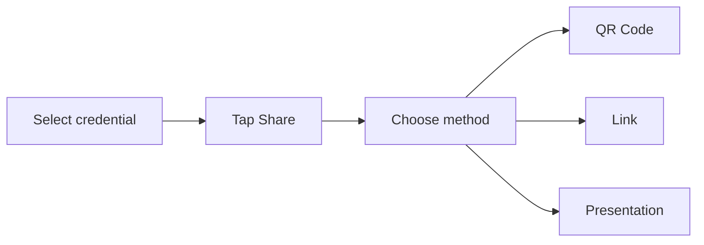
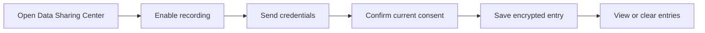
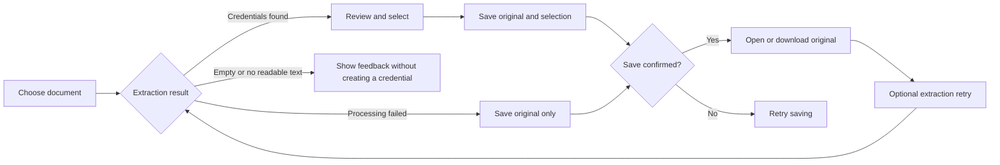
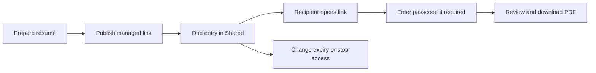
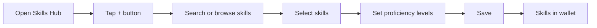

# LearnCard App

The **LearnCard App** is a digital wallet for verifiable credentials. It allows users to claim, store, organize, and share their achievements, badges, certifications, and IDs.

Available on:

- 📱 iOS ([App Store](https://apps.apple.com/us/app/learncard/id1635841898))
- 📱 Android ([Google Play](https://play.google.com/store/apps/details?id=com.learncard.app))
- 🌐 Web ([app.learncard.com](https://app.learncard.com))

---

## Key Features

| Feature               | Description                                                            |
| --------------------- | ---------------------------------------------------------------------- |
| **Claim Credentials** | Scan QR codes or click links to add credentials to your wallet         |
| **Organize**          | Categorize credentials by type (achievements, IDs, work history, etc.) |
| **Share**             | Generate shareable links or presentations for verifiers                |
| **Connect**           | Find and connect with other profiles on the LearnCard Network          |
| **Consent**           | Control what data you share and with whom                              |

---

## User Flows

### Claiming a Credential

1. User receives a claim link or scans a QR code
2. Link opens the LearnCard App
3. User logs in (or creates an account)
4. User reviews the credential details
5. User accepts and saves to their wallet

### Sharing a Credential

1. User selects a credential from their wallet
2. Taps "Share"
3. Chooses sharing method:
    - **QR Code** — For in-person verification
    - **Link** — For sending digitally
    - **Presentation** — For formal verification requests

For browser application requests (CHAPI or VC-API), use the credential list to search and filter by category. **View selected** shows the entire selected batch, even when search hides some items. **Deselect all** clears the selection. Open **Review** to check or remove items before sending; returning to selection sends nothing. Suggested credentials remain editable.

### Private Verifier History

Click a verifier entry to expand the list of credential names recorded for that send. This uses the existing encrypted history; it does not fetch full credentials or show every claim sent.

The card shows the five newest entries. Choose **View all** to open the full history, with 20 entries per page. Refresh, Clear history and Delete entry are available in the history window; changes also update the card.

In **Data Sharing Center**, **Shared with verifiers** loads automatically and shows recording controls and any entries. Recording is off by default and is unavailable for managed accounts. Disabling recording keeps previous entries; clearing readable history keeps the preference.

An entry records successful sending or a browser handoff, not verifier acceptance. It contains the visible credential titles and, where shown during review, the verifier name, origin and purpose. It contains no credentials, claims, credential addresses or link keys. Deleting history cannot retract information already sent.

The app keeps an owner-encrypted consent snapshot on the device. Sending does not look up history in Cloud first. Without a readable local snapshot, recording is skipped until you visit Data Sharing Center on that device; current consent is checked after sending before an entry is saved.

History displays at most 500 entries from the last 90 days. Cleanup runs when history is successfully accessed; offline clients cannot guarantee immediate physical deletion. Unreadable records are hidden and are not automatically deleted. **Clear history** can remove them by their exact document IDs; unknown consent is then kept off for safety. Future-dated entries are hidden until the local clock catches up and are not removed solely because of clock skew.

**Clear history** asks for confirmation before deleting entries, including from a recovery state. Cancel leaves history and recording unchanged. If a Clear read returns no settings, recording turns off for safety, even if it was previously on.

If history cannot be loaded, **Clear history** remains available to reset recording to off when its settings are missing or unreadable. A cleanup warning means some records could not be removed; try Clear again. An unreadable encrypted document also prevents recording until recovery. A confirmed entry remains saved even when cleanup is incomplete.

If your account changes after an OID4VP send completes, the success screen says so and hides the earlier account’s details. It does not redirect to the verifier under the new account; return to the requesting application to finish its session.

### Uploading an Original Document

Open **Build My LearnCard**, then choose Resume, Certificates, Transcripts or Diplomas.
Select a supported file. Review any extracted credentials and choose which ones to save.

The original is labeled **Provided by you · Not verified by an issuer**. It is not a
verified achievement. **Open File** previews supported documents; **Download** saves the
original bytes. On iOS, saved files are in LearnCard's Documents folder.

An empty result or a file with no readable text does not create a credential or save a new
original. Choose another file or retry extraction while the upload step remains open.
Processing failures still keep the original when its save succeeds. A failed save does
not claim that the file is saved; retry saving without running extraction again.

Review can be closed and reopened within the same app session. Selecting none still saves
the original, but does not mean extraction found nothing. Saved counts include only confirmed
selected credentials. Partial failures retain the review; retrying a save reuses confirmed writes.

You can also retry from a saved document after reopening its checklist step. New results
return to review and are not saved automatically. Retrying an older saved résumé does not
replace the currently stored résumé.

### Publishing a Résumé

Resume Builder publishes one managed link for each résumé. Republishing an active résumé updates that link. Find its entry in **Shared** to change the title, passcode or expiry, or stop access. Edit the résumé itself in Resume Builder.

New links expire after 30 days by default. Both the résumé and its PDF follow the link's access settings. A recipient downloads the PDF explicitly; opening the link does not preload it.


Stopping access cannot retract downloaded copies or older résumé URLs. Including a credential includes its original signed claims, even when some fields are hidden on the PDF.


If publishing is interrupted, retry in the same browser to recover the pending attempt. PDFs larger than 4 MiB cannot be published through this flow. Turn off the QR code to download a local copy without publishing.

### Qualifications

Qualifications has its own section after IDs in the wallet and navigation, even when it is empty. It contains professional licenses, certifications, and apprenticeship, journeyman, and master certificates.

- Existing credentials in their original automatic category move to Qualifications in the background after the account opens; account access does not wait for this scan. Successful scans are remembered for that account and cloud service. Unavailable credentials retry on the next app session, not on every account operation. Saved manual overrides, explicit credential categories, and custom Boost categories stay unchanged. Older choices without a manual-choice marker are treated as automatic defaults.
- Qualification credentials default to an orange certificate frame with Qualifications corner glyphs; explicit display settings and recognized achievement types take precedence.
- Colorful matches the other section shades: orange-300 Passport tiles and selected tabs, orange-400 page headers, orange-200 page backgrounds, and orange-500 count badges with dark text. Actions keep darker orange for readable contrast. Neutral Mode uses white backgrounds for all Passport categories in tile and list views, and keeps the Colorful Solid Color Qualifications glyph in both layouts. Other icon placements retain their theme-specific artwork. Colorful has a dedicated empty-state illustration; Formal keeps its shared empty-state placeholder. Credential image fallbacks also use Qualifications artwork instead of the Achievements trophy.
- Click **professional qualifications** on the Qualifications page to open **About Qualifications**, with Qualifications artwork and a short explanation of professional licenses, certifications, and apprenticeship, journeyman, or master certificates.
- Certificate previews keep the issuer's details and seal inside the frame, above the category label.
- Expiration dates remain visible. An expired qualification stays in the account and can still be opened or shared.
- Identification documents, such as passports and driver's licenses, remain in IDs.
- Resumes keep Achievements alongside Qualifications. Existing saved section order, hidden sections, dates, and edited descriptions remain intact when an older resume is opened.

### Self-Assigning Skills

1. User opens the Skills Hub from their wallet
2. Taps the **+** button to add skills
3. Searches by skill name or occupation, or browses suggested skills across the available frameworks
4. Selects one or more skills from a framework
5. Sets a proficiency level for each skill:
    - **Hidden** — Do not display proficiency status
    - **Novice** — Just starting and needs guidance
    - **Beginner** — Handles simple tasks without support
    - **Proficient** — Works independently on routine tasks
    - **Advanced** — Solves complex tasks efficiently
    - **Expert** — Deep mastery; can lead and mentor others
6. Saves the self-attested skills to their wallet


Self-assigned skills are **self-attested credentials**. They represent what a user claims about their own abilities. For third-party verified skills, see issued credentials from organizations.


---

## Account Security & Recovery

Each account is controlled by a private key that never exists in one place: it is split into pieces held by the user's device, LearnCard's servers, and the user's recovery methods, and any two pieces are needed to sign in. Neither LearnCard nor a stolen phone alone can access the account.

After signing up, users are prompted to set up at least one recovery method:

| Method              | What it is                                                |
| ------------------- | --------------------------------------------------------- |
| **Passkey**         | Face ID, Touch ID, or a hardware key on the user's device |
| **Recovery Phrase** | A 24-word phrase the user writes down                     |
| **Backup File**     | A password-protected file the user downloads              |
| **Email Backup**    | An encrypted backup sent to a verified email address      |

Signing in on a new device works either by scanning a QR code from a device that's already signed in, or by using one of the recovery methods. Recovery settings live under **Account Recovery** in the profile.

For how this works under the hood, see [Key Management (SSS)](../../core-concepts/identities-and-keys/key-management-sss.md).

---

## Related Documentation

- [Export & Import Your Data](../../how-to-guides/export-and-import-your-data.md) — Take your data with you
- [Send & Issue Credentials](../../how-to-guides/send-credentials.md) — For organizations issuing into the app
- [Build an App Inside LearnCard](../../how-to-guides/publish-your-app.md) — Build an experience inside the app
- [Verify Credentials](../../tutorials/verify-credentials.md) — For verifiers
- [ConsentFlow Overview](../../core-concepts/consent-and-permissions/consentflow-overview.md) — How users control what they share
