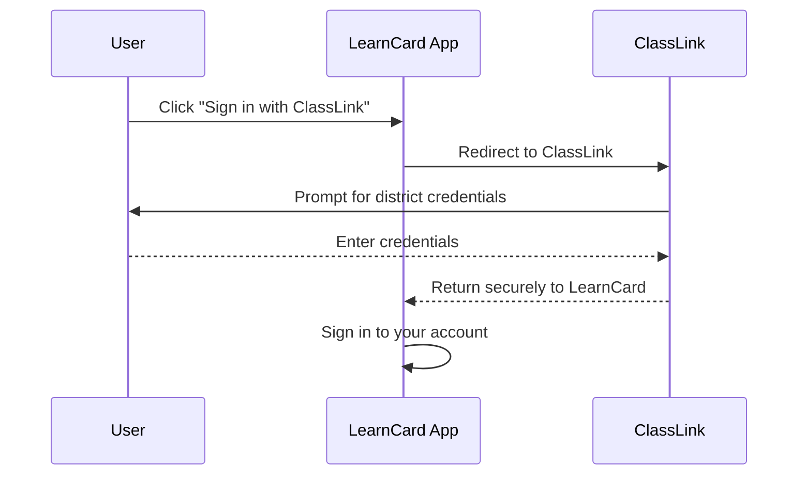

# Sign in with ClassLink

LearnCard supports signing in with your district's ClassLink account. You can use your school login to open your account and request your state transcript.

## How it works

When you choose to sign in with ClassLink, LearnCard redirects you to your district's ClassLink login page. After you authenticate, ClassLink securely returns you to LearnCard.

## Requesting State Transcripts

Once signed in with a verified ClassLink account, you may be eligible to request your state transcript. If your district participates, LearnCard will automatically check your eligibility and let you request your transcript, which arrives in your account.

## Troubleshooting

- **"Your school account doesn't have an email address yet"**: Your district hasn't added an email to your ClassLink account. Ask your school to add one, then sign in again.
- **"Use a personal email, not your school email"**: The "Add a personal email" prompt needs an address you'll keep after leaving school, such as a personal Gmail or iCloud address.
- **"That sign-in link expired"**: The connection to ClassLink timed out. Please try signing in again.
