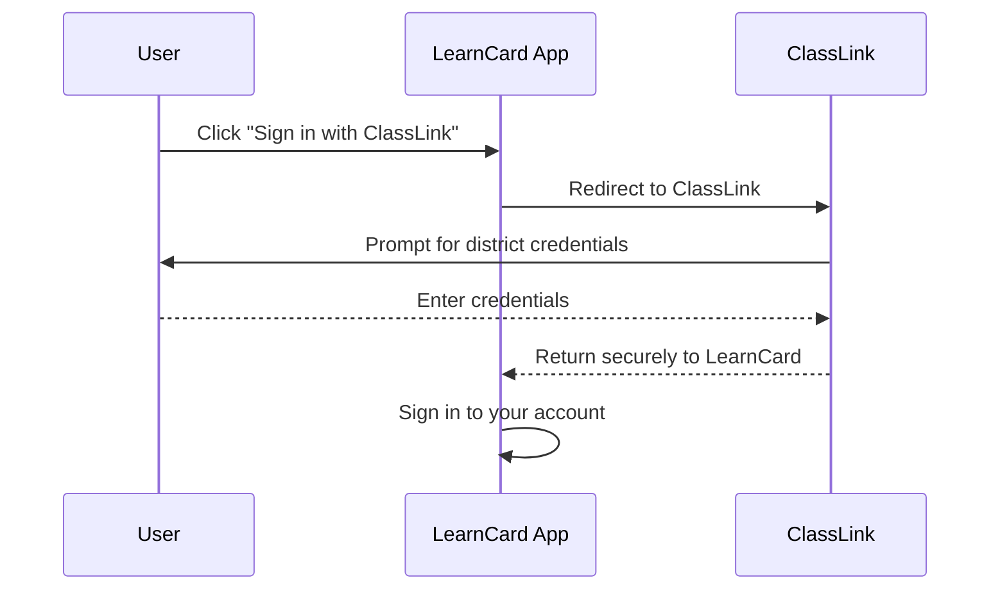

# Sign in with ClassLink

LearnCard supports signing in with your district's ClassLink account. You can use your school login to open your account and request your state transcript.

## How it works

When you choose to sign in with ClassLink, LearnCard redirects you to your district's ClassLink login page. After you authenticate, ClassLink securely returns you to LearnCard.

## Requesting State Transcripts

Once signed in with a verified ClassLink account, you may be eligible to request your state transcript. If your district participates, LearnCard will automatically check your eligibility and let you request your transcript, which arrives in your account.

## Troubleshooting

- **No school email**: You can sign in with ClassLink even if your district hasn't given you an email address, or uses one LearnCard can't confirm. LearnCard never sends mail to an address it can't confirm, so you won't get sign-in codes or account notices there.
- **"You already have a LearnCard account with this email"**: Your school email already has its own LearnCard account. Sign in the way you usually do (for example with an email code), then open **School Connect** to connect your school account to it.
- **"Your school account is connected to a LearnCard account that now signs in another way"**: You recovered your account and it no longer uses a sign-in that ClassLink can open directly. Sign in the way you usually do, then open **School Connect** to reconnect your school account.
- **"This LearnCard account is already connected to a different school account"**: Each LearnCard account can be connected to one school account. Sign in with the school account that's already connected.
- **"School sign-in is temporarily unavailable"**: LearnCard couldn't reach ClassLink. Wait a few minutes and try again.
- **"Use a personal email, not your school email"**: The "Add a personal email" prompt needs an address you'll keep after leaving school, such as a personal Gmail or iCloud address. The prompt only appears where your organization has turned it on, and is never shown to student accounts.
- **"That sign-in link expired"**: The sign-in link was too old or was already used. Please try signing in again.
- **"ClassLink sign-in took too long"**: On the mobile app, the ClassLink sign-in window closes after 10 minutes. Please try signing in again. On iPhone and iPad, the app does not reuse your browser's ClassLink session, so you may need to enter your district login each time.
- **Shared Android devices**: On Android, ClassLink sign-in opens in a browser tab that shares the browser's ClassLink session. If the previous student is still signed in to ClassLink in the browser, you could land in their account. On a shared device, sign out of ClassLink in the browser when you finish, and check the name shown after you sign in.
