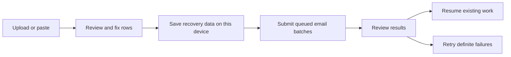

# Issue credentials from a spreadsheet

Use **Issue Credentials** to send one credential template to several people with different field values.

1. Choose a credential type and enter its details.
2. Choose **Specific people**, then **Upload spreadsheet**, or paste several spreadsheet rows into the people search.
3. Upload a CSV, TSV, or XLSX file. Files can contain up to 10,000 people and 200 columns and must be smaller than 10 MiB. For XLSX, select a visible worksheet.
4. Review the recipient email column and column-name row. Recipient detection uses email values; if both student and guardian columns contain emails, choose the intended recipients.
5. Choose **Review people** to open the recipient workspace. Desktop uses an editable table; phones use cards. Search the full roster or filter **Needs attention**. Each page contains at most 25 people. Fix invalid emails, duplicate recipients, missing required fields, invalid evidence links, and formulas without cached results, or **Skip** those rows.
6. Open **Credential fields** in the workspace to choose which fields are shared or different for each person. Headers match placeholders regardless of case, spaces, or underscores. Use the preview arrows to review each person.
7. Choose **Issue Credential**. Results distinguish sent, failed, waiting, and sends that need confirmation.

**Get CSV template** downloads the current field columns. With no recipients, it includes a marked example row; replace its email before issuing. **Download table** exports the current values. Uploading an edited table updates matching people and adds new ones. Keep the `__lc_run_id` and `__lc_row_id` columns: these preserve a row's identity even when correcting its email. These columns are never credential fields.

Evidence links and uploaded files become standard Open Badges Evidence entries. Importing a link does not fetch its contents.

## Resume an interrupted run

Recovery data is saved in this browser's IndexedDB for the issuing account, network, and organization. Return to **Issue Credentials**, then choose **Restore Saved Run** and **Resume**. A draft that has not started is sent with **Issue Credential**. Stay on the original device and browser; clearing browser data or signing out removes recovery records, including unconfirmed sends. The server may still finish accepted work after sign-out, so check delivery before starting another run. Recovery must save successfully before a send starts.

**Skip for Now** hides the restore banner without deleting its saved rows or delivery history. **View saved run** opens the hidden run later on this device. Editing a restored run makes it available for recovery again.

Email issuance continues on the server after leaving the page. Resume observes an existing batch or recovers its receipt using the original request. It does not restart successful rows. An unconfirmed submission older than the 24-hour replay window requires checking its results before another issuance.

**Retry Failed** and **Download Failed Rows** include only definite failures. Correct the exported failed rows and upload them into their saved run. Submitted rows remain in the run history and cannot be removed. Successful and uncertain rows are locked; definite failures remain editable for correction and retry. Sends that need confirmation are excluded from retry files; check their results before issuing again. Profile recipients are sent one at a time; a lost response needs confirmation because that send has no replay guarantee.

**Check Again** refreshes known email batch receipts without submitting credentials or generating new keys. A completed batch can still contain unconfirmed items; replaying that same batch request only returns its existing receipt. If checking does not resolve them, contact support for reconciliation before issuing again. Profile sends cannot be safely replayed automatically and require manual confirmation.

Settled recovery records are removed after 30 days. Unresolved records remain available for review. Use **Start Another Run** only when you intend a separate issuance.

Duplicate protection applies when restoring the same saved run or re-importing its exported CSV on this browser. Starting a new run from an original spreadsheet creates a new issuance and can send another credential to the same person.

Open **Review delivery issues** to search failed or unconfirmed sends in pages of 25. Correct definite failures in **Review people** before retrying; unconfirmed sends retain their recovery safeguards.

Choose **View delivery status** in the batch card to search every recipient and filter by Not sent, Queued, Sent, Failed, or Unconfirmed. The viewer updates as the active run receives results. The card comes into view once when sending starts; later updates leave your scroll position alone. The compact, full-width scene of colorful credential sheets moving through drifting clouds and the initial scroll respect your device’s reduced-motion setting.

Date fields use a calendar picker and a readable date. Timestamps are shown in UTC; changing the calendar date preserves the time. New dates use midnight UTC. Opening the workspace leaves the saved timestamp unchanged. Invalid source values stay visible until corrected.

## Sending to people without a spreadsheet

All **Specific people** sends use the same saved-run flow, including a single profile selected from the picker. This intentionally requires IndexedDB and the browser's Web Locks API: if recovery cannot be saved safely, sending stops. Each different filled credential is validated before any submission, so large personalized rosters can take longer to prepare. The sending state remains visible during validation. Profile sends have no automatic transport retry because a lost response can follow a successful send.

Changing the credential type preserves recipient rows and their entered values. Only variables used by the selected template become credential fields; review those fields and previews before sending. Spreadsheet column mapping remains Open Badges only.

Evidence uses standard Open Badges `Evidence` entries. Attachment names remain in the standard `name` field; the unsupported `EvidenceFile`, `fileName`, and `fileType` extensions are omitted from all issuance modes so credentials work without a LearnCard extension context.

### CSV corrections and failure-only retries

Re-uploading an unchanged exported CSV preserves unresolved Excel formula/error flags; correct the flagged value to clear it. Same-run exports restore the original recipient address when CSV formula protection added an apostrophe. Literal apostrophes in addresses remain intact.

Retry Failed includes only recipients with a confirmed failure. Newly added people remain unattempted until Issue or Resume. Resume and retry validate result ranges again before new submissions, including failures discovered while checking an existing receipt. Previously accepted requests keep their frozen contents for safe replay.

CSV and TSV uploads must use UTF-8. Invalid byte sequences or replacement characters block import with instructions to export as CSV UTF-8 or XLSX. Out-of-range Excel content identifies the sheet and cell to remove.

An expired unacknowledged request is never replayed. Its rows remain unconfirmed for support reconciliation; unrelated failed rows and unattempted chunks may continue. Viewing a hidden run preserves its dismissal, while editing the draft makes its reminder available again. Analytics count only recipients selected for a new send action.

Duplicate protection applies within a saved run. Starting a fresh run from an original spreadsheet creates a separate issuance; there is no cross-run 24-hour deduplication. This scope follows the accepted product decision for this release.
