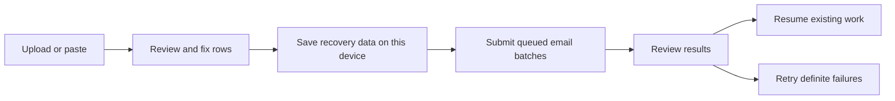

# Issue credentials from a spreadsheet

Use **Issue Credentials** to send one credential template to several people with different field values.

1. Choose a credential type and enter its details.
2. Choose **Specific people**, then **Upload spreadsheet**, or paste several spreadsheet rows into the people search.
3. Upload a CSV, TSV, or XLSX file. Files can contain up to 10,000 people and 200 columns and must be smaller than 10 MiB. For XLSX, select a visible worksheet.
4. Review the recipient email column and column-name row. Recipient detection uses email values; if both student and guardian columns contain emails, choose the intended recipients.
5. Choose **Review people** to open the recipient workspace. Desktop uses an editable table; phones use cards. Search the full roster or filter **Needs attention**. Each page contains at most 25 people. Fix invalid emails, duplicate recipients, missing required fields, invalid evidence links, and formulas without cached results, or **Skip** those rows.
6. Open **Credential fields** in the workspace to choose which fields are shared or different for each person. Headers match placeholders regardless of case, spaces, or underscores. Use the preview arrows to review each person.
7. Choose **Issue Credential**. Results distinguish sent, failed, waiting, and sends that need confirmation.

**Get CSV template** downloads the current field columns. With no recipients, it includes a marked example row; replace its email before issuing. **Download table** exports the current values. Uploading an edited table updates matching people and adds new ones. Keep the `__lc_run_id` and `__lc_row_id` columns: these preserve a row's identity even when correcting its email. These columns are never credential fields.

Evidence links and uploaded files become standard Open Badges Evidence entries. Importing a link does not fetch its contents.

Open a person’s credential preview to check the mapped values before issuing. Unsigned previews show **Preview** rather than a verification result. Ordinary evidence URLs appear as links; recognized video links keep their video presentation. **Awarded on** uses the mapped awarded date, falling back to the issuance date for credentials without one.

## Import a credential or spreadsheet

Choose **Import a credential or spreadsheet** on the Issue page. The dialog has two separate options:

- **Upload a file:** choose or drop a CSV, TSV, XLSX spreadsheet or a credential JSON file. The file opens for review immediately.
- **Paste a link or data:** paste a direct credential link, complete credential JSON, or copied spreadsheet rows containing email addresses, then choose **Review content**. Expand **What can I paste?** for examples; Credential Engine links and record IDs are also supported.

You review the content before adding it. The opening dialog stays compact on desktop; a spreadsheet opens in the larger review workspace. Both layouts scroll within the shared modal on smaller screens.

## File size and processing limits

Spreadsheet files are parsed on your device. The original CSV, TSV, or XLSX file is not uploaded to the issuance server. Selected evidence links are referenced without fetching them during import.

Imports allow at most 10 MiB of file data, 10,000 people, 200 columns, and 2,000,000 cells. CSV parsing stops when a row, column, or cell limit is reached. XLSX archives also allow at most 1,000 members and 32 MiB of actual expanded data across all members, including hidden sheets and embedded media. Declared ZIP sizes alone do not determine acceptance. Duplicate or ambiguous member paths are rejected.

XLSX parsing runs in a separate browser worker. The app terminates the worker after 20 seconds, or when parsing succeeds or fails. If a workbook is too complex, remove unused sheets and media or split it into smaller files. These processing limits are not a fixed ceiling on the browser's total memory use.

The issuance API separately enforces a 4 MiB JSON request limit and at most 100 items per batch. Accepted email batches use a durable queue and an issuer-specific hourly admission quota (10,000 items by default, configurable by the service operator). These limits do not replace deployment-level request-rate, connection, or aggregate-concurrency controls.

## Start with a spreadsheet

You can also choose **Start from a link, file, or ID** before selecting a credential type. Upload a spreadsheet or paste its rows, review the recipient column, and choose **Add People**. The people and original cells remain available when choosing or changing the credential type.

Choose **Map columns** to open the column workspace. Each row shows the source column, example values, and its credential field. Choose **Include** to add it, or select an included column to remove it; the original cells remain available. Expand **Format options** for number and date settings.

| Column         | Credential field                                                                                                      |
| -------------- | --------------------------------------------------------------------------------------------------------------------- |
| Score or grade | An independent result linked to its scale; several grade columns can coexist.                                         |
| Credits        | A numeric credits-earned value, including zero.                                                                       |
| Hours          | Description text by default. To count hours as credits, choose **Credits earned** and enter the intended credit unit. |
| Evidence URL   | Standard Open Badges Evidence.                                                                                        |
| Awarded date   | When the achievement was awarded; issuance time remains separate.                                                     |
| Other text     | A personalized description field, preserving leading-zero identifiers.                                                |

Choose the spreadsheet's decimal format before adding numeric columns. Reviewed numeric values use a decimal point and no grouping separators. A percentage cell displayed as `95%` becomes a Percent result of `95`.

Choose an explicit date format for day/month or month/day text. An ISO calendar date keeps its day; a timestamp must include its timezone. Invalid dates and numbers stay visible for correction or skipping.

These mappings use the [Open Badges 3.0 fields](https://www.imsglobal.org/spec/ob/v3p0): standard Evidence, linked results, numeric credits, and awardedDate. Files and links do not require LearnCard-specific credential terms.

## Resume an interrupted run

Recovery data is saved in this browser's IndexedDB for the issuing account, network, and organization. Return to **Issue Credentials**, then choose **Restore Saved Run** and **Resume**. A draft that has not started is sent with **Issue Credential**. Stay on the original device and browser; clearing browser data or signing out removes recovery records, including unconfirmed sends. The server may still finish accepted work after sign-out, so check delivery before starting another run. Recovery must save successfully before a send starts.

**Skip for Now** hides the restore banner without deleting its saved rows or delivery history. **View saved run** opens the hidden run later on this device. Editing a restored run makes it available for recovery again.

Email issuance continues on the server after leaving the page. Resume observes an existing batch or recovers its receipt using the original request. It does not restart successful rows. An unacknowledged request older than the 24-hour replay window stays unconfirmed for support reconciliation. It is never automatically resent.

**Retry Failed** and **Download Failed Rows** include only definite failures. Correct the exported failed rows and upload them into their saved run. Submitted rows remain in the run history and cannot be removed. Successful and uncertain rows are locked; definite failures remain editable for correction and retry. Sends that need confirmation are excluded from retry files; check their results before issuing again. Profile recipients are sent one at a time; a lost response needs confirmation because that send has no replay guarantee.

**Check Again** refreshes known email batch receipts without submitting credentials or generating new keys. A completed batch can still contain unconfirmed items; replaying that same batch request only returns its existing receipt. If checking does not resolve them, contact support for reconciliation before issuing again. Profile sends cannot be safely replayed automatically and require manual confirmation.

Settled recovery records are removed after 30 days. Unresolved records remain available for review. Use **Start Another Run** only when you intend a separate issuance.

Duplicate protection applies when restoring the same saved run or re-importing its exported CSV on this browser. Starting a new run from an original spreadsheet creates a new issuance and can send another credential to the same person.

Open **Review delivery issues** to search failed or unconfirmed sends in pages of 25. Correct definite failures in **Review people** before retrying; unconfirmed sends retain their recovery safeguards.

Choose **View delivery status** in the batch card to search every recipient and filter by Not sent, Queued, Sent, Failed, or Unconfirmed. The viewer updates as the active run receives results. The card comes into view once when sending starts; later updates leave your scroll position alone. The compact, full-width scene of colorful credential sheets moving through drifting clouds and the initial scroll respect your device’s reduced-motion setting.

Date fields use a calendar picker and a readable date. Timestamps are shown in UTC; changing the calendar date preserves the time. New dates use midnight UTC. Opening the workspace leaves the saved timestamp unchanged. Invalid source values stay visible until corrected.

Column mapping currently supports Open Badges credentials. Choose each Evidence or Portfolio column separately to include its links; importing the sheet alone does not add these fields. Selected columns stay visible with a checkmark so they can be removed. Exported CSVs distinguish mapped columns from the table’s separate Evidence link and preserve both on re-import.

The **Additional evidence** field and attachments in **Review people** supplement any evidence columns included through **Map columns**.

## Sending to people without a spreadsheet

All **Specific people** sends use the same saved-run flow, including a single profile selected from the picker. This intentionally requires IndexedDB and the browser's Web Locks API: if recovery cannot be saved safely, sending stops. Each different filled credential is validated before any submission, so large personalized rosters can take longer to prepare. The sending state remains visible during validation. Profile sends have no automatic transport retry because a lost response can follow a successful send.

Changing the credential type preserves recipient rows and corrected cells for included spreadsheet mappings; shared values and unrelated template variables reset. Only variables used by the selected template become credential fields; review those fields and previews before sending. Spreadsheet column mapping remains Open Badges only.

Evidence uses standard Open Badges `Evidence` entries. Attachment names remain in the standard `name` field; the unsupported `EvidenceFile`, `fileName`, and `fileType` extensions are omitted from all issuance modes so credentials work without a LearnCard extension context.

### Template and field boundaries

Changing credential type re-applies the included spreadsheet mappings and preserves corrected mapped cells. Importing a replacement credential clears mappings and previous template values; the source spreadsheet remains available for mapping again. Shared values from an earlier template do not silently populate a replacement. Every included column is required for each active recipient; remove an optional column or skip a recipient when a cell should not be issued.

Calendar award dates represent midnight UTC, so a generic local-time viewer may show the previous day. Timestamps require seconds and an explicit timezone and normalize to UTC before signing. Unsupported date spellings are rejected rather than guessed.

### CSV corrections and failure-only retries

Re-uploading an unchanged exported CSV preserves unresolved Excel formula/error flags; correct the flagged value to clear it. Same-run exports restore the original recipient address when CSV formula protection added an apostrophe. Literal apostrophes in addresses and credential text remain intact. New exports mark their reversible escaping with `__lc_csv_encoding=apostrophe-v1`: formula-like values gain one apostrophe, and a literal leading apostrophe is doubled. When editing these exported CSV cells directly, retain that convention (for example, `''=SUM(A1:A2)` represents the literal text `'=SUM(A1:A2)`). Ordinary original spreadsheets without saved-run IDs are imported literally. Older unversioned exports decode only an exact escaped match to a saved value; edited or unknown apostrophe-prefixed text stays literal.

Retry Failed includes only recipients with a confirmed failure. Newly added people remain unattempted until Issue or Resume. Resume and retry validate result ranges again before new submissions, including failures discovered while checking an existing receipt. Previously accepted requests keep their frozen contents for safe replay.

CSV and TSV uploads must use UTF-8. Invalid byte sequences or replacement characters block import with instructions to export as CSV UTF-8 or XLSX. Out-of-range Excel content identifies the sheet and cell to remove.

An expired unacknowledged request is never replayed. Its rows remain unconfirmed for support reconciliation; unrelated failed rows and unattempted chunks may continue. Each chunk records admission start before contacting the server, so a chunk prepared over 24 hours ago can still be sent if admission never started. Older saved runs without that marker remain conservative because their submission history is unknown. Viewing a hidden run preserves its dismissal, while editing the draft makes its reminder available again. Analytics count only recipients selected for a new send action.

Duplicate protection applies within a saved run. Starting a fresh run from an original spreadsheet creates a separate issuance; there is no cross-run 24-hour deduplication. Cross-run duplicate protection is outside the scope of this release.

Recovery currently shows one pending run and one hidden run at a time. Starting another draft hides the saved-run shortcut until the page is reloaded. Check Again polls the selected batch until it finishes, so a running batch can keep the page busy. A history screen for multiple runs and a one-shot status refresh are follow-up UI improvements.
