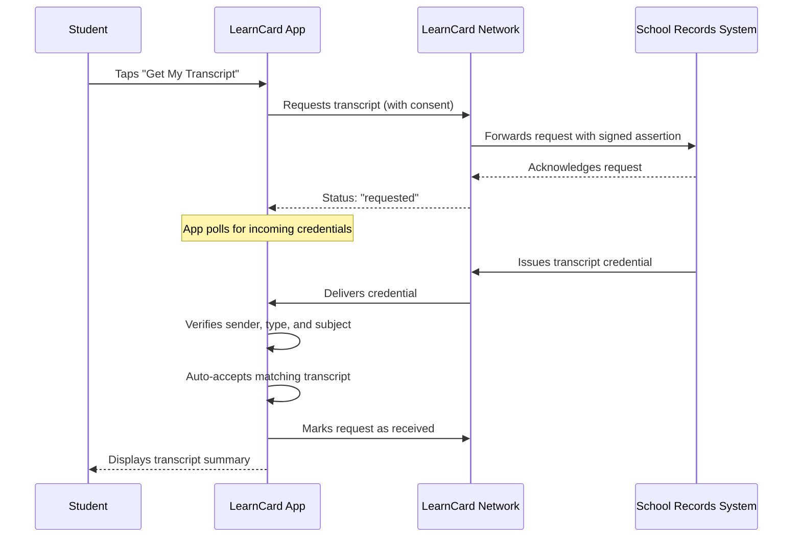

# Transcript Request Flow

The LearnCard App allows eligible students to request their official transcript directly from their school records system. This feature provides a seamless way to receive and store academic records in the wallet.

## How It Works

When a student requests their transcript, the app communicates with the school records system. Once the transcript is ready, it is delivered directly to the student's wallet and automatically accepted.



## Eligibility

The transcript request feature is available to students who:

1. Are signed in through a supported school single sign-on (SSO) provider.
2. Have a valid state student ID associated with their account.
3. Belong to a school district that has enabled transcript issuance.

## User Experience

1. **Opt-In**: Eligible students see a "Get your transcript" card in their wallet or during onboarding.
2. **Requesting**: After consenting, what the student sees depends on how long the school says delivery takes (see [Delivery estimate](#delivery-estimate)):
    - **No estimate, or 30 seconds or less**: live steps ("Request sent", "Your school is preparing your transcript", "Adding it to your account").
    - **Up to 5 minutes**: a progress bar with the time left ("About 2 minutes left"). Past the estimate it keeps moving slowly and reads "Almost there" until the transcript arrives.
    - **Longer**: "Transcript requested" with when to expect it ("Your school expects to send it tomorrow") and a **Continue** button. The School Connect card shows the same estimate.

    In every case the student can move on, and the transcript is added whenever it arrives. The app checks for the incoming transcript every 5 seconds at first, backing off to once a minute, and stops after 30 minutes in an app session. Returning to the app or receiving a credential notification triggers another check.

3. **Arrival**: When the transcript arrives, it is automatically verified and added to the wallet. The card updates to show a summary of the transcript (e.g., school name, graduation year, GPA) and a button to view the full details.
4. **Notifications**: If the student leaves the app before the transcript arrives, they will receive a push notification. Tapping the notification opens the transcript directly. The app waits up to 5 seconds for the request status; if it cannot confirm the match in time, it shows the normal claim screen instead.
5. **Still waiting**: If the request is more than 24 hours old (or 24 hours past the school's estimate, if that is later), or the app has stopped checking and the estimate has passed, the card says the transcript may already be in their notifications and offers **Check Again** and **Open Notifications**.

## Partner Issuer Contract (draft)


The partner contract is not signed yet. This section describes what LearnCard sends today. Field names are provider neutral so they do not change if another school sign-in provider is added.


### Request

LearnCard Network sends `POST <issuer endpoint>` with `Authorization: Bearer <assertion>` and this JSON body:

```json
{
    "assertion": "<signed JWT>",
    "request_id": "6f1c2a5e-0c4f-4b8e-9d2a-3e7b1f0a9c11"
}
```

The assertion is a 5-minute EdDSA JWT. Verify it against the `did:web` document of the `iss` (the `kid` is `<iss>#owner`). `iss` is always the configured LearnCard Network domain, for example `did:web:api.learncard.app`, never the hostname a request happened to use.

| Claim              | Meaning                                                          |
| ------------------ | ---------------------------------------------------------------- |
| `iss`              | LearnCard Network's `did:web`                                    |
| `aud`              | The audience configured for your issuer                          |
| `sub`              | The student's DID. Issue the transcript to this DID              |
| `jti`              | Unique request ID. Reject replays                                |
| `request_id`       | Same value as `jti`, and the `request_id` in the body            |
| `iat`, `exp`       | Issue and expiry time (unix seconds)                             |
| `state`            | State code of the student's district, for example `CA`           |
| `state_student_id` | The student's state-issued ID                                    |
| `idp`              | The school sign-in provider, for example `classlink`             |
| `idp_tenant`       | The provider's district (tenant) ID                              |
| `auth_time`        | When the student last signed in with the provider (unix seconds) |
| `consent_at`       | When the student agreed to the request (unix seconds)            |

Respond with HTTP `200` or `202` and `{ "status": "accepted" }`, or HTTP `200` and `{ "status": "none_yet" }` when there is no transcript yet. Any other response is treated as a failure.

#### Delivery estimate

An accepted response can say when you expect to deliver the transcript. This is optional but recommended: it lets the app set the right expectation instead of showing a spinner.

```json
{ "status": "accepted", "expectedInSeconds": 120 }
```

| Field               | Description                                                                             |
| ------------------- | --------------------------------------------------------------------------------------- |
| `expectedInSeconds` | Seconds from now until you expect to deliver. Preferred, because it ignores clock skew. |
| `expectedBy`        | ISO 8601 time with an offset, for example `2026-11-12T09:00:00-05:00`.                  |

If both are present, `expectedInSeconds` wins. An estimate that is malformed, already past, or more than 30 days away is ignored; the request still succeeds. Deliver as soon as you can: arriving early is always fine.

Respond within 15 seconds. Return `202` as soon as the request is queued and do the work afterwards. If LearnCard gets no response in time (or the connection drops after the request was sent), it cannot tell whether you accepted the request, so it keeps the request pending and keeps waiting for a transcript that echoes that `request_id`. Treat `request_id` as idempotent: process each one at most once.

### Delivery

Send the transcript credential to the student's DID (`sub`) through the LearnCard Network send API, from the LearnCard Network profile LearnCard has configured for your district (its profile ID). Sign it with the issuer DID LearnCard has configured for your district.

The credential **must** echo the request ID so the app can match it to the request. Add one entry to the top-level `evidence` array whose `id` is `urn:uuid:<request_id>`:

```json
{
    "evidence": [
        {
            "id": "urn:uuid:6f1c2a5e-0c4f-4b8e-9d2a-3e7b1f0a9c11",
            "type": ["Evidence"]
        }
    ]
}
```

The app auto-accepts a transcript only when all of these hold:

- It was sent by the configured LearnCard Network profile. The network authenticates the sender, and the app checks the sending profile's ID. It does not check the profile's DID, because the network reports every profile's DID as its own `did:web:<network>:users:<profileId>`.
- The credential's own `issuer` is the configured issuer DID (for example your own `did:web:records.example.org`). This DID does not need to be the sending profile's DID.
- The credential verifies, is a `ClrCredential`, is for the student's DID, and was issued after the request. "Issued" is `validFrom` (or `issuanceDate`). The app allows up to 5 minutes of clock difference, so a whole-second `validFrom` or a slightly slow issuer clock is fine. Keep your signing host's clock NTP-synced, and never set `validFrom` later than the time you send the credential: if `validFrom` is ahead of the student's device clock by up to 5 minutes the app re-checks it until it becomes valid, and anything further ahead is left for a manual accept.
- If the credential echoes a request ID (the `urn:uuid:` evidence entry above, or `requestId` / `request_id` on `credentialSubject` or an evidence entry), it equals the student's current request. Do not add unrelated top-level evidence entries with a `urn:uuid:` ID: the app treats them as a mismatch.

A transcript that does not match stays in the student's notifications for a manual accept. If the student accepts the requested transcript by hand, the app still recognises it (using the same rules) among the credentials already accepted from your profile and marks the request received.

`id` is a core Verifiable Credentials term. `Evidence` is defined by the Open Badges 3.0 and CLR 2.0 contexts that transcript credentials normally use; if you sign with a different context, check that it defines `Evidence` before signing. Until every issuer sends it, the app still accepts a transcript without it when the sender, type and subject match.
