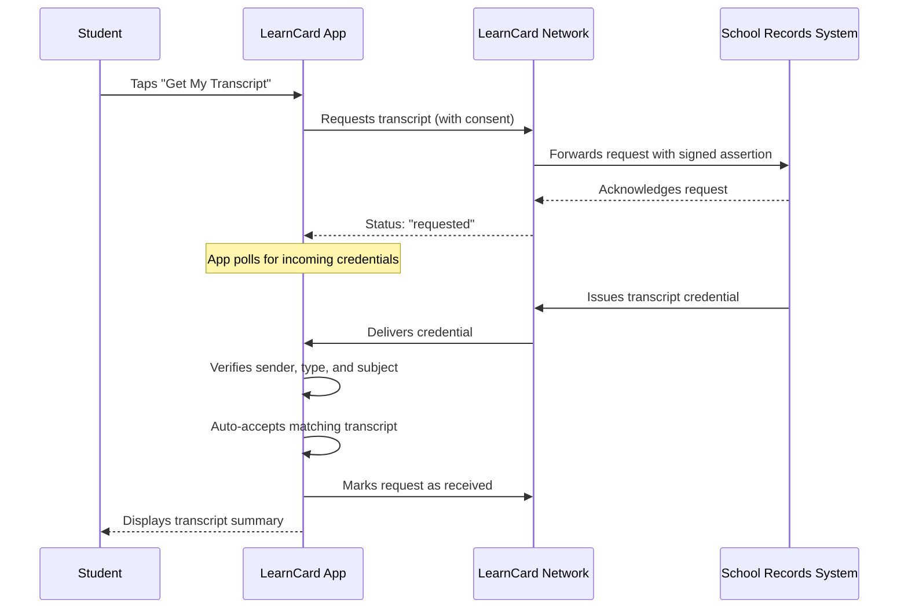

# Transcript Request Flow

The LearnCard App allows eligible students to request their official transcript directly from their school records system. This feature provides a seamless way to receive and store academic records in the wallet.

## How It Works

When a student requests their transcript, the app communicates with the school records system. Once the transcript is ready, it is delivered directly to the student's wallet and automatically accepted.

## Eligibility

The transcript request feature is available to students who:

1. Are signed in through a supported school single sign-on (SSO) provider.
2. Have a valid state student ID associated with their account.
3. Belong to a school district that has enabled transcript issuance.

## User Experience

1. **Opt-In**: Eligible students see a "Get your transcript" card in their wallet or during onboarding.
2. **Requesting**: After consenting, the card shows a progress indicator. The app polls for the incoming transcript.
3. **Arrival**: When the transcript arrives, it is automatically verified and added to the wallet. The card updates to show a summary of the transcript (e.g., school name, graduation year, GPA) and a button to view the full details.
4. **Notifications**: If the student leaves the app before the transcript arrives, they will receive a push notification. Tapping the notification opens the transcript directly.
