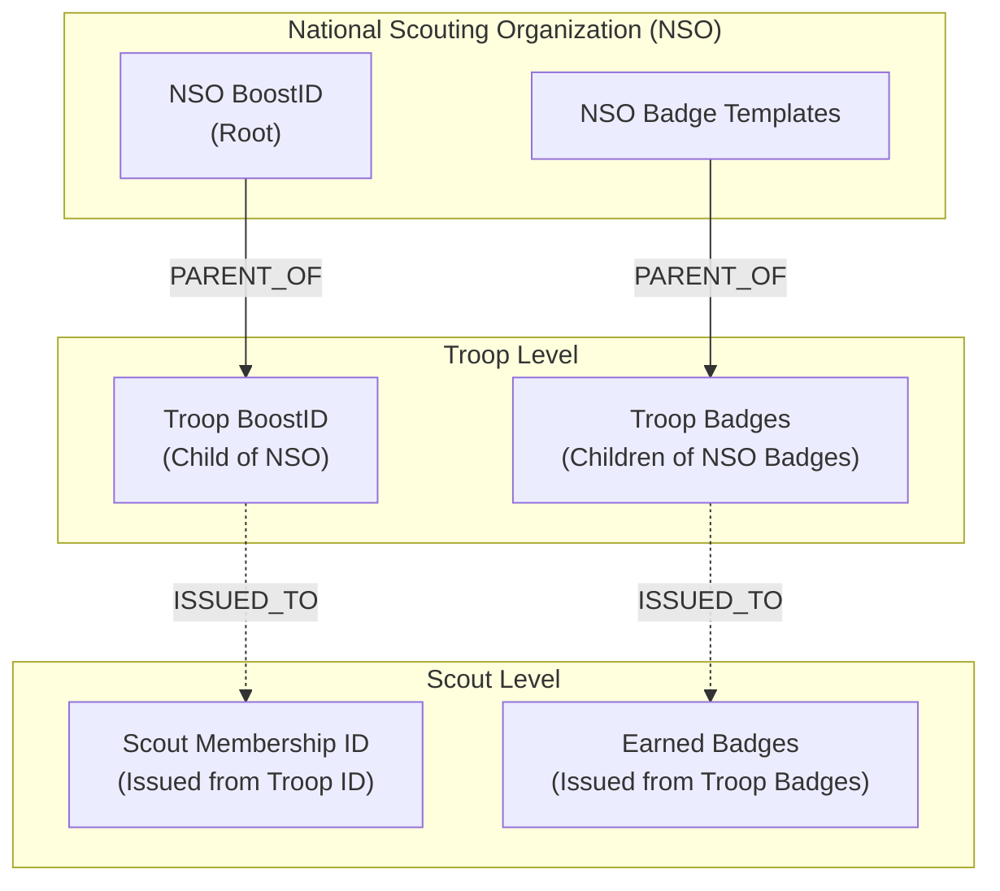
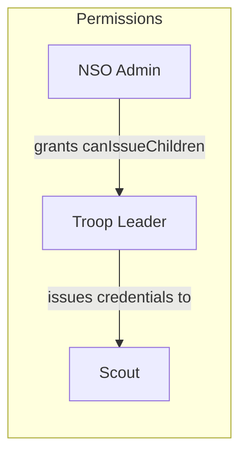
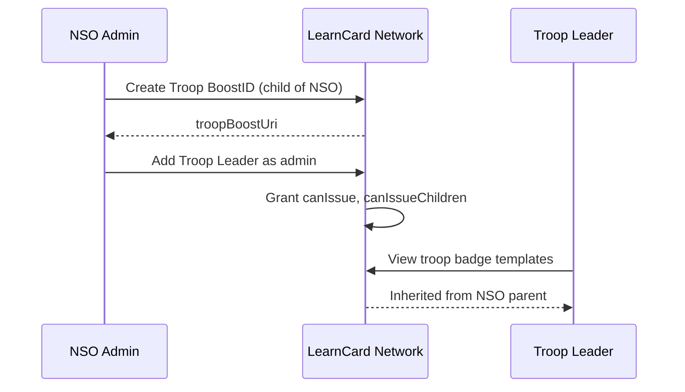
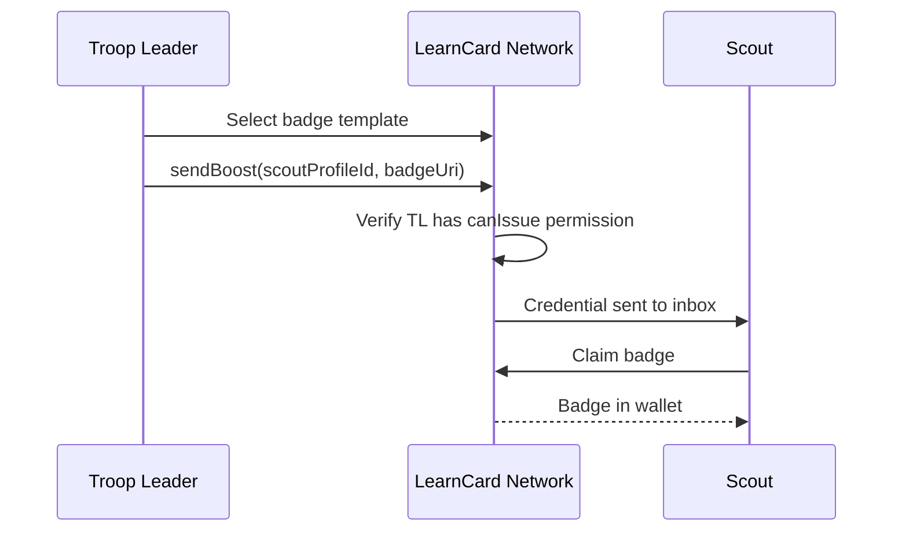

# ScoutPass

**ScoutPass** is a specialized LearnCard application designed for scouting organizations to issue and manage achievement badges digitally. It uses LearnCard's **Boost hierarchy** system to model the organizational structure of scouting: National Organizations → Troops → Scouts.

Available on:

- 📱 iOS ([App Store](https://apps.apple.com/us/app/scoutpass/id6451271002))
- 📱 Android ([Google Play](https://play.google.com/store/apps/details?id=com.scoutpass.app))
- 🌐 Web ([pass.scout.org](https://pass.scout.org/))

---

## Supported browsers and devices

Tailwind 4 requires Safari 16.4+, Chrome 111+, or Firefox 128+. The iOS app
requires iOS 16.4 or later. On Android, keep Android System WebView or Chrome
updated to version 111 or later; the Android OS version alone does not determine
support. See [Tailwind's browser requirements](https://tailwindcss.com/docs/compatibility).

## Key Features

| Feature                    | Description                                                       |
| -------------------------- | ----------------------------------------------------------------- |
| **Hierarchical Structure** | NSO → Troop → Scout organization modeled with parent-child Boosts |
| **BoostID Membership**     | Digital ID cards for troop membership at each level               |
| **Badge Issuance**         | Issue digital badges for achievements, ranks, and milestones      |
| **Role-Based Permissions** | NSO admins, troop leaders, and scouts have scoped permissions     |
| **Verifiable Credentials** | All badges and IDs are W3C Verifiable Credentials                 |

---

## Scanning QR codes

Open your profile QR card and select **Scan**. Boost codes open the claim flow, and supported profile codes open the contact view. Other HTTP or HTTPS website links open in the browser.

If the code contains unsupported content or its website link cannot be opened, ScoutPass displays “The QR code you have scanned is not compatible.” Select **Scan Another** to try a different code, or **Done** to return to the app.

---

## For developers: how ScoutPass models this on LearnCard

ScoutPass is a worked example of a multi-level organization built on the platform. Everything below is the developer view — the same [Boost](../../core-concepts/credentials-and-data/boost-credentials.md) parent-child relationships and permission flags are available to any integration.

### Organizational hierarchy

ScoutPass uses parent-child Boost relationships to create a hierarchical structure:

#### How it works

1. **NSO creates root Boosts** — The National Scouting Organization creates BoostID templates and badge templates at the top level
2. **Troops are child Boosts** — Each troop is created as a child of the NSO, inheriting badge templates
3. **Scouts receive credentials** — Troop leaders issue membership IDs and badges to individual scouts

---

### User roles & permissions

Permissions flow down through the hierarchy using LearnCard's permission model:

| Role             | Scope             | Permissions                                                                                |
| ---------------- | ----------------- | ------------------------------------------------------------------------------------------ |
| **NSO Admin**    | Organization-wide | Create badge templates, manage troops, `canCreateChildren`, `canManageChildrenPermissions` |
| **Troop Leader** | Troop-level       | Issue badges to scouts, manage troop roster, `canIssue`, `canIssueChildren`                |
| **Scout**        | Individual        | View and share earned badges and membership ID                                             |

---

### Key flows

#### Competency framework administration

ScoutPass shows the Competencies **Admin Panel** and framework management tools only when the current account's resolved IDs include a **Global Admin ID**. The controls stay hidden while the ID query is loading or fails. National admins, troop leaders, and scouts do not receive access through their membership IDs. Badge authors can still select existing competencies without editing the framework.

If an admin overlay is open when access is lost or the ID query fails, ScoutPass closes that specific overlay, including its fullscreen shell. Other open overlays and badge-author competency selection remain available.

This is a frontend visibility rule, using `useGetCurrentUserTroopIdsResolved().isScoutGlobalAdmin`. It is **not a server authorization boundary**: the ID lookup reads the user's personal LearnCloud index, and this change adds no server check of the ID's issuer, network claim status, or revocation status.

The shared LearnCard Network API still allows any authenticated profile to create or link a framework; editing, deleting, and managing its competencies require framework manager permissions. A regular user can therefore bypass ScoutPass's UI and create a framework through the API, including retaining manager access to a framework created before the UI restriction. LearnCard App relies on the shared API behavior.

For stronger enforcement, add a ScoutPass-specific server capability keyed to the authenticated profile and enforce it on framework and competency mutations, in addition to the existing framework manager checks. Trusted credential claim and revocation events could grant and remove that capability. The UI would read the same capability from the API. The policy must be selected by trusted deployment configuration, rather than a caller-controlled tenant header, to preserve LearnCard App's permissions and prevent bypasses.

#### Setting up a troop

#### Issuing a badge

---

## Related Documentation

- [Credential Status & Bitstring Status Lists](../../core-concepts/credentials-and-data/credential-status-and-bitstring-status-lists.md) — How revocation works
- [Credential Templates (Boosts)](../../core-concepts/credentials-and-data/boost-credentials.md) — Reusable templates, hierarchies, and permissions
- [Network Profiles](../../core-concepts/identities-and-keys/network-profiles.md) — Managing organizational profiles
