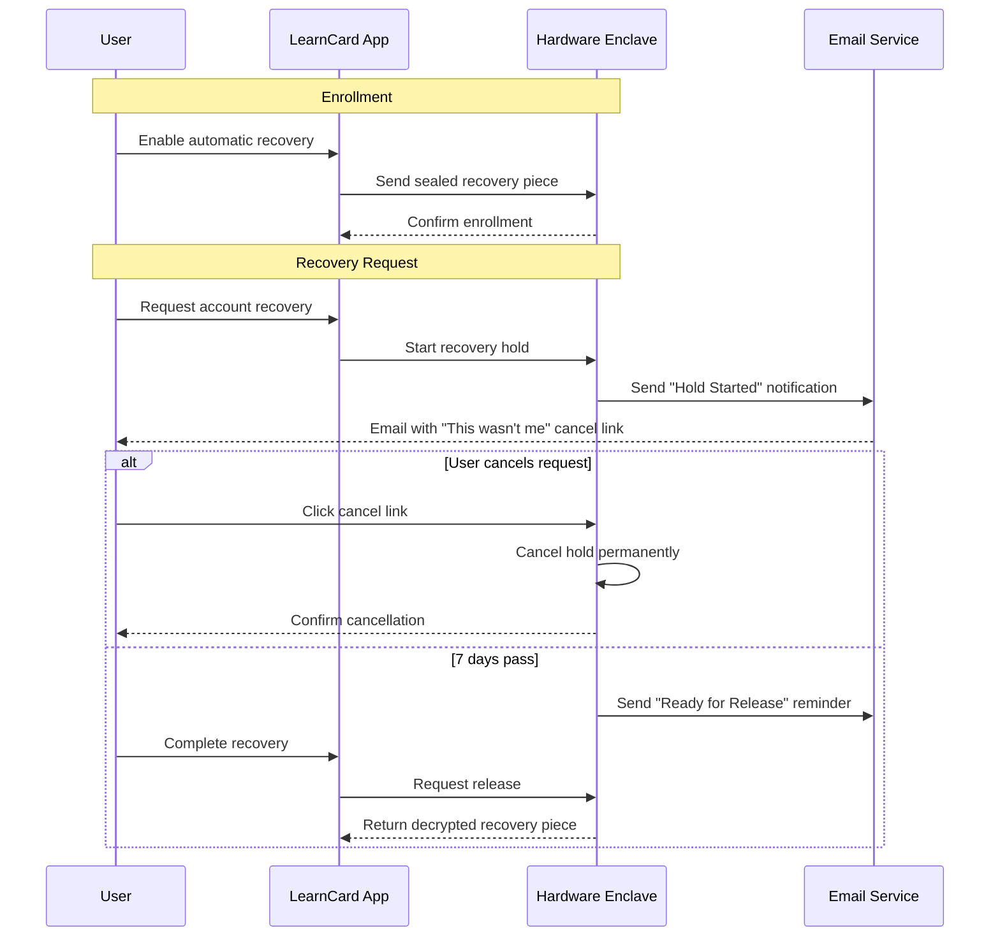
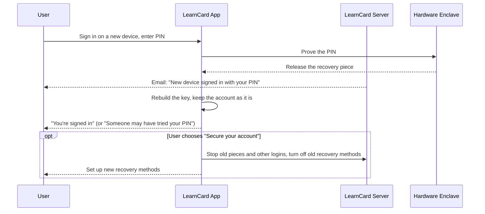

# Automatic Account Recovery

Automatic account recovery provides a safety net for users who lose access to their primary devices or recovery phrases. Instead of relying on a central database that could be compromised, LearnCard uses a hardware-secured environment to hold a sealed recovery piece. This piece can only be released after a mandatory waiting period or by providing a correct Personal Identification Number (PIN).

## What is Automatic Recovery?

When a user sets up automatic recovery, their device encrypts one piece of their recovery key. This encrypted piece is sent to a specialized, isolated server environment called a hardware enclave.

The enclave is programmed with strict rules:

1. **Delayed Release**: It will only release the decrypted recovery piece after a mandatory 7-day waiting period.
2. **PIN Release**: It will release the piece immediately if the user provides the correct PIN, but permanently locks the piece after 10 failed attempts.

Because the rules are enforced by the hardware enclave itself, no human operator or database administrator can bypass them to access the recovery piece early or without the PIN.

### Creating a PIN

New accounts are asked to create a PIN during sign-up ("Create your PIN"), which they then use to sign in on new devices. A PIN problem never blocks account creation:

- If automatic recovery is not available when the account is created (for example, it is turned off for the organization or the service cannot be reached in time), the step is skipped. Once automatic recovery is set up for the account, the app asks for a PIN when it next starts.
- If saving the PIN fails or takes too long, the app shows an error and lets the user try again. After the second failure, a "Skip for now" option appears, and the app asks again when it next starts.

Users can change or remove their PIN in Settings. Removing it asks for confirmation first, because without a PIN, getting into the account on a new device can mean the 7-day wait.

## The Recovery Flow

The recovery process is designed to give the legitimate owner time to react if an unauthorized person attempts to recover their account.

Until a second independent time source is in place, waiting-period releases are refused entirely rather than proceed on an unverified wait — the system fails closed.

## Signing In With a PIN


This behaviour is new. Its security trade-off was accepted on 2026-11-03; it ships to production after staging verification.


On a new device, the PIN is the quickest way back in. After signing in with their usual login, the user sees "Confirm it's you" and enters their 6-digit PIN. Other ways to confirm (approving from another device, a passkey, and so on) are listed below the PIN, and a quiet "Trouble signing in?" link leads to the 7-day wait. A user who enters the correct PIN is signed in **without resetting the account**:

- Their other devices stay signed in.
- Their recovery phrase, backup file, passkey and email recovery key keep working.
- The PIN stays the same. It gets a fresh set of 10 attempts only if no wrong entry has been recorded against it, other than the user's own typos during this sign-in. The PIN is used only in memory for that step and is never stored.
- Typos the user makes while signing in on this device are their own: they do not trigger a warning and do not stop the PIN getting a fresh set of attempts. Only wrong entries recorded before this sign-in started, or made from somewhere else while it was under way, count. Starting the sign-in again (for example after restarting the app) starts a new count.
- If someone else has entered the PIN incorrectly, the same PIN never gets a fresh set of attempts. It keeps working with the attempts it has left, and the app asks the user to choose a new, different PIN. On the device used to sign in, the app refuses the same PIN, also after a restart. If the user skips this, the app asks again the next time it starts, while those wrong entries are still recorded. So wrong guesses against a PIN share one set of 10 attempts, however many times the owner signs in with it. Every PIN sign-in also uses one attempt, so a user who keeps skipping can eventually lock the PIN and would then need the 7-day wait.

A user who has lost their usual login confirms their recovery email first, then enters the PIN, then signs in with a new login, which is linked to the same account. Each PIN try on this path needs a new email code, and the PIN keeps the attempts it had left (it is not refreshed).

Because the login and the PIN together are now enough to sign in quietly, LearnCard adds three checks:

1. **Email notice.** Every successful PIN sign-in sends a "New device signed in with your PIN. Not you? Secure your account." email to the account's verified addresses, with a link to secure the account. The server sends it when the PIN is accepted, so the app cannot suppress it. A failed send never blocks the sign-in.
2. **A confirmation after signing in.** The app shows "You're signed in" once, with a "Done" button and a "Lost a device? Secure your account" link. If the PIN was entered incorrectly before this sign-in (not counting the user's own typos), the app instead says "Someone may have tried your PIN", says how many times it was entered incorrectly, and leads with "Choose a new PIN"; the app refuses the PIN that was just used. The same link and a "Not now" option stay available.
3. **Secure my account.** Available from that link, from the email link, and as "Sign out of other devices" under "Security" at the end of Account Recovery settings. That row shows a small amber dot while wrong PIN entries are recorded against the current PIN, not counting the user's own typos during their last sign-in on this device. Its confirmation screen explains what will happen before anything changes. It stops other devices and other linked logins from signing in again, and turns off the old recovery phrase, backup file, passkey and email recovery key. The user can keep the PIN (by entering it again, unless wrong entries are recorded against it right after a PIN sign-in), choose a new one, or continue without one, and is then asked to set up new recovery methods, starting with a passkey. The app suggests a new PIN if someone else might know the current one.

Someone who knows both the login and the PIN can also use "Secure my account", which can remove the owner's other logins. After every "Secure my account", LearnCard emails the account's contact address and its verified recovery email. That email is written for an owner who may not have done this: it does not rely on the "Secure my account" link. It says that the account's recovery methods were reset, so they may no longer work, and tells the owner to contact the organization's support address (or, if the organization has none, the organization that gave them access). The email cannot restore access by itself.

A recovery that was already under way before a "Secure my account" (or before another recovery that reset the account), for example one where the recovery-email code had already been confirmed, cannot be finished after it; it has to start again from the beginning.


"Secure my account" does not change the account's key. A device that already signed in and is still open may keep working until it signs out, and the action cannot undo anything someone already did with the account. It stops new sign-ins with the old pieces, the old recovery methods and other linked logins.


### What happens to the PIN after other recoveries

The 7-day hold still resets the account: it signs out other devices and turns off other recovery methods. The PIN is removed, because this is the path for users who forgot their PIN, and the app asks the user to choose a new one.

## What is Attestation?

To ensure the hardware enclave is actually running the correct, unmodified code, LearnCard uses a process called **attestation**.

In plain words, attestation is how a device checks a hardware-signed proof of exactly which code is running before trusting it. When the LearnCard App communicates with the enclave, the enclave provides a cryptographic certificate generated by the underlying hardware (like Amazon Web Services Nitro). This certificate proves that the enclave is running the exact software version approved by LearnCard, without any modifications or backdoors. If the proof doesn't match the expected version, the app refuses to send the recovery piece.

## Operator Capabilities and Limits

The hardware enclave design strictly limits what LearnCard operators (or attackers who compromise the operator's systems) can do.

**What the operator CAN do:**

- Turn off the servers (causing an outage where recovery is unavailable).
- Delete the encrypted recovery pieces (causing permanent data loss, meaning users cannot recover their accounts).
- See when a user requests a recovery and when it completes.

**What the operator CANNOT do:**

- Read the decrypted recovery piece.
- Bypass the 7-day waiting period.
- Guess the PIN infinitely (the enclave enforces the 10-attempt limit).
- Modify the enclave's code without changing the attestation proof (which the app would detect and reject).

## Honest Limits

While the enclave provides strong security, it is not magic. There are specific technical limits to its guarantees:

- **Rollback Detection**: The system detects if an attacker tries to roll back the enclave's memory to an older state (to reset the PIN counter, for example), but it cannot prevent it in all scenarios. If a rollback is detected, the system fails closed and refuses to release the key. The PIN attempt budget is only as strong as this rollback detection.
- **Time Sources**: The enclave relies on external time servers to measure the 7-day waiting period. It requires at least two agreeing signed sources and fails closed otherwise. Time intervals describe signed processing events, not an authenticated upper bound on receipt time.
- **Enrollment Verification**: Production release also awaits a reviewed way for the secure environment to confirm the current enrollment.

For a comprehensive technical breakdown of the threat model, cryptographic guarantees, and known limitations, please review the [Security Review Packet](https://github.com/learningeconomy/LearnCard/blob/main/services/escrow-enclave-app/SECURITY.md).
