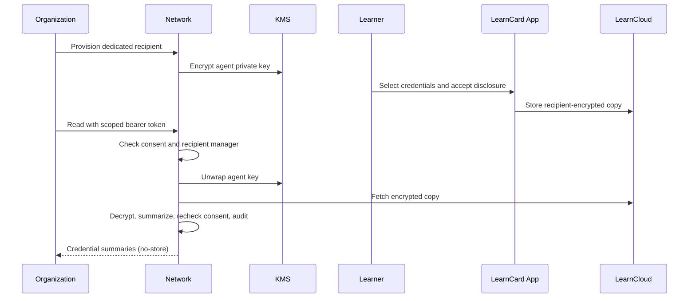

# Read Consented Credentials as an Organization

Readable delivery lets an organization request credential summaries through an authenticated API. Provision or enable an organization recipient **before** asking learners to consent. LearnCard then processes the selected encrypted credentials for that organization.

This feature is disabled by default. An operator must configure and enable it for the network you use. It does not make existing encrypted records readable retroactively.

## Understand the delegation

The organization explicitly accepts LearnCard as a manager of the recipient. Managers participate in the recipient's DID document, including authentication and signing authority as well as encryption. This is broader than a permission to decrypt a single credential. Use the dedicated recipient only for this integration; do not use a learner, family, or existing organization identity as the delivery agent.

The consent screen names the recipient and explains that LearnCard can process the selected information on its behalf. Neither provisioning nor this API grants access without current learner consent and any required guardian approval.

## Provision and request consent

Using an organization administrator's initialized SDK, call `learnCard.invoke.createReadableDeliveryRecipient` with:

| Field                      | Value                                                                          |
| -------------------------- | ------------------------------------------------------------------------------ |
| `profileId`                | Optional existing organization profile you directly manage; omit to create one |
| `requestId`                | A UUID retained for retries of this operation                                  |
| `displayName`              | The organization name learners will see (1–100 characters)                     |
| `acceptDelegatedAuthority` | `true`, after accepting the delegation described above                         |
| `disclosureVersion`        | `"1"`                                                                          |

The response contains `profileId`, `did`, `displayName`, `agentDid`, `enabled`, and `disclosureVersion`. Repeating the same request ID and name returns the same enabled recipient. With `profileId`, the existing profile must be an organization directly managed by the caller, with the same display name and no previous readable-delivery setup. None of its contracts may have ever received consent, even withdrawn consent. The check and co-manager creation are atomic with first consent and audience changes. Existing contracts get a new audience version so an already-open consent screen must reload the disclosure. The profile identity is preserved. Learner and family profiles cannot opt in.

Include the returned `profileId` in `recipients` when creating the consent contract. Ask the learner to select credentials and accept through the app. Adding a recipient later requires the existing audience-change and renewed-consent process. Older ciphertext does not acquire the new key.

## Create a scoped API token

From the administrator's SDK, use `addAuthGrant` with a `name`, `scope: "contracts-data:read contracts-data:decrypt"`, and `actAs` set to the recipient's `profileId`. Exchange that grant ID using `getAPITokenForAuthGrant`. Keep the token in your backend secret store.

Both permissions are required. `contracts-data:read` alone and the usual read-only wildcard `*:read` cannot decrypt. The caller must still manage the selected recipient. Provisioning and disabling require `readableDelivery:write`.

## Read summaries

Send `POST /api/readable-delivery/data` on the configured network with:

- `Authorization: Bearer <token>`
- `X-LearnCard-Act-As: <recipient profileId>`
- `Content-Type: application/json`

The JSON body takes `contractUri`, the learner's `did`, an optional `limit` (1–25; default 10), and the previous page's optional `cursor`. The equivalent SDK method is `getReadableDeliveryData(input)` on a client acting as the recipient.

The response contains `records`, `hasMore`, and a continuation `cursor` when applicable. Each record has its consented `uri`, `category`, and a status:

| Status        | Meaning                                                                          |
| ------------- | -------------------------------------------------------------------------------- |
| `readable`    | Decrypted and parsed; `credential` contains the summary                          |
| `unreadable`  | The copy could not be decrypted, including copies made before agent provisioning |
| `unavailable` | The configured storage could not supply the encrypted copy                       |
| `invalid`     | The decrypted object is not a supported credential                               |

The summary includes available name, types, issuer, dates, and boost URI. It excludes the credential subject, raw credential, and proof material. Each summary has a `verification` object:

| Field        | Values / meaning                                                                                        |
| ------------ | ------------------------------------------------------------------------------------------------------- |
| `proof`      | `valid`, `invalid`, or `unavailable`                                                                    |
| `status`     | `valid`, `invalid`, `unavailable`, or `not_applicable` when the credential declares no status mechanism |
| `dates`      | `valid` or `invalid`; expiry and not-before dates are checked                                           |
| `label`      | The outcome label below                                                                                 |
| `issuerName` | Registry display name when the issuer is recognized                                                     |

| Label                   | Meaning                                                                                                                                          |
| ----------------------- | ------------------------------------------------------------------------------------------------------------------------------------------------ |
| `verified`              | Signature and applicable status/date checks passed, and the issuer is expected for this contract                                                 |
| `recognized_issuer`     | Checks passed and the issuer is in a configured registry, but is not expected for this contract                                                  |
| `signed_unknown_issuer` | Checks passed; the issuer is neither expected nor recognized by the successfully checked registries                                              |
| `self_reported`         | Missing/invalid signature or signed by the learner's known identity, even if that identity was listed as expected                                |
| `unverified`            | A required check could not complete, the credential is revoked/suspended/expired/not yet valid, or registry recognition could not be established |

Expected issuers are the contract owner and explicit writers (both their stored DID and network DID), plus their registered signing-authority DIDs. The owner can supply additional DIDs with `contract.expectedIssuers` when creating or updating a contract; send an empty array to remove those additions. These expectations do not grant write permission or data access. Current expectations are checked again before a response is released.

Proof and status verification run in a disposable WASM worker. Public verification documents use bounded HTTPS GETs with DNS-pinned public addresses and no redirects; private addresses, credentials in URLs, and arbitrary outbound methods are rejected. Only the exact owned network origin is allowed over HTTP in local development. Verification has a time/request budget and incomplete checks never produce a positive label. Unsupported proof/status formats produce an explicit failure or unavailable result, not a verified credential. No status mechanism means `not_applicable`, not proof that the issuer can never revoke the credential. Integrators should use the label and individual checks together and set their own acceptance policy.

Pages reflect current consent, rather than a historical snapshot. Suspended, withdrawn, or pending-renewal consent is denied. The API checks consent again before releasing results and returns `Cache-Control: private, no-store`.

## Stop access

Learners can withdraw consent using the existing app flow. The creating administrator can also call `disableReadableDelivery(profileId)`. Disabling removes the agent as a manager and blocks this API. It cannot recall summaries already delivered. There is no re-enable operation; provision a fresh recipient and obtain fresh consent when starting again.

## Operator configuration

| Variable                               | Purpose                                                                              |
| -------------------------------------- | ------------------------------------------------------------------------------------ |
| `READABLE_DELIVERY_ENABLED`            | Enable explicitly; default `false`                                                   |
| `READABLE_DELIVERY_KMS_KEY_ARN`        | Exact symmetric KMS key ARN, supplied by this service's infrastructure               |
| `READABLE_DELIVERY_CLOUD_URL`          | Trusted public LearnCloud HTTPS origin, without `/trpc`                              |
| `READABLE_DELIVERY_CLOUD_INTERNAL_URL` | Optional trusted internal origin; HTTPS required outside local development           |
| `READABLE_DELIVERY_LOCAL_KEY`          | 64 hex characters, accepted only by an offline, nonproduction runtime outside Lambda |

For Lambda, set the enable flag and trusted origins in the brain service's checked-in per-stage configuration (`config/config.<stage>.json`); they are applied at cold start. The deployment helper supplies the KMS ARN and deliberately never forwards a local wrapping key. Local standalone processes can use their own `.env`.

The infrastructure creates a retained, automatically rotating KMS wrapping key restricted to the brain service execution role and the readable-delivery encryption context. That role is shared by the existing brain service functions; it is the runtime trust boundary. The recipient, domain, and key version are bound to each ciphertext. KMS failure never falls back to a local key. Automatic KMS rotation preserves access to existing envelopes; rotating a recipient's agent identity is not supported by this API.

The graph stores encrypted private-key envelopes separately from public profiles. Provisioning, disabling, and reads admitted by the rate limiter write audit events containing actor, recipient, action, outcome, timestamp, and result count, without credential content or learner identifiers. An unavailable audit store prevents successful delivery. Read requests are limited to 60 per minute per actor and recipient before audit writes, including requests with insufficient permissions. Throttled traffic is rejected at the counter without creating additional audit nodes. Retain and restrict these audit records under your organization's operational policy.

Only the network's own storage and the explicitly configured LearnCloud origin are read. Redirects are refused, ciphertext is limited to 2 MiB, and plaintext is neither persisted nor cached. Other storage backends return `unavailable`.

The `consent-flow` verification journey exercises existing-organization provisioning, app disclosure, encrypted LearnCloud delivery, verified outcome labels, token scopes, withdrawal, and disablement on a disposable stack. Local verification uses an ephemeral wrapping key; it does not prove deployed AWS permissions. Validate KMS permissions in the target nonproduction environment before enabling the feature there.
