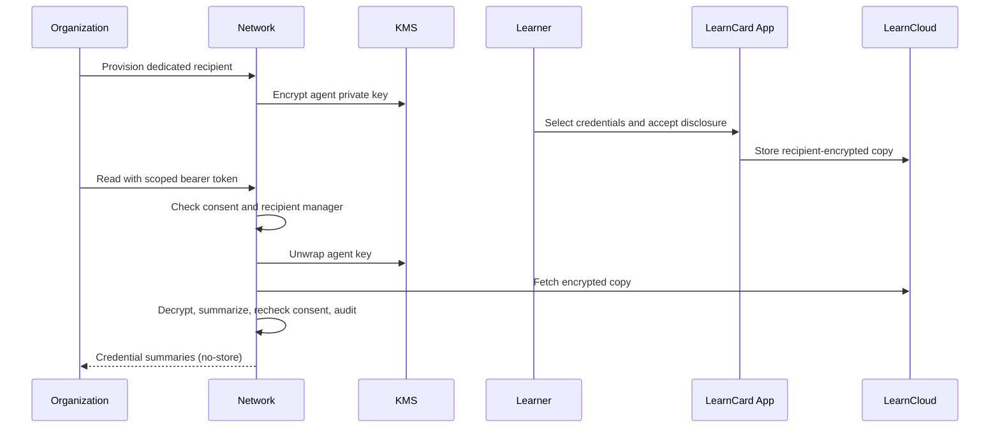

# Read Consented Credentials as an Organization

Readable delivery lets an organization request credential summaries through an authenticated API. Provision a dedicated recipient **before** asking learners to consent. LearnCard then processes the selected encrypted credentials for that organization.

This feature is disabled by default. An operator must configure and enable it for the network you use. It does not make existing encrypted records readable retroactively.

## Understand the delegation

The organization explicitly accepts LearnCard as a manager of the new recipient. Managers participate in the recipient's DID document, including authentication and signing authority as well as encryption. This is broader than a permission to decrypt a single credential. Use the dedicated recipient only for this integration; do not use a learner, family, or existing organization identity as the delivery agent.

The consent screen names the recipient and explains that LearnCard can process the selected information on its behalf. Neither provisioning nor this API grants access without current learner consent and any required guardian approval.

## Provision and request consent

Using an organization administrator's initialized SDK, call `learnCard.invoke.createReadableDeliveryRecipient` with:

| Field                      | Value                                                      |
| -------------------------- | ---------------------------------------------------------- |
| `requestId`                | A UUID retained for retries of this operation              |
| `displayName`              | The organization name learners will see (1–100 characters) |
| `acceptDelegatedAuthority` | `true`, after accepting the delegation described above     |
| `disclosureVersion`        | `"1"`                                                      |

The response contains `profileId`, `did`, `displayName`, `agentDid`, `enabled`, and `disclosureVersion`. Repeating the same request ID and name returns the same enabled recipient. It never attaches the agent to an existing profile.

Include the returned `profileId` in `recipients` when creating the consent contract. Ask the learner to select credentials and accept through the app. Adding a recipient later requires the existing audience-change and renewed-consent process. Older ciphertext does not acquire the new key.

## Create a scoped API token

From the administrator's SDK, use `addAuthGrant` with a `name`, `scope: "contracts-data:read contracts-data:decrypt"`, and `actAs` set to the recipient's `profileId`. Exchange that grant ID using `getAPITokenForAuthGrant`. Keep the token in your backend secret store.

Both permissions are required. `contracts-data:read` alone and the usual read-only wildcard `*:read` cannot decrypt. The caller must still manage the selected recipient. Provisioning and disabling require `readableDelivery:write`.

## Read summaries

Send `POST /api/readable-delivery/data` on the configured network with:

- `Authorization: Bearer <token>`
- `X-LearnCard-Act-As: <recipient profileId>`
- `Content-Type: application/json`

The JSON body takes `contractUri`, the learner's `did`, an optional `limit` (1–25; default 10), and the previous page's optional `cursor`. The equivalent SDK method is `getReadableDeliveryData(input)` on a client acting as the recipient.

The response contains `records`, `hasMore`, and a continuation `cursor` when applicable. Each record has its consented `uri`, `category`, and a status:

| Status        | Meaning                                                                          |
| ------------- | -------------------------------------------------------------------------------- |
| `readable`    | Decrypted and parsed; `credential` contains the summary                          |
| `unreadable`  | The copy could not be decrypted, including copies made before agent provisioning |
| `unavailable` | The configured storage could not supply the encrypted copy                       |
| `invalid`     | The decrypted object is not a supported signed credential                        |

The summary includes available name, types, issuer, dates, and boost URI. It excludes the credential subject, raw credential, and proof material. `verification.proof` is `valid`, `invalid`, or `not_checked`. This release checks self-contained `did:key` issuer proofs; other issuers are `not_checked`. `verification.status` is always `not_checked`: this endpoint does **not** establish revocation status, expiry, issuer trust, or overall credential validity. Do not present `proof: valid` as “verified and current.”

Pages reflect current consent, rather than a historical snapshot. Suspended, withdrawn, or pending-renewal consent is denied. The API checks consent again before releasing results and returns `Cache-Control: private, no-store`.

## Stop access

Learners can withdraw consent using the existing app flow. The creating administrator can also call `disableReadableDelivery(profileId)`. Disabling removes the agent as a manager and blocks this API. It cannot recall summaries already delivered. There is no re-enable operation; provision a fresh recipient and obtain fresh consent when starting again.

## Operator configuration

| Variable                               | Purpose                                                                              |
| -------------------------------------- | ------------------------------------------------------------------------------------ |
| `READABLE_DELIVERY_ENABLED`            | Enable explicitly; default `false`                                                   |
| `READABLE_DELIVERY_KMS_KEY_ARN`        | Exact symmetric KMS key ARN, supplied by this service's infrastructure               |
| `READABLE_DELIVERY_CLOUD_URL`          | Trusted public LearnCloud HTTPS origin, without `/trpc`                              |
| `READABLE_DELIVERY_CLOUD_INTERNAL_URL` | Optional trusted internal origin; HTTPS required outside local development           |
| `READABLE_DELIVERY_LOCAL_KEY`          | 64 hex characters, accepted only by an offline, nonproduction runtime outside Lambda |

The infrastructure creates a retained, automatically rotating KMS wrapping key restricted to the brain service execution role and the readable-delivery encryption context. That role is shared by the existing brain service functions; it is the runtime trust boundary. The recipient, domain, and key version are bound to each ciphertext. KMS failure never falls back to a local key. Automatic KMS rotation preserves access to existing envelopes; rotating a recipient's agent identity is not supported by this API.

The graph stores encrypted private-key envelopes separately from public profiles. Reads, provisioning, and disabling write audit events containing actor, recipient, action, outcome, timestamp, and result count, without credential content or learner identifiers. An unavailable audit store prevents successful delivery. Retain and restrict these audit records under your organization's operational policy.

Only the network's own storage and the explicitly configured LearnCloud origin are read. Redirects are refused, ciphertext is limited to 2 MiB, and plaintext is neither persisted nor cached. Other storage backends return `unavailable`.

The `consent-flow` verification journey exercises provisioning, app disclosure, encrypted LearnCloud delivery, token scopes, withdrawal, and disablement on a disposable stack. Local verification uses an ephemeral wrapping key; it does not prove deployed AWS permissions. Validate KMS permissions in the target nonproduction environment before enabling the feature there.
