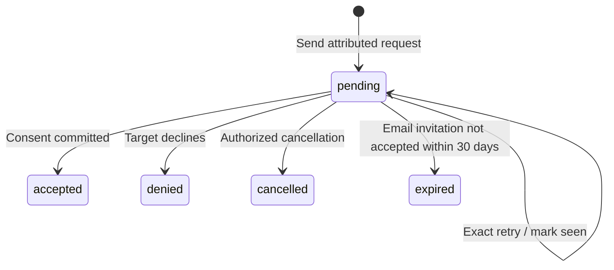

# Contract Requests and Events

A contract request invites a person to review a ConsentFlow contract. Address it to an existing network profile, or to an email address when you do not know the profile. Sending a request grants no permission to read or write the user's data. The user chooses consent terms through the existing consent flow, including guardian approval when required.

The Salesforce Data Mediator, or any other external integration, is a client of these APIs and webhooks.

## Verify locally

From a repository checkout with workspace dependencies installed and OrbStack or Docker running:

```bash
bun run test:referrals
```

This command starts a disposable Neo4j database, creates synthetic accounts, checks referral actions, privacy and notification retries, then stops the database. It prints a result for each suite and saves detailed logs and JSON results in the operating system's temporary directory. The first run may download the database image. No API servers, environment setup or real accounts are needed.

Use `bun run test:referrals --full` to include consent, credential and legacy-notification regressions. A failed or incomplete run exits with a nonzero status. These checks exercise service routes in-process; app screens, signed HTTP delivery and the external CRM need separate testing.

## Roles

| Action                                     | Who can perform it                                                                                 |
| ------------------------------------------ | -------------------------------------------------------------------------------------------------- |
| Send a generic request                     | Contract owner, explicit writer, or current data recipient                                         |
| List sent requests / inspect target status | Owner and writer: all referrals; current recipient: only referrals it sent; target: its own status |
| List incoming requests                     | The target profile only                                                                            |
| Mark a generic request seen                | The target, for an existing request only                                                           |
| Deny                                       | The target only                                                                                    |
| Cancel                                     | Owner, writer, target, or the requesting recipient while still in the audience                     |
| Read consented data                        | Owner and current data recipients, under current consent permissions                               |
| Write outcomes                             | Owner or explicit writer, under current write permissions                                          |

A writer outside the data audience receives only a decision and correlation metadata for a request it sent. Being a writer does not grant read access.

Being a data recipient does not grant access to other organizations' invitations or decisions, even after the learner accepts. Request lists are filtered in the database. Inspecting another sender's request returns `null`, the same as a missing request, without exposing its status, message, internal reference, or target profile. Owners and writers retain management access; legacy writer/target request reads retain their behavior.

## Send and track a request

Use an initialized network-enabled LearnCard instance with an existing profile. Generic send, deny, seen and cancel actions require `contracts:write` scope when using an auth grant.

```typescript
const { requestId, status } = await referrer.invoke.sendContractRequest({
    contractUri,
    targetProfileId: learnerProfileId,
    externalReferenceId: 'referral-123',
    message: 'Career support is available through this partner.',
});
// status is 'pending'. Store requestId next to your own referral record.

const request = await referrer.invoke.getContractRequest(contractUri, requestId);
// { requestId, status, externalReferenceId, requestedAt, expiresAt?, target }
// target is { profile } for a request sent to a profile.

// Cancel by request ID, or by the target profile ID.
await referrer.invoke.cancelContractRequest(contractUri, { requestId });
```


**Breaking change.** `sendContractRequest` used to return `true`. It now returns `{ requestId, status }`. Code that compared the result with `true` must read `status` instead.


`getRequestStatusForProfile(learnerProfileId, undefined, contractUri)` still returns the request for a known profile, with `requestId`, `requestedBy`, `externalReferenceId`, `requestedAt`, `message`, `status` and `readStatus`. Legacy requests may omit attribution fields.

`externalReferenceId` is an opaque integration reference, limited to 256 characters; `message` is limited to 500. Avoid putting sensitive data in either field. Targets may also be addressed by a resolvable network DID. Sending a request to yourself returns `BAD_REQUEST`, including when addressed by DID. A missing profile target returns `NOT_FOUND`. To invite someone whose profile you do not know, see [Invite by email](#invite-by-email). Requests are limited to 500 per hour per contract and sender.

For sends to a profile, there is one request per contract and profile in this version. An identical pending retry keeps the same request and event IDs. Conflicting sender, reference or message returns `CONFLICT`. Sends to an email follow the rules in [Invite by email](#invite-by-email) instead. Terminal requests and existing legacy requests are not replaced. One exception: when you send to a profile that holds your own email invitation for this contract (pending, expired or cancelled), the new request replaces it and gets a new `requestId`. The invitation's `requestId` keeps answering as an invitation to that email until it expires. Sending to a target with an unexpired active consent, including a one-time snapshot, also returns `CONFLICT`.

## Invite by email

Pass `targetEmail` instead of `targetProfileId`. Pass exactly one of the two.

```typescript
const { requestId } = await referrer.invoke.sendContractRequest({
    contractUri,
    targetEmail: 'learner@example.com',
    externalReferenceId: 'referral-123',
});

const request = await referrer.invoke.getContractRequest(contractUri, requestId);
// request.target is { email: 'learner@example.com' } until the person accepts.
```

- The answer is always `{ requestId, status: 'pending' }`. It is the same whether or not the email belongs to an account, and whatever that account has already consented to. You cannot use this call to find out who has an account.
- Delivery happens shortly after the call, usually within a minute. If no account has verified that email, LearnCard sends one invitation email with the branding of the tenant that made the call, and retries it if delivery fails. At most 3 invitation emails go to one address per contract in 24 hours. The email does not contain your `message`.
- When a profile verifies that email (at sign-up or later), the invitation becomes an ordinary request with the same `requestId`, and the person gets the usual in-app `request_sent` notification. If the normal request rules do not pass (for example the person already has a request or active consent for this contract), the invitation stays `pending` and expires. You cannot tell this apart from no response.
- An identical retry (same contract, email, sender, reference and message) while the first is pending returns the same `requestId` and sends nothing.
- A send that differs in sender, reference or message creates a separate invitation with its own `requestId`; it does not answer `CONFLICT`. If several invitations reach the same profile, the first becomes the request and the others stay `pending` and expire.
- Once your earlier invitation has expired or been cancelled, sending again creates a new invitation with a new `requestId`. If the person's profile still holds your earlier request, the new one replaces it.
- An invitation that is still pending 30 days after it was sent expires. One that was accepted, declined or cancelled before then keeps that status. An expired invitation reads `expired`, whether or not it reached a profile, and it can no longer be accepted, declined or cancelled (cancelling answers `CONFLICT`). The person can still consent to the contract on their own; that consent carries no referral.
- Emails are compared without regard to letter case.

**What you can see.** Until the status is `accepted`, an email-addressed request shows `target: { email }` and no profile, DID or read state in `getContractRequest` and `getContractSentRequests`. `getRequestStatusForProfile` returns `null` for it, and `cancelContractRequest` with a profile ID answers as if no request existed; use the `requestId`. A `request_denied` or `request_cancelled` notification caused by the invited person names the contract owner as sender, not the person. The person's DID reaches you through the consent event on acceptance, together with your `externalReferenceId`.

Integration webhooks report an email-addressed request too: `request_sent` once when you make it, `request_denied`, `request_cancelled` and `request_expired` without a subject, and `request_accepted` with the subject. See [Integration Webhooks and Change Feed](integration-webhooks.md) for the event reference.

Sending the same email to several contracts, or timing your calls, does not change these answers: the call returns before LearnCard looks the email up.

## Target actions

```typescript
const requests = await learner.invoke.getAllContractRequestsForProfile(learnerProfileId);
await learner.invoke.markContractRequestAsSeen(contractUri, learnerProfileId);

// Explicitly decline; merely dismissing a card is not denial.
await learner.invoke.denyContractRequest(contractUri);

// Or cancel a pending request; authorized senders use this method too,
// with the target profile ID or with { requestId }.
await learner.invoke.cancelContractRequest(contractUri, learnerProfileId);
```

Acceptance uses `consentToContract` after the user reviews the latest contract, audience and permissions. For referral acceptance, pass `expectedRequestId` in the consent options. The server checks that this exact request is still pending under the same contract lock as the consent write. A missing, mismatched, denied, or cancelled request returns `CONFLICT` without recording consent or a consent event. New consent and re-consent also reject expired contracts. Omit `expectedRequestId` for independent direct or legacy consent links; cancelling an invitation does not disable a valid direct consent link. Include its current `audienceVersion` for recipient-bearing contracts. Encryption must cover the owner and current recipients before sharing credential URIs. See [ConsentFlow](../../core-concepts/consent-and-permissions/consentflow-overview.md).



Denied and cancelled generic requests retain their correlation fields. Withdrawing consent retains an accepted generic request and the referral captured on consent history. It revokes current data access; it does not reset a terminal request to pending. If the learner later consents again, the original referral remains attached to the consent and subsequent transactions. This does not reopen the request or send another acceptance decision to a requester outside the audience. A legacy AI request cannot replace an attributed request; it returns `CONFLICT`.

## Polling fallback

Use `getContractSentRequests(contractUri)` to reconcile visible invitation statuses, or `getContractRequest(contractUri, requestId)` for one request. Each row has `target`; a row for an email-addressed request has no `profile` until it is accepted, and email invitations that have not reached a profile are listed too. The brain route `getConsentedDataForDid` is exposed by the SDK as `getConsentFlowDataForDid(did, { limit, cursor })`; follow pagination and filter records by `contractUri`. An accepted request can outlive consent, so always read current permitted data before relying on the decision. Polling does not claim credentials or run client synchronization. See the [integrator example](../../how-to-guides/consent-flow/brokered-referrals.md#poll-when-webhooks-are-unavailable).

## Webhook events


This section describes **profile notification webhooks**. A server-to-server integration that needs HMAC-signed requests, an ordered feed it can poll, or a way to rebuild its state after an outage should use [Integration Webhooks and Change Feed](integration-webhooks.md) instead. That channel also reports contract retirement, re-consent pauses, suspension and expiry, which profile webhooks do not, and offers a connections snapshot (`getContractConnections`).


Configure the receiving profile's `notificationsWebhook` using the existing profile API. Events use `type: "CONSENT_FLOW_TRANSACTION"` and a localized `message`. Correlation lives in `data.metadata`:

```json
{
    "eventId": "stable-event-id",
    "deliveryKey": "stable-event-id:recipient-profile-id",
    "event": "consent_created",
    "contractUri": "lc:network:example.com/trpc:contract:contract-id",
    "termsUri": "lc:network:example.com/trpc:terms:terms-id",
    "requestId": "request-id",
    "requestedBy": "referrer-profile-id",
    "externalReferenceId": "referral-123",
    "recipientRole": "owner"
}
```

| Event                                 | Delivery                                                                                    |
| ------------------------------------- | ------------------------------------------------------------------------------------------- |
| `request_sent`                        | Target; metadata includes `type: "contract-request"` and optional message                   |
| `request_accepted`                    | Requester outside the data audience; no transaction payload or Terms URI                    |
| `request_denied`, `request_cancelled` | Owner and original requester only; no consent payload                                       |
| `consent_created`, `consent_updated`  | Owner and data recipients                                                                   |
| `consent_withdrawn`                   | Owner and data recipients; signals revocation                                               |
| `credentials_synced`                  | Owner and data recipients; legacy transaction shape retained with permitted credential URIs |

Each event is deduplicated per recipient, excluding the acting profile. Consenting to a request also changes its status to accepted atomically. A Terms update that accepts a pending request after prior consent expired sends the requester an acceptance decision too.

Explicit writers do not automatically subscribe to other senders' decisions. An original requester removed from the data audience can still receive its own minimal acceptance decision and correlation reference, without a transaction payload, Terms URI or consented data.

`termsUri` appears only on consent events delivered to the data audience. Referral fields are optional for direct or legacy consent, and are preserved on Terms, transaction history, and holder export metadata. The owner, writers with data access, and the original referrer retain `externalReferenceId` on their permitted events. Other data recipients receive consented data and public attribution (`requestId`, `requestedBy`), with the internal reference removed from both metadata and the transaction's `referral`. They do not receive private invitation text. The learner retains the full referral in its own history and export. Use the consented data APIs for current values; notification transactions are not a substitute for permission checks.

## Delivery and retry

State changes and event intents commit in the same Neo4j statement. Notification transport failure does not roll back consent or a request. A leased worker checks pending deliveries once per minute, using the existing SQS/webhook transport. Production uses the scheduled `contractEvents` Lambda; Docker starts the same worker after server readiness and stops it during shutdown. Local Serverless Offline can use the handler directly; it does not start the Docker timer.

Delivery is **at least once**. Persist `deliveryKey` with the downstream side effect to deduplicate retries, and acknowledge only after durable storage. Return an existing supported acknowledgement such as `{"success": true}`. Direct webhook timeouts, HTTP 5xx, HTTP 408/425/429, and explicit unsuccessful storage acknowledgements are retryable. Other HTTP 4xx responses are final rejections. A missing or disabled webhook also ends direct delivery without retry. These distinctions apply only to contract events; existing notification callers retain their behavior.

Outbox retries start after one minute, double after each failed attempt, and cap at one hour between attempts. A delivery stops after 12 claimed attempts or 24 hours from event creation, whichever comes first. Claims count even if the worker crashes before recording the outcome. A stopped delivery is marked `rejected` for a permanent rejection or `failed` when its retry budget expires; it is not marked delivered. The worker retains a coarse failure reason without recording the notification body in logs.

With a continuously running worker and repeated failures, the delays before attempt 12 total about six hours (363 minutes). The 24-hour ceiling also limits aged or abandoned work; it is not a promise to retry for a full day. Worker downtime and backlog can change when attempts run.

For SQS, a successful enqueue completes the outbox delivery. The queue consumer acknowledges permanent contract webhook rejections so SQS can discard those messages; temporary failures remain subject to the queue's configured retry and retention policy. The outbox's 12-attempt/24-hour limits do not govern SQS retries.

Recipients removed before dispatch are skipped, including events already placed on SQS. Request decisions queued under the former broad audience are also suppressed for unrelated recipients. Queued consent events have private reference fields removed if the recipient no longer has referral management access. These checks run before outbox dispatch and again in the SQS consumer; previously delivered copies cannot be recalled. Expired or withdrawn consent blocks queued data events, and revoked personal values or credential URIs are removed before delivery. A queued invitation is skipped if the request was already decided. Already delivered copies cannot be recalled.

Outbox intents discard their payload and message once every delivery is delivered, skipped, rejected, or failed; stable event/delivery metadata remains for deduplication and diagnostics. Pending intents remain available only within the retry budget. Cleanup also recovers events with no recipients or with already-finished deliveries. Expiration and cleanup require a running worker; they happen on a subsequent pass and can be delayed by a backlog or service downtime. This removes the extra notification copy, while consent history remains available through its existing APIs. Failed notifications are not automatically replayed after configuration is repaired.

Inline dispatch looks up only the current event by ID. The scheduler uses indexed cleanup markers and pending-delivery indexes for due, aged and exhausted work, so finished history is excluded from those recurring scans. On its first global pass, an atomic migration backfills older retained payload markers and pending delivery timestamps once. Allow that migration to finish during rollout and drain older service versions before the backfill; it can take longer on an existing large history. Finished event metadata is retained; automatic history deletion remains a separate retention policy.

## Legacy compatibility

Existing owner-only contracts and consent calls require no migration. `sendAiInsightsContractRequest` retains its boolean output and `type: "AI Insight"`, `shareLink`, and `contractUri` notification metadata. Legacy writer seen/upsert and legacy cancellation/deletion behavior remain available for legacy requests. The AI-specific shared-insights list excludes attributed generic requests.

REST paths and response schemas are generated from the brain-service tRPC router. The TypeScript brain client inherits route types; the network plugin exposes the invoke methods above. Python client generation follows the repository's published OpenAPI workflow after deployment.
