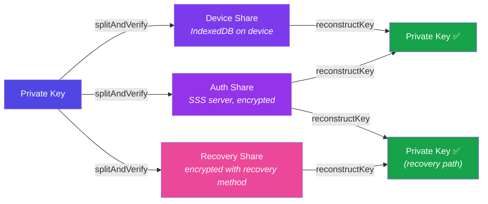
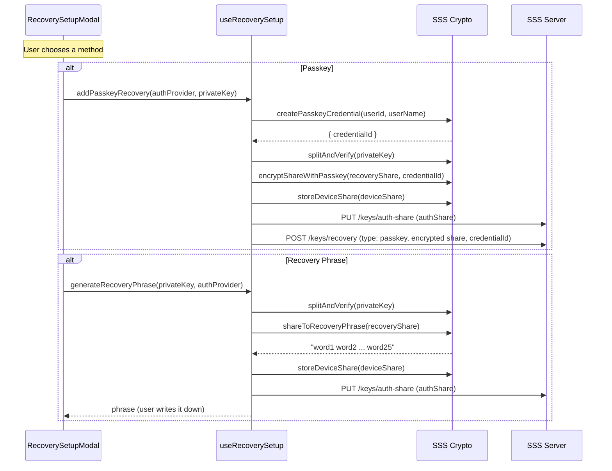
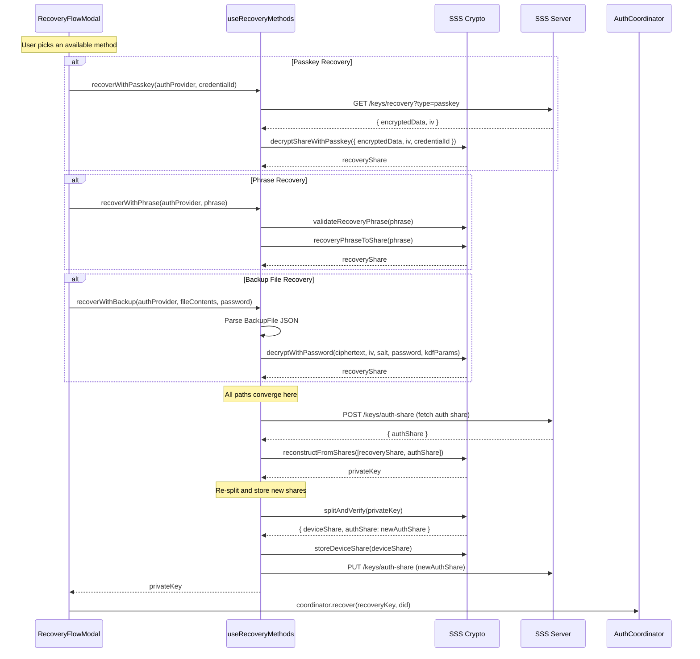

# AuthCoordinator — Recovery System Guide

How the recovery system works: share lifecycle, recovery methods, setup and execution flows, and hook APIs.

---

## SSS Share Model

Every private key is split into **3 shares** using Shamir's Secret Sharing (2-of-3 threshold):



### Normal operation

The coordinator reconstructs the private key from **device share + auth share**. No recovery share is involved.

### Recovery

When the device share is lost (new device, cleared storage), the private key is reconstructed from **recovery share + auth share**. After reconstruction, new shares are generated and the device share is stored on the new device.

### Share preservation on logout

`clearAllIndexedDB()` deletes all IndexedDB databases **except** `lcb-sss-keys`, which stores the device share. This means the user keeps their device share across logouts, avoiding unnecessary recovery prompts on re-login.

---

## Recovery Methods

Three methods are supported. Each encrypts the **recovery share** differently.

| Method          | Storage                           | User Input           | Encryption                                     |
| --------------- | --------------------------------- | -------------------- | ---------------------------------------------- |
| **Passkey**     | Server (encrypted recovery share) | Biometric/FIDO2 auth | WebAuthn PRF → AES-GCM                         |
| **Phrase**      | User writes down 25 words         | 25-word mnemonic     | Direct encoding (`shareToRecoveryPhrase`)      |
| **Backup File** | User downloads `.json` file       | File + password      | `encryptWithPassword` (Argon2id KDF → AES-GCM) |

### Email recovery relay and residual risk

For email recovery, the client encrypts the versioned recovery share, target email, tenant
branding, and a client-generated confirmation code to a pinned relay public key using ephemeral
P-256 ECDH, HKDF-SHA-256, and AES-256-GCM. `lca-api` proxies only the authenticated ciphertext
and records the pending method after the isolated relay reports synchronous Postmark acceptance;
it never receives the share. The confirmation code is also sent separately to `lca-api` so the
existing HMAC hash, expiry, and attempt-limit checks remain authoritative. This means a compromised
`lca-api` can interfere with enrollment metadata or the code lifecycle, but cannot decrypt or
redirect the recovery share because the recipient is authenticated inside the ciphertext.

The relay is still a **transient share holder while decrypting**, and Postmark plus the recipient's
mailbox retain the plaintext email. Email recovery is therefore a bridge, not enclave-grade escrow;
it should be retired when enclave-backed recovery is available.

### Server endpoints for recovery

| Endpoint                                                                                 | Method | Description                        |
| ---------------------------------------------------------------------------------------- | ------ | ---------------------------------- |
| `GET /keys/recovery?type=<type>&providerType=<p>` (auth token via `X-Auth-Token` header) | GET    | Fetch encrypted recovery share     |
| `POST /keys/recovery`                                                                    | POST   | Store new encrypted recovery share |

---

## Recovery Setup Flow

After a new user completes first-time setup (`needs_setup` → `ready`), the LCA app prompts them to configure at least one recovery method via `RecoverySetupModal`.

### Detection logic (LCA `AuthSessionManager`)

1. A `sawNeedsSetupRef` tracks whether the coordinator passed through `needs_setup`
2. Once the wallet initializes (`ready` + wallet created), check:
    - Did the coordinator pass through `needs_setup`?
    - Does the user have 0 recovery methods?
3. If both true → show `RecoverySetupModal`

### `useRecoverySetup` hook

Located at `packages/learn-card-base/src/hooks/useRecoverySetup.ts`.



### `useRecoverySetup` API

```ts
const {
    getRecoveryMethods, // (authProvider) => Promise<RecoveryMethodInfo[]>
    addPasskeyRecovery, // (authProvider, privateKey) => Promise<string> (credentialId)
    generateRecoveryPhrase, // (privateKey, authProvider?) => Promise<string> (25 words)
    exportBackup, // (privateKey, password, did) => Promise<BackupFile>
} = useRecoverySetup({ serverUrl });
```

---

## Recovery Execution Flow

When the coordinator reaches `needs_recovery` (device share missing or stale), the app shows `RecoveryFlowModal`.

### `useRecoveryMethods` hook

Located at `packages/learn-card-base/src/hooks/useRecoveryMethods.ts`.



### `useRecoveryMethods` API

```ts
const {
    recoverWithPasskey, // (authProvider, credentialId) => Promise<string>
    recoverWithPhrase, // (authProvider, phrase) => Promise<string>
    recoverWithBackup, // (authProvider, fileContents, password) => Promise<string>
    connecting, // boolean — loading state
    error, // string | null — last error
} = useRecoveryMethods({ serverUrl });
```

---

## Escrow hold restart

If the original browser or resume secrets are lost, call `coordinator.startEscrowRecovery({ restart: true })`.
Restart cancels the old hold as superseded and returns new resume secrets with a full waiting period.
The pending hold must be at least 24 hours old (configurable with `ESCROW_HOLD_RESTART_MIN_AGE_MS`).
Earlier attempts throw `EscrowHoldRestartThrottledError`, with `retryAfter` when available; ordinary starts still reuse the existing hold.

## Recovery PIN

An **optional** fast path layered on top of escrow recovery. Escrow already seals a recovery
share to the enclave for every user; the PIN doesn't add a second custodial share — it adds a
second _release policy_ (`pin`) on that same sealed blob, alongside the default 7-day `hold`
policy. A user with a PIN can recover **immediately**; a user without one falls back to the
delay-gated hold, unchanged.

PINs are **6–12 digits**. Trivial patterns are rejected client-side (`normalizePin`/`validatePin`
in `@learncard/sss-key-manager`'s `escrow-pin.ts`): all-same-digit, ascending/descending runs, and
a short denylist (`123456`, `000000`, etc.).

### Setup, change, and remove

Setting or changing a PIN **rotates the escrow share** — a signed-in device does not hold the
plaintext recovery share, so it can't re-seal the old one with a new PIN verifier baked in.
(Exception: after a PIN sign-in the device's own share _is_ the released recovery share for
that version; see [PIN sign-in](#pin-sign-in-keep-by-default) below.)

```ts
// Set a PIN for the first time, or change the existing one (both rotate).
await coordinator.setEscrowPin('482913');

// Remove the PIN. Escrow recovery still works via the 7-day hold.
await coordinator.clearEscrowPin();
```

Both require `state.status === 'ready'` and throw otherwise. After either call, `coordinator`
re-fetches enrollment so `state.escrowPin` (an `EscrowPinStatus`) reflects the new `enabled` /
`attemptsRemaining` values on the next render.

### Recovering with a PIN

Each call to `recover({ method: 'escrow-pin', pin })` is **one attempt against a fresh hold** —
the server always supersedes any pending `pin` hold with a new one per attempt, and a failed
`/complete` burns the hold it was called on. The UI is expected to loop on mismatch rather than
retry the same call:

```ts
try {
    await coordinator.recover({ method: 'escrow-pin', pin: userEnteredPin });
    // state transitions to 'ready'
} catch (e) {
    if (e.name === 'EscrowPinMismatchError') {
        // e.attemptsRemaining — show "Incorrect PIN. N attempts left."
    } else if (e.name === 'EscrowPinLockedError') {
        // PIN disabled after 10 lifetime failed attempts — fall through to
        // the existing 7-day hold flow (recover({ method: 'escrow' })).
    }
}
```

(`EscrowPinMismatchError` / `EscrowPinLockedError` classes are exported from
`@learncard/sss-key-manager` for `instanceof` checks; the app's `EscrowPinSignIn` checks
`err.name` since the error may cross a serialization boundary.)

```mermaid
sequenceDiagram
    participant UI as EscrowPinSignIn
    participant AC as AuthCoordinator
    participant Server as SSS Server / Enclave

    UI->>AC: recover({ method: 'escrow-pin', pin })
    AC->>Server: startEscrowRecovery({ releasePolicy: 'pin' })
    Server-->>AC: fresh hold + resumeToken + pinSalt
    AC->>Server: complete(holdId, resumeToken, pinProof)

    alt Correct PIN (login already bound)
        Server-->>AC: recovery share released (server emails "new device signed in with your PIN")
        AC->>AC: reconstruct, check DID, store the released share as this device's share at version N
        alt No wrong entry recorded against the PIN other than this flow's own typos
            AC->>Server: re-enroll at N with the same PIN (new salt, fresh 10 attempts)
        else Earlier or foreign wrong entries recorded (or count unknown)
            AC-->>AC: no re-set; PIN keeps its reduced budget (newPinRequired)
        end
        AC-->>UI: state: ready + pinSignIn (review sheet; asks for a new PIN if required)
        opt User chooses "Secure my account"
            UI->>AC: secureAccount({ pin })
            AC->>Server: POST /keys/revoke-other-devices (re-split, wipe old versions, unlink other logins)
            AC->>Server: re-enroll escrow at N+1 (with the PIN, or without for pin: null)
        end
    else Incorrect PIN
        Server-->>AC: EscrowPinMismatchError(attemptsRemaining)
        Note over Server: hold burned — next attempt is a new hold
        AC-->>UI: throw EscrowPinMismatchError
    else 10th incorrect PIN
        Server-->>AC: EscrowPinLockedError
        Note over Server: PIN disabled; 7-day hold still available
        AC-->>UI: throw EscrowPinLockedError
    end
```

### Forgotten PIN

"I don't have a PIN" (or a locked-out PIN) falls back to the existing 7-day hold —
`recover({ method: 'escrow' })` — which supersedes any pending `pin` hold on the server.

### PIN sign-in (keep by default)

> **Security trade-off accepted (Accepted by Jackson Smith (CTO), 2026-11-03; SECURITY.md D19).** Login + PIN now signs a new device in without resetting
> the account. Compensating controls: the server emails every verified address on each PIN
> release, the app shows a one-time review sheet, and "Secure my account" / "Sign out of
> other devices" run the old reset on demand.

A successful PIN release **no longer re-splits the key or rebinds the account**:

- **Login already bound** (`needs_recovery`): the strategy stores the released recovery share as
  the device share at the released version N (same `shareVersion`). If, and only if, the
  server's PIN status read **before and after** the release both show **zero** wrong entries
  against the current PIN (`escrowPin.wrongAttempts === 0`), or only this flow's own typos
  (see "Own typos" below), and exactly one charge between them (this release), it then
  re-sets the **same PIN** at N (new salt and verifier,
  owner-signed `set` / Nitro `change`, fresh 10-attempt budget). The re-set carries
  `expectedPinCharges` (the post-release `attemptsRemaining` / `wrongAttempts`), and lca-api
  writes it only while the PIN still shows exactly those charges, in the write's own filter,
  so a guess reserved or resolved after the client's check is never wiped (CONFLICT; the PIN
  keeps its reduced budget). No auth-share
  write, no rebind: other devices, the recovery phrase, backup file, passkey and email key all
  keep working. Result: `pinSignIn: { mode: 'kept' }`. See "New PIN after wrong entries"
  below for the other case.
- **Lost login** (`identity_recovery`, after the recovery-email code): `recover({ method:
'escrow-pin', pin })` is now allowed in `choose_method`. The verified session proves the PIN
  start and is consumed by it, so every attempt needs a fresh code; a failed attempt returns to
  `enter_email` and rethrows the original error. After the new login,
  `completeIdentityRecovery` calls `POST /keys/recovery-session/pin-sign-in`, which only links
  the login (accepted only with a rebind token minted by a PIN release). The PIN is not held
  across the login step, so the budget is not refreshed. Result: `mode: 'relinked'`. A lost
  acknowledgement is resolved by reading the account back with the new login.
- **Version race**: if another device rotated between the release and the store, the device is
  stored at N while N is still in history (`mode: 'deferred-rotation'`, no PIN re-set); the
  next start-up's `reconcileShares` advances it with the usual non-wiping rotation. If N is
  gone (another device secured or recovered the account), the sign-in fails closed with
  `PinSignInStaleError` and stores nothing. Keep mode never falls back to a rotation or rebind.
- **PIN re-set fails** or the PIN fails today's PIN rules: the PIN at N stays valid and is not
  cleared (`pinRefreshed: false`); no clear-PIN repair is scheduled. A re-set that was attempted
  and could not be confirmed is reported as `pinSignIn.pinRefreshFailed: true` (not a reason to
  ask for a new PIN; if the authority committed it but its receipt was lost, the budget is in fact
  full again). In authority mode lca-api either refuses it before the authority (a PIN attempt
  raced it; both copies unchanged) or converges to the authority's commit; any copy mismatch
  left over is caught by `ensureEscrowEnrollment`, which compares lca-api's
  `escrowBlobIdentity` with the signed authority envelope and re-enrols (or, for a PIN-protected
  copy, returns `pin-reset-required`) without clearing the PIN on its own. While lca-api reports
  `escrowUpdating` (a PIN operation holds its lease) a mismatch is treated as in progress, not
  stale, and nothing is repaired that cycle.

#### Own typos (approved: Jackson Smith, CTO, 2026-11-03; SECURITY.md D19)

Wrong entries this device made during the **same** PIN sign-in flow are the user's own and
never count toward the warning or block the same-PIN re-set. The coordinator keeps one flow
per account per session (`pinAttemptBaseline`): `wrongAttempts` from the first PIN status it
sees before any attempt (`priorWrongAttempts`), and `ownWrongAttempts`, incremented only for
an `EscrowPinMismatchError` returned to this client. Each PIN attempt passes
`input.pinAttempts = { priorWrongAttempts?, ownWrongAttempts }` to the strategy (always the
coordinator's own counts; a caller-supplied value is overwritten). The strategy treats the
sign-in as clean only when `priorWrongAttempts === 0` and every status read during the
release shows exactly `ownWrongAttempts` wrong entries; the re-set then sends
`expectedPinCharges.wrongAttempts = ownWrongAttempts`, which lca-api still enforces in the
write, so a foreign entry landing at any point blocks it. A missing prior count (legacy record,
failed read) blocks it; with no flow context (no status seen before the first attempt, or an
older caller) the original rule applies (zero wrong entries). The lost-login path applies the
same test to `newPinRequired` (the counts are kept with the pending identity until the new
login is linked). A new session or app start begins a new flow, so earlier misses are then
prior. Reaching `ready` by any method (PIN or not) also ends the flow, and the flow is bound to
one PIN generation: the baseline keeps the status `salt` (`pinAttempts.pinSalt`), a later status
with another salt (a new PIN, or a same-PIN re-set elsewhere) starts a new flow from that read,
and the strategy ignores the counts (original rule) if any status it reads shows another salt.
So own typos against one PIN can never excuse guesses against a later one. lca-api answers
"Incorrect PIN." only when it actually recorded the wrong entry; if the record changed under the
compare it returns CONFLICT ("Automatic recovery changed; please refresh."), which is not counted
as own. When own typos were excused but the re-set did not run, `escrowPinChangeRequired`
and `escrowPinAttention` ignore that many wrong entries for the session (memory only; any
further entry, or a new PIN generation, ends it).

#### New PIN after wrong entries

A PIN that has seen wrong guesses never gets a fresh budget for the **same** PIN. When the
status read before or after a successful release shows any wrong entry other than this flow's
own typos (`wrongAttempts > ownWrongAttempts`, or any entry recorded before the flow started),
or cannot say (`wrongAttempts` missing: legacy record, older server, failed read), the strategy
skips the
same-PIN re-set and reports `pinSignIn: { pinRefreshed: false, newPinRequired: true }` (also for
`relinked`, which never re-sets). The read before the release matters for legacy records:
lca-api's reservation initialises a missing verified count to 0, so after any release such a
record reads `wrongAttempts: 0` even though its history is unknown. Another charge between the
two reads (for example someone else's guess still in flight) also skips the re-set, without
asking for a new PIN. The coordinator then:

- sets `ready.escrowPinChangeRequired: true` (derived on every state update from
  `pinSignIn.newPinRequired`, or an enabled PIN with `wrongAttempts > 0` or a stored guard
  tag, below);
- keeps a tag of the PIN just used, never the PIN: HMAC-SHA-256 over the DID and the PIN,
  keyed by a hash of the account's private key, in memory and in
  `config.pinChangeGuardStorage` (default `localStorage`; `null` for memory only) under
  `learncard:pin-change-guard:<did>`. Only someone who already holds the account key can test
  PINs against it. `setEscrowPin(pin)` and `secureAccount({ pin })` reject that same PIN with
  `SameEscrowPinError` before anything changes, in this session and after a restart on this
  device. A different PIN goes through the usual owner-signed set, which starts a new PIN
  generation with a full budget and a zero count; the tag and prompt are then cleared. The tag
  is also dropped when the PIN is cleared, when the status shows an untouched new generation
  (`attemptsRemaining === 10`), and by `forgetDevice()`. Only a completed sign-in persists
  it: until then it is kept under `learncard:pin-change-guard-pending:<did>` (never read as a
  guard; it only lets a lost-login sign-in that completes after the new login's redirect
  promote it), and a sign-in that is cancelled or abandoned (cancelled recovery, sign-out)
  drops it, leaving any guard from an earlier completed sign-in untouched;
- `acknowledgePinSignIn()` / `dismissEscrowPinChange()` hide the prompt for this account for
  this session only. The PIN keeps its reduced budget, and the prompt returns on the next app
  start while `escrowPin.wrongAttempts > 0` (it also appears for an owner whose PIN collected
  wrong guesses without any PIN sign-in).

Bound: wrong guesses across any number of owner PIN sign-ins share one budget per PIN
generation (10 attempts, `ESCROW_PIN_MAX_ATTEMPTS`, less the attempts already used); only the
owner choosing a different PIN (or "Secure my account") starts a new one. Limits: the same-PIN
check runs on the device that did the PIN sign-in (another of the owner's devices, or this one
after its storage was cleared, still prompts while wrong entries are recorded but cannot
compare the old PIN, because the server keeps only a derived verifier inside the sealed
blob); a guess reserved before the pre-release read and still unresolved after the re-set
could in principle go uncharged on the old generation (the enclave call that resolves it takes
seconds; the window is that long); and every release (the owner's correct ones included) uses
budget, so repeated PIN sign-ins without choosing a new PIN can lock the PIN and leave only the
waiting period.

Nitro: a `set` / `change` PIN action starts a new generation with `attempts_used: 0`
(`services/escrow-enclave-app/src/policy/authority.rs`, ~L271-278), and `Replace` accepts the
current `share_version` (`services/escrow-enclave-app/src/authority/intent.rs`, ~L292-293), so
the same-PIN re-set at N gets a fresh budget. Checked by code reading, not a live enclave run.

App (`apps/learn-card-app`): with `pinSignIn.newPinRequired` the post-sign-in review
(`PinSignInReviewSheet`) shows its warning variant ("Someone may have tried your PIN", amber
icon) with "Choose a new PIN" as the primary action, the quiet "Lost a device? Secure your
account" link, and "Not now" (`acknowledgePinSignIn()`). On later starts `escrowPinChangeRequired` opens the same new-PIN
prompt directly (`RecoveryPinSetupOverlay` reason `new-pin-required`; "Skip for now" calls
`dismissEscrowPinChange()`). `SecureAccountFlow` asks for a different PIN in that state and
returns to the PIN step on `SameEscrowPinError`.

#### One recovery at a time

Every recovery entry point (`recover()` for PIN, hold, phrase, passkey and backup;
`prepareIdentityRecovery()`; `startEscrowRecovery()`; and the lost-login
`sendIdentityRecoveryCode()` / `verifyIdentityRecoveryCode()`) runs under one synchronous
in-flight guard. A second call while one is pending is rejected with `RecoveryInProgressError`
(message "Recovery is already running") before it reads or writes any state, so it cannot
consume the single-use recovery session, reset the identity state, or make the pending PIN
completion see a state mismatch and cancel itself. `cancelIdentityRecovery()`, `logout()` and
`forgetDevice()` stay available and move the recovery generation on: the abandoned step then
discards its own result. After that, sending and verifying a new code work at once (they wait
only for a step of the current generation), while a recovery method or hold start still waits
until the abandoned step has settled and cleaned up the strategy's single pending identity. The UI must also disable method switching and submission while
a recovery is pending; the guard is the backstop.

The PIN is used only in memory for the call that proves it. It is never stored, logged, or kept
for a retry.

`ready.pinSignIn` (`PinSignInInfo`) drives the post-sign-in review: `{ mode, pinRefreshed,
newPinRequired, priorWrongAttempts? }`. `priorWrongAttempts` is the server's verified wrong-entry count
(`escrowPin.wrongAttempts`) as first seen for that account in this coordinator session, so
misses in this session never count; it is omitted when the server cannot say. A reload during
recovery takes a new snapshot (which can over-report, never under-report). Clear it with
`coordinator.acknowledgePinSignIn()`.

`coordinator.secureAccount({ pin })` ("Secure my account", "Sign out of other devices")
requires `ready` with a valid session and calls the strategy's `revokeOtherDevices`: one
atomic `POST /keys/revoke-other-devices` re-splits, drops every older auth-share version and
unlinks every login except the caller's (other devices and logins can no longer sign in; old
phrase/backup/passkey/email key off; recovery methods back to pending; account provisional), staged through the pending-candidate slot so a lost
acknowledgement is promoted by reconciliation. Escrow is then re-enrolled at the new version
with `pin` (fresh salt) or, for `pin: null`, without a PIN; a failed re-enrollment is repaired
by the next status refresh, which clears the PIN. Accounts without escrow (or opted out) are
not enrolled.

The revoke re-splits the **same** private key. It does not evict a device that already holds
the key: an app with a cached key (private-key-first resume) keeps reaching `ready` without
the server. The app copy says so; see `SECURITY.md` D19. A PIN-release rebind token that keep
mode left unspent can no longer wipe and rebind once the account has moved past the released
version.

### What happens to the PIN after other recoveries

Every non-PIN escrow recovery rebinds the account, and the rebind drops lca-api's PIN record
(salt and attempt counter), so the old PIN cannot be carried to the new shares.

- **Hold (7-day) recovery**: the PIN is cleared. This is the "forgot my PIN" path, and keeping
  the old PIN would need lca-api to keep its PIN record through the rebind.
- **Resuming a pending hold recovery** (`completeIdentityRecovery` after a failed rebind): the
  PIN is cleared.

A cleared PIN shows as `state.escrowPin.enabled === false` after the refresh. Apps should treat
that as a nudge to ask the user to set their PIN again (see LCA's `AuthCoordinatorProvider`).
When the PIN was kept, `escrowPin.enabled` is `true` and no prompt is needed.

---

## Share Lifecycle Diagram

Complete lifecycle of SSS shares across key operations:

```mermaid
graph TD
    subgraph "First-Time Setup"
        NEW_KEY["generateEd25519PrivateKey()"] --> SPLIT1["splitAndVerify(privateKey)"]
        SPLIT1 --> STORE_DEV1["storeDeviceShare(deviceShare)<br/>→ IndexedDB: lcb-sss-keys"]
        SPLIT1 --> STORE_AUTH1["storeAuthShare(authShare)<br/>→ SSS Server"]
    end

    subgraph "Normal Login"
        GET_DEV["getDeviceShare()<br/>← IndexedDB"] --> RECON["reconstructKey(device, auth)"]
        GET_AUTH["fetchServerKeyStatus()<br/>← SSS Server"] --> RECON
        RECON --> VERIFY["DID match check"]
        VERIFY -->|match| READY["✅ ready"]
        VERIFY -->|mismatch| RECOVERY_NEEDED["needs_recovery"]
    end

    subgraph "Recovery"
        DECRYPT["Decrypt recovery share<br/>(passkey/phrase/backup)"]
        DECRYPT --> RECON2["reconstructFromShares(recovery, auth)"]
        RECON2 --> RESPLIT["splitAndVerify(privateKey)<br/><i>Generate fresh shares</i>"]
        RESPLIT --> STORE_DEV2["storeDeviceShare(newDevice)"]
        RESPLIT --> STORE_AUTH2["updateAuthShare(newAuth)"]
    end

    subgraph "Recovery Setup"
        SPLIT_RS["splitAndVerify(privateKey)"] --> ENCRYPT["Encrypt recoveryShare<br/>(passkey/phrase/backup)"]
        ENCRYPT --> STORE_RS["POST /keys/recovery<br/>→ SSS Server"]
        SPLIT_RS --> UPDATE_DEV["storeDeviceShare(deviceShare)"]
        SPLIT_RS --> UPDATE_AUTH["PUT /keys/auth-share(authShare)"]
    end

    subgraph "Logout (trusted device)"
        SIGNOUT["authProvider.signOut()"]
        CLEAR_IDB["clearAllIndexedDB()<br/><i>Preserves lcb-sss-keys</i>"]
        CLEAR_STORES["Clear app stores, localStorage,<br/>sessionStorage, secure storage"]
        NOTE_SHARE["Device share persists in IDB<br/><i>Enables fast re-login</i>"]
    end

    subgraph "Forget Device (public computer)"
        FORGET["forgetDevice()"]
        CLEAR_LOCAL["clearLocalKeys()<br/><i>Clears device share from IDB</i>"]
        FORGET --> CLEAR_LOCAL
    end

    style READY fill:#16a34a,color:#fff
    style RECOVERY_NEEDED fill:#ef4444,color:#fff
```



### Key invariant

After every recovery **except a PIN sign-in**, the shares are **re-split** and **re-stored**.
This means:

- The device share on the new device is fresh (not the old one)
- The auth share on the server is fresh
- Old shares are effectively invalidated

A PIN sign-in keeps version N: the new device's share is the released recovery share, and
nothing on the server changes. `secureAccount()` performs the re-split and invalidation on
demand (see [PIN sign-in](#pin-sign-in-keep-by-default)).

---

## RecoveryFlowModal

**Location:** `apps/learn-card-app/src/components/recovery/RecoveryFlowModal.tsx`

### When shown

The modal is rendered when `coordinator.state.status === 'needs_recovery'`, and during lost-login
recovery (`identity_recovery` / `identity_recovery_success`).

### PIN sign-in first

When the account has a usable PIN (`escrowRecovery.pinAvailable`: `needs_recovery`, or
`identity_recovery` in `choose_method`, with `escrowPin.enabled`) and an escrow method, Screen 1
leads with PIN entry (`EscrowPinSignIn`, titled "Confirm it's you": the user has already signed
in with their login, so the PIN is a confirmation step, with no tinted panel behind the boxes).
"Approve from another device" ("Scan a code with a device you're signed in on"), passkey and the
other methods follow under "Other ways to confirm" in secondary styling; methods not set up sit
behind "Show N more" (each still labelled "Not set up"). The PIN path shows **no** "sign you out
on your other devices / turn off your other sign-in methods" warning, because a PIN sign-in keeps
the account as it is. Accounts without a usable PIN keep the "Sign in on this device" copy.

One quiet "Trouble signing in?" link (for accounts without a PIN: "Can't use any of these?" +
"Get back into your account") leads to Screen 2, which is now the **7-day hold only** and keeps
those warnings (the hold still resets the account). "Use my recovery PIN instead" returns to
Screen 1. A locked or unavailable PIN hides the PIN entry for the rest of the flow and shows the
reason; with nothing else to pick, the modal then opens on Screen 2. A hold already pending on
this browser is still shown on Screen 1, and the PIN is still offered next to it.

After the recovery-email code, a failed PIN try returns the coordinator to `enter_email`; the
modal shows the PIN error there with a note that each try needs a new code.

### After a PIN sign-in

`ready.pinSignIn` shows `PinSignInReviewSheet` once, in one of two variants:

- **Normal** (no wrong entries other than this sign-in's own typos): green check, "You're signed
  in", "Your other devices stay signed in too.", primary "Done" (focused; calls
  `acknowledgePinSignIn()`), and a quiet "Lost a device? Secure your account" link.
- **Warning** (`newPinRequired`, or `priorWrongAttempts > 0`): amber icon, "Someone may have
  tried your PIN", "It was entered incorrectly N times before you signed in. Choose a new PIN to
  stay protected." (singular for 1; count-free copy when the count is unknown or 0, e.g. a
  foreign entry landed during the flow), primary "Choose a new PIN" (focused; the new-PIN flow
  refuses the PIN just used), the same quiet link, and "Not now".

The revoke is never the default action. The review holds back every other PIN prompt
(`decidePinPromptAfterReady` → `pin-sign-in-review`).

"Lost a device? Secure your account" opens `SecureAccountFlow`, which is shared with the quiet
"Sign out of other devices" row under "Security" at the end of `RecoverySetupModal` (an amber dot
marks it while wrong PIN entries are recorded against the current PIN other than this
session's excused own typos, `ready.escrowPinAttention`; a dismissed new-PIN prompt does not
hide it) and the `/account/secure` link in the PIN sign-in email. Its
confirm screen explains what will happen and carries the red destructive button; it then asks
for the PIN again (enter the current
PIN to keep it, a new one to change it, or continue without one), calls
`coordinator.secureAccount({ pin })`, and then leads into recovery setup, passkey first. The
email link carries no token: the route is a `PrivateRoute`, and the flow re-checks the login
session (Keycloak re-auth resumes it with the `secure-account` intent).

### Method availability

Each method is only shown as "Available" if the server has a recovery record of that type in the user's `recoveryMethods` array. This prevents showing methods that would fail at runtime:

```ts
const methods = [
    { id: 'passkey', available: hasMethod('passkey') && webAuthnSupported },
    { id: 'phrase', available: hasMethod('phrase') },
    { id: 'backup', available: hasMethod('backup') },
];
```

### User flow

1. User sees the PIN entry (if the account has a PIN) and the list of available recovery methods
2. Enters the PIN, or selects a method → enters credentials (passkey auth, phrase, or file + password)
3. On success → coordinator transitions to `ready` → wallet initializes
4. On failure → error shown inline, user can try again or pick another method
5. Cancel → calls `coordinator.logout()` → returns to `idle`

---

## RecoverySetupModal

**Location:** `apps/learn-card-app/src/components/recovery/RecoverySetupModal.tsx`

### When shown

Shown as a **dismissible prompt** for first-time users who:

1. Went through `needs_setup` → `ready` (tracked via `sawNeedsSetupRef`)
2. Have **zero** configured recovery methods

### User flow

1. User sees options: Passkey, Recovery Phrase, Backup File
2. Can configure one or more methods
3. Can dismiss without configuring (prompt disappears, wallet still works)

---

## Crypto Dependencies

All cryptographic operations come from `@learncard/sss-key-manager`:

| Function                  | Package Path           | Description                                       |
| ------------------------- | ---------------------- | ------------------------------------------------- |
| `splitAndVerify`          | `atomic-operations.ts` | Split private key into 3 shares with verification |
| `reconstructFromShares`   | `sss.ts`               | Reconstruct from any 2 shares                     |
| `encryptWithPassword`     | `crypto.ts`            | Argon2id KDF → AES-GCM encryption                 |
| `decryptWithPassword`     | `crypto.ts`            | Reverse of above                                  |
| `createPasskeyCredential` | `passkey.ts`           | WebAuthn credential creation                      |
| `encryptShareWithPasskey` | `passkey.ts`           | PRF-derived key → AES-GCM                         |
| `decryptShareWithPasskey` | `passkey.ts`           | Reverse of above                                  |
| `shareToRecoveryPhrase`   | `recovery-phrase.ts`   | Encode share as 25-word mnemonic                  |
| `recoveryPhraseToShare`   | `recovery-phrase.ts`   | Decode mnemonic back to share                     |
| `storeDeviceShare`        | `storage.ts`           | Persist to IndexedDB (`lcb-sss-keys`)             |
| `getDeviceShare`          | `storage.ts`           | Retrieve from IndexedDB                           |

---

## See Also

- [README.md](./README.md) — Core state machine reference + diagrams
- [INTEGRATION.md](./INTEGRATION.md) — How to wire the coordinator into an app
