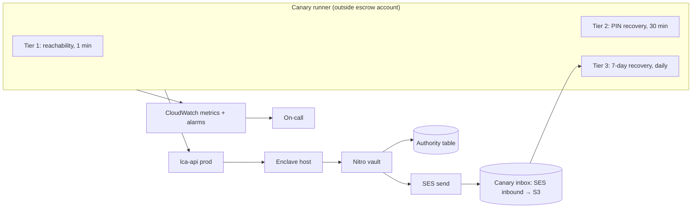

# Escrow recovery canary and monitoring

**Status:** Tiers 1–2 runner and monitoring-account infrastructure implemented (see the [operator runbook](../escrow-canary/README.md)). Tier 3, the deadline evaluator and the canary inbox (phase 3) are implemented but off by default and not yet deployed or live-verified; see [TIER3-DESIGN.md](../escrow-canary/TIER3-DESIGN.md). Phase 1 has reason-count metrics; escrow-account supporting alarms/probes remain follow-up.
**Depends on:** the enrollment-authority stack (#1703 → #1706 → #1710 → #1714).
**Prerequisites:** The production tenant (`apps/learn-card-app/environments/learncard/config.json`) must move to SSS key derivation with the escrow attestation config before the canary (and any escrow rollout) can run; the PCR gate references `auth.sss.escrowEnclaveMeasurements` once it exists.
**Paths:** `app/` = `services/escrow-enclave-app/`, `api/` = `services/learn-card-network/lca-api/`,
`sdk/` = `packages/sss-key-manager/`.

## 1. Problem

Escrow is a recovery service. Users rely on it rarely and only when they have
already lost access, so a broken escrow path is invisible until the worst
possible moment. We need continuous evidence that, in production:

1. the vault is reachable and trusted by real clients;
2. a user can recover with their PIN;
3. a user without a PIN can recover after the 7-day wait, including the
   emailed code, the 24-hour warning and the release-timing rules.

### Why health checks are not enough

Every defect found during the first staging bring-up (2026-10-15) passed the
host health check, attestation, the monitor and every alarm:

| Defect                                                                       | Health / alarms | Real user                |
| ---------------------------------------------------------------------------- | --------------- | ------------------------ |
| SDK rejected real AWS attestation documents (indefinite-length CBOR payload) | Green           | Could not enrol          |
| Authority writer lacked `kms:Decrypt` on the table's encryption key          | Green           | Could not enrol          |
| Provider dropped `getRecoveryLanguage`                                       | Green           | Could not enrol          |
| SigV4 signed `Host: email…:8002`; SES rejected every send                    | Green           | Could not start recovery |

Each was only visible by driving the real client through the real flow. The
monitoring design is therefore built around a **synthetic user**.

## 2. Goals and non-goals

**Goals**

- Page within about 5 minutes (worst case, including alarm evaluation) when the
  vault is unreachable or untrusted by clients.
- Page within about 1 hour (worst case) when PIN recovery is broken.
- Page within about 24 hours when the 7-day path (code, confirm, warning,
  release) is broken.
- Page on failure **and** on the canary itself going silent.
- Gate image rolls and key-policy trims on the same checks.
- Produce an honest availability figure for the recovery service.

**Non-goals**

- Shortening or bypassing the 7-day wait or the 24-hour warning for any account,
  canary included. The canary must use exactly the user path.
- Load or performance testing.
- Replacing the ledger monitor (integrity/coverage), which stays as is.

## 3. Design overview

The runner uses the production `sdk/` (`createSSSStrategy`) and the resolved
production tenant configuration (lca-api URL, enclave mode, pinned measurements
from `auth.sss.escrowEnclaveMeasurements`). It does not call the host or vault directly and has no
escrow-account credentials.

## 4. Tiers

### Tier 1: reachability (every minute)

1. Fetch `GET /keys/escrow/attestation?nonce=<fresh>` and verify it with the SDK
   (AWS root, nonce, pinned PCR tuple, key ID). This is the exact client check.
2. For one canary account, call `getAuthorityState` and verify the signed
   snapshot (ledger key, measurement allowlist, generation, DID).
3. Emit `Tier1.Success` (0/1) and per-step latency.

Catches: vault/host/PrivateLink down, attestation regressions, measurement pin
drift, authority-table read failures (permissions, encryption key), signing-key
changes.

### Tier 2: PIN recovery (every 30 minutes)

On a PIN-enrolled canary account (two accounts, alternating):

1. Drop the local device share (fresh in-memory storage).
2. Run the authenticated PIN recovery with the correct PIN. This goes through
   `completeIdentityRecovery`, which rotates shares and re-enrols the account.
3. Check the recovered private key derives the account's known DID.
4. Store the new device state, then set the PIN again (recovery retires it), so
   the attempt budget (10 per PIN set) never accumulates and the next run starts
   clean. If the runner crashes between steps 2 and 4, the next run will detect
   the retired PIN state and re-set the PIN before attempting recovery, preventing
   the account from becoming permanently unusable.
5. Weekly, prepend one deliberately wrong PIN attempt, assert the mismatch response,
   and then start a fresh PIN hold for the correct attempt (exercises the attempt counter
   and the mismatch cancellation).

Emit `Tier2.Success` and per-step latency.

Catches: enrollment writes, signed intents, PIN verification, share release,
client reconstruction, share rotation.

### Tier 3: 7-day recovery (daily, staggered)

Each day a new run starts on a canary account from a rotating pool, so at steady
state one recovery **finishes** every day. A release uses whatever image is live
on its release day, so release regressions surface within ~24 hours.

| Day | Step                                                                                         | Assertion                                                    |
| --- | -------------------------------------------------------------------------------------------- | ------------------------------------------------------------ |
| 0   | Start 7-day recovery                                                                         | `startRecovery` succeeds; signed hold binds DID/key/hold ID  |
| 0   | Read code from canary inbox; confirm                                                         | Email arrives within 5 min; confirm succeeds; deadline ≈ +7d |
| 0   | Status check                                                                                 | `releaseAfter` matches confirmation time + hold              |
| 6   | Read 24-hour warning email                                                                   | Warning arrives; release still **refused**                   |
| 7+  | Complete recovery at the effective deadline (below)                                          | Release succeeds; recovered key derives the known DID        |
| 7   | Re-enrol account; return to pool                                                             | Enrollment succeeds                                          |
| —   | Weekly: start one more run and cancel it in the app (`cancelRecovery`), then try to complete | Cancel succeeds; later completion refused                    |

**Effective deadline.** The runner never assumes "day 7". It reads status and
completes at `max(confirmation + 7 days, recorded warning + 24 hours)` plus the
API's existing 60-second release margin (`ESCROW_RELEASE_TIME_MARGIN_MS`). The
hourly warning job can legitimately push availability later than the first
estimate, so completing early would be a false failure.

**Per-step deadlines.** Each run records the events it expects; a step that has
not happened by its deadline emits 0 for that step:

| Step       | Deadline                                                      |
| ---------- | ------------------------------------------------------------- |
| Code email | 5 minutes after `startRecovery`                               |
| Confirmed  | 10 minutes after `startRecovery`                              |
| Warning    | confirmation + 6 days + 2 hours (the warning job runs hourly) |
| Released   | effective deadline + 2 hours                                  |
| Cancelled  | 10 minutes after cancel                                       |

**Expected vs missing (alarm wiring).** Sparse step outcomes cannot carry the
"is this step due?" signal by themselves, so tier 3 is wired as two parts:

1. **Deadline evaluator** (every 15 minutes, separate scheduled function). It
   reads the runner's ledger of in-flight runs (DynamoDB or S3 in the monitoring
   account: account, hold ID, step, due time, observed time) and, for every step
   whose deadline has passed without the expected event, counts it overdue. Each
   evaluation emits, continuously:
    - `Tier3.Overdue` = number of overdue expected steps (0 when healthy);
    - `Tier3.EvaluatorHeartbeat` = 1, only after it successfully read the whole
      ledger and checked every in-flight run.
2. **Step outcomes** (`Tier3.Confirmed`, `Warned`, `Released`, `Cancelled`) are
   emitted only when a step completes or fails. They drive dashboards and the
   explicit-failure alarm, with missing data **not breaching**, because their
   absence is normal between events.

Alarms: `Tier3.Overdue > 0` pages (missing data not breaching, relying on the
heartbeat for evaluator silence); `Tier3.EvaluatorHeartbeat` missing for 45 minutes pages;
any explicit step value of 0 pages. Expectedness lives only in the ledger: a run
records "warning due at X" when it confirms, "release due at Y" when it reads the
effective deadline, and "cancel result due" only on weekly cancel runs. Warm-up
and the gaps between weekly cancels therefore produce `Overdue = 0`, not missing
data, and a broken evaluator pages even while daily starts continue.

Validate before production, in staging, with a fake clock in the evaluator:

- warm-up: days 0–7 with starts but no warnings/releases due → no page;
- weekly cancel gap: six days without a cancel run → no page;
- overdue warning (suppress the warning email) → `Overdue` pages within one
  evaluation;
- evaluator stopped while the runner keeps starting holds → heartbeat pages;
- evaluator that cannot read the ledger → no heartbeat → pages.

Emit `Tier3.Started`, `Tier3.Confirmed`, `Tier3.Warned`, `Tier3.Released`,
`Tier3.Cancelled` (0/1 each, when the step completes or fails) and email delivery
latency; overdue detection is the evaluator's job (above).

Detection: start/code/confirm/warning regressions within 24 hours; release
regressions within 24 hours (next scheduled release); a regression in hold
_creation_ that only breaks the later release appears up to 7 days after deploy.
That last window is inherent: nobody, including us, can shorten the wait.

## 5. Canary accounts and secrets

- **Pool:** 2 PIN accounts (tier 2), 12 hold accounts (7 in flight + 1 cancel +
  4 spare), 1 read-only account (tier 1). Per-account limits (one code send per
  minute, 3 per day, one active hold) make a pool necessary.
- **Quarantine:** an account whose start, confirm, release, or post-release
  re-enrollment fails is quarantined. A failed code send can leave a hold that
  nobody can confirm and the app cannot see (§14), and a failed re-enrollment
  leaves a broken account that would fail its next tier-3 run. The runner emits
  `Tier3.PoolAvailable` (healthy idle accounts); an alarm fires below 2, so
  orphans exhaust the buffer loudly instead of stalling tier 3 silently. The runner
  clears orphaned holds once, after 24 hours, via the user's own DID-authenticated
  cancel (`cancelRecovery`); this spends no code send and creates no second hold
  (the `startRecovery` `restart: true` supersede was the original proposal). An
  operator handles anything else.
- **Real accounts:** created through normal sign-up in the production tenant,
  with recovery emails on the canary domain. No flags, allowlists or special
  cases anywhere in `api/` or `app/`; the canary must take the user path. They
  are covered by the ledger monitor like any account.
- **Secrets:** each account's private key (needed to sign intents and to verify
  the recovered key), PIN, and auth credentials live only in the monitoring account's secret
  store. After each recovery the runner stores the new device state.
- **Identifiability:** account emails are `canary+<n>@canary.notify.learncard.com`
  so support and analytics can exclude them by address, without code paths.

## 6. Runner authentication

Each canary account is signed in once by an operator through the normal app flow. The resulting Firebase refresh token is stored in Secrets Manager in the monitoring account (encrypted, runner-only access, rotation/revocation procedure documented). Each run exchanges it at Google's securetoken endpoint (`https://securetoken.googleapis.com/v1/token`, `grant_type=refresh_token`) for a fresh ID token, which lca-api verifies exactly as for real users.

We explicitly reject:

- A Firebase Admin service account or custom tokens: this credential could mint tokens for any user, violating the principle of least privilege.
- Inbox-based email sign-in: this adds an inbox dependency to tiers 1–2, which should only test reachability and PIN recovery.

Note: A revoked or expired refresh token surfaces as a distinct runner auth failure (not an escrow failure) with its own alert. Keycloak tenants (direct grants off, 5-min access tokens, 10h SSO max) would need an offline-token/dedicated client design, which is out of scope until such a tenant enables escrow.

## 7. Canary inbox

- Subdomain `canary.notify.learncard.com`, MX → SES inbound (us-east-1).
- Receipt rule recipient: `canary@canary.notify.learncard.com`. SES treats a
  recipient that already contains a plus-label as an exact match, while the base
  address also matches its plus-variants, so this covers every pool address
  (`canary+<n>@…`). Store the raw message in an S3 bucket in the monitoring
  account (SSE, 7-day lifecycle); drop everything else.
- The runner matches messages by recipient and arrival after the request time,
  parses the 8-digit code from the vault's fixed template, and asserts the sender
  and DKIM pass. The expected sender must be derived from the deployed email
  configuration (e.g., `recovery@vault.notify.learncard.com` in production,
  matching `recovery@${sending_domain}` in `infra/escrow-enclave/email.tf`),
  not hardcoded, so the canary strictly verifies the intended sender without
  rejecting legitimate deliveries after a rollout.
- This also proves **delivery**, not just SES acceptance.

## 8. Where it runs

Recommended: a scheduled Lambda (EventBridge) in a dedicated monitoring account (not the escrow account, and not the organization management account since SCPs do not apply there), so an escrow-account failure cannot
silence it. CloudWatch Synthetics is an alternative with built-in canary
dashboards; GitHub Actions cron is acceptable for staging but has unreliable
scheduling for a paging signal.

Device shares: the SDK already accepts custom storage through
`SSSStrategyConfig.storage`, so the runner passes an in-memory implementation
and persists it to its secret store between runs. No SDK change is needed.

## 9. Metrics and alarms

Namespace `LearnCard/EscrowCanary`, dimension `Tier`.

| Alarm                   | Condition                                                    | Missing data  | Severity          |
| ----------------------- | ------------------------------------------------------------ | ------------- | ----------------- |
| Tier 1 failing          | Success < 1 for 2 of 3 one-minute periods                    | Breaching     | Page              |
| Tier 2 failing          | Success < 1 for 2 consecutive 30-minute runs                 | Breaching     | Page              |
| Tier 3 pool low         | `Tier3.PoolAvailable` < 2                                    | Breaching     | Ticket            |
| Tier 3 step failed      | Any explicit step value 0                                    | Not breaching | Page              |
| Tier 3 step overdue     | `Tier3.Overdue` > 0                                          | Not breaching | Page              |
| Tier 3 evaluator silent | No `Tier3.EvaluatorHeartbeat` for 45 min                     | Breaching     | Page              |
| Tier 3 email slow       | Delivery latency > 5 min                                     | Ignore        | Ticket            |
| Canary silent           | No `Tier1.Success` for 5 min, or no `Tier3.Started` for 26 h | Breaching     | Page              |
| Uptime (dashboard)      | Tier 1+2 success ratio, 30-day rolling                       | —             | SLO, target 99.9% |

"Missing data = breaching" is essential for continuously emitted signals (tier 1,
tier 2, the tier 3 evaluator): a broken runner must page, not go green. Sparse
step outcomes are the one exception, covered by the evaluator above.

**Worst-case time to page** (a failure that starts just after a successful run):

| Tier | Probe interval | Failures needed | Alarm evaluation | Worst case   |
| ---- | -------------- | --------------- | ---------------- | ------------ |
| 1    | 1 min          | 2 of 3          | ~1–2 min         | ~4–5 minutes |
| 2    | 30 min         | 2 consecutive   | ~1–2 min         | ~62 minutes  |
| 3    | Daily          | 1               | ~1–2 min         | ~24 hours    |

Requiring two failures for tiers 1 and 2 trades a few minutes of latency for
fewer pages from a single transient error; the bounds in §2 and §15 include it.

## 10. Supporting signals (between canary runs)

These narrow the cause once a canary fails, and catch partial outages:

- **lca-api reason codes:** today lca-api maps every vault failure to a generic
  412/403 and logs nothing. Phase 1 builds on the allowlisted reason codes
  introduced in #1739 and #1744 (`policy`, `pin_mismatch`, `blob`, `unavailable`
  subreasons including `ledger`/`time`, `transport`, `malformed`/`invalid_response`,
  `invalid_hold`, `http_429`, `codeMismatch`, `codeExpired`, `codeLocked`). Add
  these non-sensitive reason labels to logs and a metric per route. Alarm on a
  spike in `startRecovery`/`confirmRecovery`/enrollment failures.
- **DynamoDB:** `UserErrors` is an account-and-region aggregate with no
  `TableName` dimension, so alarm on it at account level (the escrow account runs
  only escrow tables, which makes it a useful proxy; the encryption-key defect
  showed up there immediately). Alarm on `SystemErrors` per authority table with
  both `TableName` and `Operation` dimensions. Table-specific client errors come
  from the lca-api `store` reason code above, not from CloudWatch.
- **SES:** sends, deliveries, bounces, complaints on the recovery configuration
  set. Alarm when recoveries start but sends stay at zero.
- **Time servers:** the vault needs 2 of 3 public Roughtime servers to boot and
  to release. Probe all three from the host every 5 minutes; ticket at 2 of 3,
  page at 1 of 3. None of the three has an uptime guarantee (see STAGING.md).
- **KMS:** attested `Decrypt` errors on the escrow and credential keys.
- **Ledger monitor:** unchanged (integrity, coverage, sweep heartbeats every 15
  minutes).

## 11. Release gates

1. **Image roll gate (automates today's manual checklist):** after a new host is
   in service and before the old image is removed from KMS key policies:
   attestation verifies against the build manifest; exactly one attested unseal
   per key; no `GenerateDataKey`; sealed key unchanged; tier 1 and tier 2 pass.
   Failure stops the trim and keeps the previous image trusted for rollback.
2. **Configuration consistency (CI):** the running image's PCR tuple must be in
   the resolved production tenant configuration (`auth.sss.escrowEnclaveMeasurements`
   via `packages/learn-card-base/src/config/authConfig.ts`), every KMS key policy,
   and the monitor trust parameter. Drift between these is how one deploy can break
   every client.
3. **Staging:** run tiers 1 and 2 after every staging lca-api or app deploy,
   including deploys from `main` that overwrite a branch deploy.

## 12. Implementation plan

| Phase | Scope                                                                                                                                                | Effort   |
| ----- | ---------------------------------------------------------------------------------------------------------------------------------------------------- | -------- |
| 1     | lca-api reason codes + metrics; DynamoDB/SES/KMS alarms; time-server probe                                                                           | 2–3 days |
| 2     | Runner (Lambda) with in-memory share storage, tier 1 + tier 2, alarms, dashboard; staging first                                                      | 3–5 days |
| 3     | Canary domain + SES inbound + S3; tier 3 scheduler, pool and run ledger; deadline evaluator; cancel path (implemented, off by default; not deployed) | 3–5 days |
| 4     | Image roll gate + CI consistency check                                                                                                               | 2–3 days |
| 5     | Production: create canary accounts, enable paging, 2 weeks observation                                                                               | 2 weeks  |

Tier 3 produces its first release signal 7 days after it starts.

## 13. Security considerations

- Canary accounts hold real keys in the monitoring account's secret store; compromise of the
  runner exposes only canary accounts. Keep the runner role unable to read any
  other secret, and alarm on secret access outside the schedule.
- The canary inbox receives real recovery codes for canary accounts only;
  restrict the receipt rule to the canary recipient pattern and keep a short
  retention.
- No production code may branch on "is canary". Reviewers should reject any such
  change; it would make the canary test a different system.
- The canary must never be granted escrow-account credentials, host access or
  vault bearer tokens.

## 14. Open questions

1. Resolved: authenticated PIN recovery goes through `completeIdentityRecovery`,
   which rotates shares and re-enrols; tier 2 re-sets the PIN each run (§4).
2. Resolved: the SDK accepts custom storage via `SSSStrategyConfig.storage` (§8).
3. A failed code send currently leaves a confirmable-by-nobody hold that the app
   cannot see (observed in staging). Returned code-send failures can expose the
   durable hold and allow resend, but loss of the entire create response can
   still orphan a hold. Keep the quarantine and pool safeguards.
4. Paging destination and on-call ownership for escrow alarms.
5. SLO target: 99.9% for tiers 1+2 is proposed; confirm with product.
6. Production SES production-access and inbound receiving for the canary domain.

## 15. Limits

This does not make escrow "100%". It bounds how long a failure can go unnoticed:
about 5 minutes for reachability, about 1 hour for PIN recovery, about 24 hours
for the 7-day path
(7 days for the rare creation-only release regression). For a recovery path users
hope never to need, that continuous, user-level evidence is the strongest
guarantee available.
