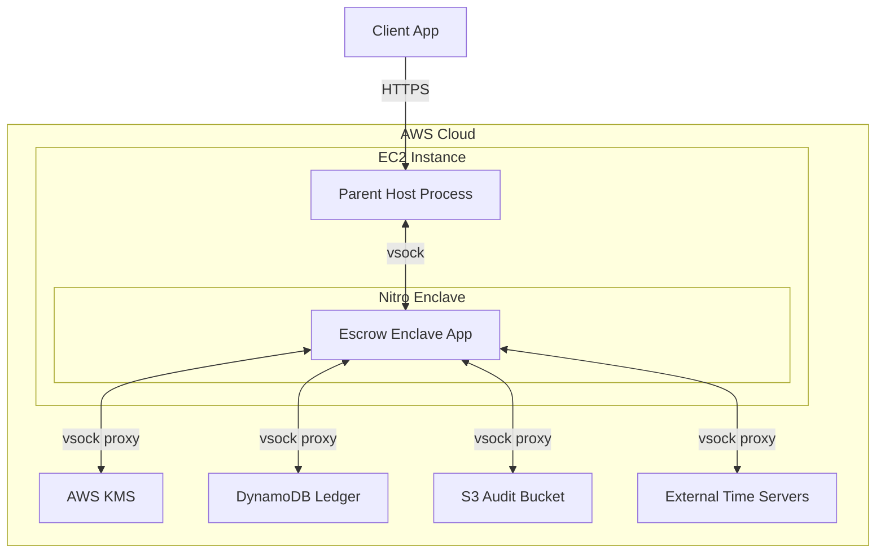

# Security Review Packet: Escrow Enclave

This document provides a comprehensive security overview of the Escrow Enclave system, detailing its trust boundaries, threat model, cryptographic guarantees, and known limitations. It is intended for external security reviewers and internal auditors.

## System Overview and Trust Boundaries

**PR 2 / Design 2 status:** the enrollment blocker is resolved **only in configured
authority mode**, with the measured authority/credential configuration, attested
writer unsealing, both verified Organizations guardrails, owner intent verification,
and the authority-aware clients/API. Unconfigured deployments still use
`UnavailableEnrollment`. No live AWS deployment or guardrail evaluation is claimed
by the offline implementation. See [offline audit coverage](AUDIT-COVERAGE.md) and
the [ordered staging cutover](STAGING.md#pr-2-authority-cutover--operator-only).
**Attack C remains a launch blocker for PR 3.** Existing lca-api notifications are
not enclave-controlled email confirmation.

The Escrow Enclave is a hardware-isolated environment (AWS Nitro Enclaves) responsible for securely holding and releasing encrypted account recovery keys. It enforces a strict release policy (7-day delay or PIN) that cannot be bypassed by the host operating system, the parent application (`lca-api`), or human operators.



**Trust Boundaries:**

- **Trusted:** The measured enclave code (`services/escrow-enclave-app/`), AWS Nitro hypervisor isolation, AWS KMS (for key sealing), and pinned external time authorities (Roughtime).
- **Untrusted:** The parent EC2 host (`services/escrow-enclave-host/`), the `lca-api` service, the network, and human operators (including database administrators).

## Assets

1. **Escrow Private Key:** A P-256 key deterministically derived inside the enclave from an attested KMS-generated 32-byte seed. The parent stores only the seed's KMS CiphertextBlob; neither seed nor derived private key leaves the enclave in plaintext.
2. **User Recovery Pieces:** Encrypted blobs submitted by clients. The enclave decrypts these only when the release policy is satisfied.
3. **PIN Budgets:** The remaining number of PIN attempts (max 10) for a given enrollment.
4. **Ledger State:** The history of holds, cancellations, and releases, ensuring a hold cannot be replayed or a PIN budget bypassed.

## Adversaries

- **Compromised Host/Parent:** Can drop, delay, or reorder messages. Can deny service by refusing to persist data or route traffic. Cannot read enclave memory or forge enclave signatures.
- **Compromised `lca-api`:** Can submit malicious requests or attempt to brute-force PINs. Constrained by the enclave's PIN budget and cryptographic verification.
- **Malicious Operator / Key Admin:** Can delete infrastructure or modify IAM policies. A key admin with MFA can theoretically rewrite the KMS key policy (see Residual Risk below).
- **Network Attacker:** Can observe or tamper with traffic between the client and the parent, or the parent and external services. Mitigated by TLS and enclave-verified signatures.
- **Malicious Client:** Can submit malformed requests or attempt to exploit parsing vulnerabilities. Mitigated by strict input validation and memory-safe Rust code.

## Design Decisions

- **D1 (Instance Size):** The enclave requires an `m6i.xlarge` instance. AWS requires at least 2 vCPUs for the parent host, so a 2-vCPU enclave necessitates a 4-vCPU parent instance.
- **D2 (Time Sources):** The enclave hypervisor clock was considered but not used. Measured code pins Cloudflare (draft-08), int08h and Tanner Ryan (Google legacy), with a 2-of-3 quorum and a shared two-second query deadline. All authenticated intervals must intersect; no majority/outlier exclusion. The 10s radius cap accommodates rough/smeared time without weakening the seven-day comparison. Bad signatures/timeouts count as unavailable; one unavailable source is tolerated, two fail closed. int08h and Tanner passed live verification on 2026-09-30; Cloudflare timed out. Public-source uptime and high-volume service-use approval remain staging obligations.
- **D3 (Legacy detection / configured prevention):** The host-owned ledger remains detection-only. Configured Design 2 instead serializes every sensitive transition in AWS-operated DynamoDB with exact prior-row conditions and durable execution receipts, independent of parent history and AWS token expiry. This prevents host replay/rollback across fresh boots and parallel enclaves under the AWS/protected-administration trust assumption. It does not protect against approved management/key administrators deliberately undoing that boundary.
- **D4 (KMS Recipient Flow):** The enclave generates a boot-time RSA-2048 recipient keypair. First boot calls `GenerateDataKey(KeySpec=AES_256, Recipient=NSM attestation)` with `{purpose:escrow-enclave-key,keyId}` context; subsequent boots call `Decrypt` with the same context and Recipient. Both reject any Plaintext field (including empty), require nonempty recipient ciphertext, and accept exactly 32 seed bytes after CMS opening. Generation additionally requires a nonempty CiphertextBlob for persistence. Domain-separated HKDF-SHA256 binds keyId and rejection-samples the escrow P-256 scalar; the seed/scalar buffers zeroize. No `Encrypt` operation exists in the enclave. No sealed-format migration is supported: Nitro never ran in production and the prior `nitro,kms` build did not compile. Deploy with a fresh restricted CMK, or prove it has never allowed attacker-known ciphertext generation: newly denying Encrypt does not invalidate pre-existing host-known 32-byte-seed ciphertexts.
- **D7 (KMS Key Policy):** The KMS key policy uses one statement per released measurement tuple. It requires an exact match on PCR0, PCR1, and PCR2 simultaneously to prevent cross-combination of measurements.
- **D10 (Key Admin Residual Risk):** An MFA-authenticated key admin can theoretically rewrite the KMS key policy to remove attestation gates. This residual risk is mitigated by mandatory two-person PR review and CloudTrail alarms, rather than an immutable key policy.
- **D11 (RSA/Marvin Rationale):** The `rsa` crate has a known timing side-channel (Marvin). This is accepted because the CMS blob only arrives inside the enclave's own TLS session to KMS, meaning the host cannot submit chosen ciphertexts.
- **D12 (Software Mode Blocked in Production):** The client guard (`getEscrowStrategyConfig` in `packages/learn-card-base/src/config/authConfig.ts`) downgrades `software` mode to `off` for production tenants (`learncard`, `vetpass`, `scoutpass`) whenever the resolved tenant config's deploy `stage` is `production` — which is also the fail-closed default for a missing or unrecognized stage. The guard keys on this deploy `stage`, not the Vite build mode (`IS_PRODUCTION`, i.e. `mode === 'production'`): staging deployments are Vite production-mode builds too (`apps/learn-card-app`'s `build` script runs `vite build` under `STAGE=staging`), so `IS_PRODUCTION` alone can't tell a staging deploy from production. Staging deliberately runs the software enclave (host-trusted, dev/test only) per #1565, with `stage: 'staging'` baked into the tenant config by `prepare-native-config.ts --stage staging` (learn-card-app) or the equivalent `VITE_NODE_ENV`-driven overlay (scouts). Independently, the enclave binary enforces this server-side: `--emulate` (software mode) is feature-gated behind `fake-nsm`/`fake-kms`/`fake-time`/`fake-ledger`, which a production `--features nitro,kms` build excludes, so that compiled binary refuses `--emulate` before binding.
- **D13 (Audit design):** Legacy mode retains its bounded per-blob ledger and `Carried` genesis. Configured mode instead stores per-DID authority state, bounded per-hold/operation rows and immutable execution receipts with signed proposals. No legacy history is imported. Proposed events and post-commit signatures have different domain tags; a proposal is never commit proof. The independent monitor verifies authenticated table evidence and continuity, not parent readback. Time intervals remain processing evidence, not authenticated upper bounds on receipt time.
- **D14 (Release replay and ordering):** Configured authority commits successful PIN results together with release. Cancel committed first blocks release; release committed first is final. Unknown/reconciled reservations never permit another comparison, and ambiguous release commits never grant another seal. A lost response can burn a hold. Configured carry/rewrap consult and update the authority; unsigned carry is refused. Unconfigured create/release/cancel remain fail-closed with `UnavailableEnrollment`.
- **D15 (Cancel-Link Token Primitive):** Cancel-link tokens (`services/learn-card-network/lca-api/src/helpers/escrowCancelToken.ts`) are 256-bit random values stored as SHA-256 hashes and compared in constant time — the same primitive as resume tokens. They are single-use and valid only while the hold is `pending`. Retry notification tokens are HMAC-derived.
- **D18 (Enclave key stability and rotation):** The escrow key is generated once and KMS-sealed (`services/escrow-enclave-app/src/kms.rs`); any build whose PCRs are in the key policy unseals the same key, so new builds and redeploys keep the same `keyId` and all existing copies stay readable (measurement rotation ≠ key rotation). The `keyId` changes only by deliberate rotation or if the host loses the sealed key. Previous keys (up to 3) are read-only, advertised and bound in the signed attestation, and new copies are always sealed with the current key. PIN carry and re-seal preserve the attempt count (D17/P8.3). Honest limits: (a) **lost sealed key** — if the host loses the sealed key object and first boot generates a new one, every copy under the old key is unrecoverable by escrow (users fall back to other recovery methods); mitigations = the sealed key lives under a create-only `sealed-keys/` prefix in the versioned artifacts bucket, where the enclave-host IAM role can create but never overwrite or delete an existing sealed key object, and holds that create permission only while `escrow_allow_first_boot` is true (`infra/escrow-enclave/iam.tf`'s conditional `WriteSealedKey` statement, `storage.tf`'s bucket policy denying any unconditional `sealed-keys/*` write, no `s3:DeleteObject`/`s3:DeleteObjectVersion` grant anywhere), the bucket's versioning preserves prior object versions if an admin ever does replace one, and `ESCROW_ALLOW_FIRST_BOOT` stays off in steady state (`services/escrow-enclave-host/README.md`); (b) **re-seal vs. a recovery starting at the same moment** — the rewrap job (`services/learn-card-network/lca-api/src/jobs/escrowBlobRewrap.ts`) skips accounts with a pending hold, but a hold started between that check and the write refers to the old copy, and its release will then be refused; this is rare (once per user per rotation), fails safe, and the user starts a new recovery.

## Guarantees vs. Non-Guarantees

We are scrupulously honest about the limits of this system. The following table outlines what the system enforces versus what it only detects or relies on operational controls for.

| Threat                          | Prevention / Detection Boundary                                                                                                                                                                                                                                                                                                                                                                                                                         | Citation                                                                                 |
| :------------------------------ | :------------------------------------------------------------------------------------------------------------------------------------------------------------------------------------------------------------------------------------------------------------------------------------------------------------------------------------------------------------------------------------------------------------------------------------------------------ | :--------------------------------------------------------------------------------------- |
| Forged/modified ledger record   | **Prevented** by enclave signature and sequence verification.                                                                                                                                                                                                                                                                                                                                                                                           | `services/escrow-enclave-app/README.md`                                                  |
| Ledger rollback / stale history | **Configured:** host replay is prevented by authenticated authority reads and conditional transactions. **Legacy:** detection-only. Privileged coherent authority rollback remains a governance risk.                                                                                                                                                                                                                                                   | D3, D13; [coverage](AUDIT-COVERAGE.md)                                                   |
| Release replay                  | **Configured:** committed release is final, including across restart. A lost reply can burn the hold. **Unconfigured:** release remains unavailable.                                                                                                                                                                                                                                                                                                    | D14                                                                                      |
| Enclave clock manipulation      | **Enforced** by a compiled 2-of-3 Roughtime quorum (Cloudflare, int08h, Tanner Ryan); every valid interval must overlap. One unavailable/invalid-signature source is tolerated; two or any authenticated disagreement fail closed. The hypervisor clock was considered but not used. Signed processing events are not an authenticated upper bound on receipt time.                                                                                     | `services/escrow-enclave-app/README.md`, [Design Decisions](#design-decisions) (D2, D13) |
| PIN attempt budget bypass       | **Configured:** ten durable reservations per signed PIN set, serialized across enclaves; carry/rewrap cannot replenish it and old blobs fail current-identity checks. **Legacy:** per-blob detection limitations remain.                                                                                                                                                                                                                                | D3, D13; BLOCKER-ENROLLMENT status below                                                 |
| Key Admin policy rewrite        | **Residual Risk**. An MFA-authenticated admin can rewrite the KMS policy to remove attestation gates. Mitigated by PR review and CloudTrail alarms.                                                                                                                                                                                                                                                                                                     | `infra/escrow-enclave/README.md`, [Design Decisions](#design-decisions) (D10)            |
| RSA timing side-channels        | **Accepted Risk**. The `rsa` crate has a known timing side-channel (Marvin). Exploitation requires chosen ciphertexts, which the enclave does not accept from the host (only via verified KMS TLS).                                                                                                                                                                                                                                                     | [Design Decisions](#design-decisions) (D11)                                              |
| Software mode in production     | **Prevented**. The client guard downgrades software mode to `off` for production tenants whenever the deploy `stage` is `production` (the fail-closed default). Staging deliberately runs the software enclave (host-trusted, dev/test only) — the guard keys on deploy stage, not Vite build mode, since staging is a production-mode build too. The enclave binary separately excludes the software-mode emulator from `nitro,kms` production builds. | [Design Decisions](#design-decisions) (D12)                                              |
| Lost sealed key                 | **Accepted Risk**. If the host loses the sealed key object and generates a new one, all existing copies under the old key are unrecoverable by escrow. Mitigated by the create-only `sealed-keys/` prefix in the versioned artifacts bucket (the host role can create but never overwrite or delete an existing sealed key) and keeping `ESCROW_ALLOW_FIRST_BOOT` off in steady state.                                                                  | [Design Decisions](#design-decisions) (D18)                                              |
| Re-seal vs. concurrent recovery | **Fails Safe**. A recovery hold started between the rewrap job's check and its write refers to the old copy, and its release will be refused. The user must start a new recovery.                                                                                                                                                                                                                                                                       | [Design Decisions](#design-decisions) (D18)                                              |

## KMS Key Policy Summary

### Independent authority observer and residual risks

The monitor gets only GetItem/Query/Scan on the exact authority table, plus a
security-owned public trust parameter. It gets neither escrow/credential-CMK
access nor writer credentials. The table policy and **both** attached SCPs restrict
its exception to reads. The observer SCP protects its IAM role (including PassRole),
Lambda code/configuration and fixed SSM trust parameter against non-admin takeover.
The original escrow CMK policy is unchanged.

The sweep uses strongly consistent reads and an unchanged account fence around
pagination. It verifies key-ID/measurement-pinned proposals, receipt/revision
bindings, per-PIN-generation budgets, hold terminal order and every committed row's
receipt. Invalid data alarms; unavailable/changing/over-capacity reads retry and
alarm on coverage failure. A separate missing-authority-heartbeat alarm prevents
the legacy monitor's heartbeat from masking a disabled/broken authority observer.

This is detection, not an availability or immutable-administration guarantee:

- Signed RPC Commit/Snapshot artifacts are not stored in the table; the observer
  verifies stored proposals and authenticated execution receipts, never equating
  a proposal signature with proof of commit. Clients verify RPC artifacts separately.
- A coherent privileged purge to a historical prefix (or an empty table) cannot
  be distinguished from an unused/shorter history without an external durable
  high-water mark. No such checkpoint is claimed. Same-generation restore is forbidden.
- Organization/management owners and MFA key administrators remain trusted. They
  can change SCPs/policies, provision writer keys, or suppress monitoring. Scheduler,
  alarm/subscriber controls and independent CloudTrail delivery need security-owned
  operational protection; the detector is not an immutable control plane.
- Bounds/timeouts can require sharding or a reviewed checkpoint design before
  scaling. They cause coverage failure, never a partial-history success.
- Mongo remains an availability/UX cache and holds auth shares/PIN salts needed by
  client recovery. Durable encrypted authority output does not make those caches
  recoverable if lost. Ambiguous releases may burn holds; no refund/replay is allowed.
- No live guardrail, credentials, native relay or monitor-delivery verification was
  performed in this PR. Attack C/email confirmation remains PR 3.

### AWS TLS and signing time (authority foundations)

The existing KMS client now obtains fresh enclave-verified `TimeSource` evidence
before each Decrypt or GenerateDataKey operation. Production supplies the compiled
Roughtime quorum; unavailable or malformed intervals fail before AWS network IO.
This hardens existing boot/unsealing, not enrollment authorization:
`UnavailableEnrollment` remains wired, and authority/email clients are not active.
Boot now also requires available Roughtime evidence for KMS access.

The previous SDK-default HTTPS transport used rustls's system clock and native
roots from the Alpine CA bundle baked into the EIF. The replacement uses a narrow
hyper 1/rustls adapter because the locked Smithy HTTPS builder does not expose a
custom rustls configuration/time provider. Mozilla roots from `webpki-roots` are
compiled into the binary and pinned by Cargo.lock; neither host CA files nor
`SSL_CERT_FILE`/proxy environment variables select trust roots or transport.
This is WebPKI trust plus the fixed regional AWS hostname, not AWS-only CA pinning.

- Certificate chain/name validation runs at **both authenticated interval bounds**,
  rounding the lower bound down and the upper bound up to whole seconds. TLS
  handshake-signature verification remains rustls/WebPKI's standard implementation.
- An explicit rustls time provider uses the same sample, with no wall-clock fallback.
  SigV4 uses the interval midpoint through the SDK's explicit time source.
- Each operation creates a fresh SDK client and connection pool. TLS resumption,
  early data, idle pooling, Hyper's cancelled-request retries and SDK retries are
  disabled. SDK response-date clock-skew correction therefore cannot influence a
  subsequent request. An unknown GenerateDataKey outcome is not automatically retried.
- Only HTTPS to the configured regional authority is accepted. Redirects are not
  followed. Responses are bounded to 1 MiB, with a 15-second whole-exchange deadline;
  local timers bound resource use, not trusted elapsed time.

**Limit:** Roughtime authenticates server processing time, not a receipt-time upper
bound. A host that delays a live response or suspends execution can make the sample
old before the handshake or request completes. Fresh nonces, disabled reuse and
timeouts do not prove real-time freshness against suspension. Certificate checks
cover the signed interval, not a proven current wall-clock interval; a compromised
certificate key valid then is not ruled out solely because the certificate has
expired by receipt. AWS's own SigV4 time window can reject delayed requests, but is
not an enclave-authenticated elapsed-time guarantee. No revocation/OCSP freshness
guarantee is added. D2, D3, D11 and D13 remain applicable.

### Configured direct data-plane clients

The `authority::aws` clients sign only enclave-built GetItem,
TransactGetItems, conditional TransactWriteItems and SESv2 SendEmail requests.
They reuse the trusted-time transport above, pin the table/SES identity by full
account-qualified ARN and do not retry any operation. Each transaction retains an
immutable token/body pair; each email has a generated execution tag (not an SES
idempotency guarantee). Unknown mutation outcomes remain errors. Read failures
must never be interpreted as missing authority state.

Dedicated credentials are a distinct zeroizing type that rejects STS access-key
IDs and has no session token or conversion from parent boot credentials. Its
`from_unsealed` constructor accepts material from trusted enclave code only.
The configured `CredentialUnsealer` uses a separate measured credential CMK and fresh
NSM Recipient attestation, then the existing BER/CMS recipient unwrap. Its KMS
encryption context binds `purpose` (`authority-writer` or `email-sender`), `tenant`,
`environment`, `authorityGeneration` and `principalArn`. The credential CMK must
differ from the escrow CMK and use the measured account and existing KMS relay's
region. It never calls GenerateDataKey or falls back to the escrow CMK.

Decrypted JSON is capped at 4096 bytes; escape bytes are rejected before invoking
the JSON decoder so it cannot allocate an escape-decoding copy of a secret value.
Fields are parsed as borrowed strings from a zeroizing buffer; its exact fields are `accessKeyId`, `secretAccessKey`, and
`principalArn`. Unknown/duplicate fields, session tokens, malformed keys, escaped
strings requiring allocation, or a principal mismatch fail closed. Owned final
credentials zeroize on drop; this is not a claim about all SDK/library copies.
The parent can deliver only optional opaque ciphertexts (6144 bytes each), never
the dedicated keys. Existing temporary parent STS credentials remain unchanged
and are used only to authorize attested KMS access, not DynamoDB/SES requests.

Claimed principal metadata is checked against
measured configuration, but is not independently an AWS identity proof: the
credential-CMK/provisioning binding and resource IAM policy must enforce that
contract before activation. Gated Terraform and the operator provisioning script
now implement that contract; they have not been deployed or adversarially tested
against AWS. Install the management-account SCP before enabling resources: IAM
users cannot protect their access keys from other IAM administrators through
user-attached policies. The SCP receipt variable requires independent verification,
and organization/key administrators remain trusted (D10). Configured boot now
unseals the writer and supervises the direct DynamoDB relay. Missing/partial
configuration or failed unsealing never falls back to host credentials. Email
unsealing/sending/confirmation remain inactive for PR 3.

### Escrow CMK policy

The AWS KMS Customer Master Key (CMK) policy (`infra/escrow-enclave/kms.tf`) is the primary security boundary enforcing attestation.

- **Per-Tuple PCR Statements:** `kms:GenerateDataKey` and `kms:Decrypt` are granted via individual statements for each approved measurement tuple (PCR0, PCR1, PCR2). Conditions use `StringEqualsIgnoreCase` and require all three PCRs to match simultaneously.
- **Key-Substitution Denies:** Deny `kms:Encrypt`, `kms:ReEncrypt*`, `kms:GenerateDataKeyWithoutPlaintext`, and `kms:GenerateDataKeyPair*` for all principals. Attestation-only Decrypt is insufficient if the host can mint ciphertext for known plaintext. These denies and fresh-CMK provenance are required deployment contracts, not a property the Rust CMS parser can establish.
- **Grant Ban:** `kms:CreateGrant` is explicitly denied for all principals to prevent bypassing the policy via grants.
- **Missing/Debug Attestation Deny:** GenerateDataKey and Decrypt must be explicitly denied without recipient attestation or with any all-zero debug PCR.
- **MFA on Policy Changes:** `escrow-kms-admin` (the only non-root principal with `kms:PutKeyPolicy`) can only be assumed by listed IAM users with MFA under an hour old. The key policy additionally denies `kms:PutKeyPolicy` to the root user without MFA (`BoolIfExists`, so root access keys are denied too). The MFA deny can't cover the role itself: role sessions report `aws:MultiFactorAuthPresent=false` even when assumed with MFA, so KMS's lockout check rejects such a policy.
- **No IAM delegation:** The root break-glass statement is restricted to the root user with `aws:PrincipalArn`. A bare `arn:aws:iam::<account>:root` principal grants the account, so any IAM admin (including `OrganizationAccountAccessRole`) could otherwise rewrite the key policy without MFA; this was found and closed during staging bring-up.

## Measurement Rotation Procedure (N / N+1)

`ESCROW_TENANT`, `ESCROW_KEY_ID`, `ESCROW_KMS_REGION`, `ESCROW_KMS_KEY_ARN`,
`ESCROW_PREVIOUS_KEY_IDS`, and `ESCROW_ALLOW_FIRST_BOOT` are Docker ARG→ENV measured
configuration. `build-eif.sh` validates required flags/env and records them under
`measurements.json.config`; CI supplies repository variables. The EIF does not
inherit the parent's environment. Changes to any value require rebuilding and
reviewing new PCRs, including the provisioning→steady-state first-boot flag change.
Linux startup writes the validated regional KMS→127.0.0.1 mapping to `/etc/hosts`
before KMS access and fails closed on error. The final image contains a non-root
owned writable hosts file; real EIF permissions/NSM/vsock access remain staging checks.

When the enclave code changes, the EIF measurements (PCRs) change. To rotate without downtime (`infra/escrow-enclave/README.md`):

1. **Build N+1:** The CI workflow (`.github/workflows/escrow-enclave-eif.yml`) builds the EIF twice and verifies reproducibility. The resulting `measurements.json` is committed to `security/escrow-measurements.json`.
2. **Add N+1:** Update `infra/escrow-enclave/variables.tf` (or tfvars) to include both N and N+1 measurements. Apply the Terraform change (requires two-person review and MFA).
3. **Roll ASG:** Update the ASG to deploy the N+1 image.
4. **Update Clients:** Publish the new measurements to the tenant config so clients accept N+1 attestations.
5. **Retire N:** Once all instances and clients are updated, remove the N measurement from the Terraform configuration and apply.

## Key Rotation Procedure

To deliberately rotate the escrow key (e.g., periodic rotation or suspected compromise):

1. **Generate New Key:** Configure a new `ESCROW_KEY_ID` and a new `ESCROW_SEALED_KEY_OBJECT` under an unused path in the `sealed-keys/` prefix (e.g. `sealed-keys/escrow-enclave-key-v2` if `v1` is current) — this path must not already exist, since both the host's own conditional write and Terraform's bucket policy (`infra/escrow-enclave/storage.tf`) refuse to overwrite an existing object at it. Temporarily set `ESCROW_ALLOW_FIRST_BOOT=true` on **both** the host and the enclave to allow the enclave to generate and seal the new key at that new path.
2. **Turn Off First Boot:** As soon as the new key is sealed, set `ESCROW_ALLOW_FIRST_BOOT` back to `false` (or unset it) on both the host and the enclave and restart. Confirm the new sealed object exists under `sealed-keys/` (e.g. `aws s3api head-object --bucket <artifacts-bucket> --key sealed-keys/escrow-enclave-key-v2`) before proceeding. Leaving the flag on is a standing risk — see "Lost sealed key" above.
3. **Configure Previous Key:** Move the OLD key ID to `ESCROW_PREVIOUS_KEY_IDS` and its OLD sealed object path (e.g. `sealed-keys/escrow-enclave-key-v1`) to `ESCROW_PREVIOUS_KEY_OBJECTS` on the host. Apply these config changes (requires two-person review).
4. **Verify Attestation:** Confirm the signed attestation lists the new key as current and the old key as previous.
5. **Migrate Blobs:** Let sign-in re-enrolls and the hourly rewrap job (`escrowBlobRewrap`) migrate existing blobs to the new key.
6. **Monitor Progress:** Watch migration progress using `bun scripts/escrow-blob-mode-report.ts --current-key-id=<new> --previous-key-ids=<old>`.
7. **Retire Previous Key:** Once the report shows 0 copies under the old key (or after deciding the remainder falls back to other recovery methods), remove it from the host configuration.

Enclave-side steps above require rebuilding the measured image, not only changing
the host environment. Keep previous keys while retained active histories reference
their ledger signatures, even if blob migration is complete. Policy derives a
keyId→ledger-verifier map from current plus up to three previous unsealed keys;
each record selects its verifier with signed CBOR key 10, unknown IDs fail, and new
appends always use the current signer. Before rotation, publish the monitor SSM
String parameter as `{"<keyId>":"<130-character lowercase hex SEC1 P-256 key>",...}`
(1–4 entries), retaining old attestation-validated ledger public keys. A bare
130-hex key remains accepted with legacy single-key/single-keyId semantics; it
cannot verify mixed-key chains. Recycle monitor execution environments on updates.

## Incident Response Pointers

- **Monitor Alarms:** The independent ledger monitor (`services/escrow-ledger-monitor/`) runs every 15 minutes. It alarms on DynamoDB/S3 divergence, invalid signatures, or unexpected `MODIFY`/`REMOVE` events on the append-only ledger.
- **Kill Switch:** If tampering is suspected, operators must manually set `ESCROW_RELEASE_KILL_SWITCH=true` in the `lca-api` environment and redeploy. This refuses starting and completing recovery; cancellation and notifications keep working. The monitor does not auto-flip this switch to prevent denial-of-service attacks. (`services/escrow-ledger-monitor/README.md`, `services/learn-card-network/lca-api/src/routes/escrow.ts`)

### Cancellation durability and response

Cancellation is **API-enforced immediately** once Mongo atomically changes the hold
to `cancelled` and records `enclaveCancelPendingAt`. The API preserves a successful
user cancellation response even when the enclave is unavailable. New recovery holds
for the same account identity are refused while any prior cancellation is unconfirmed,
including across linked providers, release policies, and re-enrollment.

Enclave revocation is **durable and retried, but eventually consistent**, not an
instant revocation guarantee against a compromised host. New holds retain their
encrypted source envelope so removal or replacement cannot erase retry material.
The existing hourly `escrowHoldReminders` job retries a bounded, attempt-ordered
batch; successful replies set `enclaveCancelConfirmedAt` and remove the pending
marker and retained envelope. Failures remain pending. Sanitized console/Sentry
error-level alerts fire when cancellation is still pending within 24 hours of
`releaseAfter`, or already overdue, including backlog outside the retry batch.
Operators must investigate these alerts before release, and use the manual API
kill switch where appropriate; it does not stop a host bypassing the API.

Errors never confirm cancellation. In configured mode, a stable hold-bound operation
ID and authenticated immutable receipt let retries positively confirm an already
committed cancellation across restart. The API persists its commit receipt before
clearing `enclaveCancelPendingAt`. Obsolete pending holds can be cancelled after
rotation/disablement; cancellation grants no release. Legacy/unknown rows do not
invent confirmation. Suppressed delivery and unavailable authority still mean the
queue cannot guarantee bounded revocation latency. Unconfigured mode remains unavailable.

## Open Items / Launch Blockers

- **BLOCKER-TIME — all three sources verify; operational review remains:** Three operator-published keys are compiled in: Cloudflare, int08h and Tanner Ryan. All three verify live from the staging host (2026-10-06, image `vc3b4711b`). Cloudflare's draft-08 replies omit the `NONC` echo; the parser now accepts that (the nonce is bound by the signed Merkle `ROOT`) and still rejects a present-but-wrong echo, covered by a real captured response. Before launch obtain Tanner's requested high-volume infrastructure approval and review public-service availability/rate limits. No Netnod Roughtime endpoint/key could be established from its official pages, so none is guessed. Signed processing-time/delayed-delivery limitations remain unchanged. ([Design Decisions](#design-decisions) D2)
- **BLOCKER-ENROLLMENT — resolved when configured, not an unconditional launch approval:** Measured scope and attested writer credentials select `AuthorityEnrollment`; owner Ed25519 `did:key` intent binds exact source/target identities and expected enrollment version. Older/fabricated sources (attack B), signature replay, counter rollback through parent history and competing enclave writes are refused. Operation revision is separate from enrollment version. Set/change/clear require signatures and reset a PIN generation; keep/carry/rewrap preserve its ten-attempt budget. Rewrap requires original signed delegation and preserves DID/share/epoch/verifier/count. The actual resealed envelope is committed atomically. Unconfigured mode remains `UnavailableEnrollment`. Credential provisioning, IAM/SCP verification and rollout are operator gates, not established by offline tests.
- **RESOLVED-PIN-EPOCH-CARRY (P8.3/H1, v2):** Chain identity is SHA-256 of `learncard-ledger-chain-v2\0 || tenant_byte_length_u64_be || tenant || sha256(did) || blob_hash`. `sourceEnrollmentEpoch` still binds signed source records but never selects the chain. Stateful `observe` rejects changed epoch, invalid or remembered stale history with `Ledger`; storage failures map to `Unavailable`. Every carry/rewrap appends and reads back a first `Carried` event on the output blob's empty chain before returning ciphertext. Its code-7 CBOR array is `[7, sourceChainId(bytes32), sourceHeadHash(bytes32), attemptsCarried(uint 0..10)]`. The floor is `min(10, sourceCarried + sourceAttemptsUsed)`; positive encrypted floors must match the first signed Carried event on carry, hold creation and release. Carry binds `targetEnrollmentEpoch`; rewrap preserves the source epoch. Append failure returns no blob. The monitor checks the source prefix accounting on INSERT and sweeps without recursive ancestry traversal. An all-zero head denotes an empty prefix with floor zero (the source may have later acquired ordinary hold records); nonzero heads must exist in the authenticated source chain. Client-made new blobs legitimately start at zero. Nitro never ran in production, so there is no chain migration.
    - **Floor accounting:** `ChainState.attempts_used` counts attempts on the destination chain only; `policy.rs` adds the inherited floor at its call sites (release budget and carry floor). The inherited count is not hidden from the monitor: it is signed in the destination's `Carried` genesis record, which the monitor parses and checks against the source head (`services/escrow-ledger-monitor/src/lib.rs`). `PinAttemptReserved` numbering restarts on the destination chain, and an explicit `PinLocked` record is written only when the local count reaches ten; a carried account can lock earlier (`floor + local >= 10`), enforced by the budget check rather than by that audit record.
    - **Software mode (`softwareEnclave.ts`):** accepts `sourceEnrollmentEpoch` but ignores it. Software mode has no enclave ledger to reset in the first place — its PIN attempt budget is the host's `escrowPin.failedAttempts`/`verifiedFailedAttempts` counters in MongoDB, which `routes/escrow.ts`'s enroll route already copies forward unchanged on every carry, independent of `enrollmentEpoch`. Software mode therefore never had this bug; `pinAttemptsFloor` is a remote/nitro-mode-only concept, not implemented for software-mode enforcement (documented in `softwareEnclave.ts`).
    - **Same-process rollback fix (H1):** carry and rewrap both call the existing Policy ledger's stateful `observe`, not stateless `verify_chain`. This retains high-water marks and rejects empty/truncated chains and forks after the process has observed or signed a newer head. The source chain is read-only in storage, but observation mutates enclave memory. The same-instance regression spends three attempts and refuses both empty and truncated views on both paths.
- **Residual rollback caveat (legacy only):** the legacy parent-ledger path retains D3's limitations. Configured recovery does not use that history for freshness or PIN budgets. A privileged authority-table restore/purge or credential/key-policy compromise is outside the host-adversary guarantee; restore requires a new measured generation and two-person approval, never Mongo/history bootstrap or same-generation rollback.
- **RESOLVED-BLOB-IDENTITY-MALLEABILITY:** The v1 envelope does not authenticate the ephemeral point, and P-256 ECDH yields the same shared x-coordinate for `Q` and `-Q`, so both decrypt identically. Blob identity (`crypto::escrow_blob_identity`) is therefore SHA-256 over a domain tag and length-prefixed decoded fields (version, algorithm, keyId, the point's x-coordinate only, salt, IV, ciphertext), not the serialized JSON. A negated-point twin or base64/JSON alias maps to the same chain, hold binding and Carried record. lca-api computes the same value (`services/escrow-enclave/blobIdentity.ts`), pinned by a shared golden vector over `escrow-vectors.json`. Any other change to the ciphertext, salt or IV fails AES-GCM authentication.
- **BLOCKER-ATTACK-C:** Today `create_hold` accepts `ReleasePolicy::Hold` even when the blob has a PIN, and notifications come from lca-api. A compromised lca-api could start a hold with its own recipient key, suppress emails, and receive the share after 7 days. This requires vault-sent email confirmation to mitigate.

**Independent persistence checks (M9):** INSERT requires a head captured before
the chain read (valid prefix, at least the inserted sequence), and exact signed S3
bytes at `audit/<tenant>/<chainId>/<seq>-<record_hash_hex>.cbor`. Missing audits
receive at most three reads with 100 ms gaps; different bytes alarm immediately.
Sweeps paginate both heads and records (25 items/page, at most 10,000 pages per
table), detect record partitions lacking heads, and emit SweepCompleted only after
both scans finish. Operational errors/cap exhaustion fail the invocation, not a
fabricated empty result. Fully suppressed evidence remains outside detection.

## Staging Adversarial Verification (2026-10-05)

Historical checks below predate Design 2 and do **not** attest that the new table,
two SCPs, monitor read exception or credential delivery have been deployed/tested.

Run against the live staging deployment (account `217358003896`, steady-state image `vefcd07a1`).

**As the enclave host** (instance role, on the instance): denied `kms:Decrypt` and `GenerateDataKey` without attestation, `Encrypt` of a host-known seed, `GenerateDataKeyWithoutPlaintext`, `ReEncrypt`, `CreateGrant`, `PutKeyPolicy` (with the current policy, so a success would have been a no-op) and `ScheduleKeyDeletion`; denied overwriting, creating or deleting `sealed-keys/` objects and replacing the EIF; denied editing or deleting ledger records. The SSO AdministratorAccess role is denied even `kms:DescribeKey`. Not exercised live: a debug-mode enclave asking KMS for the key (the app refuses earlier); covered by the offline policy tests.

**Finding (fixed):** the host role could read every SSM parameter, including the staging CA key, because `AmazonSSMManagedInstanceCore` grants `ssm:GetParameter` on `*`. The host policy now denies parameter reads outside its three host parameters (`DenyOtherParameters`).

**As an account admin** on a test chain: editing and deleting a signed ledger record were allowed but alarmed within a minute (`LedgerIntegrityFailure`, plus the sweep finding a head without its record). Deleting the Object Lock audit copy (with or without governance bypass) and shortening its retention were refused. Overwriting the audit key creates a new version; the locked original survives and the monitor raised `AuditMismatch`.

**Time sources from AWS:** int08h and Tanner Ryan verified; Cloudflare answered but failed to parse (no `NONC` echo). Fixed in `vc3b4711b`; all three verified from AWS on 2026-10-06, and the SSM deny was confirmed live (the host reads its three parameters, every other read is denied).

`scripts/staging-smoke.ts` covers the functional path (verify-blob, carry with a signed `Carried` record, fail-closed create-hold); `scripts/verify-attestation.py` checks a live attestation.

## How to Verify

To verify the components locally (requires Rust 1.93 and Node.js):

**Enclave App (`services/escrow-enclave-app/`):**

```bash
cargo fmt --check
cargo clippy -- -D warnings
cargo test
cargo clippy --features fake-ledger,fake-time,fake-kms,fake-nsm -- -D warnings
cargo check --features nitro,kms
```

**Enclave Host (`services/escrow-enclave-host/`):**

```bash
cargo fmt --check
cargo clippy -- -D warnings
cargo test
```

**Ledger Monitor (`services/escrow-ledger-monitor/`):**

```bash
cargo fmt --check
cargo clippy --all-targets -- -D warnings
cargo test
```

**Infrastructure (`infra/escrow-enclave/`):**

```bash
terraform fmt -check -recursive
terraform init -backend=false
terraform validate
```
