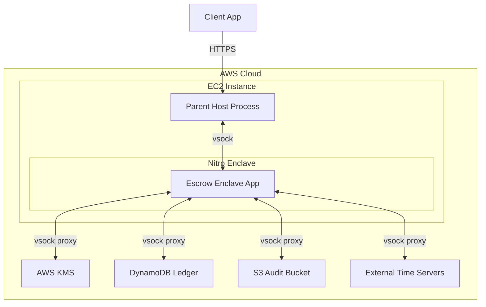

# Security Review Packet: Escrow Enclave

This document provides a comprehensive security overview of the Escrow Enclave system, detailing its trust boundaries, threat model, cryptographic guarantees, and known limitations. It is intended for external security reviewers and internal auditors.

## System Overview and Trust Boundaries

**2026-10-16 hold evidence update:** returned SES failures no longer discard a
durably created hold. Response-only, ledger-signed delivery evidence binds its
unchanged digest; `codeSent: false` includes ambiguous acceptance. It never starts
the seven-day wait or changes the send/guess budgets. A lost whole response or
outer timeout remains an availability risk. The new bearer-authenticated
`/v1/hold-state` read signs a caller nonce and the exact hold identity, generation,
state, confirmation/warning times and remaining guesses. Persisted state does not
record send acceptance, so reads conservatively report `unknown`, not success
inferred from a throttle. Clients must verify against attested ledger evidence and
fresh nonces; a signature is not an assurance of subsequent state stability.

`codeMismatch`, `codeExpired`, and `codeLocked` disclose only public policy outcomes
after hold-binding checks. They reveal no digits, secret hashes or unmetered
equality oracle; the fifth failed guess locks, expired attempts remain consumed,
and malformed/binding failures remain generic. Bearer-only cancellation still
permits a compromised API to cause durable DoS, not disclosure. See
[ENROLLMENT-AUTHORITY §§11–12](ENROLLMENT-AUTHORITY.md#11-hold-delivery-evidence-and-state-reads-2026-10-16)
for wire details, new-host-first compatibility, the unchanged persisted format,
and the recommended future owner-signature cancellation design (not implemented).

**PR 2 / Design 2 status:** the enrollment blocker is resolved **only in configured
authority mode**, with the measured authority/credential configuration, attested
writer unsealing, both verified Organizations guardrails, owner intent verification,
and the authority-aware clients/API. Unconfigured deployments still use
`UnavailableEnrollment`. No live AWS deployment or guardrail evaluation is claimed
by the offline implementation. See [offline audit coverage](AUDIT-COVERAGE.md) and
the [ordered staging cutover](STAGING.md#pr-2-authority-cutover--operator-only).
**Attack C remains a launch blocker for PR 3.** Existing lca-api notifications are
not enclave-controlled email confirmation.

The Escrow Enclave is a hardware-isolated environment (AWS Nitro Enclaves) responsible for securely holding and releasing encrypted account recovery keys. It enforces a strict release policy (7-day delay or PIN) that cannot be bypassed by the host operating system, the parent application (`lca-api`), or human operators.



**Trust Boundaries:**

- **Trusted:** The measured enclave code (`services/escrow-enclave-app/`), AWS Nitro hypervisor isolation, AWS KMS (for key sealing), and pinned external time authorities (Roughtime).
- **Untrusted:** The parent EC2 host (`services/escrow-enclave-host/`), the `lca-api` service, the network, and human operators (including database administrators).

## Assets

1. **Escrow Private Key:** A P-256 key deterministically derived inside the enclave from an attested KMS-generated 32-byte seed. The parent stores only the seed's KMS CiphertextBlob; neither seed nor derived private key leaves the enclave in plaintext.
2. **User Recovery Pieces:** Encrypted blobs submitted by clients. The enclave decrypts these only when the release policy is satisfied.
3. **PIN Budgets:** The remaining number of PIN attempts (max 10) for a given enrollment.
4. **Ledger State:** The history of holds, cancellations, and releases, ensuring a hold cannot be replayed or a PIN budget bypassed.

## Adversaries

- **Compromised Host/Parent:** Can drop, delay, or reorder messages. Can deny service by refusing to persist data or route traffic. Cannot read enclave memory or forge enclave signatures.
- **Compromised `lca-api`:** Can submit malicious requests or attempt to brute-force PINs. Constrained by the enclave's PIN budget and cryptographic verification.
- **Malicious Operator / Key Admin:** Can delete infrastructure or modify IAM policies. A key admin with MFA can theoretically rewrite the KMS key policy (see Residual Risk below).
- **Network Attacker:** Can observe or tamper with traffic between the client and the parent, or the parent and external services. Mitigated by TLS and enclave-verified signatures.
- **Malicious Client:** Can submit malformed requests or attempt to exploit parsing vulnerabilities. Mitigated by strict input validation and memory-safe Rust code.

## Design Decisions

- **D1 (Instance Size):** The enclave requires an `m6i.xlarge` instance. AWS requires at least 2 vCPUs for the parent host, so a 2-vCPU enclave necessitates a 4-vCPU parent instance.
- **D2 (Time Sources):** The enclave hypervisor clock was considered but not used. Measured code pins Cloudflare (draft-08), int08h and Tanner Ryan (Google legacy), with a 2-of-3 quorum and a shared two-second query deadline. All authenticated intervals must intersect; no majority/outlier exclusion. The 10s radius cap accommodates rough/smeared time without weakening the seven-day comparison. Bad signatures/timeouts count as unavailable; one unavailable source is tolerated, two fail closed. int08h and Tanner passed live verification on 2026-09-30; Cloudflare timed out. Public-source uptime and high-volume service-use approval remain staging obligations.
- **D3 (Legacy detection / configured prevention):** The host-owned ledger remains detection-only. Configured Design 2 instead serializes every sensitive transition in AWS-operated DynamoDB with exact prior-row conditions and durable execution receipts, independent of parent history and AWS token expiry. This prevents host replay/rollback across fresh boots and parallel enclaves under the AWS/protected-administration trust assumption. It does not protect against approved management/key administrators deliberately undoing that boundary.
- **D4 (KMS Recipient Flow):** The enclave generates a boot-time RSA-2048 recipient keypair. First boot calls `GenerateDataKey(KeySpec=AES_256, Recipient=NSM attestation)` with `{purpose:escrow-enclave-key,keyId}` context; subsequent boots call `Decrypt` with the same context and Recipient. Both reject any Plaintext field (including empty), require nonempty recipient ciphertext, and accept exactly 32 seed bytes after CMS opening. Generation additionally requires a nonempty CiphertextBlob for persistence. Domain-separated HKDF-SHA256 binds keyId and rejection-samples the escrow P-256 scalar; the seed/scalar buffers zeroize. No `Encrypt` operation exists in the enclave. No sealed-format migration is supported: Nitro never ran in production and the prior `nitro,kms` build did not compile. Deploy with a fresh restricted CMK, or prove it has never allowed attacker-known ciphertext generation: newly denying Encrypt does not invalidate pre-existing host-known 32-byte-seed ciphertexts.
- **D7 (KMS Key Policy):** The KMS key policy uses one statement per released measurement tuple. It requires an exact match on PCR0, PCR1, and PCR2 simultaneously to prevent cross-combination of measurements.
- **D10 (Key Admin Residual Risk):** An MFA-authenticated key admin can theoretically rewrite the KMS key policy to remove attestation gates. This residual risk is mitigated by mandatory two-person PR review and CloudTrail alarms, rather than an immutable key policy.
- **R-AUTHORITY-ROLLBACK (security acceptance required):** Until the
  [authority archiver](AUTHORITY-ARCHIVER.md) ships, a coherent authority-table
  rollback/purge by an attacker who already broke the admin boundary is detected
  through CloudTrail data-event write alarms and governance/trail-tamper alarms,
  **not independent archived authority history**. Table-only sweeps cannot detect
  coherent loss of all historical rows. These are best-effort signals, not a
  guaranteed detection deadline: a stolen writer identity can evade the nonwriter
  filter, and a trusted organization/MFA admin can weaken policies or detection.
  COMPLIANCE locks delivered log versions, not future logging or KMS availability.
  Accepted for all rollout stages (LAUNCH-DECISIONS.md RAR, amended 2026-10-31);
  the archiver is post-launch hardening. Same-generation rollback remains
  forbidden.

**Fixed monitoring gap (deployment and drills still required):** operator
read-only verification on **2026-10-20** found no escrow staging CloudTrail trail,
including shadow trails, and no organization trail. The organization's only trail
was single-account in management. CloudTrail event history showed **36
PutKeyPolicy events in 90 days** during image rolls, while EventBridge
`TriggeredRules = 0` over **60 days** for kms-governance and all six authority-*
rules. Those governance alarms had never fired: without an enabled trail,
EventBridge did not receive the required `AWS API Call via CloudTrail` events.
Bootstrap now defines the missing multi-region management/data trail with locked
log storage; core adds authority-write and trail-tamper rules. Nothing is applied
by this PR. Do not treat this code fix as deployed mitigation until the
[staging drills](STAGING.md#cloudtrail-trail-and-alarm-drills--operator-only) pass.

- **D11 (RSA/Marvin Rationale):** The `rsa` crate has a known timing side-channel (Marvin). This is accepted because the CMS blob only arrives inside the enclave's own TLS session to KMS, meaning the host cannot submit chosen ciphertexts.
- **D12 (Software Mode Blocked in Production):** The client guard (`getEscrowStrategyConfig` in `packages/learn-card-base/src/config/authConfig.ts`) downgrades `software` mode to `off` for production tenants (`learncard`, `vetpass`, `scoutpass`) whenever the resolved tenant config's deploy `stage` is `production` — which is also the fail-closed default for a missing or unrecognized stage. The guard keys on this deploy `stage`, not the Vite build mode (`IS_PRODUCTION`, i.e. `mode === 'production'`): staging deployments are Vite production-mode builds too (`apps/learn-card-app`'s `build` script runs `vite build` under `STAGE=staging`), so `IS_PRODUCTION` alone can't tell a staging deploy from production. Staging deliberately runs the software enclave (host-trusted, dev/test only) per #1565, with `stage: 'staging'` baked into the tenant config by `prepare-native-config.ts --stage staging` (learn-card-app) or the equivalent `VITE_NODE_ENV`-driven overlay (scouts). Independently, the enclave binary enforces this server-side: `--emulate` (software mode) is feature-gated behind `fake-nsm`/`fake-kms`/`fake-time`/`fake-ledger`, which a production `--features nitro,kms` build excludes, so that compiled binary refuses `--emulate` before binding.
- **D13 (Audit design):** Legacy mode retains its bounded per-blob ledger and `Carried` genesis. Configured mode instead stores per-DID authority state, bounded per-hold/operation rows and immutable execution receipts with signed proposals. No legacy history is imported. Proposed events and post-commit signatures have different domain tags; a proposal is never commit proof. The independent monitor verifies authenticated table evidence and continuity, not parent readback. Time intervals remain processing evidence, not authenticated upper bounds on receipt time.
- **D14 (Release replay and ordering):** Configured authority commits successful PIN results together with release. Cancel committed first blocks release; release committed first is final. Unknown/reconciled reservations never permit another comparison, and ambiguous release commits never grant another seal. A lost response can burn a hold. Configured carry/rewrap consult and update the authority; unsigned carry is refused. Unconfigured create/release/cancel remain fail-closed with `UnavailableEnrollment`.
- **D15 (Cancel-Link Token Primitive):** Cancel-link tokens (`services/learn-card-network/lca-api/src/helpers/escrowCancelToken.ts`) are 256-bit random values stored as SHA-256 hashes and compared in constant time — the same primitive as resume tokens. They are single-use and valid only while the hold is `pending`. HMAC derivation (`token = HMAC-SHA256(SEED, holdId)`) was considered and rejected for this primary token: an HMAC-derived token is fully determined by `SEED` and the hold ID, so a future `SEED` compromise would retroactively make every cancel link for every hold — past, present and future — derivable offline from hold IDs alone, which are not treated as secret (they appear in Mongo, in client receipts, and in the resumeToken flow). A true random primary token is never a function of `SEED`, so a `SEED` compromise does not retroactively compromise already-issued cancel links. Retry notification tokens (`rotateEscrowCancelToken`) are HMAC-derived instead: this is a deliberate, narrower trade-off for idempotent redelivery (recompute the same link for a retry without storing or resending a new one), bounded to at most four additional HMAC-derived hashes per hold (`cancelTokenHashes`), alongside the original random token which always remains valid.
- **D18 (Enclave key stability and rotation):** The escrow key is generated once and KMS-sealed (`services/escrow-enclave-app/src/kms.rs`); any build whose PCRs are in the key policy unseals the same key, so new builds and redeploys keep the same `keyId` and all existing copies stay readable (measurement rotation ≠ key rotation). The `keyId` changes only by deliberate rotation or if the host loses the sealed key. Previous keys (up to 3) are read-only, advertised and bound in the signed attestation, and new copies are always sealed with the current key. PIN carry and re-seal preserve the attempt count (D17/P8.3). Honest limits: (a) **lost sealed key** — if the host loses the sealed key object and first boot generates a new one, every copy under the old key is unrecoverable by escrow (users fall back to other recovery methods); mitigations = the sealed key lives under a create-only `sealed-keys/` prefix in the versioned artifacts bucket, where the enclave-host IAM role can create but never overwrite or delete an existing sealed key object, and holds that create permission only while `escrow_allow_first_boot` is true (`infra/escrow-enclave/iam.tf`'s conditional `WriteSealedKey` statement, `storage.tf`'s bucket policy denying any unconditional `sealed-keys/*` write, no `s3:DeleteObject`/`s3:DeleteObjectVersion` grant anywhere), the bucket's versioning preserves prior object versions if an admin ever does replace one, and `ESCROW_ALLOW_FIRST_BOOT` stays off in steady state (`services/escrow-enclave-host/README.md`); (b) **re-seal vs. a recovery starting at the same moment** — the rewrap job (`services/learn-card-network/lca-api/src/jobs/escrowBlobRewrap.ts`) skips accounts with a pending hold, but a hold started between that check and the write refers to the old copy, and its release will then be refused; this is rare (once per user per rotation), fails safe, and the user starts a new recovery.

- **D19 (PIN sign-in keeps the account) — ACCEPTED: Jackson Smith (CTO), 2026-11-03.** Product decision (2026-11): a successful PIN release no longer re-splits the key or wipes older auth-share versions. Before this change every PIN recovery rebound the account: lca-api dropped `previousAuthShares`, marked recovery methods pending and unset the escrow blob and PIN, which signed out every other device and turned off the recovery phrase, backup file, passkey and email key. Now:
    - **Login + PIN signs a new device in silently.** With a login already bound to the account, the client stores the released recovery share as its device share at the released `shareVersion` N and makes no auth-share write; it then re-enrols the **same** PIN at N (owner-signed set/change, fresh ten-attempt budget) **only when the PIN status read before and after the release both record zero wrong attempts for the current PIN generation, with exactly one charge (this release) between them**, and lca-api writes that re-set only while the PIN still shows the charges the client saw after its release (`expectedPinCharges`, checked in the write's filter); otherwise (any wrong attempt recorded, the count missing or unreadable, another charge in between, or the charges changed before the write) it does not re-set the PIN, which keeps its reduced budget (see "Budget refresh" below). With a lost login, the recovery-email code is also required, and `POST /keys/recovery-session/pin-sign-in` only links the new login (accepted only with a rebind token minted by a PIN release, `origin: 'pin-release'`; hold and phrase/passkey tokens are refused, so those paths still wipe). Share history, recovery methods and escrow are unchanged on both paths.
    - **The PIN is now an account-takeover factor on its own terms, not only a reset trigger.** Before, an attacker with login + PIN got the key but the owner was visibly signed out everywhere. Now the owner's devices keep working and nothing visible happens on them. The PIN's protection is unchanged: ten lifetime attempts per PIN set (D14, configured authority), per-IP throttles in lca-api, and a hold per attempt.
    - **Device share = recovery share at N.** The new device's local share is byte-identical to the recovery share behind escrow, phrase, passkey and backup at N. This adds no exposure: device share + login already reconstructs the key, as does recovery share + login. It does mean a stolen copy of that device's storage is equivalent to a stolen recovery phrase for version N, until the next rotation.
    - **Budget refresh only for a PIN nobody has guessed at.** Re-setting a PIN starts a new PIN generation with `attempts_used` 0 (below). The keep path does that for the **same** PIN only when `escrowPin.wrongAttempts` is 0 both before and after the release (or, under the own-typos rule below, equals the wrong entries this device itself made in this sign-in flow, with none recorded before it) (the earlier read catches a legacy record, whose missing count lca-api's reservation turns into 0) and no other charge landed, enforced again by lca-api at write time; with any recorded wrong attempt the same PIN never gets a fresh budget, so someone guessing cannot get a new ten-attempt budget out of each of the owner's PIN sign-ins. The app then asks for a **new** PIN (alongside "Secure my account" and the wrong-entry warning); the coordinator refuses the PIN just used (`SameEscrowPinError`), compared against a tag kept in memory and in local storage (HMAC-SHA-256 of DID and PIN, keyed by a hash of the account private key, so only a holder of that key can test PINs against it), so the refusal also holds after an app restart on that device. If the user dismisses, the PIN keeps its reduced budget and the prompt returns on the next app start while wrong attempts remain recorded. **Bound:** for one PIN generation, wrong guesses are limited to that generation's remaining budget in total (ten attempts, less the attempts already used, including the owner's own releases); a refresh never happens while a wrong guess is recorded. Limits: the same-PIN check works only on the device that did the PIN sign-in (the server stores only a derived verifier inside the sealed blob, so another of the owner's devices, or this one after its storage was cleared, cannot compare a "new" PIN with the old one; it still shows the prompt while wrong attempts are recorded); a guess still at the authority when the re-set is attempted no longer goes uncharged (the PIN-operation lease below refuses the re-set instead); and every release, including the owner's correct ones, uses budget, so repeated PIN sign-ins without choosing a new PIN can lock the PIN (the user then falls back to the waiting period). The lost-login path never re-sets the PIN; it reports whether a new PIN is needed from the status read after linking.
    - **Own-typos rule — ACCEPTED: Jackson Smith (CTO), 2026-11-03.** Wrong PIN entries this device submitted during the **same** PIN sign-in flow are the user's own typing: they do not count toward the "someone may have tried your PIN" warning and do not block the same-PIN budget refresh. A flow starts with the coordinator's first PIN status read for the account, before its first attempt (`priorWrongAttempts`), and counts only the mismatch responses this client itself received (`ownWrongAttempts`); a new session or app start begins a new flow, so earlier misses then count as prior. The refresh runs only when the prior count is exactly 0 (a missing or legacy count blocks it) and the status read before and after the release both show exactly `ownWrongAttempts` wrong entries (more means someone else guessed; fewer or unknown is unexplained), with exactly one charge between them. lca-api accepts a non-zero `expectedPinCharges.wrongAttempts` (never more than the charges) but still writes only while the PIN shows exactly those charges, so a foreign entry that lands after the client's reads still blocks the write. lca-api cannot tell whose entries they are: the rule relies on the client, which already holds the key and could set any new PIN anyway, so it adds no capability; it can only give the same PIN a fresh budget when nobody else's guess is recorded. **Bound unchanged in kind:** a guesser's entries are never excused (they are never this client's mismatch responses), so they still keep the budget reduced and trigger the new-PIN prompt. A flow is bound to one PIN generation (the status `salt`) and ends when the device reaches `ready` by any method, so own typos against one PIN never excuse guesses against a later one. lca-api returns "Incorrect PIN." only when it recorded that wrong entry (a compare whose record changed underneath gets CONFLICT instead), so the client never counts an unrecorded entry as own. Residual: a mismatch response that was lost in transit is not counted as own, which only errs toward the warning. If the re-set does not run (failed, or `deferred-rotation`), the coordinator suppresses the new-PIN prompt for the excused entries for that session only; after a restart they count again.
    - **Compensating controls:** (1) lca-api emails the account's verified addresses on every successful PIN release (`escrow-pin-sign-in` template, push copy "New device signed in with your PIN"), triggered server-side at `/keys/escrow/complete` so the client cannot suppress it; delivery is fail-open and never fails the release. (2) The app shows a one-time sheet after a PIN sign-in: "You're signed in" with a "Lost a device? Secure your account" link, or, when the PIN has recorded wrong attempts that were not this sign-in's own typos (above), the warning "Someone may have tried your PIN" leading with "Choose a new PIN" (the same link stays). (3) "Secure my account" / "Sign out of other devices" (`POST /keys/revoke-other-devices`, the email link `/account/secure`, and Account Recovery settings) performs today's reset on demand: one atomic CAS on `{provider, primaryDid, expectedShareVersion}` re-splits, wipes older versions, returns methods to pending, unsets escrow, **unlinks every login except the caller's** (so a login added by a lost-login PIN sign-in does not survive), then best-effort cancels pending holds (which cannot release after the commit anyway), and emails the account's contact address and verified recovery email (`account-secured` template, fail-open). That notice assumes the reader may not have run the revoke and may have lost their login. It does not point to `/account/secure`, and it does not offer the app's lost-login recovery as the way back, because the revoke it reports has just returned every recovery method to pending and unset escrow, so that path usually has nothing left to use; it says the recovery methods were reset and sends the owner to the tenant support address, or, for a tenant without one, to the organization that gave them access (no address is invented). (4) Every recovery-session token (`'recover'` and `'rebind'`, from the recovery-email code, phrase/passkey/backup, the waiting-period hold and the PIN release) records the account's `securityEpoch` at mint; a `'rebind'` token minted from a recovery session inherits that session's epoch. Every wiping rotation (revoke and `/rebind`) increments the epoch in the same document update, and `/rebind` and `/pin-sign-in` only write while the epoch still matches (enforced in the update filter, not a read-then-write check), so no token minted before a revoke or another wiping rebind can be used after it, whatever its origin. Ordinary non-wiping rotations do not move the epoch, so an in-flight recovery survives them. Legacy records without the field are at epoch 0. A PIN-release token is additionally pinned to the released `shareVersion` at `/rebind`, as before.
    - **What the revoke does NOT do:** it re-splits the **same** private key; it does not rotate the DID key. Any device or person that already reconstructed the key keeps it: an app that caches the key (the private-key-first resume path; every browser outside public-computer mode) keeps resuming to `ready` without the server, and an attacker who signed in can keep signing as the owner's DID. The revoke only stops **new** share-based sign-ins (older device shares, the old phrase/backup/passkey/email key, other logins and the old escrow copy). The app copy says this ("A device that is open right now may keep working until it signs out…") rather than promising every device is signed out. Real eviction needs DID key rotation or server-side session invalidation; out of scope here.
    - **Residual risk:** an attacker with login + PIN can also run "Secure my account" and sign the owner out, which equals the old always-wipe behaviour. The `account-secured` email is the owner's only signal in that case; it cannot restore access by itself. The notice goes to addresses an inbox-compromising attacker may also control. An attacker who holds the owner's **own** login (not a separately linked one) is not removed by the revoke; the owner must also change that login's password and should choose a new PIN (the secure flow asks for a PIN and tells users to pick a new one if someone else might know theirs; it refuses the PIN just used when that PIN has recorded wrong attempts, but otherwise still allows keeping it). Already-reconstructed keys are not revoked (above).
    - **Nitro same-version `Change` (checked by code reading, not a live enclave run):** a `Set` or `Change` PIN action starts a new PIN generation with `attempts_used: 0` (`services/escrow-enclave-app/src/policy/authority.rs`, the `PinAction::Set | PinAction::Change | PinAction::Clear` arm, ~L271-278), and a `Replace` enrollment is accepted at a `share_version` equal to the current one (`services/escrow-enclave-app/src/authority/intent.rs`, `intent.share_version >= current_blob...share_version`, ~L292-293), so re-enrolling the same PIN at the released version N gives a fresh budget. **Still unverified (nitro):** whether the authority retires a released blob's PIN at carry time. Software mode was fixed and tested (`hasCompletedEscrowHoldForVersion(..., { completedAfter })`). Confirm with the enclave owner before enabling in a configured deployment.
    - **PIN-operation lease (authority mode, lca-api; no enclave change).** The authority's `apply_enrollment_intent` checks only the expected enrollment version, not the operation revision, so a PIN compare that lands between lca-api's checks and the intent does not make it refuse: a `Change` would still replace the envelope and reset `attempts_used`, while lca-api's charge-conditioned Mongo write then missed and left the old copy (authority NEW, Mongo OLD; every later hold refused). lca-api now serialises every owner-signed intent it relays (enroll/replace/carry/disable, any PIN action) with a per-account lease in the user-key document (`escrowEnrollmentLease`), claimed in one write conditioned on the exact blob and PIN record (so the charges) it validated, on no other lease, and on no PIN compare in flight (`escrowPinCompares`, one marker per reservation, cleared when the authority answers). Any miss is CONFLICT with nothing sent to the authority. While the lease is held, `/keys/escrow/start` and `/keys/escrow/complete` refuse before creating a hold or reserving a guess (429 "try again in a moment"; nothing charged), and `/keys/escrow/complete` also refuses, before charging, a PIN hold bound to a copy other than lca-api's current one (the authority would refuse it without counting it). The background rewrap job takes the same lease around its delegated `authority_rewrap` call (and skips an account whose lease is held), since a rewrap also advances the enrollment version. The post-commit write is conditioned on the lease and the replaced blob identity, not on charges, and releases the lease. **Reconciliation:** the lease records what to persist (PIN salt, PIN action, share version, the authority version/epoch/PIN generation it expects); when the write misses, the response is lost, or lca-api crashes, lca-api reads the signed authority state and adopts it only if it is exactly the lease's commit (enrollment version +1, epoch, PIN generation, share version, and the returned envelope identity when known), otherwise drops the lease. A lease whose outcome cannot be known yet is kept until it expires (120 s, four times the 30 s maximum authority call timeout) and settled by the next account request that touches escrow (start, complete, enroll, disable, authority-state, or the rewrap job). A settle that finds the commit already persisted by another request counts as adopted. When the authority call's response was lost, the request still fails even if its commit is adopted (the authority refuses a replayed request id, so there is no receipt for the client to verify); the SDK then reports a same-PIN refresh as `pinRefreshFailed`, an under-claim. While a lease is held `/keys/auth-share` reports `escrowUpdating`, and `ensureEscrowEnrollment` treats a copy mismatch then as in progress rather than stale. **Residual:** a lease that expires while its authority call is somehow still in flight (longer than four transport timeouts) could be dropped as uncommitted before a late commit; clients detect the resulting copy mismatch (`escrowBlobIdentity` on `/keys/auth-share` vs the signed authority envelope) and `ensureEscrowEnrollment` repairs it (re-enrol, or ask for a new PIN when the stale copy is PIN-protected; it never clears the PIN by itself). A real fix of the authority-side check (refusing on an operation-revision change) needs an enclave image roll and is out of scope.
    - Client details: `packages/learn-card-base/src/auth-coordinator/RECOVERY.md` ("PIN sign-in"); user-level description: `docs/core-concepts/automatic-account-recovery.md`.

## Guarantees vs. Non-Guarantees

We are scrupulously honest about the limits of this system. The following table outlines what the system enforces versus what it only detects or relies on operational controls for.

| Threat                          | Prevention / Detection Boundary                                                                                                                                                                                                                                                                                                                                                                                                                         | Citation                                                                                 |
| :------------------------------ | :------------------------------------------------------------------------------------------------------------------------------------------------------------------------------------------------------------------------------------------------------------------------------------------------------------------------------------------------------------------------------------------------------------------------------------------------------ | :--------------------------------------------------------------------------------------- |
| Forged/modified ledger record   | **Prevented** by enclave signature and sequence verification.                                                                                                                                                                                                                                                                                                                                                                                           | `services/escrow-enclave-app/README.md`                                                  |
| Ledger rollback / stale history | **Configured:** host replay is prevented by authenticated authority reads and conditional transactions. **Legacy:** detection-only. Privileged coherent authority rollback remains a governance risk.                                                                                                                                                                                                                                                   | D3, D13; [coverage](AUDIT-COVERAGE.md)                                                   |
| Release replay                  | **Configured:** committed release is final, including across restart. A lost reply can burn the hold. **Unconfigured:** release remains unavailable.                                                                                                                                                                                                                                                                                                    | D14                                                                                      |
| Enclave clock manipulation      | **Enforced** by a compiled 2-of-3 Roughtime quorum (Cloudflare, int08h, Tanner Ryan); every valid interval must overlap. One unavailable/invalid-signature source is tolerated; two or any authenticated disagreement fail closed. The hypervisor clock was considered but not used. Signed processing events are not an authenticated upper bound on receipt time.                                                                                     | `services/escrow-enclave-app/README.md`, [Design Decisions](#design-decisions) (D2, D13) |
| PIN attempt budget bypass       | **Configured:** ten durable reservations per signed PIN set, serialized across enclaves; carry/rewrap cannot replenish it and old blobs fail current-identity checks. **Legacy:** per-blob detection limitations remain.                                                                                                                                                                                                                                | D3, D13; BLOCKER-ENROLLMENT status below                                                 |
| Key Admin policy rewrite        | **Residual Risk**. An MFA-authenticated admin can rewrite the KMS policy to remove attestation gates. Mitigated by PR review and CloudTrail alarms.                                                                                                                                                                                                                                                                                                     | `infra/escrow-enclave/README.md`, [Design Decisions](#design-decisions) (D10)            |
| RSA timing side-channels        | **Accepted Risk**. The `rsa` crate has a known timing side-channel (Marvin). Exploitation requires chosen ciphertexts, which the enclave does not accept from the host (only via verified KMS TLS).                                                                                                                                                                                                                                                     | [Design Decisions](#design-decisions) (D11)                                              |
| Software mode in production     | **Prevented**. The client guard downgrades software mode to `off` for production tenants whenever the deploy `stage` is `production` (the fail-closed default). Staging deliberately runs the software enclave (host-trusted, dev/test only) — the guard keys on deploy stage, not Vite build mode, since staging is a production-mode build too. The enclave binary separately excludes the software-mode emulator from `nitro,kms` production builds. | [Design Decisions](#design-decisions) (D12)                                              |
| Lost sealed key                 | **Accepted Risk**. If the host loses the sealed key object and generates a new one, all existing copies under the old key are unrecoverable by escrow. Mitigated by the create-only `sealed-keys/` prefix in the versioned artifacts bucket (the host role can create but never overwrite or delete an existing sealed key) and keeping `ESCROW_ALLOW_FIRST_BOOT` off in steady state.                                                                  | [Design Decisions](#design-decisions) (D18)                                              |
| Login + PIN sign-in (D19)       | **Accepted risk (Accepted by Jackson Smith (CTO), 2026-11-03).** Bound login + PIN (or recovery-email code + PIN) signs a new device in without signing others out. Detection, not prevention: server email on every PIN release, a one-time in-app review, and an on-demand revoke that stops new share-based sign-ins and unlinks other logins but cannot evict a device that already holds the key.                                                  | [Design Decisions](#design-decisions) (D19)                                              |
| Re-seal vs. concurrent recovery | **Fails Safe**. A recovery hold started between the rewrap job's check and its write refers to the old copy, and its release will be refused. The user must start a new recovery.                                                                                                                                                                                                                                                                       | [Design Decisions](#design-decisions) (D18)                                              |

## KMS Key Policy Summary

### Independent authority observer and residual risks

The monitor gets only GetItem/Query/Scan on the exact authority table, plus a
security-owned public trust parameter. It gets neither escrow/credential-CMK
access nor writer credentials. The table policy and **both** attached SCPs restrict
its exception to reads. The observer SCP protects its IAM role (including PassRole),
Lambda code/configuration and fixed SSM trust parameter against non-admin takeover.
The original escrow CMK policy is unchanged.

The sweep uses strongly consistent reads and an unchanged account fence around
pagination. It verifies key-ID/measurement-pinned proposals, receipt/revision
bindings, per-PIN-generation budgets, hold terminal order and every committed row's
receipt. Invalid data alarms; unavailable/changing/over-capacity reads retry and
alarm on coverage failure. A separate missing-authority-heartbeat alarm prevents
the legacy monitor's heartbeat from masking a disabled/broken authority observer.

This is detection, not an availability or immutable-administration guarantee:

- Signed RPC Commit/Snapshot artifacts are not stored in the table; the observer
  verifies stored proposals and authenticated execution receipts, never equating
  a proposal signature with proof of commit. Clients verify RPC artifacts separately.
- A coherent privileged purge to a historical prefix (or an empty table) cannot
  be distinguished from an unused/shorter history without an external durable
  high-water mark. No such checkpoint is claimed. Same-generation restore is forbidden.
- Organization/management owners and MFA key administrators remain trusted. They
  can change SCPs/policies, provision writer keys, or suppress monitoring. Scheduler,
  alarm/subscriber controls and independent CloudTrail delivery need security-owned
  operational protection; the detector is not an immutable control plane.
- Bounds/timeouts can require sharding or a reviewed checkpoint design before
  scaling. They cause coverage failure, never a partial-history success.
- Mongo remains an availability/UX cache and holds auth shares/PIN salts needed by
  client recovery. Durable encrypted authority output does not make those caches
  recoverable if lost. Ambiguous releases may burn holds; no refund/replay is allowed.
- No live guardrail, credentials, native relay or monitor-delivery verification was
  performed in this PR. Attack C/email confirmation remains PR 3.

### AWS TLS and signing time (authority foundations)

The existing KMS client now obtains fresh enclave-verified `TimeSource` evidence
before each Decrypt or GenerateDataKey operation. Production supplies the compiled
Roughtime quorum; unavailable or malformed intervals fail before AWS network IO.
This hardens existing boot/unsealing, not enrollment authorization:
`UnavailableEnrollment` remains wired, and authority/email clients are not active.
Boot now also requires available Roughtime evidence for KMS access.

The previous SDK-default HTTPS transport used rustls's system clock and native
roots from the Alpine CA bundle baked into the EIF. The replacement uses a narrow
hyper 1/rustls adapter because the locked Smithy HTTPS builder does not expose a
custom rustls configuration/time provider. Mozilla roots from `webpki-roots` are
compiled into the binary and pinned by Cargo.lock; neither host CA files nor
`SSL_CERT_FILE`/proxy environment variables select trust roots or transport.
This is WebPKI trust plus the fixed regional AWS hostname, not AWS-only CA pinning.

- Certificate chain/name validation runs at **both authenticated interval bounds**,
  rounding the lower bound down and the upper bound up to whole seconds. TLS
  handshake-signature verification remains rustls/WebPKI's standard implementation.
- An explicit rustls time provider uses the same sample, with no wall-clock fallback.
  SigV4 uses the interval midpoint through the SDK's explicit time source.
- Each operation creates a fresh SDK client and connection pool. TLS resumption,
  early data, idle pooling, Hyper's cancelled-request retries and SDK retries are
  disabled. SDK response-date clock-skew correction therefore cannot influence a
  subsequent request. An unknown GenerateDataKey outcome is not automatically retried.
- Only HTTPS to the configured regional authority is accepted. Redirects are not
  followed. Responses are bounded to 1 MiB, with a 15-second whole-exchange deadline;
  local timers bound resource use, not trusted elapsed time.

**Limit:** Roughtime authenticates server processing time, not a receipt-time upper
bound. A host that delays a live response or suspends execution can make the sample
old before the handshake or request completes. Fresh nonces, disabled reuse and
timeouts do not prove real-time freshness against suspension. Certificate checks
cover the signed interval, not a proven current wall-clock interval; a compromised
certificate key valid then is not ruled out solely because the certificate has
expired by receipt. AWS's own SigV4 time window can reject delayed requests, but is
not an enclave-authenticated elapsed-time guarantee. No revocation/OCSP freshness
guarantee is added. D2, D3, D11 and D13 remain applicable.

### Configured direct data-plane clients

The `authority::aws` clients sign only enclave-built GetItem,
TransactGetItems, conditional TransactWriteItems and SESv2 SendEmail requests.
They reuse the trusted-time transport above, pin the table/SES identity by full
account-qualified ARN and do not retry any operation. Each transaction retains an
immutable token/body pair; each email has a generated execution tag (not an SES
idempotency guarantee). Unknown mutation outcomes remain errors. Read failures
must never be interpreted as missing authority state.

Dedicated credentials are a distinct zeroizing type that rejects STS access-key
IDs and has no session token or conversion from parent boot credentials. Its
`from_unsealed` constructor accepts material from trusted enclave code only.
The configured `CredentialUnsealer` uses a separate measured credential CMK and fresh
NSM Recipient attestation, then the existing BER/CMS recipient unwrap. Its KMS
encryption context binds `purpose` (`authority-writer` or `email-sender`), `tenant`,
`environment`, `authorityGeneration` and `principalArn`. The credential CMK must
differ from the escrow CMK and use the measured account and existing KMS relay's
region. It never calls GenerateDataKey or falls back to the escrow CMK.

Decrypted JSON is capped at 4096 bytes; escape bytes are rejected before invoking
the JSON decoder so it cannot allocate an escape-decoding copy of a secret value.
Fields are parsed as borrowed strings from a zeroizing buffer; its exact fields are `accessKeyId`, `secretAccessKey`, and
`principalArn`. Unknown/duplicate fields, session tokens, malformed keys, escaped
strings requiring allocation, or a principal mismatch fail closed. Owned final
credentials zeroize on drop; this is not a claim about all SDK/library copies.
The parent can deliver only optional opaque ciphertexts (6144 bytes each), never
the dedicated keys. Existing temporary parent STS credentials remain unchanged
and are used only to authorize attested KMS access, not DynamoDB/SES requests.

Claimed principal metadata is checked against
measured configuration, but is not independently an AWS identity proof: the
credential-CMK/provisioning binding and resource IAM policy must enforce that
contract before activation. Gated Terraform and the operator provisioning script
now implement that contract; they have not been deployed or adversarially tested
against AWS. Install the management-account SCP before enabling resources: IAM
users cannot protect their access keys from other IAM administrators through
user-attached policies. The SCP receipt variable requires independent verification,
and organization/key administrators remain trusted (D10). Configured boot now
unseals the writer and supervises the direct DynamoDB relay. Missing/partial
configuration or failed unsealing never falls back to host credentials. Email
unsealing/sending/confirmation remain inactive for PR 3.

### Escrow CMK policy

The AWS KMS Customer Master Key (CMK) policy (`infra/escrow-enclave/kms.tf`) is the primary security boundary enforcing attestation.

- **Per-Tuple PCR Statements:** `kms:GenerateDataKey` and `kms:Decrypt` are granted via individual statements for each approved measurement tuple (PCR0, PCR1, PCR2). Conditions use `StringEqualsIgnoreCase` and require all three PCRs to match simultaneously.
- **Key-Substitution Denies:** Deny `kms:Encrypt`, `kms:ReEncrypt*`, `kms:GenerateDataKeyWithoutPlaintext`, and `kms:GenerateDataKeyPair*` for all principals. Attestation-only Decrypt is insufficient if the host can mint ciphertext for known plaintext. These denies and fresh-CMK provenance are required deployment contracts, not a property the Rust CMS parser can establish.
- **Grant Ban:** `kms:CreateGrant` is explicitly denied for all principals to prevent bypassing the policy via grants.
- **Missing/Debug Attestation Deny:** GenerateDataKey and Decrypt must be explicitly denied without recipient attestation or with any all-zero debug PCR.
- **MFA on Policy Changes:** `escrow-kms-admin` (the only non-root principal with `kms:PutKeyPolicy`) can only be assumed by listed IAM users with MFA under an hour old. The key policy additionally denies `kms:PutKeyPolicy` to the root user without MFA (`BoolIfExists`, so root access keys are denied too). The MFA deny can't cover the role itself: role sessions report `aws:MultiFactorAuthPresent=false` even when assumed with MFA, so KMS's lockout check rejects such a policy.
- **No IAM delegation:** The root break-glass statement is restricted to the root user with `aws:PrincipalArn`. A bare `arn:aws:iam::<account>:root` principal grants the account, so any IAM admin (including `OrganizationAccountAccessRole`) could otherwise rewrite the key policy without MFA; this was found and closed during staging bring-up.

## Measurement Rotation Procedure (N / N+1)

`ESCROW_TENANT`, `ESCROW_KEY_ID`, `ESCROW_KMS_REGION`, `ESCROW_KMS_KEY_ARN`,
`ESCROW_PREVIOUS_KEY_IDS`, and `ESCROW_ALLOW_FIRST_BOOT` are Docker ARG→ENV measured
configuration. `build-eif.sh` validates required flags/env and records them under
`measurements.json.config`; CI supplies repository variables. The EIF does not
inherit the parent's environment. Changes to any value require rebuilding and
reviewing new PCRs, including the provisioning→steady-state first-boot flag change.
Linux startup writes the validated regional KMS→127.0.0.1 mapping to `/etc/hosts`
before KMS access and fails closed on error. The final image contains a non-root
owned writable hosts file; real EIF permissions/NSM/vsock access remain staging checks.

When the enclave code changes, the EIF measurements (PCRs) change. To rotate without downtime (`infra/escrow-enclave/README.md`):

1. **Build N+1:** The CI workflow (`.github/workflows/escrow-enclave-eif.yml`) builds the EIF twice and verifies reproducibility. The resulting `measurements.json` is committed to `security/escrow-measurements.json`.
2. **Add N+1:** Update `infra/escrow-enclave/variables.tf` (or tfvars) to include both N and N+1 measurements. Apply the Terraform change (requires two-person review and MFA).
3. **Roll ASG:** Update the ASG to deploy the N+1 image. **Ship a matching host binary in the same roll.** The host links the enclave crate's wire types and returns `503 unavailable` for any enclave response it cannot parse, after the enclave has already committed the operation (2026-10-23 staging finding below). Rebuild `escrow-enclave-host` from the EIF's commit whenever `wire.rs` changed since the deployed host's commit.
4. **Update Clients:** Publish the new measurements to the tenant config so clients accept N+1 attestations.
5. **Retire N:** Once all instances and clients are updated, remove the N measurement from the Terraform configuration and apply.

## Key Rotation Procedure

To deliberately rotate the escrow key (e.g., periodic rotation or suspected compromise):

1. **Generate New Key:** Configure a new `ESCROW_KEY_ID` and a new `ESCROW_SEALED_KEY_OBJECT` under an unused path in the `sealed-keys/` prefix (e.g. `sealed-keys/escrow-enclave-key-v2` if `v1` is current) — this path must not already exist, since both the host's own conditional write and Terraform's bucket policy (`infra/escrow-enclave/storage.tf`) refuse to overwrite an existing object at it. Temporarily set `ESCROW_ALLOW_FIRST_BOOT=true` on **both** the host and the enclave to allow the enclave to generate and seal the new key at that new path.
2. **Turn Off First Boot:** As soon as the new key is sealed, set `ESCROW_ALLOW_FIRST_BOOT` back to `false` (or unset it) on both the host and the enclave and restart. Confirm the new sealed object exists under `sealed-keys/` (e.g. `aws s3api head-object --bucket <artifacts-bucket> --key sealed-keys/escrow-enclave-key-v2`) before proceeding. Leaving the flag on is a standing risk — see "Lost sealed key" above.
3. **Configure Previous Key:** Move the OLD key ID to `ESCROW_PREVIOUS_KEY_IDS` and its OLD sealed object path (e.g. `sealed-keys/escrow-enclave-key-v1`) to `ESCROW_PREVIOUS_KEY_OBJECTS` on the host. Apply these config changes (requires two-person review).
4. **Verify Attestation:** Confirm the signed attestation lists the new key as current and the old key as previous.
5. **Migrate Blobs:** Let sign-in re-enrolls and the hourly rewrap job (`escrowBlobRewrap`) migrate existing blobs to the new key.
6. **Monitor Progress:** Watch migration progress using `bun scripts/escrow-blob-mode-report.ts --current-key-id=<new> --previous-key-ids=<old>`.
7. **Retire Previous Key:** Once the report shows 0 copies under the old key (or after deciding the remainder falls back to other recovery methods), remove it from the host configuration.

Enclave-side steps above require rebuilding the measured image, not only changing
the host environment. Keep previous keys while retained active histories reference
their ledger signatures, even if blob migration is complete. Policy derives a
keyId→ledger-verifier map from current plus up to three previous unsealed keys;
each record selects its verifier with signed CBOR key 10, unknown IDs fail, and new
appends always use the current signer. Before rotation, publish the monitor SSM
String parameter as `{"<keyId>":"<130-character lowercase hex SEC1 P-256 key>",...}`
(1–4 entries), retaining old attestation-validated ledger public keys. A bare
130-hex key remains accepted with legacy single-key/single-keyId semantics; it
cannot verify mixed-key chains. Recycle monitor execution environments on updates.

## Incident Response Pointers

- **Monitor Alarms:** The independent ledger monitor (`services/escrow-ledger-monitor/`) runs every 15 minutes. It alarms on DynamoDB/S3 divergence, invalid signatures, or unexpected `MODIFY`/`REMOVE` events on the append-only ledger.
- **Kill Switch:** If tampering is suspected, operators must manually set `ESCROW_RELEASE_KILL_SWITCH=true` in the `lca-api` environment and redeploy. This refuses starting and completing recovery; cancellation and notifications keep working. The monitor does not auto-flip this switch to prevent denial-of-service attacks. (`services/escrow-ledger-monitor/README.md`, `services/learn-card-network/lca-api/src/routes/escrow.ts`)

### Cancellation durability and response

Cancellation is **API-enforced immediately** once Mongo atomically changes the hold
to `cancelled` and records `enclaveCancelPendingAt`. The API preserves a successful
user cancellation response even when the enclave is unavailable. New recovery holds
for the same account identity are refused while any prior cancellation is unconfirmed,
including across linked providers, release policies, and re-enrollment.

Enclave revocation is **durable and retried, but eventually consistent**, not an
instant revocation guarantee against a compromised host. New holds retain their
encrypted source envelope so removal or replacement cannot erase retry material.
The existing hourly `escrowHoldReminders` job retries a bounded, attempt-ordered
batch; successful replies set `enclaveCancelConfirmedAt` and remove the pending
marker and retained envelope. Failures remain pending. Sanitized console/Sentry
error-level alerts fire when cancellation is still pending within 24 hours of
`releaseAfter`, or already overdue, including backlog outside the retry batch.
Operators must investigate these alerts before release, and use the manual API
kill switch where appropriate; it does not stop a host bypassing the API.

Errors never confirm cancellation. In configured mode, a stable hold-bound operation
ID and authenticated immutable receipt let retries positively confirm an already
committed cancellation across restart. The API persists its commit receipt before
clearing `enclaveCancelPendingAt`. Obsolete pending holds can be cancelled after
rotation/disablement; cancellation grants no release. Legacy/unknown rows do not
invent confirmation. Suppressed delivery and unavailable authority still mean the
queue cannot guarantee bounded revocation latency. Unconfigured mode remains unavailable.

## Open Items / Launch Blockers

- **RESOLVED-PIN-SIGN-IN (D19) — trade-off accepted: Jackson Smith (CTO), 2026-11-03.** PIN sign-in keeps the account by default, with the compensating controls and known limits listed under D19 ([PR #1905](https://github.com/learningeconomy/LearnCard/pull/1905)). Remaining before production (verification, not a decision): confirm the two nitro behaviours listed under D19 against a live enclave (so far verified by code reading only), and run the PIN sign-in, secure-account and canary tier 2 journeys on staging.

- **BLOCKER-TIME — all three sources verify; operational review remains:** Three operator-published keys are compiled in: Cloudflare, int08h and Tanner Ryan. All three verify live from the staging host (2026-10-06, image `vc3b4711b`). Cloudflare's draft-08 replies omit the `NONC` echo; the parser now accepts that (the nonce is bound by the signed Merkle `ROOT`) and still rejects a present-but-wrong echo, covered by a real captured response. Before launch obtain Tanner's requested high-volume infrastructure approval and review public-service availability/rate limits. No Netnod Roughtime endpoint/key could be established from its official pages, so none is guessed. Signed processing-time/delayed-delivery limitations remain unchanged. ([Design Decisions](#design-decisions) D2)
- **BLOCKER-ENROLLMENT — resolved when configured, not an unconditional launch approval:** Measured scope and attested writer credentials select `AuthorityEnrollment`; owner Ed25519 `did:key` intent binds exact source/target identities and expected enrollment version. Older/fabricated sources (attack B), signature replay, counter rollback through parent history and competing enclave writes are refused. Operation revision is separate from enrollment version. Set/change/clear require signatures and reset a PIN generation; keep/carry/rewrap preserve its ten-attempt budget. Rewrap requires original signed delegation and preserves DID/share/epoch/verifier/count. The actual resealed envelope is committed atomically. Unconfigured mode remains `UnavailableEnrollment`. Credential provisioning, IAM/SCP verification and rollout are operator gates, not established by offline tests.
- **RESOLVED-PIN-EPOCH-CARRY (P8.3/H1, v2):** Chain identity is SHA-256 of `learncard-ledger-chain-v2\0 || tenant_byte_length_u64_be || tenant || sha256(did) || blob_hash`. `sourceEnrollmentEpoch` still binds signed source records but never selects the chain. Stateful `observe` rejects changed epoch, invalid or remembered stale history with `Ledger`; storage failures map to `Unavailable`. Every carry/rewrap appends and reads back a first `Carried` event on the output blob's empty chain before returning ciphertext. Its code-7 CBOR array is `[7, sourceChainId(bytes32), sourceHeadHash(bytes32), attemptsCarried(uint 0..10)]`. The floor is `min(10, sourceCarried + sourceAttemptsUsed)`; positive encrypted floors must match the first signed Carried event on carry, hold creation and release. Carry binds `targetEnrollmentEpoch`; rewrap preserves the source epoch. Append failure returns no blob. The monitor checks the source prefix accounting on INSERT and sweeps without recursive ancestry traversal. An all-zero head denotes an empty prefix with floor zero (the source may have later acquired ordinary hold records); nonzero heads must exist in the authenticated source chain. Client-made new blobs legitimately start at zero. Nitro never ran in production, so there is no chain migration.
    - **Floor accounting:** `ChainState.attempts_used` counts attempts on the destination chain only; `policy.rs` adds the inherited floor at its call sites (release budget and carry floor). The inherited count is not hidden from the monitor: it is signed in the destination's `Carried` genesis record, which the monitor parses and checks against the source head (`services/escrow-ledger-monitor/src/lib.rs`). `PinAttemptReserved` numbering restarts on the destination chain, and an explicit `PinLocked` record is written only when the local count reaches ten; a carried account can lock earlier (`floor + local >= 10`), enforced by the budget check rather than by that audit record.
    - **Software mode (`softwareEnclave.ts`):** accepts `sourceEnrollmentEpoch` but ignores it. Software mode has no enclave ledger to reset in the first place — its PIN attempt budget is the host's `escrowPin.failedAttempts`/`verifiedFailedAttempts` counters in MongoDB, which `routes/escrow.ts`'s enroll route already copies forward unchanged on every carry, independent of `enrollmentEpoch`. Software mode therefore never had this bug; `pinAttemptsFloor` is a remote/nitro-mode-only concept, not implemented for software-mode enforcement (documented in `softwareEnclave.ts`).
    - **Same-process rollback fix (H1):** carry and rewrap both call the existing Policy ledger's stateful `observe`, not stateless `verify_chain`. This retains high-water marks and rejects empty/truncated chains and forks after the process has observed or signed a newer head. The source chain is read-only in storage, but observation mutates enclave memory. The same-instance regression spends three attempts and refuses both empty and truncated views on both paths.
- **Residual rollback caveat (legacy only):** the legacy parent-ledger path retains D3's limitations. Configured recovery does not use that history for freshness or PIN budgets. A privileged authority-table restore/purge or credential/key-policy compromise is outside the host-adversary guarantee; restore requires a new measured generation and two-person approval, never Mongo/history bootstrap or same-generation rollback.
- **RESOLVED-BLOB-IDENTITY-MALLEABILITY:** The v1 envelope does not authenticate the ephemeral point, and P-256 ECDH yields the same shared x-coordinate for `Q` and `-Q`, so both decrypt identically. Blob identity (`crypto::escrow_blob_identity`) is therefore SHA-256 over a domain tag and length-prefixed decoded fields (version, algorithm, keyId, the point's x-coordinate only, salt, IV, ciphertext), not the serialized JSON. A negated-point twin or base64/JSON alias maps to the same chain, hold binding and Carried record. lca-api computes the same value (`services/escrow-enclave/blobIdentity.ts`), pinned by a shared golden vector over `escrow-vectors.json`. Any other change to the ciphertext, salt or IV fails AES-GCM authentication.
- **BLOCKER-ATTACK-C — resolved when configured, not an unconditional launch approval (PR 3):** A Hold-policy `create_hold` now always starts `AwaitingConfirmation`, never the old unconfirmed `Pending` — the enclave sends an 8-digit, 30-minute, CSPRNG one-time code to the blob-bound `recoveryEmail` (in `recoveryLanguage`, one of en/es/fr/ar) and fails the whole request closed if either is missing, so a compromised lca-api that only controls the recipient key can no longer silently start a releasable hold. `confirm-hold` binds the caller's `client_ephemeral_public_key` to the signed hold record (rejecting a guess from any other recipient key even with the correct code), caps guesses at 5, and `resend-code` replaces the prior code outright (old code stops matching, guess counter resets) subject to a per-DID throttle (3 sends / 24h, 60s minimum gap). Release requires **both** a matched confirmation **and** a `send-release-warning` recorded at least 24h earlier — independently re-derived and enforced by the ledger monitor from signed events, never trusted from the stored `HoldItem` row's own timestamps (`escrow-ledger-monitor/src/authority.rs`). `cancel` remains valid from `AwaitingConfirmation` or `Pending` (idempotent on retry) but not once `Released`. PIN-policy holds are entirely unaffected (never enter `AwaitingConfirmation`; same fast-release path as before). Email wording is fixed, measured-image content only — no links, no images. Only the code message states "only enter this code if you started this recovery"; the started and release-warning messages instead tell the recipient to open the app and cancel the recovery if they didn't start it, naming a display brand mapped from the tenant label (`email.rs`'s `brand_name`) — relayed through the existing `enable_enclave_email`/vsock-proxy infrastructure with a dedicated, scope-limited `email-sender` IAM credential (SES `SendEmail` only, from the single approved address). See `AUDIT-COVERAGE.md`'s "Recovery boundary / attack C" row for the full offline test inventory. **Remaining operator gates, not closed by this implementation:** real SES bounce handling, an operator inbox confirmation of the code email, and a full live 7-day-since-confirmation soak — see `STAGING.md`. The email vsock relay on real Nitro hardware and SES delivery of code emails were exercised on 2026-10-23 ([Staging verification](#staging-verification-2026-10-23)).

**Independent persistence checks (M9):** INSERT requires a head captured before
the chain read (valid prefix, at least the inserted sequence), and exact signed S3
bytes at `audit/<tenant>/<chainId>/<seq>-<record_hash_hex>.cbor`. Missing audits
receive at most three reads with 100 ms gaps; different bytes alarm immediately.
Sweeps paginate both heads and records (25 items/page, at most 10,000 pages per
table), detect record partitions lacking heads, and emit SweepCompleted only after
both scans finish. Operational errors/cap exhaustion fail the invocation, not a
fabricated empty result. Fully suppressed evidence remains outside detection.

## Staging Verification (2026-10-23)

Account `217358003896`, image `v79ea1bd7` (CI run 40021189082, commit `79ea1bd78`), host binary built from the same commit. Old measurement `v36742286` remains allowed until the jackson+wait3 hold (started on the old image) releases on the new one.

- **N+1 roll:** the KMS key policies gained the new tuple without removing the old one. The new enclave runs non-debug with the new PCRs, and `/keys/escrow/attestation` reports key id `escrow-staging-v1` with the already-pinned public key (the existing sealed key unsealed). Monitor trust gained the new measurement digest. Canary tier 1 failed `pcr` until its measurements were updated, then passed. Tier 2 passed.
- **Drill 1 (non-writer write to the authority table):** denied; both governance alerts delivered.
- **Drill 2 (`PutKeyPolicy` during the roll):** `EscrowKmsGovernanceChange` fired once with no failed invocations; SNS reported delivery. **Gap (since fixed in `monitor.tf`):** the rule matched only the escrow CMK, so the same apply's credentials-key policy change raised no alert. It now also matches the credentials CMK, plus `AccessDenied` attempts on these KMS events, which can log `requestParameters: null`. The rule now also watches the storage CMK (which encrypts the sealed key object and authority table), `CancelKeyDeletion`/`DisableKeyRotation`, and `Create/Update/DeleteAlias` on the three escrow aliases. Re-run this drill after applying, including a storage-key change.
- **Drill 3 (SSO tamper attempts):** `StopLogging` and `PutBucketPolicy` (sent with the current policy) were denied, logging stayed on, and both paged `EscrowCloudTrailTamper` with no failed invocations. **Finding (fixed in #1792):** an SCP-denied `StopLogging` is recorded with `requestParameters: null`, which the original rule never matched. A denied S3 `PutBucketPolicy` keeps `requestParameters.bucketName`. Three attack C runs of real vault writes raised no governance or tamper alert.
- **Attack C (`scripts/staging-attack-c.ts`, live):** a bearer-only create-hold returned a hold whose signed state read back `awaitingConfirmation` with 5 attempts. Guesses 1–4 were refused with `codeMismatch` and 5–6 with `codeLocked`; attempts read back 0. Unconfirmed release was refused (`policy`) and the hold stayed `awaitingConfirmation`. Cancellation returned a verified commit and read back `cancelled`. SES reported each code email delivered; the operator inbox check was skipped (`--skip-inbox-check`). The script's stated gaps still apply: SES delivery is not provable from enclave state, and vault cancel is bearer-only.
- **Finding (fixed in the roll):** the first roll kept the Oct 15 host binary. That host predated #1714/#1744 and could not parse the new enclave's create-hold response. Create-hold returned `503 unavailable` in under a second after the hold had committed and the code email had been sent. PIN holds were unaffected. Rebuilding the host from `79ea1bd78` fixed it; see the rotation procedure above.

## Staging Adversarial Verification (2026-10-05)

Historical checks below predate Design 2 and do **not** attest that the new table,
two SCPs, monitor read exception or credential delivery have been deployed/tested.

Run against the live staging deployment (account `217358003896`, steady-state image `vefcd07a1`).

**As the enclave host** (instance role, on the instance): denied `kms:Decrypt` and `GenerateDataKey` without attestation, `Encrypt` of a host-known seed, `GenerateDataKeyWithoutPlaintext`, `ReEncrypt`, `CreateGrant`, `PutKeyPolicy` (with the current policy, so a success would have been a no-op) and `ScheduleKeyDeletion`; denied overwriting, creating or deleting `sealed-keys/` objects and replacing the EIF; denied editing or deleting ledger records. The SSO AdministratorAccess role is denied even `kms:DescribeKey`. Not exercised live: a debug-mode enclave asking KMS for the key (the app refuses earlier); covered by the offline policy tests.

**Finding (fixed):** the host role could read every SSM parameter, including the staging CA key, because `AmazonSSMManagedInstanceCore` grants `ssm:GetParameter` on `*`. The host policy now denies parameter reads outside its three host parameters (`DenyOtherParameters`).

**As an account admin** on a test chain: editing and deleting a signed ledger record were allowed but alarmed within a minute (`LedgerIntegrityFailure`, plus the sweep finding a head without its record). Deleting the Object Lock audit copy (with or without governance bypass) and shortening its retention were refused. Overwriting the audit key creates a new version; the locked original survives and the monitor raised `AuditMismatch`.

**Time sources from AWS:** int08h and Tanner Ryan verified; Cloudflare answered but failed to parse (no `NONC` echo). Fixed in `vc3b4711b`; all three verified from AWS on 2026-10-06, and the SSM deny was confirmed live (the host reads its three parameters, every other read is denied).

`scripts/staging-smoke.ts` covers the functional path (verify-blob, carry with a signed `Carried` record, fail-closed create-hold); `scripts/verify-attestation.py` checks a live attestation.

## How to Verify

To verify the components locally (requires Rust 1.93 and Node.js):

**Enclave App (`services/escrow-enclave-app/`):**

```bash
cargo fmt --check
cargo clippy -- -D warnings
cargo test
cargo clippy --features fake-ledger,fake-time,fake-kms,fake-nsm -- -D warnings
cargo check --features nitro,kms
```

**Enclave Host (`services/escrow-enclave-host/`):**

```bash
cargo fmt --check
cargo clippy -- -D warnings
cargo test
```

**Ledger Monitor (`services/escrow-ledger-monitor/`):**

```bash
cargo fmt --check
cargo clippy --all-targets -- -D warnings
cargo test
```

**Infrastructure (`infra/escrow-enclave/`):**

```bash
terraform fmt -check -recursive
terraform init -backend=false
terraform validate
```
